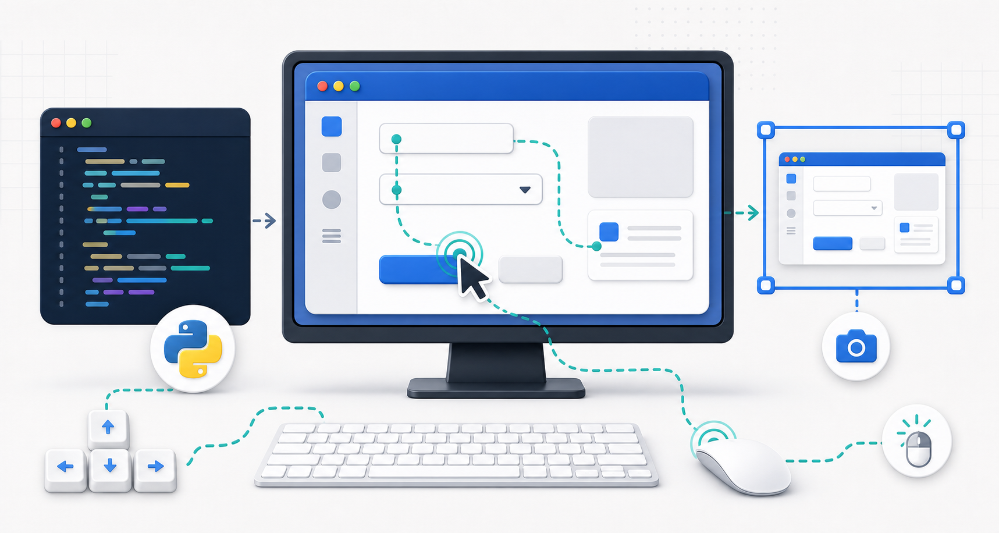

업무 자동화, 반복 클릭, HTS 매매 자동화, 테스트 자동 실행...\
마우스와 키보드를 사람이 직접 조작하지 않고 **코드로 제어**하고 싶다면?

👉 오늘은 Python GUI 자동화 라이브러리 `pyautogui`를 정리해보겠습니다.

------------------------------------------------------------------------

## 1️⃣ pyautogui란?

`pyautogui`는 마우스, 키보드, 화면 캡처 등을 제어할 수 있는\
**Cross-platform GUI 자동화 라이브러리**입니다.

설치:

``` bash
pip install pyautogui
```

------------------------------------------------------------------------

## 2️⃣ 마우스 제어

### 📍 좌표로 이동

``` python
import pyautogui

pyautogui.moveTo(100, 200) # 즉시 이동
pyautogui.moveTo(100, 200, duration=1) # 1초 동안 이동
```

### 🖱 클릭

``` python
pyautogui.click()
pyautogui.click(500, 300) # 특정 위치 클릭
pyautogui.doubleClick()
pyautogui.rightClick()
```

### 🎯 현재 마우스 좌표 확인

``` python
print(pyautogui.position())
```

------------------------------------------------------------------------

## 3️⃣ 키보드 제어

### ⌨ 한 글자 입력

``` python
pyautogui.write("hello world")
```

### ⌨ 특수키 입력

``` python
pyautogui.press("enter")
pyautogui.press("esc")
```

### ⌨ 단축키 조합

``` python
pyautogui.hotkey("ctrl", "c")
pyautogui.hotkey("ctrl", "v")
```

------------------------------------------------------------------------

## 4️⃣ 화면 캡처

### 📸 전체 화면 캡처

``` python
img = pyautogui.screenshot()
img.save("capture.png")
```

### 📸 특정 영역 캡처

``` python
img = pyautogui.screenshot(region=(left, top, width, height))
img.save("region.png")
```
특정 프로그램 영역만 저장할때 유용합니다.

------------------------------------------------------------------------

## 5️⃣ 화면에서 이미지 찾기

``` python
import pyautogui

try:
    location = pyautogui.locateOnScreen("button.png", confidence=0.9)
except pyautogui.ImageNotFoundException:
    location = None

if location is not None:
    point = pyautogui.center(location)
    print("찾은 위치:", point)  # 확인 후 pyautogui.click(point.x, point.y)
```
✔ 버튼 이미지 기반 자동 클릭
✔ 반복 업무 자동화에 필수 기능

※ confidence 사용 시 OpenCV 필요
``` bash
pip install opencv-python
```

미검출 시 예외가 발생할 수 있으므로 `None` 검사만으로는 충분하지 않다. 경로·배율·검색 영역과 재시도 코드는 [이미지 인식 실패 진단]()에서 설명한다. 기본 조작을 시험할 때는 메모장 같은 창을 대상으로 위치와 포커스를 먼저 확인한다.

------------------------------------------------------------------------

## 6️⃣ 실전 예제 -- 자동 로그인

``` python
import pyautogui
import time

time.sleep(3)

pyautogui.write("my_id")
pyautogui.press("tab")
pyautogui.write("my_password")
pyautogui.press("enter")
```

------------------------------------------------------------------------

## 7️⃣ 안정성 설정

### 🛑 Fail-safe 기능
주 모니터 모서리로 마우스를 이동하면 PyAutoGUI 함수가 `FailSafeException`을 발생시켜 동작을 중단할 수 있습니다. 이 예외를 무시하는 반복문을 만들지 않습니다.

``` python
pyautogui.FAILSAFE = True
```

### ⏳ 동작 간 기본 대기시간 설정

``` python
pyautogui.PAUSE = 0.5
```

## 8️⃣ pyautogui의 장점

✔ 배우기 쉬움
✔ OS 독립적
✔ GUI 테스트 자동화에 적합
✔ 반복 업무 자동화에 강력

## 9️⃣ 단점 및 주의사항

⚠ 화면 해상도에 따라 좌표가 달라짐
⚠ UI 변경 시 이미지 매칭 실패
⚠ 보안 프로그램 차단 가능

------------------------------------------------------------------------

## 🔥 마무리

`pyautogui`는 단순 매크로를 넘어\
**업무 자동화, 테스트 자동화, 트레이딩 자동화까지 가능한 강력한
도구**입니다.

반복 작업이 많다면 생산성을 크게 향상시킬 수 있습니다.

## 다음 단계

- 원하는 창에서만 조작하려면 [PyGetWindow 창 제어]()를 확인합니다.
- 다른 PC에 전달하려면 [PyInstaller exe 배포]()로 이어집니다.
- 정해진 시간에 실행하려면 [작업 스케줄러의 경로·로그온 설정]()을 확인합니다.

## 참고 자료

- [PyAutoGUI 공식 문서](https://pyautogui.readthedocs.io/en/latest/)
- [이미지 검색과 미검출 예외](https://pyautogui.readthedocs.io/en/latest/screenshot.html)
