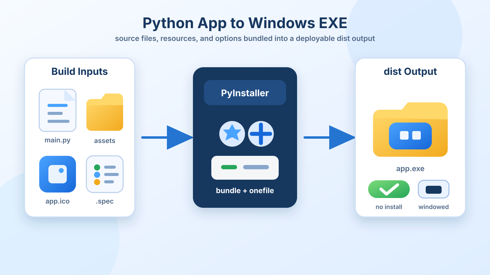

## 들어가며

Python으로 실행할 때는 되는데 exe에서는 이미지나 설정 파일을 못 찾는다면, **파일을 번들에 넣었는지와 코드가 어떤 경로에서 읽는지**를 각각 확인한다. PyInstaller는 Python 코드의 모든 상대경로를 자동으로 바꿔 주지 않는다.

이 글은 Windows PowerShell과 PyInstaller 6.x 공식 문서의 동작을 기준으로 설명한다. 설치 버전은 아래 명령으로 확인하고, 다른 버전을 쓴다면 해당 버전의 도움말도 비교하자.

## 문제 상황: exe를 더블클릭하면 창이 바로 닫힌다

파일을 여는 코드가 다음과 같다고 가정하자.

```python
from pathlib import Path

print(Path("defaults.json").read_text(encoding="utf-8"))
```

`defaults.json`은 **현재 작업 폴더**에서 찾는다. 프로젝트 폴더에서 실행할 때는 성공해도 다른 폴더에서 실행하거나 작업 스케줄러에 등록하면 실패할 수 있다. `--windowed`로 콘솔까지 숨기면 오류를 보기도 어렵다.

## 원인 분석: 작업 폴더·번들·exe 위치는 다르다

| 알고 싶은 위치 | 확인 방법 | 용도 |
|---|---|---|
| 현재 작업 폴더 | `Path.cwd()` | 상대경로가 해석되는 기준 |
| 실행 중인 모듈 위치 | `Path(__file__).resolve().parent` | 번들에 포함한 읽기용 리소스 |
| 실행 파일 위치 | 번들 실행 시 `Path(sys.executable).resolve().parent` | exe 옆에 별도로 둔 파일 |
| 사용자별 저장 위치 | 예: `%LOCALAPPDATA%` 아래 앱 폴더 | 로그·사용자가 바꾼 설정·결과 |

[PyInstaller 런타임 문서](https://pyinstaller.org/en/stable/runtime-information.html)는 번들 안에서도 `__file__`을 기준으로 리소스 위치를 계산할 수 있도록 설명한다. `--onefile`에서는 포함 파일이 실행 중 임시 위치에 풀리므로 그 안에 변경 사항을 저장해도 다음 실행까지 유지된다고 기대하면 안 된다.

## 해결 방법: 같은 Python 환경에서 단계적으로 빌드한다

먼저 빌드 전용 가상환경을 만든다. 활성화 스크립트 없이 실행 파일을 직접 사용하면 어떤 Python에 설치했는지 분명하다.

```powershell
python -m venv .venv
.\.venv\Scripts\python.exe -m pip install pyinstaller
.\.venv\Scripts\python.exe -m PyInstaller --version
```

처음에는 콘솔이 있는 폴더 배포로 빌드한다.

```powershell
.\.venv\Scripts\python.exe -m PyInstaller --onedir main.py
```

`dist\main\main.exe`만 옮기지 말고 **`dist\main` 폴더 전체**를 배포한다. 실행을 확인한 뒤 필요하면 단일 파일로 바꾼다.

```powershell
.\.venv\Scripts\python.exe -m PyInstaller --onefile main.py
```

`--onefile`은 배포 파일을 줄여 주지만 시작할 때 파일을 풀어야 한다. 배포 편의와 시작 시간을 비교해서 선택한다. Windows용 exe는 Windows에서 빌드해야 하며, Python이 없는 대상 PC에서도 별도로 실행을 확인해야 한다.

## 예제: 설정 파일을 동봉하고 다른 폴더에서 읽는다

아래 구조로 두 파일을 만든다.

```text
project/
  main.py
  defaults.json
```

`defaults.json`:

```json
{"message": "resource loaded"}
```

`main.py`:

```python
import json
from pathlib import Path
import sys

resource = Path(__file__).resolve().parent / "defaults.json"
settings = json.loads(resource.read_text(encoding="utf-8"))
print("frozen:", bool(getattr(sys, "frozen", False)))
print("resource_exists:", resource.is_file())
print("message:", settings["message"])
```

다음 명령은 프로젝트 폴더에서 실행한다. 현재 PyInstaller 6.x 문서의 `SOURCE:DEST` 형식을 사용한다.

```powershell
.\.venv\Scripts\python.exe -m PyInstaller --onedir --add-data "defaults.json:." main.py
.\dist\main\main.exe
```

자동화용 이미지라면 파일을 같은 방식으로 포함하고 `Path(__file__).resolve().parent / "button.png"`로 찾는다. 구버전 Windows 예제에서 보이는 세미콜론 형식을 그대로 복사하기보다 `--help`에서 설치 버전의 형식을 확인한다.

## 결과 확인: 다른 작업 폴더에서도 같은 파일을 읽는가

프로젝트 폴더에서 PowerShell 변수에 경로를 담고 다른 폴더로 이동해 실행한다.

```powershell
$demoExe = (Resolve-Path .\dist\main\main.exe).Path
Push-Location $env:TEMP
try {
    & $demoExe
    if ($LASTEXITCODE -ne 0) { throw 'exe 실행 실패' }
} finally {
    Pop-Location
}
```

번들 실행 시 기대하는 출력은 다음과 같다. 실제 경로는 설치 위치와 빌드 방식에 따라 달라진다.

```text
frozen: True
resource_exists: True
message: resource loaded
```

이 글의 `main.py`는 Python 3.14.5에서 **스크립트 파일과 다른 작업 폴더로 실행해** 리소스를 읽는 것을 확인했다. 위 `frozen: True` 출력은 exe 검증 시 확인할 기준이며, 이 보강 작업에서 PyInstaller 빌드와 대상 PC 배포까지 실행한 결과는 아니다.

이미지는 읽을 수 있는데 화면 인식만 실패한다면 경로와 다른 문제다. [PyAutoGUI 이미지 인식 진단]()으로 넘어가 배율과 검색 영역을 확인한다.

## 실무 팁

### 흔한 실수: 모든 오류에 hidden import부터 추가한다

| 증상 | 먼저 확인할 것 |
|---|---|
| `FileNotFoundError` | `--add-data`와 리소스 경로 |
| 특정 모듈의 `ModuleNotFoundError` | 동적 import인지, 실제 빌드 환경에 설치됐는지 |
| DLL 로딩 실패 | 확장 모듈 의존성·아키텍처·빌드 경고 |
| 더블클릭 직후 종료 | 콘솔 빌드로 실행해 traceback 확인 |
| 예약 실행에서만 실패 | 작업 폴더·계정·환경변수·가상환경 경로 |

OpenCV의 배포 패키지 이름은 `opencv-python`이지만 import 이름은 `cv2`다. 동적 import 누락을 확인했다면 `--hidden-import=cv2`를, 패키지 데이터 수집이 실제로 필요하다면 `--collect-all cv2`를 검토한다. 두 옵션을 모든 프로그램에 기본으로 추가할 필요는 없다.

```powershell
.\.venv\Scripts\python.exe -m PyInstaller --onedir --hidden-import=cv2 main.py
Get-Content .\build\main\warn-main.txt
```

경고 파일에는 해당 플랫폼에서 사용하지 않는 선택적 모듈도 나오므로 모든 경고가 실행 실패 원인은 아니다. [공식 문제 해결 문서](https://pyinstaller.org/en/stable/when-things-go-wrong.html)를 참고해 traceback과 함께 판단한다.

### 주의사항: 콘솔 숨김과 로그 저장은 함께 설계한다

콘솔 실행이 성공하고 파일 로그를 준비한 뒤 GUI 앱에 `--windowed`를 적용한다. 이 글의 `print()` 확인 예제는 콘솔용이다. `input()`으로 콘솔 입력을 기다리는 프로그램에 `--windowed`를 붙이는 식으로 바꾸지 않는다.

로그는 임시 번들이 아니라 사용자별 저장 폴더에 기록할 수 있다.

```python
import logging
import os
from pathlib import Path

log_dir = Path(os.environ["LOCALAPPDATA"]) / "StandSpringDemo"
log_dir.mkdir(parents=True, exist_ok=True)
logging.basicConfig(
    filename=log_dir / "app.log", encoding="utf-8", level=logging.INFO,
    format="%(asctime)s %(levelname)s %(message)s",
)
logging.info("application started")
```

`--icon icon.ico`로 아이콘을 넣을 수 있다. 다른 이미지 형식은 Pillow를 통한 변환 조건이 있으므로, Windows 배포에서는 준비한 `.ico` 파일을 사용하는 편이 단순하다. `--noupx`나 코드 서명은 백신 오탐을 반드시 해결하는 옵션은 아니다. 탐지 결과와 배포 절차를 확인하자.

### 추천 명령어

```powershell
.\.venv\Scripts\python.exe -m PyInstaller --clean --onedir --add-data "defaults.json:." main.py
```

`.spec` 파일을 수정해 빌드 설정을 관리한다면 해당 파일로 다시 빌드한다. spec 빌드에서는 대부분의 명령행 설정이 spec의 값으로 결정된다.

```powershell
.\.venv\Scripts\python.exe -m PyInstaller main.spec
```

## 마무리

### 핵심 요약

콘솔이 있는 `--onedir` 빌드부터 확인하고, 동봉 리소스는 `__file__` 기준으로 읽는다. 로그와 변경 가능한 설정은 지속되는 별도 경로에 둔다.

### 언제 사용하면 좋은가

같은 Windows 환경의 사용자에게 Python 설치 없이 프로그램을 전달할 때 사용할 수 있다. 번들 생성과 대상 PC에서의 실행 검증은 별도 단계다.

### 추가 학습 주제

권한이 필요한 작업은 [관리자 권한 요청 방식]()을, 직접 실행은 되는데 예약 실행이 실패하는 경우는 [작업 스케줄러 설정과 로그 확인]()을 참고한다.

## 참고 자료

- [PyInstaller: Using PyInstaller](https://pyinstaller.org/en/stable/usage.html)
- [PyInstaller: Run-time Information](https://pyinstaller.org/en/stable/runtime-information.html)
- [PyInstaller: When Things Go Wrong](https://pyinstaller.org/en/stable/when-things-go-wrong.html)
- [PyInstaller: Operating Mode](https://pyinstaller.org/en/stable/operating-mode.html)