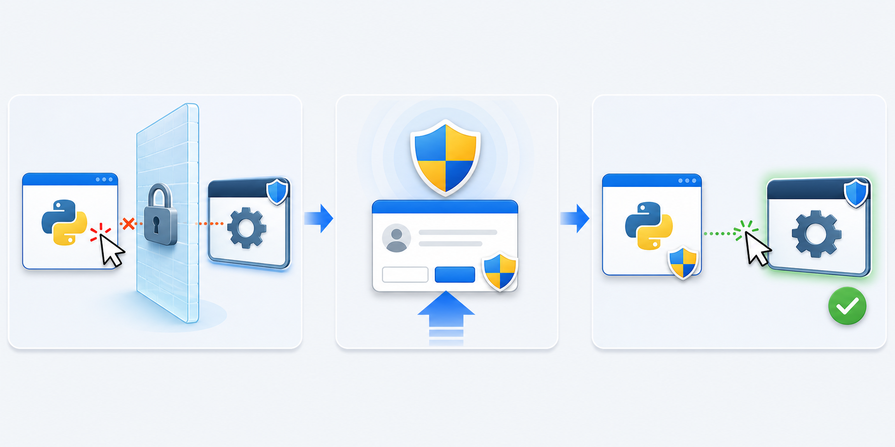

## 들어가며

Python 자동화가 특정 창에 입력하지 못한다고 해서 항상 관리자 권한 문제는 아니다. **대상 창·화면 잠금·포커스·실행 권한을 구분한 뒤, 권한이 필요한 작업에만 UAC 승인을 요청한다.**

항상 관리자 권한이 필요한 exe는 PyInstaller의 `--uac-admin` 옵션을 사용할 수 있다. 일부 기능에서만 권한이 필요하면 코드에서 재실행을 요청하는 방식도 있다. 두 방식을 동시에 적용할 필요는 없다.

## 문제 상황: 재실행하니 파일 경로와 인수가 달라진다

다음처럼 인수를 공백으로 연결하면 경로에 공백이 있을 때 경계가 사라진다.

```python
parameters = " ".join(sys.argv)
```

또한 소스 실행의 `sys.executable`은 `python.exe`이고, PyInstaller 번들에서는 만들어진 exe다. 같은 인수 목록을 무조건 넘기면 번들에서 exe 경로를 불필요한 첫 인수로 전달하거나 원래 인수를 잃어버릴 수 있다.

## 원인 분석: 권한 상승과 GUI 접근은 별개다

Windows의 입력 주입에는 무결성 수준 등 보안 제한이 있다. 예를 들어 [SendInput 문서](https://learn.microsoft.com/en-us/windows/win32/api/winuser/nf-winuser-sendinput)는 같은 수준 또는 더 낮은 무결성 수준의 앱에 입력할 수 있다고 설명한다.

그렇다고 관리자 프로세스가 모든 화면을 조작할 수 있는 것은 아니다. UAC 보안 데스크톱, 화면 잠금, 다른 세션, 포커스 제한은 별도 문제다. **관리자 권한을 받았다는 사실만으로 자동화 성공을 보장하지 않는다.**

## 해결 방법: 항상 필요한 권한과 조건부 권한을 나눈다

### 항상 필요한 경우: --uac-admin

PyInstaller는 관리자 권한을 요청하는 매니페스트를 넣는 옵션을 제공한다.

```powershell
python -m PyInstaller --onedir --uac-admin main.py
```

배포 준비가 끝난 GUI 앱이라면 다음처럼 조합할 수 있다.

```powershell
python -m PyInstaller --onefile --windowed --uac-admin main.py
```

권한이 필요한 실행 환경에서는 Windows의 정책과 실행 컨텍스트에 따라 UAC 승인 또는 자격 증명 입력이 필요할 수 있다. 사용자가 거부하면 관리자 권한으로 진행되지 않는다. 이미 상승된 환경에서 실행할 때까지 ‘항상 팝업이 뜬다’고 가정해서는 안 된다.

### 일부 기능에 필요한 경우: runas 재실행

다음 예는 Windows용이다. `subprocess.list2cmdline()`으로 인수 경계를 보존하고, 소스와 번들의 인수 목록을 구분한다. 재실행 요청에 실패하면 원래 프로세스를 성공 종료하지 않는다.

## 예제: 공백이 있는 경로와 인수를 보존한다

`main.py`:

```python
import ctypes
from ctypes import wintypes
from pathlib import Path
import subprocess
import sys


def relaunch_arguments():
    if getattr(sys, "frozen", False):
        return list(sys.argv[1:])
    return [str(Path(sys.argv[0]).resolve()), *sys.argv[1:]]


def ensure_admin():
    shell32 = ctypes.WinDLL("shell32", use_last_error=True)
    shell32.IsUserAnAdmin.restype = wintypes.BOOL
    if shell32.IsUserAnAdmin():
        return

    shell32.ShellExecuteW.argtypes = [
        wintypes.HWND, wintypes.LPCWSTR, wintypes.LPCWSTR,
        wintypes.LPCWSTR, wintypes.LPCWSTR, ctypes.c_int,
    ]
    shell32.ShellExecuteW.restype = ctypes.c_void_p
    result = shell32.ShellExecuteW(
        None, "runas", sys.executable,
        subprocess.list2cmdline(relaunch_arguments()),
        str(Path.cwd()), 1,
    )
    if (result or 0) <= 32:
        raise OSError(f"관리자 권한 재실행 요청 실패: result={result}")
    raise SystemExit(0)


if __name__ == "__main__":
    ensure_admin()
    print("관리자 프로세스에서 실행 중입니다.")
    print("arguments:", sys.argv[1:])
```

`ShellExecuteW`는 실패 시 32 이하의 값을 반환한다. 32보다 큰 값은 실행 요청 성공을 뜻하며, 자식 프로세스의 작업 완료나 결과까지 보장하지 않는다. [Microsoft ShellExecuteW 문서](https://learn.microsoft.com/en-us/windows/win32/api/shellapi/nf-shellapi-shellexecutew)를 참고한다.

이 예는 스크립트를 직접 실행하는 방식과 PyInstaller 번들을 대상으로 한다. `python -m package`로 모듈을 실행하거나 Python 런타임 옵션까지 보존해야 한다면 별도로 시작 명령을 구성해야 한다.

## 결과 확인

실제 권한 상승을 요청하기 전에 인수 생성만 검사할 수 있다. 아래 독립 예제는 프로세스를 실행하거나 UAC를 표시하지 않는다.

```python
import subprocess

source_args = [r"C:\my app\main.py", "--name", "sample value"]
bundle_args = ["--name", "sample value"]
print("source:", subprocess.list2cmdline(source_args))
print("bundle:", subprocess.list2cmdline(bundle_args))
```

Python 3.14.5에서 확인한 출력:

```text
source: "C:\my app\main.py" --name "sample value"
bundle: --name "sample value"
```

재실행 예제는 인수 구성과 Windows API 실패 반환값 분기를 대체 호출로 검증했다. 실제 UAC 승인과 앱 조작은 사용하는 Windows 계정·정책·대상 앱에서 확인해야 한다.

## 실무 팁

### 흔한 실수

- `" ".join(sys.argv)`로 공백이 있는 인수를 합친다.
- 번들에서도 exe 경로를 다시 첫 번째 인수로 넣는다.
- UAC 요청이 거부됐는데 원래 프로세스를 정상 종료한다.
- 창 활성화 실패의 원인을 확인하지 않고 모든 실행을 관리자로 바꾼다.

### 주의사항

예약 실행 중에 UAC 승인을 기다리도록 구성하지 않는다. 필요한 계정과 실행 수준을 작업에 설정하고, GUI에 필요한 대화형 세션은 따로 확인한다. [작업 스케줄러의 실행 계정과 로그온 조건]()을 참고한다.

실행 파일 자체를 배포하기 전에 리소스와 로그 경로도 확인한다. 관리자 권한으로 실행해도 누락된 이미지 파일이나 잘못된 작업 폴더가 자동으로 해결되지는 않는다.

### 추천 명령어

```powershell
python -m PyInstaller --help
```

도움말에서 `--uac-admin`을 확인한다. 빌드 환경은 [PyInstaller exe 배포와 파일 경로]()에서 이어서 확인할 수 있다.

## 마무리

### 핵심 요약

항상 권한이 필요하면 `--uac-admin`, 조건부라면 실패 처리를 포함한 재실행을 검토한다. 권한 상승은 사용자 승인과 실행 정책을 따르며 GUI 접근까지 보장하지 않는다.

### 언제 사용하면 좋은가

앱의 특정 작업이 실제로 상승된 권한을 요구할 때 사용한다. 일반 사용자 파일 처리에는 불필요한 권한을 요청하지 않는다.

### 추가 학습 주제

포커스나 창 좌표가 문제라면 [PyGetWindow 창 제어]()를 먼저 확인한다.

## 참고 자료

- [PyInstaller: Windows-specific options](https://pyinstaller.org/en/stable/usage.html#windows-specific-options)
- [Microsoft: ShellExecuteW](https://learn.microsoft.com/en-us/windows/win32/api/shellapi/nf-shellapi-shellexecutew)
- [Microsoft: SendInput](https://learn.microsoft.com/en-us/windows/win32/api/winuser/nf-winuser-sendinput)