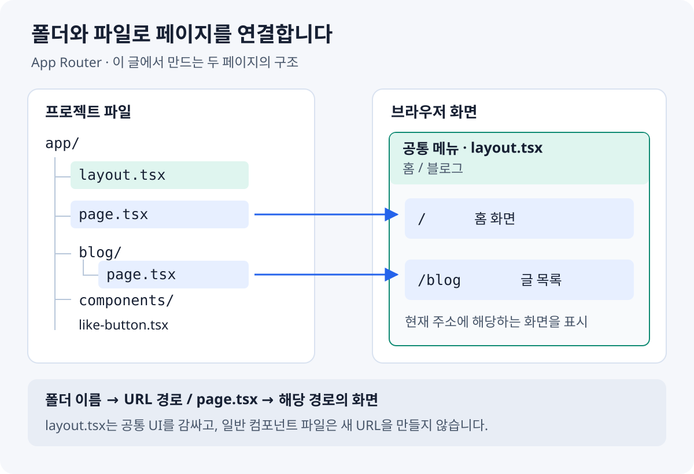
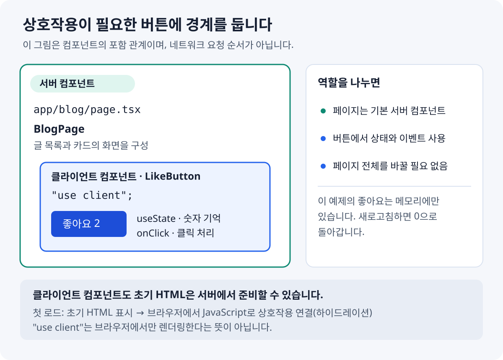

# Next.js 입문: App Router로 첫 웹사이트 만들기

*상단 그림은 Next.js로 웹사이트를 만드는 과정을 표현한 개념 삽화다. 실제 개발 도구 화면이나 실행 순서를 나타내지는 않는다.*

## 들어가며

React로 화면을 만들어 본 뒤에는 이런 질문이 생긴다. “주소마다 다른 페이지는 어떻게 보여 줄까?”, “모든 페이지에 같은 메뉴를 넣으려면?”, “서버에서 데이터를 읽는 코드는 어디에 둘까?”

**Next.js는 React로 만든 화면을 웹사이트로 구성하는 데 필요한 기능을 제공하는 프레임워크다.** 이 글에서는 작은 개인 사이트를 만들면서 페이지, 레이아웃, 서버·클라이언트 컴포넌트의 역할을 익힌다.

완성할 기능은 세 가지다.

- `/`에서 소개 화면을 보여 준다.
- 메뉴를 누르면 `/blog`의 글 목록으로 이동한다.
- 각 글의 `좋아요` 버튼을 누르면 숫자가 올라간다.

HTML 태그, JavaScript 함수·배열·`import`, React 컴포넌트와 `useState`를 조금 알고 있다면 따라가기 좋다. React가 처음이라면 [공식 React Foundations 과정](https://nextjs.org/learn/react-foundations)에서 컴포넌트와 props, state를 먼저 살펴보자.

> 이 글은 **2026년 11월 2일에 확인한 Next.js 공식 문서와 App Router**를 기준으로 작성했다. 예제는 TypeScript와 일반 CSS를 사용한다. `pages/`, `_app.tsx`, `getServerSideProps`가 등장하는 Pages Router 강좌와는 파일 구성이 다르다.
{: .prompt-info }

## 문제 상황: React 다음에 무엇을 배워야 할까?

React에서는 재사용할 수 있는 화면 조각을 **컴포넌트**로 만든다. 버튼, 메뉴, 글 목록이 각각 컴포넌트가 될 수 있다. 하지만 여러 주소를 가진 웹사이트를 구성하려면 화면 조각 외에도 정해야 할 것이 있다.

| 하고 싶은 일 | Next.js에서 처음 만날 기능 |
|---|---|
| 주소에 따라 다른 화면 보여 주기 | 파일 기반 라우팅과 `page.tsx` |
| 페이지마다 같은 메뉴 사용하기 | `layout.tsx` |
| 사이트 안에서 페이지 이동하기 | `next/link` |
| 서버에서 화면이나 데이터 준비하기 | 서버 컴포넌트 |
| 버튼 클릭과 입력 처리하기 | 클라이언트 컴포넌트 |

처음부터 캐시, 인증, 데이터베이스, 배포까지 한꺼번에 익히려 하면 각 기능의 역할이 흐려진다. 먼저 **두 페이지를 연결하고 작은 버튼 하나를 동작시키는 것**을 목표로 삼자.

## 원인 분석: React와 Next.js의 역할이 다르다

React 컴포넌트는 UI를 표현한다. Next.js는 그 위에서 라우팅, 서버 렌더링, 이미지 최적화 같은 웹 애플리케이션 기능을 제공한다. React 문법을 버리는 것이 아니라 **React 컴포넌트를 Next.js의 파일 규칙 안에 배치하는 것**에 가깝다. [Next.js 공식 소개](https://nextjs.org/docs)

여기서 **라우팅(routing)**은 `/`, `/blog` 같은 URL에 맞는 화면을 찾는 일이다. App Router에서는 폴더와 특별한 파일 이름으로 이 관계를 정의한다.



*폴더 이름은 URL의 일부가 되고, `page.tsx`는 해당 주소의 화면이 된다. `layout.tsx`는 주소를 하나 더 만들지 않고 공통 UI를 감싼다.*

## 해결 방법: 프로젝트와 첫 페이지 준비하기

### 1. Node.js와 npm 확인하기

Node.js는 개발 서버와 빌드 도구를 실행하는 환경이고, npm은 패키지를 설치하는 도구다. [Node.js 공식 다운로드 페이지](https://nodejs.org/en/download)에서 **지원 중인 LTS 버전**을 설치한 뒤 새 터미널을 연다.

```bash
node -v
npm -v
```

두 명령 모두 버전 번호를 출력해야 한다. 공식 설치 문서의 최소 요구 버전은 Node.js **20.9 이상**이지만, 새로 설치한다면 최소 버전만 맞추기보다 지원 중인 LTS를 선택하자. [Next.js 설치 요구사항](https://nextjs.org/docs/app/getting-started/installation#system-requirements)

### 2. 프로젝트 만들기

프로젝트를 보관할 폴더에서 실행한다.

```bash
npx create-next-app@latest my-next-blog
```

`npx`는 `create-next-app`이라는 프로젝트 생성 도구를 실행한다. 설치 확인 질문이 나오면 내용을 확인하고 진행한다. 이 명령은 인터넷 연결이 필요하다.

설정 선택 화면에서는 **직접 설정하는 항목(`customize settings`)**을 선택하고 다음과 같이 맞춘다. 질문 순서와 문구는 버전에 따라 달라질 수 있다.

| 항목 | 이 글의 선택 | 이유 |
|---|---|---|
| TypeScript | Yes | `.tsx` 예제를 그대로 사용 |
| Linter | ESLint | 기본 코드 검사 사용 |
| React Compiler | No | 첫 실습에서 설정 범위 줄이기 |
| Tailwind CSS | No | 일반 CSS로 스타일 작성 |
| `src/` directory | No | `app/` 경로로 설명 통일 |
| App Router | Yes | 이 글에서 사용하는 라우터 |
| Cache Components | 질문이 나오면 No | 캐시 기능은 후속 학습으로 남기기 |
| Import alias | 기본값 `@/*` 유지 | 기본 경로 별칭 유지 |

그 밖의 선택 항목은 이 예제의 핵심 동작에 필요하지 않다. 생성 옵션의 전체 목록은 [create-next-app 공식 문서](https://nextjs.org/docs/app/api-reference/cli/create-next-app)에서 확인할 수 있다.

설치가 끝나면 프로젝트 폴더로 이동해 개발 서버를 실행한다.

```bash
cd my-next-blog
npm run dev
```

터미널에 표시된 로컬 주소를 브라우저에서 연다. 기본 주소는 [http://localhost:3000](http://localhost:3000)이며, 이미 사용 중인 포트라면 다른 주소가 표시될 수 있다. 서버는 켜 둔 채 파일을 편집한다. 명령어를 추가로 실행할 때는 터미널을 하나 더 열자.

### 3. 폴더 구조 이해하기

다음은 **이번 실습에서 사용할 파일만** 추린 구조다. 생성 도구가 만든 설정 파일은 그대로 두고, 없는 폴더와 파일은 뒤의 예제를 따라 추가한다.

```text
my-next-blog/
├── app/
│   ├── layout.tsx
│   ├── page.tsx
│   ├── globals.css
│   ├── blog/
│   │   └── page.tsx
│   └── components/
│       └── like-button.tsx
├── public/
└── package.json
```

- `app/page.tsx`: `/`에서 보여 줄 홈 화면이다.
- `app/blog/page.tsx`: `/blog`에서 보여 줄 글 목록이다.
- `app/layout.tsx`: 두 화면을 감싸는 최상위 레이아웃이다.
- `app/components/like-button.tsx`: 페이지에서 가져다 쓸 버튼이다. 이 파일만으로 새 URL이 생기지는 않는다.
- `app/globals.css`: 전역 스타일이다.
- `public/`: 이미지 등 정적 파일을 둘 수 있다. 예를 들어 `public/cat.png`는 `/cat.png`로 접근한다.
- `package.json`: 설치한 패키지와 실행 명령을 기록한다.

`app/blog/` 폴더만 만들면 글 목록 화면은 아직 없다. **화면을 공개하려면 그 안에 `page.tsx`가 필요하다.** [공식 페이지·레이아웃 설명](https://nextjs.org/docs/app/getting-started/layouts-and-pages)

### 4. 첫 화면 바꿔 보기

먼저 `app/page.tsx`의 기존 내용을 다음 코드로 모두 바꾼다.

```tsx
export default function HomePage() {
  return <h1>처음 만드는 Next.js 사이트</h1>;
}
```

저장한 뒤 브라우저에 제목이 표시되는지 확인한다. `.tsx`는 TypeScript 파일 안에서 JSX를 사용할 수 있는 확장자다. JSX는 JavaScript 코드에서 화면 구조를 표현하는 문법이다.

`HomePage`는 React 컴포넌트이고, `export default`는 이 파일의 대표 컴포넌트를 내보낸다. 함수 이름보다 중요한 것은 **파일 위치가 `app/page.tsx`라는 점**이다. 이 위치 때문에 `/` 화면이 된다.

## 예제: 두 페이지와 좋아요 버튼 만들기

이제 아래 다섯 파일을 순서대로 작성한다. 앞에서 만든 `app/page.tsx`도 완성 코드로 다시 교체한다. 외부 API나 데이터베이스는 사용하지 않는다.

### 1. 모든 페이지에 공통 메뉴 넣기

`app/layout.tsx`의 기존 내용을 모두 교체한다.

```tsx
import type { Metadata } from "next";
import type { ReactNode } from "react";
import Link from "next/link";
import "./globals.css";

export const metadata: Metadata = {
  title: "나의 첫 Next.js 사이트",
  description: "Next.js를 배우며 만든 작은 개인 사이트",
};

export default function RootLayout({ children }: { children: ReactNode }) {
  return (
    <html lang="ko">
      <body>
        <header className="site-header">
          <strong>나의 개발 노트</strong>
          <nav aria-label="주 메뉴">
            <Link href="/">홈</Link>
            <Link href="/blog">블로그</Link>
          </nav>
        </header>
        <main className="container">{children}</main>
      </body>
    </html>
  );
}
```

`children`에는 현재 주소의 페이지가 들어간다. `/`에서는 홈 화면이, `/blog`에서는 글 목록이 같은 메뉴 아래 표시된다. `ReactNode`는 이 자리에 들어올 React 콘텐츠의 타입이다. 루트 레이아웃에는 `<html>`과 `<body>`가 필요하다. [레이아웃 공식 문서](https://nextjs.org/docs/app/getting-started/layouts-and-pages#creating-a-layout)

`Link`는 사이트 내부 이동에 사용하는 Next.js 컴포넌트다. 기본 `<a>`를 확장해 클라이언트 측 페이지 이동과 미리 가져오기 기능을 제공한다. 예제처럼 `href`에 이동할 URL을 지정한다. [Link 공식 설명](https://nextjs.org/docs/app/getting-started/linking-and-navigating)

기존 템플릿의 폰트 설정 등도 이번 교체 과정에서 제거된다. 위 예제에는 그 설정이 필요하지 않다.

### 2. 홈 화면 완성하기

`app/page.tsx`를 다음 코드로 교체한다.

```tsx
import Link from "next/link";

export default function HomePage() {
  return (
    <section>
      <p className="eyebrow">MY FIRST NEXT.JS SITE</p>
      <h1>배운 내용을 작은 기록으로 남깁니다.</h1>
      <p>페이지를 연결하고, 컴포넌트를 조합하며 Next.js를 익히는 중입니다.</p>
      <Link className="button" href="/blog">
        개발 노트 읽기
      </Link>
    </section>
  );
}
```

### 3. 클릭할 수 있는 버튼 만들기

`app/components/` 폴더를 만들고, `like-button.tsx`를 추가한다.

```tsx
"use client";

import { useState } from "react";

export default function LikeButton() {
  const [likes, setLikes] = useState(0);

  return (
    <button
      className="like-button"
      type="button"
      onClick={() => setLikes((current) => current + 1)}
    >
      좋아요 {likes}
    </button>
  );
}
```

`useState(0)`은 버튼의 현재 숫자를 기억한다. `onClick`에 전달한 함수는 클릭할 때 실행되고, `setLikes`가 상태를 바꾸면 React가 바뀐 숫자를 화면에 반영한다. 두 버튼을 렌더링하면 각각 별도의 상태를 갖는다.

파일 맨 위의 **`"use client"`는 이 모듈을 클라이언트 컴포넌트의 진입점으로 선언한다.** App Router의 페이지와 레이아웃은 기본적으로 서버 컴포넌트다. 상태와 클릭 이벤트가 필요한 버튼은 클라이언트 컴포넌트로 만든다. [서버·클라이언트 컴포넌트 공식 문서](https://nextjs.org/docs/app/getting-started/server-and-client-components)



*페이지 전체를 클라이언트 컴포넌트로 바꿀 필요는 없다. 상호작용이 필요한 버튼에 경계를 둔다.*

이 구분에서 두 가지를 기억하자.

- **서버 컴포넌트:** 서버 환경에서 실행된다. 이 예제에서는 글 목록을 구성한다. 브라우저의 `window`나 클릭 이벤트는 사용할 수 없다.
- **클라이언트 컴포넌트:** 브라우저에서 상태와 이벤트를 처리할 수 있다. `"use client"` 파일이 가져오는 모듈도 클라이언트 번들에 포함되므로, 필요한 부분에 경계를 두는 편이 좋다.

클라이언트 컴포넌트도 **첫 페이지 로드에서는 초기 HTML을 서버에서 준비할 수 있다.** 이후 브라우저에서 JavaScript가 이벤트를 연결해 상호작용할 수 있게 만드는 과정을 하이드레이션(hydration)이라고 한다. `"use client"`를 “오직 브라우저에서만 실행”으로 외우면 혼동하기 쉽다. [초기 렌더링과 하이드레이션 설명](https://nextjs.org/docs/app/getting-started/server-and-client-components#how-do-server-and-client-components-work-in-nextjs)

### 4. 글 목록 페이지 만들기

`app/blog/` 폴더를 만들고, `page.tsx`를 추가한다.

```tsx
import LikeButton from "../components/like-button";

const posts = [
  {
    id: 1,
    title: "Next.js 첫 실행",
    summary: "개발 서버를 실행하고 첫 페이지를 바꿨습니다.",
  },
  {
    id: 2,
    title: "컴포넌트 나누기",
    summary: "공통 메뉴와 좋아요 버튼을 별도 컴포넌트로 만들었습니다.",
  },
];

export default function BlogPage() {
  return (
    <section>
      <h1>개발 노트</h1>
      <p>오늘 배운 내용을 하나씩 기록합니다.</p>
      <div className="post-list">
        {posts.map((post) => (
          <article className="post-card" key={post.id}>
            <h2>{post.title}</h2>
            <p>{post.summary}</p>
            <LikeButton />
          </article>
        ))}
      </div>
    </section>
  );
}
```

`map()`은 배열의 글마다 카드 하나를 만든다. `key`는 React가 각 항목을 구분하도록 돕는 값이다. 이 예제에서는 중복되지 않는 `id`를 사용한다.

`BlogPage`에는 `"use client"`가 없다. **서버 컴포넌트에서 클라이언트 컴포넌트를 가져와 함께 렌더링할 수 있기 때문**이다. 글 목록은 서버 컴포넌트에 두고, 클릭 처리는 `LikeButton`이 담당한다.

지금은 글을 코드 안의 배열에 저장한다. 제목을 클릭하는 상세 페이지와 데이터 저장 기능은 아직 만들지 않았다.

### 5. 일반 CSS로 스타일 적용하기

`app/globals.css`의 기존 내용을 모두 교체한다. `layout.tsx`에서 이미 이 파일을 불러오고 있다. Next.js에서는 전역 CSS와 CSS Modules 등을 사용할 수 있다. [CSS 공식 문서](https://nextjs.org/docs/app/getting-started/css)

```css
* {
  box-sizing: border-box;
}

body {
  margin: 0;
  background: #f5f7fb;
  color: #172033;
  font-family: system-ui, sans-serif;
  line-height: 1.7;
}

a {
  color: #1d4ed8;
}

.site-header {
  display: flex;
  flex-wrap: wrap;
  justify-content: space-between;
  align-items: center;
  gap: 16px;
  padding: 20px max(24px, calc((100% - 760px) / 2));
  border-bottom: 1px solid #dce3ef;
  background: #fff;
}

nav {
  display: flex;
  gap: 20px;
}

.container {
  max-width: 808px;
  margin: 56px auto;
  padding: 0 24px;
}

.eyebrow {
  color: #1d4ed8;
  font-size: 14px;
  font-weight: 700;
}

.post-list {
  display: grid;
  gap: 20px;
  margin-top: 28px;
}

.post-card {
  padding: 24px;
  border: 1px solid #dce3ef;
  border-radius: 16px;
  background: #fff;
}

.post-card h2 {
  margin-top: 0;
}

.button,
.like-button {
  display: inline-block;
  padding: 10px 16px;
  border: 0;
  border-radius: 8px;
  background: #1d4ed8;
  color: #fff;
  font: inherit;
  text-decoration: none;
  cursor: pointer;
}
```

`className`은 JSX에서 CSS 클래스를 지정하는 속성이다. 위 스타일은 링크와 버튼의 모양을 정할 뿐이고, 페이지 이동과 숫자 변경은 앞에서 작성한 컴포넌트가 담당한다.

## 결과 확인

개발 서버가 실행 중인 상태에서 다음 동작을 확인한다.

| 확인 방법 | 예상 결과 |
|---|---|
| `/` 열기 | 소개 문구와 `개발 노트 읽기` 링크가 보인다. |
| 링크 또는 상단 `블로그` 누르기 | 주소가 `/blog`로 바뀌고 글 카드 두 개가 보인다. |
| 첫 번째 카드의 좋아요를 두 번 누르기 | 첫 번째 버튼은 `좋아요 2`, 두 번째는 `좋아요 0`이 된다. |
| `/blog`에서 새로고침 | 두 버튼 모두 `좋아요 0`으로 돌아온다. |
| 상단 `홈` 누르기 | 공통 메뉴 아래에 홈 화면이 표시된다. |

새로고침하면 숫자가 사라지는 것은 현재 예제의 정상 동작이다. `useState`는 화면의 상태를 관리하며, 서버나 데이터베이스에 좋아요를 저장하지 않는다.

프로젝트 폴더의 새 터미널에서 다음 명령도 실행한다.

```bash
npm run lint
npm run build
```

첫 명령은 ESLint 검사, 두 번째는 배포용 빌드다. Next.js 16부터는 빌드가 린트 검사를 자동으로 실행하지 않으므로 따로 확인한다. [공식 린트 설정 설명](https://nextjs.org/docs/app/getting-started/installation#set-up-linting)

빌드 성공 후에는 다음 명령으로 배포용 서버를 로컬에서 확인할 수 있다. 같은 포트를 사용하는 개발 서버가 있다면 먼저 해당 터미널에서 `Ctrl+C`로 종료한다.

```bash
npm run start
```

이는 로컬 실행이다. 인터넷에 공개하려면 별도의 배포가 필요하다. Next.js는 Node.js 서버, 컨테이너, 정적 내보내기 등을 지원하지만, 정적 내보내기는 사용할 수 있는 서버 기능에 제한이 있다. [공식 배포 문서](https://nextjs.org/docs/app/getting-started/deploying)

## 실무 팁

### 흔한 실수

| 증상 | 먼저 확인할 부분 |
|---|---|
| `/blog`에서 404가 나온다 | `app/blog/page.tsx` 경로와 파일 이름을 확인한다. `blog.tsx`만 만드는 방식과 다르다. |
| `useState` 관련 서버 컴포넌트 오류가 나온다 | `like-button.tsx`의 import 위에 `"use client"`가 있는지 확인한다. |
| 스타일이 적용되지 않는다 | `layout.tsx`의 `import "./globals.css"`와 JSX의 `className`을 확인한다. |
| `npm run dev`가 프로젝트를 찾지 못한다 | 현재 폴더에 `package.json`이 있는지 확인한다. |
| 문서와 실제 폴더 위치가 다르다 | 생성할 때 `src/`를 선택했다면 `app/` 대신 `src/app/`에 작성한다. 두 구조를 섞지 않는다. |
| PowerShell에서 `npm.ps1` 실행 정책 오류가 나온다 | Windows에서는 `npm.cmd`, `npx.cmd`로 같은 명령을 실행할 수 있다. |

### 주의사항

클릭 오류를 해결하려고 모든 파일에 `"use client"`를 붙이기보다, 상태와 이벤트가 필요한 컴포넌트부터 구분하자. 반대로 클라이언트 컴포넌트에서도 초기 서버 렌더링이 가능하므로, 컴포넌트가 렌더링되는 도중 `window`나 `localStorage`를 바로 사용하면 오류가 날 수 있다. 이런 브라우저 API는 이벤트 핸들러나 `useEffect`처럼 브라우저에서 실행되는 위치에서 다룬다.

또한 API 비밀키나 데이터베이스 접근 코드를 클라이언트 컴포넌트에 넣지 않는다. `NEXT_PUBLIC_` 접두사가 붙은 환경 변수는 브라우저에 전달되므로 비밀값을 담으면 안 된다. [환경 변수와 서버 전용 코드 설명](https://nextjs.org/docs/app/getting-started/server-and-client-components#preventing-environment-poisoning)

### 추천 명령어

프로젝트에서 사용 중인 Next.js 버전과 실행 가능한 스크립트는 다음 명령으로 확인할 수 있다.

```bash
npm ls next
npm run
```

오래된 강좌와 코드가 다르면 먼저 설치 버전과 App Router 사용 여부를 비교하자. 프로젝트 생성 시 `@latest`를 사용했더라도 이후 실제 설치된 버전은 `package.json`과 잠금 파일에 기록된다.

## 마무리

이 실습에서는 **파일 위치로 URL을 만들고, 레이아웃으로 공통 화면을 감싸고, 상태가 필요한 버튼을 클라이언트 컴포넌트로 분리했다.** 이 세 관계를 설명할 수 있다면 첫 학습 목표를 달성한 셈이다.

Next.js는 React로 여러 페이지와 서버 기능을 가진 사이트를 만들 때 검토할 수 있다. 작은 소개 페이지에서는 기능 일부만 사용해도 된다. 처음부터 모든 기능을 도입할 필요는 없다.

다음 실습으로는 `/about` 페이지를 직접 추가해 보자. 그다음에는 `[slug]`를 사용하는 글 상세 페이지, 서버에서 데이터 읽기, `loading.tsx`와 `error.tsx`, 메타데이터와 이미지 최적화 순서로 범위를 넓혀 가면 좋다.

## 참고 자료

- [Next.js 공식 문서](https://nextjs.org/docs)
- [Next.js 프로젝트 설치](https://nextjs.org/docs/app/getting-started/installation)
- [create-next-app 옵션](https://nextjs.org/docs/app/api-reference/cli/create-next-app)
- [페이지와 레이아웃](https://nextjs.org/docs/app/getting-started/layouts-and-pages)
- [링크와 페이지 이동](https://nextjs.org/docs/app/getting-started/linking-and-navigating)
- [서버·클라이언트 컴포넌트](https://nextjs.org/docs/app/getting-started/server-and-client-components)
- [CSS 스타일 적용](https://nextjs.org/docs/app/getting-started/css)
- [배포 방식](https://nextjs.org/docs/app/getting-started/deploying)
- [React Foundations](https://nextjs.org/learn/react-foundations)
