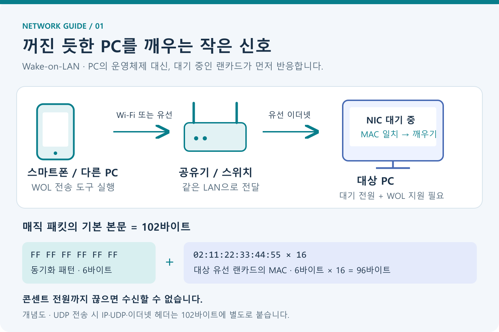
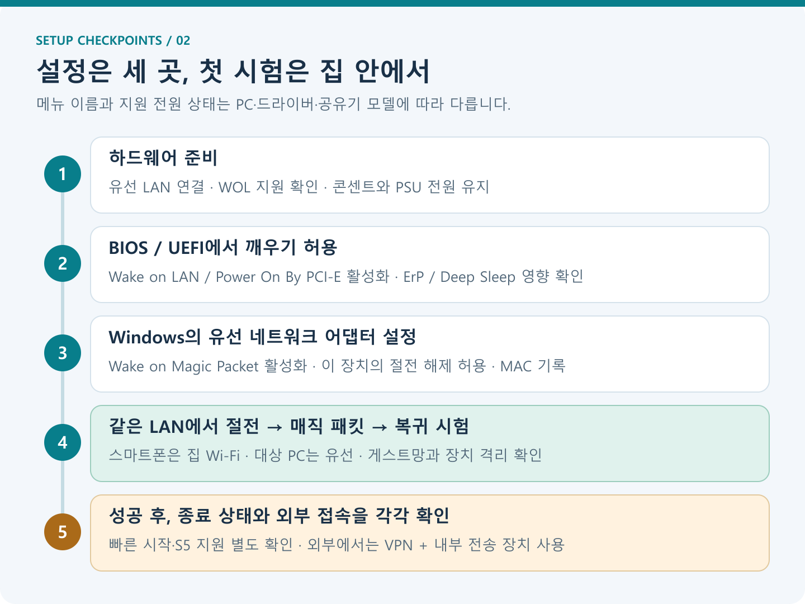
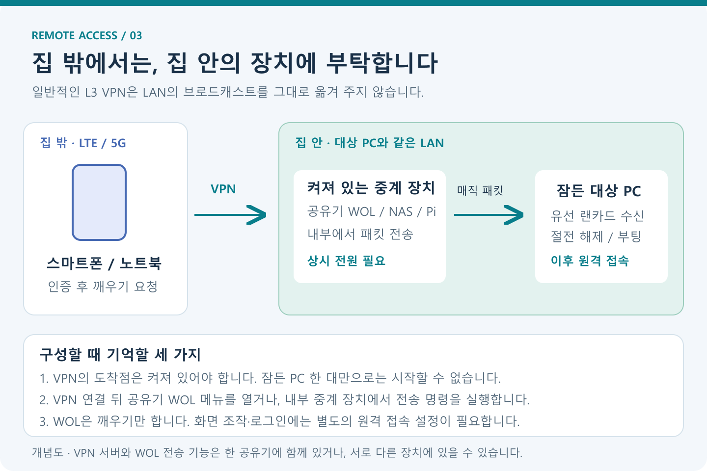

*상단 그림은 AI로 생성한 손그림 스타일의 개념 삽화이며, 본문의 도식은 직접 제작했다. 실제 BIOS나 Windows 설정 화면을 캡처한 이미지는 아니다.*

## 들어가며

외출 중 집에 있는 PC의 파일이 필요하거나, 퇴근한 뒤 사무실 개발 PC에 접속해야 할 때가 있다. 원격 접속 프로그램을 설치했더라도 PC가 잠들어 있으면 연결되지 않을 수 있다. 그렇다고 사용하지 않는 시간까지 계속 켜 두기는 아쉽다.

**Wake-on-LAN(WOL)은 네트워크로 깨우기 신호를 보내 PC의 절전을 해제하거나, 지원하는 시스템에서 전원을 켜는 기능이다.** 흔히 “Wake up on LAN”이라고도 부르지만 일반적인 명칭은 **Wake-on-LAN**이다.

설정은 다음 순서로 진행하면 원인을 구분하기 쉽다.

1. 대상 PC의 WOL 지원 여부와 유선 연결을 확인한다.
2. BIOS/UEFI와 Windows의 유선 랜카드 설정을 맞춘다.
3. **같은 집 네트워크에서 절전 해제부터 시험한다.**
4. 성공한 뒤 종료 상태와 집 밖에서의 사용을 각각 확인한다.

이 글은 **2026년 11월 8일에 확인한 공식 문서**를 바탕으로 Windows 11/10의 유선 이더넷 환경을 중심으로 설명한다. Linux 설정과 별도 패키지 없이 실행하는 Python 예제도 함께 다룬다. 메뉴 이름과 지원 범위는 메인보드·완제품 PC·랜카드·드라이버에 따라 다르다.

> **먼저 기억할 조건:** WOL은 PC에 전기를 공급하는 기능이 아니다. 멀티탭을 끄거나 전원 케이블을 뽑아 랜카드의 대기 전원까지 끊으면 사용할 수 없다. 또한 PC를 깨우는 기능과 화면을 조작하는 원격 접속 기능은 따로 설정해야 한다.
{: .prompt-info }

## 문제 상황

WOL을 처음 설정할 때는 다음 증상을 자주 만나게 된다.

| 증상 | 먼저 나눠 볼 문제 |
|---|---|
| 앱에서 전송 성공이 나오지만 PC가 반응하지 않음 | 전송 성공은 수신·깨우기 성공을 뜻하지 않음 |
| 절전 상태에서는 되지만 종료하면 안 됨 | 전원 상태별 지원, 빠른 시작, 종료 후 랜카드 전원 |
| 집 Wi-Fi에서는 되지만 LTE/5G에서는 안 됨 | 인터넷에서 내부 LAN으로 전달하는 경로 |
| 종료 직후에는 되는데 시간이 지나면 안 됨 | 유니캐스트 전송의 ARP 정보 만료 가능성 |
| 스마트폰은 Wi-Fi이고 PC는 유선이라서 안 되는 것 같음 | 연결 방식보다 같은 LAN인지, 장치 격리가 있는지 확인 |
| 아무도 누르지 않았는데 PC가 깨어남 | 매직 패킷 외 깨우기 조건, 타이머, 다른 장치 |

“공유기 포트만 열면 된다”는 설명으로는 이런 차이를 해결하기 어렵다. **PC가 깨어날 준비가 되어 있는지**와 **매직 패킷이 해당 랜카드까지 도착하는지**를 함께 봐야 한다.

## 원인 분석

### 1. 꺼져 있는 PC가 어떻게 네트워크 신호를 받을까?



PC가 절전 상태에 들어가거나 지원되는 종료 상태가 되면 CPU와 주요 장치가 쉬더라도, 일부 전원 회로와 랜카드의 깨우기 기능은 대기 전원을 사용할 수 있다.

WOL을 허용한 랜카드는 수신 데이터에서 정해진 패턴을 찾고, 자기 MAC 주소와 일치하면 메인보드에 깨우기 신호를 보낸다. 그다음 시스템이 절전에서 복귀하거나 부팅한다. 운영체제 위에서 실행 중인 프로그램이 먼저 신호를 받아야 하는 구조는 아니다. [Intel 원격 깨우기 원리](https://www.intel.com/content/www/us/en/support/articles/000005793/ethernet-products.html)

여기서 **MAC 주소**는 네트워크 인터페이스를 식별하는 6바이트 주소다. 같은 PC라도 유선 랜, Wi-Fi, USB 랜카드의 MAC 주소가 서로 다를 수 있다. 이 글에서는 **실제로 랜선을 연결한 유선 어댑터의 MAC 주소**를 사용한다.

### 2. 매직 패킷은 무엇일까?

가장 널리 쓰는 깨우기 데이터가 **매직 패킷(Magic Packet)**이다. 선택적인 암호 필드를 제외한 기본 본문은 다음과 같다.

```text
[FF FF FF FF FF FF] + [대상 MAC 주소 6바이트를 16번 연속 반복]

6 + (6 × 16) = 102바이트
```

예를 들어 MAC 주소가 `02:11:22:33:44:55`라면, 뒤쪽에 실제 바이트 `02 11 22 33 44 55`가 16번 들어간다. 콜론이 포함된 문자열을 16번 보내는 것이 아니다. [Wireshark 매직 패킷 형식](https://wiki.wireshark.org/WakeOnLAN)

이 데이터는 이더넷 프레임에 직접 담을 수도 있고, 일반적인 도구처럼 **UDP로 감싸서** 보낼 수도 있다. UDP 목적지 포트는 흔히 `9` 또는 `7`을 사용하지만, **9번 포트 자체가 PC를 켜는 특별한 스위치는 아니다.** 랜카드의 깨우기 로직이 인식하는 데이터 패턴과 실제 전달 경로가 핵심이다. UDP·IP·이더넷 헤더는 위의 102바이트 계산에 포함되지 않는다. [Wireshark WOL 전송 방식](https://wiki.wireshark.org/WakeOnLAN)

그래서 일반적인 하드웨어 WOL 수신을 위해 대상 Windows에 UDP 서버 프로그램을 설치할 필요는 없다. 송신 프로그램이나 네트워크 장비가 전송을 막는 상황은 별도로 점검하되, 대상 PC의 Windows 방화벽 전체를 끄는 방식으로 접근하지는 말자.

### 3. 절전·최대 절전·종료는 같은 상태가 아니다

겉으로 화면이 꺼져 있어도 내부 전원 상태는 다를 수 있다.

| 상태 | 의미 | WOL을 확인할 때 |
|---|---|---|
| 전통적인 절전, S3 | 메모리의 작업 상태를 유지하며 주요 장치가 쉼 | 지원되는 PC에서 첫 시험 대상으로 적합 |
| Modern Standby, S0 저전력 유휴 | S3와 다른 저전력 동작 방식 | 모델·드라이버의 네트워크 깨우기 지원 확인 |
| 최대 절전, S4 | 작업 상태를 저장장치에 기록 | 명시적으로 최대 절전에 들어간 경우의 지원 확인 |
| 빠른 시작을 사용하는 종료 | 사용자 세션은 종료하고 커널 상태를 저장하는 하이브리드 종료 | 일반 최대 절전과 깨우기 동작이 다를 수 있음 |
| 일반 종료, S5 | 작업 세션을 끝내고 다음에 새로 부팅 | Windows의 보장과 별개로 펌웨어·하드웨어 지원 필요 |
| 기계적 전원 차단, G3 | 시스템의 주 전원 공급이 끊김 | 일반적인 WOL 불가 |

Windows의 공식 전원 상태 문서는 S3와 S4의 WOL 지원을 설명하며, 빠른 시작 종료나 S5 종료에서는 운영체제가 같은 방식으로 깨우기를 보장하지 않는다고 구분한다. 일부 시스템은 BIOS가 랜카드를 준비시켜 종료 후에도 켜질 수 있다. 따라서 **“Windows에서 종료한 PC는 모두 WOL로 켤 수 있다”라고 일반화하면 안 된다.** [Microsoft 전원 상태와 WOL](https://learn.microsoft.com/en-us/windows/win32/power/system-power-states)

### 4. 집 안에서 되던 기능이 집 밖에서는 왜 안 될까?

집 안에서는 보통 같은 LAN의 **브로드캐스트 주소**로 패킷을 보내, 그 네트워크의 랜카드들이 신호를 볼 수 있게 한다. 그중 본문에 들어 있는 MAC 주소와 일치하는 대상이 깨어난다.

일반적인 인터넷 라우팅이나 L3 VPN은 이런 LAN 브로드캐스트를 그대로 전달하지 않는다. 원격 PC에 VPN 프로그램을 설치했다는 사실만으로 잠든 PC까지 깨우기 경로가 만들어지지는 않는다. **집 안에서 대신 패킷을 보내 줄 켜진 장치**가 있으면 구성이 명확해진다. Tailscale도 같은 이유로 내부의 상시 동작 장치를 활용하는 방법을 설명한다. [Tailscale의 WOL 중계 안내](https://tailscale.com/blog/wake-on-lan-tailscale-upsnap)

## 해결 방법



*모든 항목을 한꺼번에 바꾸기보다, 내부 LAN의 절전 깨우기가 되는지 확인한 다음 사용 범위를 넓힌다.*

### 1. 준비물과 지원 여부 확인하기

깨울 컴퓨터를 **대상 PC**, 신호를 보내는 스마트폰이나 다른 컴퓨터를 **송신 장치**라고 부르자.

- 대상 PC와 유선 랜카드가 WOL을 지원해야 한다. 제조사 사양과 매뉴얼에서 확인한다.
- 대상 PC는 공유기나 스위치에 **랜선으로 연결**한다.
- 대상 PC의 콘센트와 데스크톱 파워서플라이 뒤쪽 스위치는 켜 둔다.
- 첫 시험의 송신 장치는 대상 PC와 같은 LAN에 연결한다.
- 노트북은 우선 전원 어댑터를 연결해 시험하고, 배터리 상태의 지원 여부는 매뉴얼에서 따로 확인한다.

대상 PC가 Wi-Fi로만 연결되어 있다면 **WoWLAN(Wake on Wireless LAN)** 지원을 별도로 확인해야 한다. 유선 WOL과 동일하게 사용할 수 있다고 가정하면 안 된다. USB 랜카드와 도킹 스테이션도 PC의 전원 상태에 따라 포트 전원이나 깨우기 지원이 달라질 수 있다. [Dell WOL 지원 조건](https://www.dell.com/support/kbdoc/en-us/000129137/wake-on-lan-wol-troubleshooting-best-practices), [Ubuntu WoWLAN 설정 문서](https://documentation.ubuntu.com/core/explanation/system-snaps/network-manager/how-to-guides/configure-the-snap/wake-on-wlan/)

**송신 스마트폰은 Wi-Fi를 사용해도 된다.** 일반 LAN에서 Wi-Fi와 유선이 서로 통신하도록 연결되어 있으면 된다. 다만 게스트 Wi-Fi나 AP의 장치 격리 기능이 켜져 있으면 전달이 막힐 수 있다.

### 2. 대상 PC의 MAC·IP·서브넷 기록하기

대상 Windows PC에서 PowerShell 또는 명령 프롬프트를 열고 실행한다.

```powershell
ipconfig /all
```

현재 연결된 **이더넷 어댑터**에서 다음 값을 찾는다. 아래 값은 설명을 위한 가상 예시다.

```text
물리적 주소       : 02-11-22-33-44-55
IPv4 주소         : 192.168.0.50
서브넷 마스크     : 255.255.255.0
기본 게이트웨이   : 192.168.0.1
```

값이 여러 개 나오면 Wi-Fi, Bluetooth, VPN, Hyper-V 등의 가상 어댑터와 혼동하지 않도록 한다. PowerShell에서는 다음 명령으로 유선 어댑터 이름과 MAC 주소를 함께 볼 수도 있다.

```powershell
Get-NetAdapter -Physical |
    Format-Table Name, InterfaceDescription, Status, MacAddress
```

예제 네트워크의 주소를 정리하면 다음과 같다.

| 용도 | 예제 값 |
|---|---|
| 대상 PC의 유선 MAC | `02:11:22:33:44:55` |
| 대상 PC의 평상시 IP | `192.168.0.50` |
| 공유기 주소 | `192.168.0.1` |
| 네트워크 | `192.168.0.0/24` |
| 브로드캐스트 주소 | `192.168.0.255` |

**브로드캐스트 주소가 항상 `192.168.0.255`인 것은 아니다.** 위 값은 마스크가 `255.255.255.0`, 즉 `/24`일 때의 예다. 다른 대역·마스크를 사용하면 그에 맞게 계산해야 한다.

Python 3가 설치되어 있다면 대상 PC에서 확인한 IP와 마스크로 계산할 수 있다.

```powershell
python -c "import ipaddress; print(ipaddress.ip_interface('192.168.0.50/255.255.255.0').network.broadcast_address)"
```

이 예제의 결과는 다음과 같다.

```text
192.168.0.255
```

### 3. BIOS/UEFI에서 WOL 활성화하기

PC를 재시작하고 제조사 안내에 따라 BIOS/UEFI 설정 화면으로 들어간다. 진입 키는 흔히 `Delete`, `F2` 등이지만 모델마다 다르다.

전원 관리나 고급 설정에서 다음과 비슷한 항목을 찾는다.

| 항목 이름의 예 | 설정 방향 |
|---|---|
| `Wake on LAN`, `Resume by LAN` | `Enabled` 또는 해당 LAN 깨우기 모드 |
| `Power On By PCI-E`, `PME Event Wake Up` | 제조사 문서에서 LAN 깨우기용이라고 안내한 경우 활성화 |
| `Wake from S4/S5`, `Wake on LAN from S5` | 그 상태에서의 깨우기를 지원하고 사용할 때 활성화 |
| `ErP`, `ErP Ready`, `Deep Sleep` | LAN 대기 전원을 차단하는지 확인하고, WOL 사용에 필요한 경우 비활성화 |

예를 들어 ASUS의 일부 메인보드는 다음 경로를 사용한다.

```text
Advanced → APM Configuration → Power On By PCI-E → Enabled
```

이 경로는 **일부 모델의 예시**이며, 모든 메인보드에 그대로 적용되는 메뉴는 아니다. [ASUS 메인보드 WOL 설정](https://www.asus.com/uk/support/faq/1045950/)

ErP나 Deep Sleep이 랜카드의 대기 전원을 줄이는 시스템에서는 WOL과 충돌할 수 있다. ASUS의 일부 업무용 PC 안내도 ErP를 끄도록 설명한다. 비활성화하면 종료 후 소비 전력이 달라질 수 있으므로 필요한 항목만 조정한다. [ASUS 업무용 PC의 ErP·WOL 설정](https://www.asus.com/in/support/faq/1048459/)

변경 내용을 저장하고 Windows로 돌아온다. **PXE/Network Boot는 네트워크로 운영체제를 부팅하는 기능**이므로 WOL 설정과 혼동하지 말자.

### 4. Windows 11/10에서 유선 랜카드 설정하기

`Win + X`를 누르고 **장치 관리자 → 네트워크 어댑터 → 실제 유선 랜카드 → 속성**으로 이동한다. 항목이 없거나 동작이 불안정하면 PC·메인보드 제조사가 제공하는 해당 모델용 드라이버를 확인한다.

**고급 탭**에서 다음 항목을 확인한다. 모두 존재하는 것은 아니다.

| 항목 이름의 예 | 확인할 값 |
|---|---|
| `Wake on Magic Packet`, `매직 패킷 웨이크 온` | `Enabled` |
| `Shutdown Wake-On-Lan`, `Shutdown Wake Up` | 종료 후 깨우기를 지원하고 사용할 때 `Enabled` |
| `Enable PME` | 해당 어댑터의 제조사 안내에 따라 `Enabled` |
| `Wake on Pattern Match` | 일반 패턴으로 깨어날 필요가 없다면 비활성화 검토 |

**전원 관리 탭**에서는 다음 항목을 확인한다.

- `이 장치를 사용하여 컴퓨터의 대기 모드를 종료할 수 있음`을 켠다.
- 매직 패킷으로만 깨우려면 `매직 패킷에서만 컴퓨터의 대기 모드를 종료할 수 있음`도 켠다.

`전원을 절약하기 위해 컴퓨터가 이 장치를 끌 수 있음`은 이름만 보고 무조건 끄지 말자. 드라이버가 저전력 상태와 깨우기 준비를 함께 관리하기도 한다. Intel의 일부 Killer 어댑터 안내는 이 항목을 **체크**하도록 설명한다. 해당 어댑터의 제조사 권장 설정을 우선한다. [Intel 어댑터 설정 안내](https://www.intel.com/content/www/us/en/support/articles/000059062/ethernet-products.html)

전원 관리 탭이 없거나 회색으로 보인다고 바로 WOL 미지원으로 결론 내리지는 말자. Modern Standby 시스템은 설정 노출 방식과 깨우기 조건이 다를 수 있다. 관리자 PowerShell에서 지원하는 절전 상태를 확인한다.

```powershell
powercfg /a
```

출력에 `대기 모드(S0 저전력 유휴)`가 표시되는지, `대기 모드(S3)`가 가능한지 확인한다. 이 정보와 모델별 문서를 함께 보아야 한다. [Microsoft powercfg 명령 설명](https://learn.microsoft.com/en-us/windows-hardware/design/device-experiences/powercfg-command-line-options)

### 5. 같은 LAN에서 스마트폰으로 먼저 깨워 보기

스마트폰에 MAC 주소와 브로드캐스트 주소를 직접 입력할 수 있는 WOL 도구를 준비한다. 앱마다 메뉴 이름은 다르지만 일반적인 입력값은 다음과 같다.

| 앱의 입력 항목 | 입력 예시 | 의미 |
|---|---|---|
| 이름 | `집 데스크톱` | 구분용 이름 |
| MAC 주소 | `02:11:22:33:44:55` | 대상 유선 랜카드 |
| Broadcast / 전송 대상 주소 | `192.168.0.255` | 매직 패킷을 보낼 LAN 주소 |
| UDP 포트 | `9` | 이 글에서 쓰는 전송 포트 |
| 장치 IP / 상태 확인 IP | `192.168.0.50` | 앱에 별도 항목이 있다면 상태 확인 등에 사용 |

앱에 `IP` 항목 하나만 있다면 그것이 **패킷 전송 대상인지, 장치 상태 확인 주소인지** 설명을 확인한다. 두 역할을 같은 값으로 취급하는 앱도 있어, 가능하면 LAN 브로드캐스트 전송을 지원하는 도구를 사용하자.

실제 시험 순서는 다음과 같다.

1. 스마트폰을 대상 PC와 같은 일반 집 Wi-Fi에 연결한다. 첫 시험에서는 모바일 데이터를 잠시 끄면 경로를 구분하기 쉽다.
2. 대상 PC의 시작 메뉴에서 **절전**을 선택한다. 모니터만 끄는 것으로 대신하지 않는다.
3. 절전 전환이 끝나면 스마트폰에서 깨우기 버튼을 누른다.
4. 대상 PC가 복귀하는지 확인한다.

첫 시험에서는 **공유기의 인터넷 포트 포워딩이 필요하지 않다.** 집 안에서 되지 않는 상태라면 외부 접속부터 추가하지 말고 BIOS·드라이버·MAC·네트워크 격리를 먼저 점검한다.

### 6. 절전에서 성공하면 종료 상태를 따로 시험하기

절전에서는 되는데 Windows의 `종료` 뒤에는 안 된다면 매직 패킷 작성법보다 **종료 시의 전원 정책**을 먼저 의심할 수 있다.

빠른 시작이 영향을 주는지 비교하려면 다음 경로로 이동한다.

```text
제어판 → 하드웨어 및 소리 → 전원 옵션
→ 전원 단추 작동 설정 → 현재 사용할 수 없는 설정 변경
→ 빠른 시작 켜기 해제 → 변경 내용 저장
```

이후 정상적으로 Windows를 종료하고 다시 시험한다. **빠른 시작 해제는 종료 후 WOL을 보장하는 조치가 아니다.** 해당 PC의 S5 깨우기 지원과 종료 후 랜카드 전원 공급이 함께 필요하다. Microsoft는 Windows 10의 하이브리드 종료와 명시적인 최대 절전을 구분해 설명한다. [Microsoft Windows 10 WOL 동작](https://learn.microsoft.com/en-us/troubleshoot/windows-client/setup-upgrade-and-drivers/wake-on-lan-feature)

빠른 시작을 끄면 부팅 동작과 시간이 달라질 수 있다. 절전 깨우기로 충분하고 문제가 없다면 모든 PC에서 일괄적으로 끌 필요는 없다. 제조사 지원 조건과 시험 결과를 기준으로 결정하자.

랜 포트의 링크 LED는 대기 전원과 연결을 살펴보는 보조 단서다. 다만 **LED가 켜졌다고 WOL 설정이 모두 맞는 것도, 꺼졌다고 모든 모델에서 불가능한 것도 아니다.** 표시 정책은 기기마다 다르다.

### 7. 공유기에 WOL 기능이 있다면 활용하기

일부 공유기는 관리 화면에서 MAC 주소를 등록하고 직접 매직 패킷을 보낼 수 있다. 이 기능은 공유기가 LAN 내부의 송신 장치 역할을 하므로 편리하다.

ASUS의 지원 모델은 다음과 같은 메뉴를 제공한다.

```text
공유기 관리 화면 → Network Tools → Wake on LAN
→ 대상 MAC 주소 입력 → Wake up
```

지원 여부와 메뉴는 모델·펌웨어에 따라 확인한다. 다른 제조사 공유기도 설명서에서 `WOL`, `Wake on LAN`, `원격 PC 켜기` 등을 찾아보자. [ASUS 공유기 WOL 사용법](https://www.asus.com/support/faq/1011268/)

원격 접속 때 PC의 IP가 바뀌어 혼동되지 않도록 공유기의 **DHCP 주소 예약**으로 예제의 `192.168.0.50` 같은 주소를 유지하는 것도 유용하다. 다만 주소 예약은 **IP를 일정하게 배정하는 기능**이며, 꺼진 PC에 패킷을 보내는 데 필요한 **정적 ARP 등록과는 다르다.**

### 8. 집 밖에서는 VPN과 내부 중계 장치로 연결하기



*VPN으로 내부 장치에 인증해 접속한 뒤, 매직 패킷 자체는 대상 PC와 같은 LAN에서 전송한다.*

외부 사용은 다음 두 구성이 이해하기 쉽다.

| 구성 | 깨우는 순서 | 필요한 조건 |
|---|---|---|
| VPN 서버와 WOL 기능이 있는 공유기 | VPN 연결 → 공유기 내부 관리 화면 → WOL 실행 | 해당 모델의 VPN·WOL 지원과 관리 화면 접근 허용 |
| NAS·라즈베리 파이 등 중계 장치 | VPN 연결 → 켜진 중계 장치 접속 → WOL 명령 실행 | 중계 장치의 상시 전원, 대상 PC와 같은 LAN |

Tailscale의 공식 안내도 내부의 켜진 장치나 WOL 웹 도구를 경유하는 방식을 소개한다. **VPN에 연결되었다는 이유만으로 스마트폰의 LAN 브로드캐스트가 대상 PC까지 전달된다고 가정하면 안 된다.** [Tailscale 내부 WOL 서버 구성](https://tailscale.com/blog/wake-on-lan-tailscale-upsnap)

VPN을 처음 구성한다면 다음 준비를 먼저 끝낸다.

1. 공유기의 공식 설명서에 따라 **집 네트워크로 들어오는 VPN 서버**를 설정하거나, 중계 장치와 외부 기기를 같은 VPN에 등록한다. 상용 VPN으로 인터넷 출구만 바꾸는 기능과 구분한다.
2. 외부 기기에서 인증한 뒤 공유기의 내부 관리 주소나 중계 장치에 접속되는지 확인한다.
3. 내부 장치에서 WOL을 실행한다. 대상 PC만을 유일한 VPN 서버로 두면, 그 PC가 잠들었을 때 깨우기 요청을 받을 곳이 없어진다.
4. 부팅이 끝난 뒤 대상 PC의 원격 데스크톱·SSH 등 미리 준비한 원격 접속 기능으로 연결한다.

예를 들어 VPN을 통해 접근 가능한 Linux 중계 장치에 아래의 `wake.py`를 `~/wake.py`로 저장했다면, 외부 컴퓨터에서 다음처럼 실행할 수 있다. `사용자명`과 `중계장치의VPN주소`는 실제 값으로 바꾼다.

```bash
ssh 사용자명@중계장치의VPN주소 'python3 ~/wake.py 02:11:22:33:44:55 192.168.0.255'
```

이 명령의 SSH 접속 대상은 **깨울 PC가 아니라 이미 켜져 있는 중계 장치**다. 중계 장치가 내부 LAN으로 UDP를 보낸다. SSH와 VPN은 미리 구성되어 있어야 하며 접근 정책도 허용되어 있어야 한다.

외부 시험에서는 스마트폰의 집 Wi-Fi를 끄고 LTE/5G로 바꾼 뒤 VPN 연결부터 다시 확인한다. 대상 PC가 로그인 전에도 원격 접속을 받아야 한다면 관련 서비스의 자동 시작도 준비한다. 디스크 암호화의 부팅 전 PIN처럼 물리적인 입력이 필요한 구성은 깨운 뒤 접속을 막을 수 있다.

#### 공인 IP와 UDP 포트 포워딩만으로 해결하면 안 될까?

가능한 네트워크 구성도 있지만 공유기마다 제약이 커서 이 글의 기본 방법으로 삼지는 않는다.

- 꺼진 PC의 IP로 유니캐스트를 보내려면 공유기가 그 IP에 대응하는 MAC을 알아야 할 수 있다. **ARP 항목이 만료되면 종료 직후에만 되던 방식이 실패할 수 있다.**
- 브로드캐스트 주소로 전달하는 포트 포워딩이나 정적 ARP를 지원하지 않는 공유기도 있다.
- 이중 NAT나 통신사 CGNAT 환경에서는 공유기 한 곳의 포트 포워딩만으로 외부 도달 경로가 생기지 않을 수 있다.
- DDNS는 변하는 주소를 이름으로 찾게 해 줄 뿐, NAT나 브로드캐스트 전달 제약을 없애 주지는 않는다.

매직 패킷의 MAC 반복 데이터에는 사용자 인증이 없으므로, 인터넷에 직접 전달 경로를 만드는 대신 **인증된 VPN으로 내부 송신 기능에 접근하는 구성**을 권한다. 공유기 관리 화면이나 원격 데스크톱 포트를 이 작업 때문에 인터넷 전체에 공개할 필요도 없다.

## 예제

### Python 3으로 매직 패킷 보내기

스마트폰 앱 대신 **같은 LAN의 다른 컴퓨터**에서 직접 전송할 수 있다. Python 3 표준 라이브러리만 사용하므로 추가 패키지는 필요 없다. [wake.py 다운로드](/assets/code/wake-on-lan/wake.py)

다음 내용을 `wake.py`로 저장한다.

```python
"""Send a standard Wake-on-LAN magic packet using Python 3."""

import argparse
import ipaddress
import re
import socket
import time


def make_magic_packet(mac):
    if not re.fullmatch(r"[0-9A-Fa-f]{2}([:-])[0-9A-Fa-f]{2}(?:\1[0-9A-Fa-f]{2}){4}", mac):
        raise ValueError("Use a MAC such as 02:11:22:33:44:55")
    raw_mac = bytes.fromhex(mac.replace(":", "").replace("-", ""))
    return b"\xff" * 6 + raw_mac * 16


def main():
    parser = argparse.ArgumentParser(description=__doc__)
    parser.add_argument("mac", help="Target Ethernet adapter MAC address")
    parser.add_argument("broadcast", help="LAN IPv4 broadcast, e.g. 192.168.0.255")
    parser.add_argument("--port", type=int, default=9)
    parser.add_argument("--source-ip", help="Sender's LAN IPv4 address (optional)")
    args = parser.parse_args()

    try:
        packet = make_magic_packet(args.mac)
        destination = str(ipaddress.IPv4Address(args.broadcast))
        source = str(ipaddress.IPv4Address(args.source_ip)) if args.source_ip else None
        if not 1 <= args.port <= 65535:
            raise ValueError("Port must be between 1 and 65535")
    except ValueError as error:
        parser.error(str(error))

    with socket.socket(socket.AF_INET, socket.SOCK_DGRAM) as sock:
        sock.setsockopt(socket.SOL_SOCKET, socket.SO_BROADCAST, 1)
        if source:
            sock.bind((source, 0))
        for attempt in range(1, 4):
            sent = sock.sendto(packet, (destination, args.port))
            print(f"Sent {sent} bytes to {destination}:{args.port} ({attempt}/3)")
            if attempt < 3:
                time.sleep(0.2)


if __name__ == "__main__":
    main()
```

Windows의 **송신 PC**에서 실행한다. 예제 MAC·브로드캐스트 주소는 실제 환경의 값으로 바꿔야 한다.

```powershell
python wake.py 02:11:22:33:44:55 192.168.0.255
```

Linux나 macOS 송신 장치에서는 다음처럼 실행한다.

```bash
python3 wake.py 02:11:22:33:44:55 192.168.0.255
```

가상 어댑터·VPN·유선·Wi-Fi를 함께 사용해 엉뚱한 인터페이스로 나가는 것이 의심되면, **송신 장치 자신의 LAN IP**를 지정할 수 있다. 다음의 `192.168.0.20`은 대상 PC의 IP가 아니다.

```powershell
python wake.py 02:11:22:33:44:55 192.168.0.255 --source-ip 192.168.0.20
```

운영체제의 라우팅과 네트워크 정책도 함께 맞아야 한다. 이 옵션이 네트워크 격리나 VPN의 브로드캐스트 제한을 우회해 주지는 않는다.

스크립트는 같은 102바이트 본문을 짧은 간격으로 세 번 보낸다. 출력의 `Sent`는 로컬 소켓이 전송을 받아들였다는 의미다. UDP 응답을 기다리거나 대상 PC의 부팅을 확인하지 않는다.

### Linux 대상 PC에서 WOL 켜기

깨울 PC가 Linux라면 BIOS와 전원 조건은 동일하게 확인하고, 유선 인터페이스의 WOL 설정을 살펴본다. 아래는 `apt`를 사용하는 Debian/Ubuntu 계열의 예다.

```bash
sudo apt update
sudo apt install ethtool
ip -br link
sudo ethtool enp3s0
```

`enp3s0`는 예시이므로 실제 유선 인터페이스 이름으로 바꾼다. 출력에서 확인할 항목의 **형식 예시**는 다음과 같다.

```text
Supports Wake-on: pumbg
Wake-on: d
```

지원 목록의 `g`는 매직 패킷 깨우기를 뜻하고, 현재 설정의 `d`는 비활성화를 뜻한다. 활성화하고 다시 조회한다.

```bash
sudo ethtool -s enp3s0 wol g
sudo ethtool enp3s0
```

현재 설정에 `Wake-on: g`가 포함되는지 본다. 이 설정만으로 모든 종료 상태의 깨우기가 보장되는 것은 아니다. [ethtool 공식 매뉴얼](https://man.archlinux.org/man/ethtool.8)

직접 적용한 설정은 재부팅이나 네트워크 관리 프로그램에 의해 바뀔 수 있다. NetworkManager가 해당 인터페이스를 관리한다면 연결 프로필에 저장한다.

```bash
nmcli device status
nmcli connection show
sudo nmcli connection modify "Wired connection 1" 802-3-ethernet.wake-on-lan magic
nmcli -f 802-3-ethernet.wake-on-lan connection show "Wired connection 1"
```

`Wired connection 1`은 실제 유선 연결 프로필 이름으로 바꾼다. 프로필 변경은 다음 활성화 때 적용되므로 로컬에서 연결을 다시 활성화하거나 재부팅한 뒤 `ethtool`로 재확인한다. 네트워크를 다시 올리는 작업은 SSH를 끊을 수 있으니 원격으로 작업 중이라면 복구 경로를 확보한다. [NetworkManager WOL 설정](https://www.networkmanager.dev/docs/api/latest/nm-settings-nmcli.html)

## 결과 확인

### 1. 코드의 전송 검증과 PC 깨우기 검증을 구분하기

이 글의 Python 예제는 작성 환경에서 **루프백 UDP 수신기를 열어** 세 패킷의 수신, 102바이트 길이, `FF` 6바이트와 MAC 16회 반복을 확인했다. 그때의 실제 전송 출력은 다음과 같다.

```text
Sent 102 bytes to 127.0.0.1:40009 (1/3)
Sent 102 bytes to 127.0.0.1:40009 (2/3)
Sent 102 bytes to 127.0.0.1:40009 (3/3)
```

`127.0.0.1`은 **코드 검증에만 사용한 자기 컴퓨터의 주소**다. 실제 WOL 사용에서는 대상 LAN의 브로드캐스트 주소로 바꾼다. 이 검증은 특정 메인보드의 BIOS 설정이나 물리 PC의 절전·종료 후 깨우기를 시험한 결과가 아니다.

실제 환경에서는 다음 항목을 따로 기록하면 문제가 생겼을 때 비교하기 좋다.

| 시험 조건 | 확인할 결과 |
|---|---|
| 같은 LAN + 절전 | PC가 복귀하고 네트워크 연결이 돌아오는가 |
| 같은 LAN + 명시적인 최대 절전 | 해당 상태를 지원하며 정상 복귀하는가 |
| 같은 LAN + 종료 | 제조사 지원 범위에서 부팅되는가 |
| 종료 후 충분히 기다린 뒤 재시험 | 직후에만 동작하는 문제가 없는가 |
| LTE/5G + VPN + 내부 중계 | 내부 장치에 도달하고 그 장치가 깨울 수 있는가 |
| 부팅 후 원격 접속 | 서비스 자동 시작과 인증까지 완료되는가 |

### 2. Windows에서 깨우기 상태 확인하기

관리자 PowerShell에서 다음 명령을 사용할 수 있다.

```powershell
powercfg /devicequery wake_armed
powercfg /lastwake
powercfg /waketimers
```

첫 번째는 현재 깨우도록 설정된 장치 목록, 두 번째는 마지막 절전 복귀 정보, 세 번째는 활성 깨우기 타이머를 보여 준다. **S5 종료 후 펌웨어의 깨우기 지원을 판정하는 명령은 아니다.** 복귀 원인이 충분히 기록되지 않는 시스템도 있으므로 출력 하나만으로 성공·실패를 단정하지 않는다. [Microsoft powercfg 진단 항목](https://learn.microsoft.com/en-us/windows-hardware/design/device-experiences/powercfg-command-line-options)

### 3. 패킷이 LAN까지 오는지 확인하기

Wireshark를 사용할 수 있다면 대상 PC가 **켜져 있을 때 먼저** 유선 인터페이스에서 캡처하고 매직 패킷을 보내 본다. 예제 스크립트를 확인할 때의 표시 필터는 다음과 같다.

```text
udp.dstport == 9
```

WOL로 해석된 패킷만 보려면 다음 필터도 사용할 수 있다.

```text
wol
```

Wireshark가 자동으로 WOL로 해석하지 않는다면 UDP 본문의 102바이트 패턴을 직접 확인한다. 이더넷 프레임으로 직접 보내는 도구는 첫 번째 UDP 필터에 잡히지 않을 수 있다. [Wireshark WOL 해석과 필터](https://wiki.wireshark.org/WakeOnLAN)

대상 PC에서 캡처했다면 **켜진 상태에서의 전달 경로**를 확인한 것이다. 절전 뒤에도 랜카드가 패턴을 인식하도록 준비되어 있다는 것까지 증명하지는 않는다. 다른 장치에서 캡처한 경우에도 대상 포트까지 전달되었다고 자동으로 결론 내리지 말자.

## 실무 팁

### 흔한 실수

| 실수 | 바로잡는 방법 |
|---|---|
| 대상 PC에서 `wake.py`를 실행하고 그 PC를 깨우려고 함 | 다른 켜진 송신 장치에서 실행 |
| Wi-Fi MAC 또는 VPN 가상 어댑터의 MAC을 입력 | 랜선이 연결된 유선 랜카드의 MAC 사용 |
| 모든 네트워크에 `192.168.0.255` 사용 | 실제 IP와 마스크로 브로드캐스트 계산 |
| 게스트 Wi-Fi와 일반 LAN이 같은 망이라고 생각 | 장치 격리와 VLAN, 서브넷 확인 |
| 빠른 시작을 끄면 종료 후 WOL이 무조건 된다고 생각 | S5 지원, BIOS, 대기 전원 함께 확인 |
| DHCP 예약을 정적 ARP와 같은 기능으로 생각 | 주소 배정과 IP→MAC 전달 정보를 구분 |
| DDNS·VPN만 설정하면 외부 WOL이 끝났다고 생각 | 내부에서 패킷을 보낼 상시 동작 장치 확인 |
| 전송 성공 문구를 부팅 성공으로 판단 | PC 복귀와 원격 서비스 접속을 따로 확인 |

### 증상별 점검 순서

**절전에서도 전혀 반응이 없다면** 유선 연결과 대상 MAC, BIOS 깨우기 허용, 드라이버 설정부터 확인한다. 그다음 브로드캐스트 주소·송신 인터페이스·게스트망 격리를 본다. 지원 조건이 맞는데 계속 실패하면 제조사 안내에 따라 EEE(Energy Efficient Ethernet)나 Green Ethernet 같은 절전 기능을 비교 시험할 수 있다. Dell은 일부 환경에서 EEE 비활성화를 안내한다. 설정은 한 번에 하나씩 바꿔 원인을 추적한다. [Dell WOL 문제 해결](https://www.dell.com/support/kbdoc/en-us/000129137/wake-on-lan-wol-troubleshooting-best-practices)

**절전은 되는데 종료에서는 안 된다면** 빠른 시작과 종료 후 전원 공급, S5 지원을 본다. 지원되지 않는 모델이라면 검증된 절전 깨우기를 사용하는 편이 낫다.

**종료 직후에만 된다면** 대상 IP로 유니캐스트를 보내고 있는지 살핀다. ARP 만료의 영향인지 분리하려면 같은 LAN에서 올바른 브로드캐스트 주소로 다시 시험한다. DHCP 예약만 추가해서는 이 문제가 해결되지 않을 수 있다.

**집 안에서는 되는데 외부에서 안 된다면** PC 설정을 다시 바꾸기 전에 VPN으로 켜진 중계 장치에 접속되는지, 그 장치에서 보낸 WOL은 되는지 순서대로 확인한다.

**의도하지 않게 깨어난다면** 매직 패킷 외 패턴 깨우기나 링크 변화 감지를 검토하고, `powercfg /lastwake`와 `/waketimers`로 다른 장치·예약 작업의 영향도 살펴본다.

### 주의사항

WOL은 로그인이나 화면 제어 권한을 제공하지 않는다. 깨운 뒤에도 운영체제 인증과 원격 접속 권한은 그대로 필요하다. 민감한 자료를 다루는 PC에서는 조직의 전원·원격 접속 정책도 적용된다.

전력 절감 효과는 PC의 대기 소비 전력과 사용 시간, 중계 장치를 추가로 켜 두는지에 따라 달라진다. 일정한 절감률로 단정하기보다 실제 전력계로 비교하면 정확하다.

스마트 플러그로 전원을 강제로 끊는 방법은 WOL과 다르다. 실행 중인 PC의 전원을 강제로 차단하면 작업이나 파일시스템에 문제가 생길 수 있으므로, 정상 종료와 네트워크 깨우기를 기본 흐름으로 둔다.

### 추천 명령어

Windows 대상 PC의 상태를 정리할 때는 다음 조합이 유용하다.

```powershell
ipconfig /all
Get-NetAdapter -Physical
powercfg /a
powercfg /devicequery wake_armed
powercfg /lastwake
```

송신 장치에서는 실제 MAC과 LAN 브로드캐스트 주소를 넣어 실행한다.

```powershell
python wake.py 02:11:22:33:44:55 192.168.0.255
```

원격 접속이 안 된다고 무조건 WOL 실패로 판단하지는 말자. PC는 이미 켜졌지만 서비스 시작이 늦거나 방화벽·계정 권한 때문에 연결이 막힐 수도 있다. `ping` 응답도 ICMP 정책에 영향을 받으므로 최종적으로는 사용할 원격 서비스까지 확인한다.

## 마무리

### 핵심 요약

WOL이 동작하려면 **대기 전원을 받는 하드웨어**, **BIOS와 운영체제의 깨우기 설정**, **매직 패킷 전달 경로**가 모두 맞아야 한다. 먼저 같은 LAN에서 절전 해제를 성공시킨 뒤, 종료 후 깨우기와 외부 접속을 각각 확장하면 실패 지점을 찾기 쉽다.

### 언제 사용하면 좋은가

필요할 때만 켜는 집 데스크톱, 원격 개발 PC, 백업용 컴퓨터 등에 유용하다. 종료 후 깨우기가 지원되지 않더라도 절전 복귀가 안정적으로 된다면 그 범위에서 활용할 수 있다.

### 추가 학습 주제

외부에서도 자주 사용한다면 공유기 VPN과 접근 정책, 내부 WOL 중계 도구, 원격 서비스 자동 시작을 함께 익혀 보자. 브로드캐스트·서브넷·ARP의 역할을 이해하면 “어제는 됐는데 오늘은 안 되는” 문제를 추적하는 데도 도움이 된다.

## 참고 자료

- [Microsoft: 시스템 전원 상태와 WOL 지원 범위](https://learn.microsoft.com/en-us/windows/win32/power/system-power-states)
- [Microsoft: Windows 10의 WOL과 빠른 시작 동작](https://learn.microsoft.com/en-us/troubleshoot/windows-client/setup-upgrade-and-drivers/wake-on-lan-feature)
- [Microsoft: powercfg 명령어](https://learn.microsoft.com/en-us/windows-hardware/design/device-experiences/powercfg-command-line-options)
- [Intel: 원격 깨우기의 원리](https://www.intel.com/content/www/us/en/support/articles/000005793/ethernet-products.html)
- [Intel: 어댑터의 WOL 설정](https://www.intel.com/content/www/us/en/support/articles/000059062/ethernet-products.html)
- [ASUS: 메인보드 BIOS의 WOL 설정](https://www.asus.com/uk/support/faq/1045950/)
- [ASUS: 업무용 PC의 WOL·ErP 설정](https://www.asus.com/in/support/faq/1048459/)
- [ASUS: 공유기의 WOL 기능 사용](https://www.asus.com/support/faq/1011268/)
- [Dell: WOL 설정과 문제 해결](https://www.dell.com/support/kbdoc/en-us/000129137/wake-on-lan-wol-troubleshooting-best-practices)
- [Wireshark: 매직 패킷 형식과 패킷 분석](https://wiki.wireshark.org/WakeOnLAN)
- [Tailscale: 내부 장치를 이용한 WOL 중계](https://tailscale.com/blog/wake-on-lan-tailscale-upsnap)
- [ethtool: Wake-on-LAN 옵션](https://man.archlinux.org/man/ethtool.8)
- [NetworkManager: 연결 프로필의 WOL 설정](https://www.networkmanager.dev/docs/api/latest/nm-settings-nmcli.html)
- [Ubuntu: 유선 WOL과 구분되는 WoWLAN 설정](https://documentation.ubuntu.com/core/explanation/system-snaps/network-manager/how-to-guides/configure-the-snap/wake-on-wlan/)
