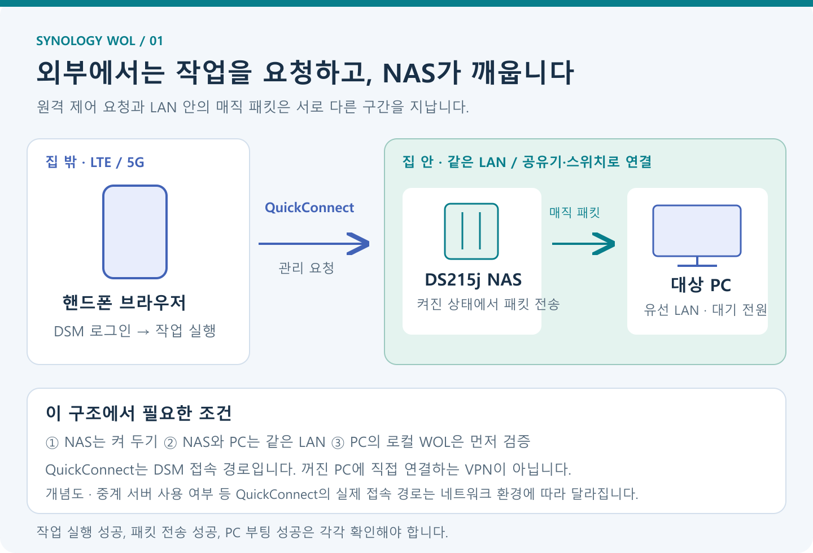
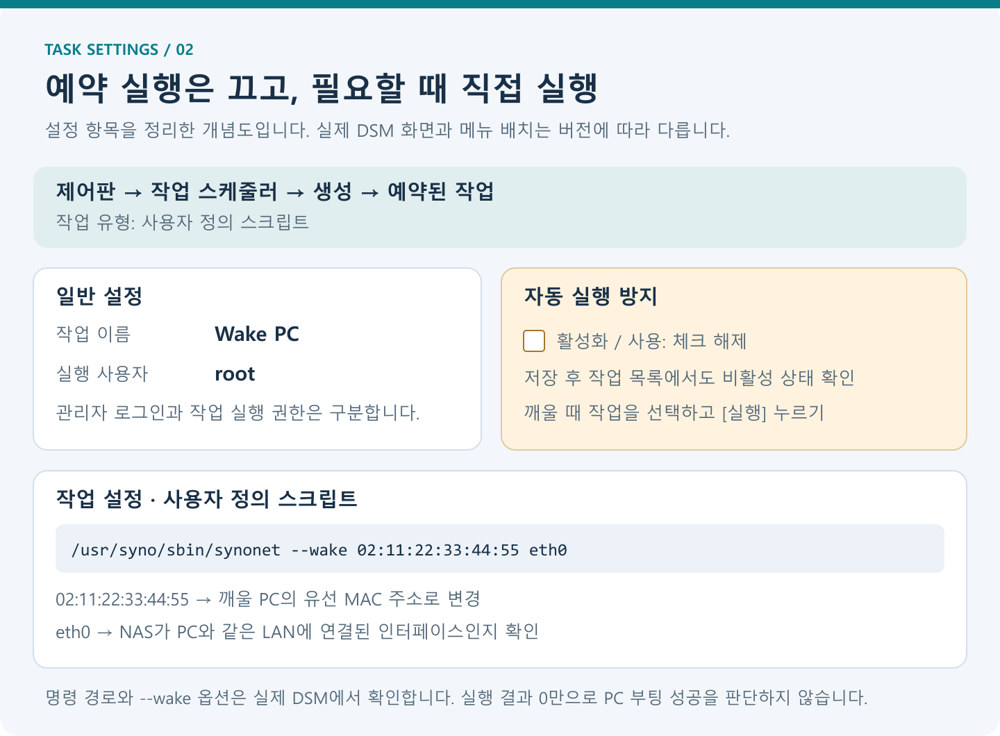
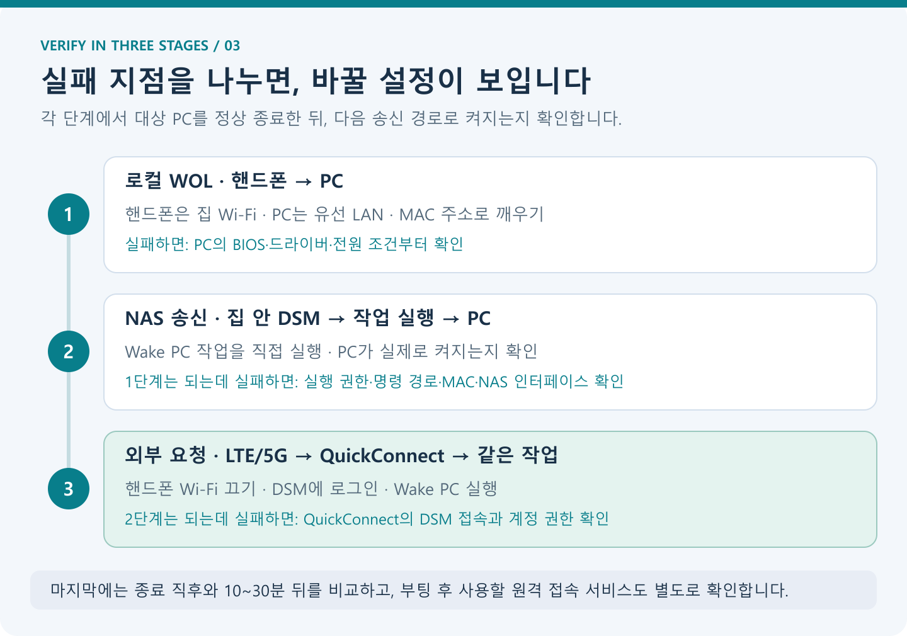

## 들어가며

같은 집 Wi-Fi에 연결한 핸드폰으로 PC를 켜는 데 성공했다. 이제 외출 중에도 켜고 싶은데, 핸드폰을 LTE나 5G로 바꾸면 기존 WOL 앱의 전송 버튼만으로는 동작하지 않는다. 집 안에서 보내던 매직 패킷이 인터넷을 통해 같은 방식으로 도착하지 않기 때문이다.

집에 **계속 켜 두는 시놀로지 NAS**가 있고, **QuickConnect로 DSM 관리 화면에 접속**할 수 있다면 다음 방법을 사용할 수 있다.

**핸드폰으로 NAS의 작업 실행을 요청하고, NAS가 같은 LAN의 PC에 매직 패킷을 보낸다.** PC를 켜기 위해 다른 PC를 한 대 더 켜 둘 필요가 없다.

이 글은 **DS215j + ipTIME A604R + 유선으로 연결한 Windows PC**를 구성 예로 사용한다. 내부 LAN에서 종료한 PC의 WOL 성공과 QuickConnect의 DSM 접속이 확인된 상황에서, **NAS 송신 작업을 추가하고 외부 동작을 검증하는 절차**를 정리했다. NAS 경유 전원 켜기를 이미 완료한 사용기로 서술하지는 않는다.

> 설명은 **2026년 11월 9일에 확인한 문서와 DSM 7 계열의 메뉴**를 기준으로 한다. DS215j의 다운로드 센터는 DSM 7.1 계열을 제공하므로, 다른 모델의 DSM 7.4 화면과 메뉴가 완전히 같다고 가정하지 않는다. 먼저 `제어판 → 정보 센터`에서 실제 DSM 버전을 확인하자. [DS215j 다운로드 센터](https://www.synology.com/en-eu/support/download/DS215j?version=7.1)
{: .prompt-info }

PC의 BIOS·Windows WOL 설정이 아직 끝나지 않았다면 [Wake-on-LAN 원리와 PC 설정 방법](/posts/wake-on-lan-setup-guide/)을 먼저 확인한다. 이 글은 **이미 되는 내부 WOL을 외부 요청과 연결하는 부분**에 집중한다.

## 문제 상황

다음과 같은 환경을 생각해 보자. 주소와 MAC은 모두 설명용 예시다.

| 장치·항목 | 예시 구성 | 역할 |
|---|---|---|
| 공유기 | ipTIME A604R, `192.168.0.1` | NAS와 PC가 연결된 LAN 제공 |
| NAS | Synology DS215j, `192.168.0.10` | 켜진 상태에서 매직 패킷 전송 |
| 대상 PC | `192.168.0.50` | 정상 종료 후 WOL로 켤 컴퓨터 |
| 대상 MAC | `02:11:22:33:44:55` | 대상 PC의 실제 유선 MAC으로 변경 |
| 핸드폰 | 집에서는 Wi-Fi, 외부에서는 LTE/5G | DSM 작업 실행 요청 |
| 외부 접속 | 기존 QuickConnect 주소 | NAS의 DSM 로그인 화면에 접속 |

핸드폰과 NAS의 역할을 구분하면 설정할 곳이 명확해진다.

- **핸드폰:** 인터넷을 통해 DSM에 로그인하고 작업을 실행한다.
- **NAS:** PC가 있는 LAN에서 깨우기 신호를 보낸다.
- **PC:** 대기 전원을 받는 유선 랜카드가 신호를 인식한다.

여기서 NAS와 PC의 평상시 IP 주소는 관리 화면과 원격 접속에 유용하지만, WOL 명령에서 대상을 지정하는 핵심 값은 **PC의 유선 MAC 주소**다.

## 원인 분석

### 1. QuickConnect로 매직 패킷을 직접 보내는 것은 아니다

QuickConnect는 지원되는 Synology 서비스에 접속하도록 연결 경로를 마련한다. DSM 관리 화면도 그 대상에 포함된다. 연결 환경에 따라 직접 연결이나 중계 경로 등이 사용될 수 있다. [QuickConnect Web Portal 설명](https://kb.synology.com/en-in/WP/Synology_QuickConnect_White_Paper/4)

이 글에서 QuickConnect를 통과하는 것은 **DSM 로그인과 작업 실행 요청**이다. NAS가 그 요청을 처리한 다음, 별도로 LAN 안에 매직 패킷을 보낸다. 따라서 QuickConnect가 일반적인 LAN 브로드캐스트나 임의의 UDP 프로그램을 그대로 중계해 준다고 이해하면 안 된다.



*원격 관리 요청 구간과 매직 패킷 전송 구간을 나눈 개념도다. 실제 패킷 캡처나 특정 QuickConnect 중계 서버의 배치를 나타내지는 않는다.*

### 2. NAS 자신의 WOL 설정과 PC를 깨우는 작업은 다르다

DSM의 `하드웨어 및 전원`에서 보이는 WOL 항목은 일반적으로 **NAS 자신이 깨우기 신호를 받는 기능**을 다룬다. 이 글에서 필요한 것은 NAS가 **다른 PC에 신호를 보내는 기능**이다.

그래서 NAS의 WOL 수신 체크박스를 찾는 대신 **작업 스케줄러에서 송신 명령을 실행**한다. NAS는 이미 켜져 있어야 한다. NAS까지 종료하면 QuickConnect에 접속해 작업을 실행할 수 없다.

### 3. DSM의 작업 실행 성공은 PC의 부팅 성공과 같지 않다

DSM은 작업을 시작하고 명령의 종료 상태를 보여 줄 수 있다. 하지만 명령이 오류 없이 끝났다는 사실만으로 PC가 부팅했다고 판단할 수는 없다.

다음 세 가지를 따로 확인해야 한다.

1. DSM이 작업을 실행했는가?
2. NAS의 올바른 LAN 인터페이스에서 깨우기 요청을 보냈는가?
3. 실제 PC가 켜지고 필요한 원격 서비스가 시작됐는가?

이 구분을 해 두면 WOL 문제와 원격 접속 프로그램의 문제를 섞지 않게 된다.

## 해결 방법

### 1. 준비 조건 확인하기

시작하기 전에 다음 조건을 맞춘다.

- **같은 LAN의 핸드폰에서 종료한 PC를 켤 수 있어야 한다.** 이미 확인했다면 PC 설정을 다시 바꾸지 않는다.
- NAS와 PC가 같은 LAN에 연결되어 있어야 한다. 게스트망·다른 VLAN의 장치라면 별도 네트워크 구성이 필요할 수 있다.
- NAS는 켜 두고 PC의 콘센트·파워서플라이 전원도 유지한다.
- DSM에 작업을 생성·실행할 수 있는 관리자 계정이 있어야 한다.
- QuickConnect로 **파일 목록뿐 아니라 DSM 관리 화면까지** 접속되는지 확인한다.

이 방법에서는 이미 작동하는 QuickConnect 연결을 사용한다. A604R의 VPN 서버나 WOL용 포트 포워딩을 추가하는 단계는 없다.

### 2. PC의 유선 MAC 주소 준비하기

가장 확실한 값은 **기존 핸드폰 WOL 앱에 입력해 실제 동작을 확인한 MAC 주소**다. 그 값을 그대로 사용하면 어댑터를 잘못 고를 가능성이 줄어든다.

Windows에서 다시 확인하려면 다음 명령을 실행한다.

```powershell
Get-NetAdapter -Physical |
    Format-Table Name, InterfaceDescription, Status, MacAddress
```

또는 다음 명령에서 연결된 이더넷 어댑터의 `물리적 주소`를 본다.

```powershell
ipconfig /all
```

아래 명령 예제의 `02:11:22:33:44:55`는 실제 장비의 주소가 아니다. **NAS의 MAC, Wi-Fi MAC, VPN 가상 어댑터의 MAC을 넣지 않도록 주의한다.**

### 3. DSM에 수동 실행용 작업 만들기

집 안에서 NAS의 내부 주소로 DSM에 접속한다. 예제 주소는 `https://192.168.0.10:5001`이지만 실제로 사용 중인 주소·HTTPS 설정을 따른다. 브라우저의 인증서 경고가 나오면 인증서와 접속 주소를 확인한다.

다음 메뉴에서 새 작업을 만든다.

```text
제어판 → 작업 스케줄러 → 생성
→ 예약된 작업 → 사용자 정의 스크립트
```

작업의 기본값은 다음과 같이 정한다.

| 항목 | 설정값 | 이유 |
|---|---|---|
| 작업 이름 | `Wake PC` | 목록에서 쉽게 찾기 |
| 실행 사용자 | `root` | NAS의 네트워크 도구 실행에 필요한 권한 확보 |
| 활성화·사용 | **체크 해제** | 예약 시간에 자동으로 PC가 켜지는 것 방지 |
| 실행 시점 | 작업 목록의 **실행** 버튼 | 원하는 때에만 호출 |

작업 스케줄러는 사용자 정의 스크립트와 수동 실행을 지원한다. 저장한 뒤에도 작업 목록의 활성화 상태를 확인한다. DSM의 번역·버전에 따라 체크박스 명칭은 조금 다를 수 있다. [Synology 작업 스케줄러 도움말](https://kb.synology.com/en-global/DSM/help/DSM/AdminCenter/system_taskscheduler?version=7)



*실제 DSM 화면을 복제한 이미지가 아니라, 입력할 항목을 정리한 설명용 도식이다.*

`root`는 **저장한 작업을 실행할 사용자**로 선택한다. DSM 로그인 계정을 root로 바꾸거나, SSH를 외부에 공개하는 절차는 아니다. 이 권한으로 실행할 스크립트에는 확인한 WOL 명령만 넣는다.

### 4. 명령 경로와 NAS 인터페이스 확인하기

아래에서 사용할 도구는 DSM의 네트워크 명령인 `synonet`이다. Synology의 CLI 가이드는 도구와 관리자 권한을 설명하지만, **그 문서에 모든 DSM 버전의 `--wake` 지원이 명시된 것은 아니다.** 해당 옵션은 실제 NAS의 도구와 실행 결과로 확인해야 한다. [Synology CLI 가이드](https://global.download.synology.com/download/Document/Software/DeveloperGuide/Firmware/DSM/All/enu/Synology_DiskStation_Administration_CLI_Guide.pdf)

새 작업의 `작업 설정 → 사용자 정의 스크립트`에 일단 다음 **조회용 명령**을 넣고 저장한 뒤 수동 실행하면, 경로와 인터페이스를 확인하는 데 도움이 된다.

```sh
id
ls -l /usr/syno/sbin/synonet
ls /sys/class/net
/usr/syno/sbin/synonet --help
```

이 명령들은 네트워크 주소나 설정을 변경하지 않는다. 도움말의 종료 코드는 도구마다 다를 수 있으므로, 마지막 코드만 보지 말고 출력 내용을 함께 읽는다. DSM의 실행 결과 저장 방법은 뒤에서 설명한다.

단일 LAN 포트 환경에서는 `eth0`를 먼저 확인한다. 다중 포트·본딩·가상 스위치 등을 쓰는 NAS에서는 이름을 단정하지 말고, **PC와 같은 LAN으로 나가는 인터페이스**를 확인한다. 인터페이스 목록에 `eth0`가 있다는 사실만으로 연결 상태까지 확인되는 것은 아니다.

명령 파일이 없거나 `--wake`가 지원되지 않는다면 그대로 다음 단계의 성공을 가정하지 않는다. 실제 DSM 버전과 도움말·오류 내용을 확인하고 송신 방법을 선택해야 한다.

### 5. WOL 명령 등록하고 집 안에서 시험하기

경로와 인터페이스가 맞으면 앞의 조회용 내용을 지우고 다음 명령으로 바꾼다.

```sh
/usr/syno/sbin/synonet --wake 02:11:22:33:44:55 eth0
```

각 부분의 의미는 다음과 같다.

| 부분 | 의미 |
|---|---|
| `/usr/syno/sbin/synonet` | 실행할 NAS 도구의 절대 경로 |
| `--wake` | 깨우기 요청에 사용하는 옵션 |
| `02:11:22:33:44:55` | **실제 대상 PC의 유선 MAC으로 변경** |
| `eth0` | NAS에서 사용할 LAN 인터페이스 |

`--wake`의 하이픈은 일반 문자 `-` 두 개다. 문서 편집기에서 길게 보이는 대시로 바뀌면 옵션이 인식되지 않을 수 있다. 이 명령 형태는 DSM 작업을 이용하는 WOL 프로젝트의 작성자 예제에서도 확인할 수 있지만, 그 프로젝트의 시험 환경을 DS215j의 검증 결과로 대신할 수는 없다. [작성자가 공개한 WOL 작업 예제](https://github.com/biaide/wake-on-lan-synology)

저장 후에는 다음 순서로 시험한다.

1. PC의 작업을 저장하고 Windows를 정상 종료한다.
2. 종료 전환이 끝나면, 집 안에서 DSM의 `Wake PC` 작업을 선택한다.
3. **활성화 체크박스가 아니라 `실행` 버튼**을 누른다.
4. 확인 창이 나오면 실행할 작업 이름을 확인하고 진행한다.
5. PC의 전원과 부팅 상태를 직접 확인한다.

이 단계가 성공하면 **NAS → PC의 내부 WOL 경로**가 동작하는 것이다. 실패한다면 아직 QuickConnect나 공유기 외부 설정을 바꿀 단계가 아니다.

### 6. LTE/5G에서 QuickConnect로 같은 작업 실행하기

NAS의 내부 시험이 성공했다면 외부 시험을 한다.

1. PC를 다시 정상 종료한다.
2. 핸드폰의 **집 Wi-Fi를 끄고 LTE/5G로 전환**한다.
3. 핸드폰 브라우저에서 기존 QuickConnect 주소를 연다. 예: `https://quickconnect.to/my-nas-id`.
4. DSM 관리자 계정으로 로그인한다.
5. `제어판 → 작업 스케줄러`에서 **같은 `Wake PC` 작업을 실행**한다.
6. PC가 켜졌는지 확인하고, 필요하다면 부팅 후 원격 접속까지 확인한다.

작은 화면에서 작업 스케줄러를 찾기 어렵다면 브라우저의 `데스크톱 사이트` 보기를 사용한다. 모바일 파일 앱의 화면에 DSM 제어판이 모두 보인다고 가정하지 말자.

이때 핸드폰의 기존 WOL 앱에서 집 안의 브로드캐스트 주소로 다시 전송하는 것이 아니다. **DSM의 실행 버튼으로 NAS가 보내게 하는 것**이 핵심이다.

### 7. QuickConnect 설정을 처음 확인하는 경우

이미 외부에서 DSM에 로그인할 수 있다면 이 단계는 넘어가도 된다. 새로 구성하거나 접속 범위를 확인할 때는 다음 위치를 본다.

```text
DSM 7 계열: 제어판 → 외부 액세스 → QuickConnect
DSM 6.2 이하: 제어판 → QuickConnect
```

QuickConnect 활성화 상태, 등록한 ID, 고급 설정의 DSM 접근 허용 범위를 확인한다. 직접 연결이 어려운 환경에서는 QuickConnect 중계 서비스가 연결에 사용될 수 있다. 단순히 파일 앱으로 접속되는지만 보지 말고, **LTE/5G에서 DSM 로그인과 작업 화면 접근까지** 확인한다. [Synology 외부 액세스 시작 안내](https://kb.synology.com/en-my/DSM/tutorial/Quick_Start_External_Access), [QuickConnect 설정 도움말](https://kb.synology.com/en-me/DSM/help/DSM/AdminCenter/connection_quickconnect)

기존 QuickConnect 연결이 되는 환경에서 이 작업 때문에 DSM·SSH·UDP 9번 포트를 추가로 외부에 열 필요는 없다. 사용하는 계정에는 강한 암호와 가능한 추가 인증을 적용하고, 접근 가능한 관리자 계정은 필요한 범위로 관리한다.

## 예제

### 실행 결과를 남기는 WOL 스크립트

한 줄 명령으로 동작을 확인한 뒤에는, 오류를 확인하기 쉬운 스크립트를 사용할 수 있다. 아래 예제는 **명령 존재 여부와 종료 코드**를 출력한다. 부팅 여부를 자동 판정하는 프로그램은 아니다.

[wake-pc.sh 다운로드](/assets/code/synology-wol/wake-pc.sh)

```sh
#!/bin/sh
# Replace the example values before running this task on a NAS.
MAC='02:11:22:33:44:55'
IFACE='eth0'
SYNONET='/usr/syno/sbin/synonet'

if [ "${1:-}" = '--dry-run' ]; then
    printf 'DRY RUN: %s --wake %s %s\n' "$SYNONET" "$MAC" "$IFACE"
    exit 0
fi

if [ ! -x "$SYNONET" ]; then
    printf 'ERROR: executable not found: %s\n' "$SYNONET" >&2
    exit 127
fi

printf 'Requesting WOL: MAC=%s interface=%s\n' "$MAC" "$IFACE"
"$SYNONET" --wake "$MAC" "$IFACE"
result=$?
printf 'synonet exit code: %s\n' "$result"
exit "$result"
```

`MAC`과 `IFACE`를 실제 환경에 맞춰 바꾼 뒤 **코드 전체를 작업 설정에 직접 붙여 넣어도 된다.** 파일로 보관한다면 기존 공유 폴더의 실제 경로에 저장하고, DSM 작업에는 다음처럼 지정한다.

```sh
/bin/sh /volume1/automation/wake-pc.sh
```

위의 `/volume1/automation/`은 예제 경로이며 자동으로 생성되지 않는다. 실제 볼륨·공유 폴더 이름과 파일 읽기 권한을 확인해야 한다. Synology는 작업 스크립트에 절대 경로를 사용하고, 사용자 파일은 시스템 파티션 대신 공유 폴더에 보관하도록 안내한다. [작업 스크립트 작성 팁](https://kb.synology.com/en-af/DSM/tutorial/common_mistake_in_task_scheduler_script)

스크립트 파일의 줄바꿈은 **LF**로 저장한다. Windows의 CRLF 때문에 `/bin/sh`가 명령을 잘못 읽는 상황을 피할 수 있다.

### 패킷을 보내지 않고 호출 내용만 확인하기

`--dry-run`을 주면 `synonet`을 실행하지 않고, 어떤 명령을 호출할지만 출력한다.

```sh
/bin/sh /volume1/automation/wake-pc.sh --dry-run
```

이 글 작성 중 같은 스크립트를 Windows의 Git Bash에서 dry run으로 실행해 확인한 **실제 출력**은 다음과 같다.

```text
DRY RUN: /usr/syno/sbin/synonet --wake 02:11:22:33:44:55 eth0
```

이 검증은 셸 문법과 인자 구성을 확인한 것이며, NAS의 도구 실행·실제 패킷 전송·DS215j의 PC 깨우기를 검증한 결과는 아니다. 또한 여기서 종료 코드가 0이어도 NAS에 해당 도구가 설치되어 있다는 뜻은 아니다. Dry run은 명령 존재 확인보다 먼저 끝나도록 작성했다.

실제로 사용할 때는 작업 명령에서 **`--dry-run`을 제거**한다.

## 결과 확인

### 세 단계로 나누어 확인하기



*어느 단계에서 실패했는지에 따라 확인할 설정을 좁힌다. 앞 단계가 성공한 상태라면 관련 없는 설정을 한꺼번에 바꾸지 않는다.*

| 시험 | 성공 기준 | 실패하면 먼저 확인 |
|---|---|---|
| 핸드폰 → PC, 집 Wi-Fi | 종료한 PC가 켜짐 | PC WOL 지원·BIOS·랜카드·대기 전원 |
| NAS → PC, 집 안 DSM | `Wake PC` 실행으로 PC가 켜짐 | 권한·명령 경로·대상 MAC·NAS 인터페이스 |
| 외부 핸드폰 → DSM → 같은 작업 | LTE/5G에서도 PC가 켜짐 | QuickConnect의 DSM 접근·계정 권한 |
| 부팅 후 원격 접속 | 사용할 서비스에 로그인 가능 | 서비스 자동 시작·방화벽·계정 권한 |

처음에는 종료 직후에 시험하고, 이후 **10~30분 기다린 뒤 같은 작업을 다시 실행**해 본다. 특정 시간이 보장 기준인 것은 아니다. 종료 직후에만 되는 문제나 대기 상태의 변화를 구분하기 위한 비교 시험이다.

### DSM의 실행 결과 보기

작업 스케줄러의 `설정`에서 **출력 결과 저장**을 켜고, 저장할 공유 폴더를 지정한다. 작업을 실행한 뒤 해당 작업의 `작업/동작 → 결과 보기`처럼 표시되는 메뉴에서 종료 상태와 출력을 확인한다. 정확한 번역과 표시 위치는 DSM 버전에 따라 다를 수 있다. [Synology 작업 실행 결과 안내](https://kb.synology.com/en-global/DSM/help/DSM/AdminCenter/system_taskscheduler?version=7)

예제 스크립트는 `synonet exit code:` 뒤에 도구의 종료 코드를 출력한다. 0이 아닌 값이면 출력된 오류를 함께 확인한다. **0이어도 실제 전원 켜기와 원격 접속은 별도 확인**한다.

NAS 내부 IP, QuickConnect 주소, 계정 이름 등이 결과에 포함될 수 있으니 오류 화면을 다른 사람에게 전달할 때는 필요한 부분만 공유한다.

## 실무 팁

### 흔한 실수

| 실수 | 해결 방향 |
|---|---|
| NAS 자신의 WOL 수신 기능을 켜는 것으로 끝냄 | PC에 보내는 송신 작업 생성 |
| 대상 MAC에 NAS의 주소를 입력 | 로컬 시험에 성공했던 PC의 유선 MAC 사용 |
| `eth0`를 PC의 인터페이스라고 이해 | NAS에서 패킷을 보낼 인터페이스임을 구분 |
| 예약 작업을 활성화한 채 저장 | 자동 실행을 끄고 수동 실행 상태 확인 |
| root를 고른 뒤 임의의 다운로드 명령까지 붙임 | 검토한 고정 WOL 명령만 실행 |
| 명령 출력의 하이픈이 `—wake`로 바뀜 | 일반 하이픈 두 개의 `--wake` 사용 |
| 파일 앱 접속 성공을 DSM 관리 접근 성공으로 판단 | 브라우저에서 제어판과 작업 스케줄러까지 확인 |
| dry run 출력을 부팅 성공으로 판단 | 실제 NAS 작업 실행과 PC 전원 확인 |

### 증상별 점검 방법

**명령 파일을 찾지 못한다면** 실제 DSM의 경로를 확인한다. 이 글의 경로가 모든 NAS·DSM 버전에 존재한다고 가정하지 않는다. 경로는 있는데 `--wake`를 거부한다면 도구의 옵션 지원을 확인한다.

**권한 오류가 난다면** DSM 로그인 계정뿐 아니라 작업의 실행 사용자를 확인한다. 일반 사용자의 권한을 광범위하게 늘리기보다, 관리자에게 해당 작업의 실행 구성을 확인받는 편이 명확하다.

**작업은 실행되지만 PC가 켜지지 않는다면** MAC 주소를 다시 비교하고, NAS의 송신 인터페이스와 같은 LAN 여부를 확인한다. VLAN·게스트망·다중 LAN 포트 환경에서는 단순히 주소 앞부분이 비슷하다는 것만으로 같은 브로드캐스트 영역이라고 판단하지 않는다.

**내부 NAS 시험은 되는데 외부에서 안 된다면** LTE/5G에서 DSM에 실제로 로그인되는지, 동일한 `Wake PC` 작업을 실행했는지 본다. QuickConnect 접속 단계에서 막혔다면 PC BIOS를 다시 바꾸는 것으로 해결되지는 않는다.

**부팅은 되는데 화면에 접속되지 않는다면** WOL과 원격 접속을 구분한다. 부팅 전 PIN 입력이나 원격 서비스 자동 시작·로그인 권한 등은 별도로 준비해야 한다.

### 주의사항

DS215j 같은 기존 NAS를 활용하는 목적은 작은 작업 하나로 내부 송신 장치를 마련하는 것이다. 이 글의 기본 절차는 새 Docker 컨테이너나 WOL 웹 서버를 설치하지 않는다. `synonet --wake`가 지원되는 실제 DSM에서 한 줄 명령부터 검증한다.

NAS가 종료되었거나 QuickConnect에 접속할 수 없는 상태라면 이 경로로 PC를 켤 수 없다. 예약 종료가 설정되어 있다면 사용 시간과 맞는지 확인한다. 디스크 대기 상태와 NAS 시스템 종료는 구분해야 한다.

명령 실행에 필요한 관리자 접근은 NAS의 파일과 설정에도 영향을 줄 수 있는 권한이다. HTTPS와 계정 보호 설정을 사용하고, 공개된 URL에서 인증 없이 작업을 실행하도록 임의의 API를 만들지는 않는다.

### 추천 명령어

NAS의 실제 상태를 확인할 때는 조회부터 시작한다.

```sh
id
ls -l /usr/syno/sbin/synonet
ls /sys/class/net
/usr/syno/sbin/synonet --help
```

준비가 끝나면 대상 PC의 실제 MAC과 확인한 NAS 인터페이스를 넣는다.

```sh
/usr/syno/sbin/synonet --wake 02:11:22:33:44:55 eth0
```

이 명령은 **NAS의 작업 스케줄러에서 실행할 명령**이다. Windows PowerShell에 그대로 넣거나, 꺼질 PC 자체에서 실행하는 것으로 대신할 수 없다.

## 마무리

### 핵심 요약

QuickConnect로 DSM에 접속할 수 있다면, NAS의 작업 스케줄러를 원격 WOL의 실행 지점으로 활용할 수 있다. 외부 핸드폰은 작업을 요청하고, NAS가 PC와 같은 LAN에 깨우기 신호를 보낸다. 로컬 WOL, NAS 송신, 외부 DSM 실행을 순서대로 확인하면 실패 지점을 찾기 쉽다.

### 언제 사용하면 좋은가

이미 켜 두는 NAS가 있고 필요할 때만 PC를 켜고 싶은 환경에 적합하다. 특히 기존 QuickConnect 접속이 마련되어 있다면, WOL용 외부 전달 경로를 새로 만드는 작업을 줄일 수 있다.

### 추가 학습 주제

다음 단계로는 부팅 후 원격 접속 서비스 자동 시작, 관리자 계정 접근 정책, 여러 PC의 작업 분리, 작업 실행 결과 관리 등을 살펴볼 수 있다. MAC 주소만 바꾸어 작업을 복제하더라도 각 PC의 전원 상태와 실제 깨우기를 따로 검증하자.

## 참고 자료

- [Synology: 작업 스케줄러](https://kb.synology.com/en-global/DSM/help/DSM/AdminCenter/system_taskscheduler?version=7)
- [Synology: 작업 스크립트 작성 팁](https://kb.synology.com/en-af/DSM/tutorial/common_mistake_in_task_scheduler_script)
- [Synology: 외부 액세스 시작 안내](https://kb.synology.com/en-my/DSM/tutorial/Quick_Start_External_Access)
- [Synology: QuickConnect 설정](https://kb.synology.com/en-me/DSM/help/DSM/AdminCenter/connection_quickconnect)
- [Synology: QuickConnect Web Portal의 동작](https://kb.synology.com/en-in/WP/Synology_QuickConnect_White_Paper/4)
- [Synology: DS215j 다운로드 센터](https://www.synology.com/en-eu/support/download/DS215j?version=7.1)
- [Synology: CLI Administrator Guide](https://global.download.synology.com/download/Document/Software/DeveloperGuide/Firmware/DSM/All/enu/Synology_DiskStation_Administration_CLI_Guide.pdf)
- [WOL 작업 명령의 작성자 예제: wake-on-lan-synology](https://github.com/biaide/wake-on-lan-synology)
- [관련 글: Wake-on-LAN 원리와 PC 설정 방법](/posts/wake-on-lan-setup-guide/)
