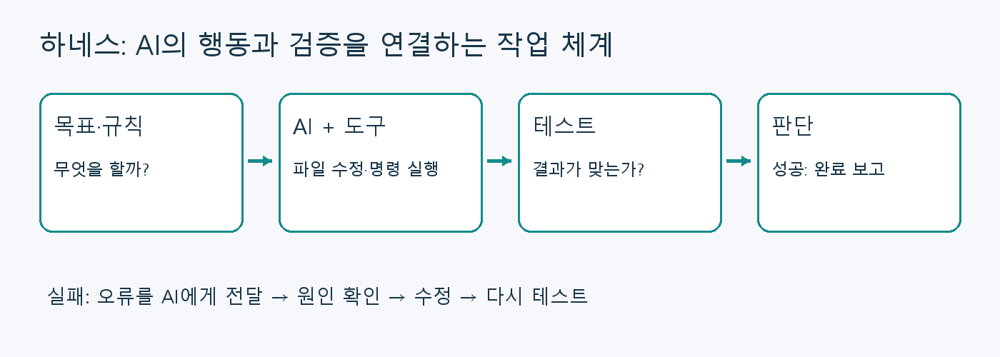
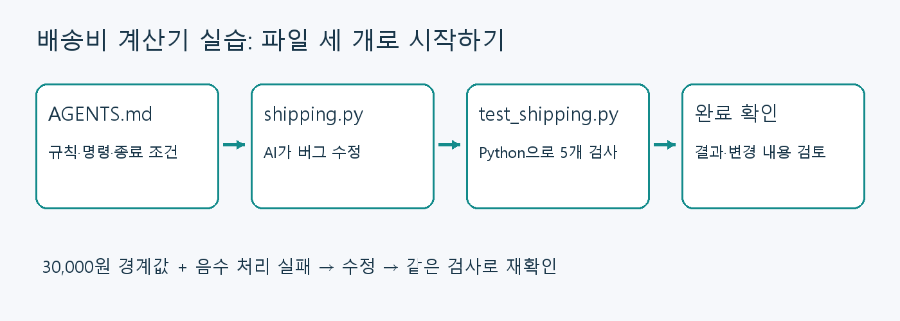

## AI에게 일을 맡겼는데, 왜 끝까지 확인하지 않을까?

AI에게 “배송비 계산기를 만들어 줘”라고 부탁했다. 코드는 금방 나왔다. 그런데 정확히 3만 원을 주문했을 때 배송비가 잘못 계산된다. “테스트도 해 줘”라고 다시 말하니 그제야 문제가 드러난다.

다른 날 새 대화에서 수정을 부탁하면 또 설명해야 한다. 어떤 파일을 고쳐야 하는지, 테스트 명령은 무엇인지, 어디까지 해야 완료인지가 대화 속에만 있었기 때문이다.

**하네스 엔지니어링은 AI가 이런 일을 반복해서 제대로 수행하도록 주변 작업 체계를 설계하고 개선하는 일**이다. 이 글에서는 파일을 읽고 코드를 수정하며 명령을 실행하는 **코딩 에이전트**를 중심으로 설명한다.

가장 궁금한 질문부터 답하면, **가이드 Markdown 파일은 좋은 출발점이지만 그 파일 하나가 실행·검증까지 해 주지는 않는다.** 작은 작업에서는 기존 에이전트 도구에 짧은 지침과 테스트를 연결하는 것으로 충분히 시작할 수 있다.

## 하네스란 무엇인가?

영어 harness에는 장비를 연결하고 제어하는 장치라는 뜻이 있다. AI 분야에서는 대체로 **모델이 도구를 사용하고, 그 결과를 받아 다음 행동을 결정하며, 작업 상태를 이어 가게 하는 실행 체계**를 가리킨다. 문맥에 따라 좁게는 에이전트 실행 프로그램, 넓게는 그 프로그램을 둘러싼 지침·검증·환경 설계까지 포함한다. 하나의 필수 파일 형식이나 특정 제품 이름으로 생각할 필요는 없다.

요리사를 AI 모델이라고 생각해 보자. 레시피만 전달하는 것과, 재료·주방·조리 도구·맛을 확인할 기준까지 준비하는 것은 다르다. 실수가 생기면 어느 단계에서 생겼는지도 알아야 한다.

코딩에서는 다음 요소가 그 역할을 한다.

| 요소 | 초보자를 위한 의미 | 예시 |
|---|---|---|
| 목표 | 무엇을 완성해야 하는가 | 배송비 계산 함수 |
| 문맥과 규칙 | 무엇을 알고 지켜야 하는가 | 금액 단위, 수정할 파일, 프로젝트 지침 |
| 도구와 실행 환경 | 실제로 어떻게 행동하는가 | 파일 편집기, 터미널, Python |
| 피드백 | 결과가 맞는지 어떻게 아는가 | 테스트 실패 메시지, 실행 결과 |
| 반복과 종료 | 실패하면 무엇을 하고 언제 끝내는가 | 수정 후 재검사, 반복 실패 시 중단 |
| 상태와 권한 | 무엇을 기억하고 어디까지 할 수 있는가 | 진행 기록, Git 이력, 쓰기 허용 범위 |


_테스트 결과가 다음 행동의 입력으로 돌아오는 연결이 중요하다._

Anthropic은 장시간 작업에서 다음 세션이 이전 진행을 이어 가도록 초기 환경, 기능 목록, 진행 기록, 검증 절차를 준비한 사례를 소개한다. **아래 실습은 그 제품을 재현한 것이 아니라, 실행 결과를 다음 수정에 연결하는 원리를 작게 연습하는 예제다.** [장시간 에이전트의 하네스 설계 사례](https://www.anthropic.com/engineering/effective-harnesses-for-long-running-agents)

## 프롬프트, 문맥, 하네스는 어떻게 다를까?

세 용어는 겹치는 부분이 있다. 입문 단계에서는 개선하려는 대상을 기준으로 구분하면 편하다.

| 관점 | 주로 바꾸는 것 | 배송비 예시 |
|---|---|---|
| 프롬프트 엔지니어링 | 요청 문장 | “3만 원 이상이면 무료 배송으로 구현해 줘” |
| 문맥 엔지니어링 | 모델에게 제공할 정보 | 기존 함수, 요금 정책, 관련 문서 제공 |
| 하네스 엔지니어링 | 행동·검증·복구가 돌아가는 구조 | 파일 수정 → 테스트 실행 → 실패 원인 확인 → 재수정 |

좋은 프롬프트를 작성하는 것도 필요하다. 여기에 **모델이 실행 결과를 직접 확인할 수 있는 연결**을 더하면 사람이 매번 결과를 복사해서 알려 주는 수고를 줄일 수 있다.

## 그렇다면 AGENTS.md만 만들면 될까?

`AGENTS.md`는 코딩 에이전트에게 프로젝트 규칙을 알려 주는 Markdown 파일이다. Codex는 시작할 때 정해진 탐색 규칙으로 이 파일을 읽으며, 전역·프로젝트·하위 경로 지침이 함께 적용될 수 있다. 임의로 만든 `guide.md`가 같은 방식으로 자동 적용된다고 가정하면 안 된다. 다른 도구에서는 지원 파일 이름과 적용 범위를 확인해야 한다. [공식 지침 파일 문서](https://learn.chatgpt.com/docs/agent-configuration/agents-md)

다음 문장을 적었다고 생각해 보자.

```markdown
변경한 코드는 반드시 테스트한다.
```

여기에는 아직 빈칸이 많다. 테스트는 어디에 있는가? 무엇을 실행하는가? Python이 설치되어 있는가? 에이전트가 터미널에 접근할 수 있는가? 실패하면 어떻게 처리하는가?

이를 다음처럼 구체화할 수 있다.

```markdown
프로젝트 루트에서 다음 명령을 실행한다.
python -m unittest discover -s . -p "test_*.py" -v
실패하면 원인을 고치고 다시 실행한다.
같은 원인으로 두 번 수정해도 실패하면 멈추고 원인을 보고한다.
```

이 지침과 함께 **실제 테스트 파일, Python 환경, 명령 실행 도구**가 있어야 흐름이 작동한다. 기존 코딩 에이전트가 도구 호출과 반복 실행을 제공한다면, 우리는 그 위에 프로젝트 규칙과 검증을 연결하면 된다. 처음부터 AI 실행 프로그램을 직접 만들 필요는 없다.

또한 지침에 “비밀 파일을 읽지 마”라고 쓰는 것과 실제 접근을 차단하는 것은 다르다. 필요한 제한은 실행 도구의 권한·샌드박스·계정 설정으로 적용해야 한다. Markdown은 행동 안내이며 운영체제 접근 제어를 대신하지 않는다.

## 실전: 배송비 계산기로 작은 하네스 구성하기

### 1. 목표와 완료 조건을 먼저 정한다

연습에는 Python 3와 파일 편집·터미널 실행이 가능한 코딩 에이전트가 필요하다. 패키지 추가 설치나 별도 API 키는 예제 코드 실행에 필요하지 않다. 에이전트 자체의 설치·로그인은 사용하는 제품 안내를 따른다.

만들 함수는 `shipping_fee(amount)`다. 입력은 **원 단위 정수**라고 가정하며, 정수가 아닌 입력의 처리는 이번 범위에서 제외한다.

| 주문 금액 | 기대 결과 |
|---|---|
| 0원 | 배송비 3,000원 |
| 29,999원 | 배송비 3,000원 |
| 30,000원 | 배송비 0원 |
| 30,001원 | 배송비 0원 |
| 음수 | `ValueError` 발생 |

“잘 만들어 줘”를 **확인 가능한 다섯 조건**으로 바꾼 것이다. 통과 기준은 사람이 먼저 검토한다. 테스트 자체가 잘못되어 있으면 그 테스트를 통과한 코드도 잘못될 수 있다.

### 2. 연습 폴더와 지침을 만든다

다른 프로젝트와 분리된 새 폴더를 만든다. 아래 명령은 PowerShell 기준이며 이후 명령은 이 폴더 안에서 실행한다.

```powershell
mkdir harness-demo
cd harness-demo
python --version
```

Windows에서 `python` 명령이 없다면 설치 상태를 확인한다. `py -3`로 실행 가능한 환경이라면 이 글의 `python`을 `py -3`로 바꿔 사용할 수 있다.

다음 구조로 파일을 준비한다.

```text
harness-demo/
├── AGENTS.md
├── shipping.py
└── test_shipping.py
```

`AGENTS.md` 내용은 다음과 같다.

```markdown
# 배송비 계산기 작업 규칙

- Python 표준 라이브러리만 사용한다.
- 제품 코드는 shipping.py, 검증 코드는 test_shipping.py에 둔다.
- 금액은 원 단위 정수다. 음수는 ValueError로 처리한다.
- 30,000원 이상은 무료 배송, 미만은 3,000원이다.
- 변경 전후에 python -m unittest discover -s . -p "test_*.py" -v 를 실행한다.
- 테스트를 약화하거나 지워서 통과시키지 않는다. 요구 변경은 사용자와 확인한다.
- 실패 원인을 확인하고 수정한다. 같은 원인으로 두 번 수정해도 실패하면 멈추고 보고한다.
- 완료 보고에는 변경 파일, 실행 명령, 결과, 남은 한계를 적는다.
- 커밋과 외부 배포는 이 연습의 범위에 포함하지 않는다.
```

이 파일을 만든 **연습 폴더를 작업 폴더로 선택해 새 에이전트 세션을 시작**한다. 지침을 수정했다면 새 세션에서 다시 적용되는지 확인한다. 처음에는 “현재 적용된 프로젝트 지침과 테스트 명령을 알려 줘”라고 요청해 경로를 확인하면 좋다.

### 3. 일부러 틀린 코드와 테스트를 준비한다

`shipping.py`에 아래 코드를 저장한다. `>`와 `>=`의 차이를 확인하기 위해 의도적으로 경계값 오류를 넣었다.

```python
def shipping_fee(amount):
    return 0 if amount > 30000 else 3000
```

`test_shipping.py`에는 다음을 저장한다.

```python
import unittest

from shipping import shipping_fee


class ShippingTests(unittest.TestCase):
    def test_below_threshold(self):
        self.assertEqual(shipping_fee(29999), 3000)

    def test_at_threshold(self):
        self.assertEqual(shipping_fee(30000), 0)

    def test_above_threshold(self):
        self.assertEqual(shipping_fee(30001), 0)

    def test_zero(self):
        self.assertEqual(shipping_fee(0), 3000)

    def test_negative(self):
        with self.assertRaises(ValueError):
            shipping_fee(-1)


if __name__ == "__main__":
    unittest.main()
```

아래 명령을 직접 실행해 본다.

```powershell
python -m unittest discover -s . -p "test_*.py" -v
```

이 글의 코드를 로컬에서 검사하면 **5개 중 2개가 실패**한다. 정확히 30,000원일 때 배송비가 붙고, 음수 입력에서 예외가 발생하지 않기 때문이다. 실패는 이 실습에서 의도한 출발 상태다.

### 4. 에이전트에게 작업을 맡긴다

연습 폴더를 연 코딩 에이전트에 다음 요청을 보낸다.

```text
AGENTS.md를 읽고 배송비 계산기의 버그를 수정해 줘.
먼저 기존 테스트를 실행해서 실패를 확인해 줘.
요구사항과 테스트를 약화하지 말고 shipping.py를 수정한 뒤 다시 검사해 줘.
완료하면 변경 파일, 실행한 명령, 테스트 결과를 알려 줘.
```

도구의 권한 요청이 표시되면 대상 명령과 작업 폴더를 확인한다. 테스트 명령을 실행할 수 없는 환경에서는 에이전트가 코드만 제안할 수도 있다. 이때는 실행 가능한 로컬 환경을 연결하거나 사람이 명령을 실행해 결과를 돌려줘야 한다.

여기서 기대하는 작업 순서는 다음과 같다. **에이전트 제품에서 얻은 실제 대화 로그가 아니라 따라야 할 흐름 예시**다.

1. 지침과 파일을 읽는다.
2. 테스트를 실행해 두 실패를 확인한다.
3. 경계값 비교와 음수 처리를 고친다.
4. 같은 테스트 명령을 다시 실행한다.
5. 실제 결과와 변경 내용을 보고한다.


_문서만 읽고 끝내지 않고, 터미널 결과를 확인하는지 관찰한다._

### 5. 수정 결과를 사람이 확인한다

다음은 다섯 조건을 통과하는 구현이다.

```python
def shipping_fee(amount):
    """Return shipping fee in KRW for a non-negative integer subtotal."""
    if amount < 0:
        raise ValueError("amount must be non-negative")
    return 0 if amount >= 30000 else 3000
```

작성 과정에서 이 구현과 위 테스트를 로컬 Python으로 실행해 **5개 모두 통과하는 것을 확인했다.** 독자의 에이전트 실행이 자동으로 같은 결과를 낸다는 뜻은 아니다. 명령 출력에서 검사 개수가 5개인지, 마지막에 `OK`가 나오는지 직접 확인한다.

```text
Ran 5 tests ...

OK
```

위 표시는 소요 시간을 생략한 결과 형식이다. “테스트했다”는 설명만 읽지 말고 **실행 명령, 종료 결과, 실제 검사 개수**를 함께 확인하자. `Ran 0 tests`는 검증 성공으로 보지 않는다.

연습을 마친 뒤 `git diff` 등으로 테스트가 지워지지 않았는지도 살펴본다. 이 다섯 테스트는 배송비 규칙을 확인하며, 모든 입력 형식이나 실제 쇼핑몰 통합 동작까지 보장하지는 않는다.

### 예제 파일 내려받기

아래 파일은 **수정 완료 버전**이다. 실패부터 실습하려면 `shipping.py`를 앞의 두 줄짜리 오류 코드로 바꾼다. 지침 파일이므로 연습 전용 폴더에 저장한다.

- [AGENTS.md](/assets/code/harness-engineering/AGENTS.md)
- [shipping.py](/assets/code/harness-engineering/shipping.py)
- [test_shipping.py](/assets/code/harness-engineering/test_shipping.py)

## 방금 무엇이 하네스였을까?

배송비 계산 함수 자체가 하네스는 아니다. 함수는 작업 대상이다. `AGENTS.md`는 행동 안내, 테스트는 판정 기준, Python과 터미널은 실행 환경이다. **이것들을 에이전트가 사용할 수 있게 연결하고 실패 결과를 다음 행동에 반영하도록 만든 전체 구성이 작은 하네스 설계**다.

이 실습에서는 기존 에이전트의 실행 기능을 활용했다. 직접 개발한다면 다음과 같은 흐름을 프로그램으로 구현하게 된다. 아래는 실행 코드가 아닌 개념도다.

```text
목표·규칙·현재 상태를 모델에 전달
반복 횟수·시간·비용 한도 안에서:
    모델이 다음 행동을 선택
    실행 프로그램이 도구 호출 권한을 확인하고 실행
    도구 결과와 오류를 모델에게 전달
    완료 조건을 검사
    성공하면 종료, 복구 불가능하거나 한도에 도달하면 중단·보고
```

테스트 명령을 반복 실행하는 셸 스크립트만으로는 AI가 실패를 해석하고 코드를 고치는 과정이 생기지 않는다. 모델의 판단과 도구 결과가 오가도록 연결하는 실행 주체가 필요하다. 반대로 단순한 반복 작업은 AI 없이 일반 스크립트로 처리하는 것이 더 간단할 수 있다.

## 실제 프로젝트에서는 무엇을 더 붙일까?

작업이 커질 때 발견한 문제에 맞춰 한 가지씩 추가하면 된다.

| 반복해서 생기는 문제 | 추가할 장치 |
|---|---|
| 매번 테스트 실행 방법을 찾는다 | 짧은 루트 지침과 실행 명령 통일 |
| 테스트는 통과하지만 화면이 깨진다 | 실제 사용자 흐름을 확인하는 브라우저 검사 |
| 새 세션에서 같은 일을 다시 한다 | 완료·미완료 항목, 검사 결과, 다음 행동을 남기는 진행 기록 |
| 검사를 생략한 코드가 합쳐진다 | CI 필수 검사와 보호 브랜치 설정 |
| 수정이 끝없이 반복된다 | 실행 시간·횟수·비용 한도와 중단 조건 |
| 필요 없는 파일까지 변경한다 | 작업 범위 명시와 실제 쓰기 권한 제한 |

CI는 변경 후 정해진 검사를 자동 실행하는 시스템이다. **CI 결과를 에이전트가 읽고 수정에 활용하도록 연결하면** 피드백 경로를 늘릴 수 있다. 검사를 필수 통과 조건으로 삼으려면 저장소 설정도 필요하다. 지침에 “테스트 필수”라고 적는 것만으로 병합이 차단되지는 않는다.

긴 작업의 진행 기록은 “많이 작업함”보다 아래처럼 남겨야 다음 작업자가 이어받기 쉽다. 파일 이름은 팀이 정하면 되고, 특별한 자동 로딩 기능을 가정하지 않는다. 시작 지침에서 이 파일을 읽도록 연결한다.

```markdown
## 현재 상태
- 완료: 정수 금액에 대한 배송비 계산
- 검증: unittest 5개 통과
- 미완료: 정수가 아닌 입력의 정책 결정
- 다음 행동: 입력 정책을 사용자와 확인한 뒤 테스트 추가
```

## 처음 만들 때 자주 막히는 부분

**지침을 읽지 않는다.** 파일 이름과 작업 폴더를 확인한다. 지원하지 않는 이름이면 요청에서 읽을 파일을 명시한다. 지침 적용을 확인할 때는 에이전트의 설명뿐 아니라 실제 작업 행동도 살펴본다.

**테스트 명령이 실패한다.** 함수 버그인지 환경 문제인지 구분한다. `ModuleNotFoundError`라면 실행 위치와 파일 이름부터 확인한다. 이 예제에서는 세 파일을 같은 폴더에 두고 실행한다.

**실패를 없애려고 테스트를 바꾼다.** 요구사항과 테스트 변경 내역을 확인한다. 실제 프로젝트에서는 코드 리뷰와 CI로 검증 기준도 함께 관리한다.

**문서가 너무 길어진다.** 자주 필요한 작업 규칙과 명령을 지침에 남기고, 세부 설계는 별도 문서로 옮겨 링크한다. 예전 명령을 그대로 둔 지침은 오히려 잘못된 작업을 반복시킬 수 있다.

**“완료”라는 답변을 믿었는데 결과가 다르다.** 완료 조건을 테스트·실행 결과·산출물 확인으로 바꾼다. 실행하지 못한 검사는 미검증으로 남기게 한다.

## 오늘 시작한다면 이 정도면 된다

작은 기능 하나를 고르고, 완료 조건을 정한 다음, **짧은 지침 + 실행 가능한 테스트 + 결과를 보고 수정하는 에이전트**를 연결해 보자. 첫 목표는 거대한 자동화 시스템을 만드는 것이 아니다. 같은 실패가 다시 발생하지 않도록 작업 환경을 조금씩 개선하는 것이다.

“가이드 md 파일만 만들면 되나요?”에 대한 답도 여기에 있다. 기존 도구가 실행 기능을 제공한다면 가이드 파일 추가가 첫 작업이 될 수 있다. 그다음에는 **그 지침이 실제로 읽히고, 명령이 실행되며, 실패가 수정으로 이어지고, 확인 가능한 기준으로 끝나는지**를 확인해야 한다.
