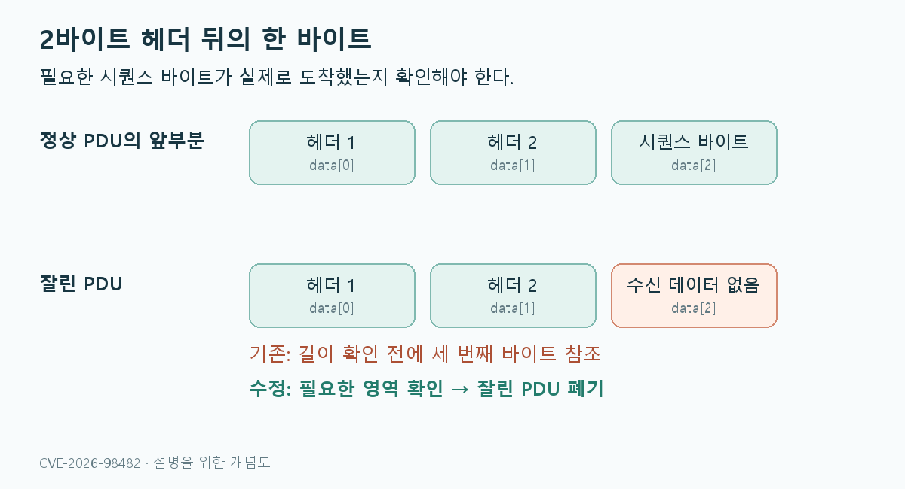
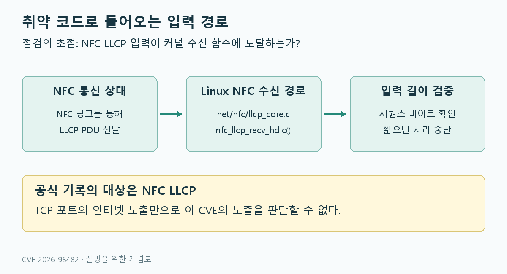
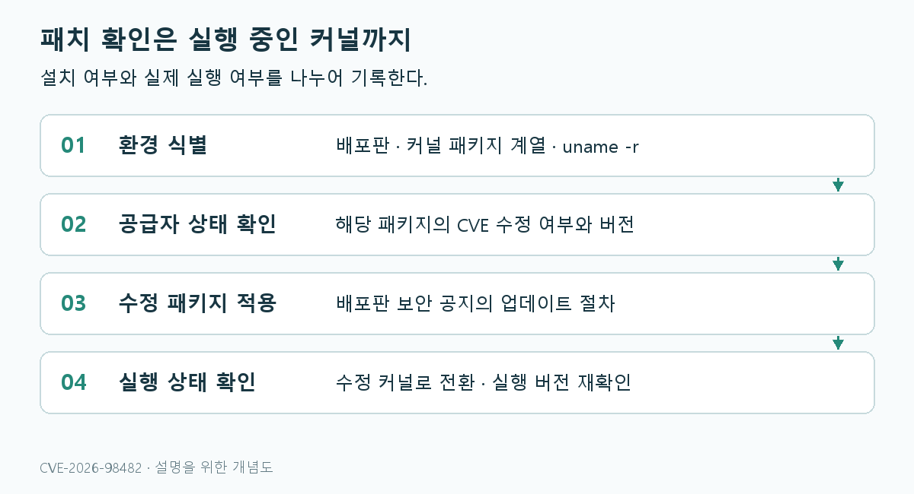

*상단 대표 이미지는 글의 핵심을 요약한 AI 생성 손그림 개념 삽화다.*

## CVE-2026-98482는 어떤 취약점인가

**CVE-2026-98482는 리눅스 커널에서 잘린 NFC LLCP 패킷을 처리할 때 발생하는 취약점이다.** 필요한 데이터가 도착했는지 확인하기 전에 값을 읽는 것이 원인이다. Ubuntu 공식 공지는 문제 함수를 `nfc_llcp_recv_hdlc()`로 명시한다. TCP 취약점과는 대상 프로토콜과 입력 경로가 다르므로, 점검도 NFC 기능을 중심으로 진행해야 한다. ([Ubuntu 보안 공지](https://ubuntu.com/security/CVE-2026-98482))

이 글은 **2026년 11월 12일 기준**으로 공개 자료를 확인해 작성했다. 취약점 재현이나 공격 성공을 직접 시험한 글은 아니며, 공식 설명과 운영자가 확인할 항목을 연결해 정리한다.

| 구분 | 확인된 내용 |
|---|---|
| CVE | CVE-2026-98482 |
| 대상 | Linux kernel의 NFC LLCP |
| 공개일 | 2026년 10월 18일 |
| 핵심 문제 | 짧은 패킷에서 초기화되지 않은 메모리 바이트를 읽음 |
| Ubuntu 우선순위 | Medium |

공개일·분류·대상 설명은 [Ubuntu의 해당 CVE 기록](https://ubuntu.com/security/CVE-2026-98482)을 기준으로 한다.

## 어떤 코드에서 문제가 발생했나

LLCP는 NFC 통신에서 사용하는 Logical Link Control Protocol이다. 문제가 있는 파일은 `net/nfc/llcp_core.c`이며, 수신 함수가 시퀀스 바이트를 읽기 전에 필요한 길이를 검증하지 않았다. ([Linux 커널 CVE 팀 공지](https://lists.openwall.net/linux-cve-announce/2026/10/18/44))

수신 경로가 보장하는 것은 2바이트 헤더까지다. 그런데 I·RR·RNR PDU 처리에서는 `skb->data[2]`, 즉 세 번째 바이트를 참조한다. 2바이트만 들어온 패킷이라면 이 값은 유효한 시퀀스 바이트가 아니라 초기화되지 않은 `skb` 여유 공간의 값일 수 있다. 이 값이 N(R)·N(S) 처리에 사용된다. ([Ubuntu의 원인 설명](https://ubuntu.com/security/CVE-2026-98482))


_바이트 관계를 단순화한 개념도이며 실제 메모리 배치를 재현한 그림은 아니다._

수정은 `pskb_may_pull()`로 필요한 영역이 존재하고 선형 영역에서 접근 가능한지 확인한 뒤 읽도록 하는 것이다. 잘린 PDU는 버린다. 공식 설명은 정상 PDU도 시퀀스 값을 지정할 수 있다는 점을 들어, 이번 결함이 공격자에게 새로운 값 제어 능력을 제공하는 것은 아니라고 구분한다. 따라서 이 설명만으로 임의 코드 실행이나 메모리 유출이 입증됐다고 볼 수는 없다. ([Linux 커널 CVE 팀의 수정 설명](https://lists.openwall.net/linux-cve-announce/2026/10/18/44))

## TCP 서버의 인터넷 노출과는 어떻게 다른가

Amazon Linux는 이 CVE에 대해 CVSS v3.1 **4.3, Medium**을 제시한다. 벡터는 다음과 같다. ([Amazon Linux 보안 기록](https://explore.alas.aws.amazon.com/CVE-2026-98482.html))

```text
CVSS:3.1/AV:A/AC:L/PR:N/UI:N/S:U/C:N/I:N/A:L
```

이 평가에서 `AV:A`는 인접 공격 경로, `A:L`은 낮은 가용성 영향을 뜻한다. 기밀성·무결성 영향은 각각 `C:N`, `I:N`이다. 이는 해당 공급자의 평가이며 모든 배포판에 동일한 판정을 강제하는 점수는 아니다.

이 CVE를 점검할 때는 **외부 입력이 NFC LLCP 수신 경로에 도달하는 환경인지**를 살펴봐야 한다. TCP 포트가 인터넷에 열려 있다는 사실만으로 이 결함의 노출을 입증할 수는 없다. 반대로 서버라는 이유만으로 NFC 관련 설정을 확인하지 않고 비영향이라고 단정해서도 안 된다. 이 판단은 공식 기록에 나온 대상 서브시스템과 공격 벡터를 운영 환경에 적용한 것이다. ([Amazon Linux의 대상·벡터](https://explore.alas.aws.amazon.com/CVE-2026-98482.html))


_NFC LLCP 입력 경로를 표현한 개념도다._

## 수정 버전과 배포판 패키지를 구분하기

커널 CVE 팀의 최초 공지에 기재된 수정 버전은 다음과 같다. 이 표는 현재 지원되는 커널 목록을 뜻하지 않는다. ([Linux 커널 CVE 팀의 버전 목록](https://lists.openwall.net/linux-cve-announce/2026/10/18/44))

| 업스트림 계열 | 수정 버전 |
|---|---|
| 5.10 | 5.10.271 |
| 5.15 | 5.15.222 |
| 6.1 | 6.1.189 |
| 6.6 | 6.6.158 |
| 6.12 | 6.12.112 |
| 6.18 | 6.18.55 |
| 7.2 | 7.2.9 |
| 개발 버전 | 7.3-rc5 |

**배포판 커널은 공급자의 보안 추적 결과로 판단해야 한다.** 보안 수정이 기존 버전 계열에 백포트되므로, `uname -r`의 앞부분을 이 표와 숫자로만 비교하면 잘못 판단할 수 있다.

예를 들어 Ubuntu 기록의 `linux` 패키지는 22.04 LTS에서 `5.15.0-202.212`를 수정 버전으로 제시한다. 같은 기록에서도 HWE·클라우드 커널은 별도 행으로 관리된다. `work in progress`는 수정 완료와 구분해서 읽어야 한다. ([Ubuntu 패키지별 상태](https://ubuntu.com/security/CVE-2026-98482))

Amazon Linux는 확인 시점에 표에 나열한 Amazon Linux 2·2023 커널 패키지를 `Not Affected`로 표시한다. 이를 다른 배포판이나 임의의 자체 빌드 커널에까지 일반화해서는 안 된다. ([Amazon Linux 패키지별 상태](https://explore.alas.aws.amazon.com/CVE-2026-98482.html))

## 운영 환경에서 확인할 순서


_업데이트 설치와 실행 커널 전환을 구분하는 점검 흐름이다._

### 1. 실행 중인 커널과 배포판 기록

다음은 대상 Linux 장비에서 실행하는 읽기 전용 명령이다.

```bash
uname -r
cat /etc/os-release
```

Ubuntu·Debian 계열에서는 설치된 커널 패키지를 함께 확인할 수 있다.

```bash
dpkg-query -W 'linux-image*'
```

설치 목록에는 사용하지 않는 과거 커널도 포함될 수 있다. **현재 부팅된 커널**, 설치된 패키지 버전, 공급자 공지의 패키지 계열을 함께 대조한다. Ubuntu라면 일반 커널인지 HWE·AWS·Azure 등 별도 계열인지도 기록한다.

### 2. NFC 기능과 장치 확인

커널 설정 파일과 sysfs가 제공되는 시스템에서는 다음을 참고할 수 있다.

```bash
# 실행 중인 커널의 설정 파일이 제공되는 경우
grep '^CONFIG_NFC' "/boot/config-$(uname -r)"

# 현재 로드된 NFC 관련 모듈 확인
lsmod | grep -i nfc

# 커널에 등록된 NFC 장치 확인
ls /sys/class/nfc/
```

설정 파일·경로가 없거나 권한이 제한된 환경에서는 명령이 실패할 수 있다. `lsmod` 결과가 비어 있어도 커널에 내장된 기능까지 배제하지는 못한다. 이 명령들은 조사 단서이며, 취약점 유무를 자동 판정하는 스캐너가 아니다.

### 3. 공급자 업데이트 적용과 부팅 확인

해당 배포판의 보안 공지에서 수정 패키지와 설치 절차를 확인한다. 패키지 업데이트 뒤에는 조직의 운영 절차에 따라 수정된 커널로 전환하고, 일반적인 재부팅 방식이라면 다시 `uname -r`로 실행 버전을 확인한다.

라이브 패치를 이용한다면 서비스가 활성화돼 있다는 사실 외에 **이번 CVE의 적용 대상 여부와 적용 결과**까지 확인해야 한다. 컨테이너 환경에서는 컨테이너 내부 패키지와 호스트 커널을 구분해 점검한다.

## 실무에서 남겨야 할 점검 결과

점검 기록에는 다음 네 가지가 있으면 후속 대응이 쉬워진다.

1. 배포판, 커널 패키지 계열과 현재 실행 버전
2. 해당 공급자의 CVE 상태와 확인 날짜
3. NFC 기능·장치 및 LLCP 경로 사용 여부에 대한 조사 결과
4. 업데이트 적용 결과와 수정 커널 전환 여부

이번 CVE를 이해하는 출발점은 번호와 실제 대상 코드를 맞추는 것이다. CVE-2026-98482에서는 NFC LLCP의 입력 길이 검증과 배포판별 패치 상태를 중심으로 대응하면 된다.

## 참고 자료

- [Ubuntu — CVE-2026-98482](https://ubuntu.com/security/CVE-2026-98482)
- [Linux 커널 CVE 팀 공지 — 공개 메일링 리스트 사본](https://lists.openwall.net/linux-cve-announce/2026/10/18/44)
- [Amazon Linux — CVE-2026-98482](https://explore.alas.aws.amazon.com/CVE-2026-98482.html)
- [CVE 공식 레코드](https://www.cve.org/CVERecord?id=CVE-2026-98482)
