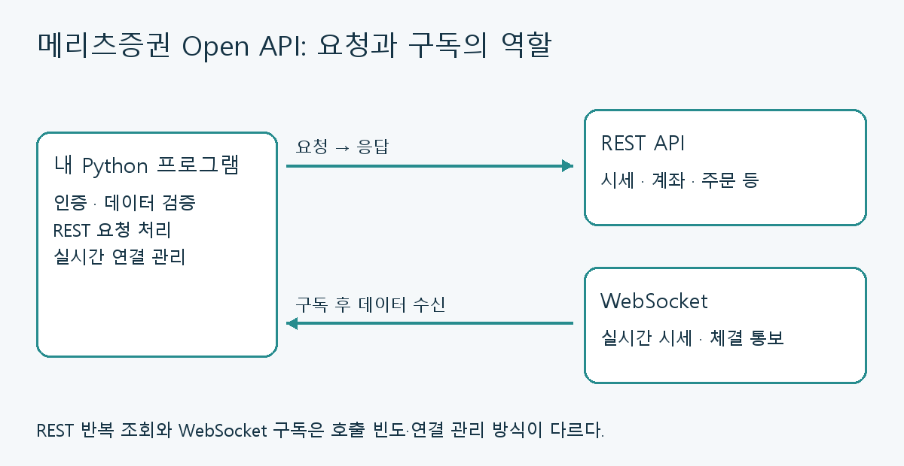
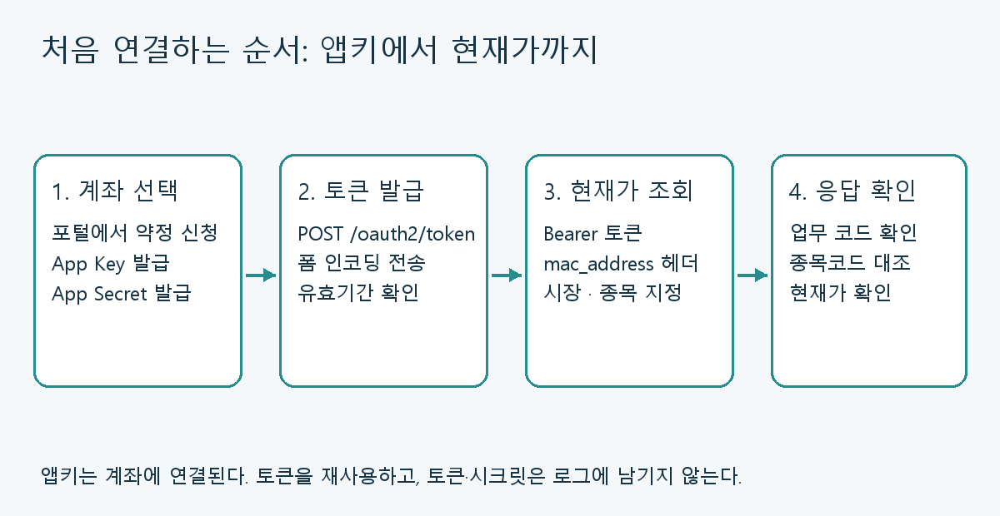

## HTS 화면을 조작하던 프로그램에서 API로

증권 프로그램의 버튼을 찾아 클릭하고 숫자를 읽어오는 방식은 화면 배치나 팝업 하나에도 영향을 받는다. 증권사가 제공하는 API를 이용하면 프로그램이 정해진 주소로 요청을 보내고, 구조화된 응답을 받아 처리할 수 있다.

**메리츠증권 Open API는 REST로 시세·계좌·주문 등을 다루고, WebSocket으로 실시간 데이터를 받는 서비스**다. AI 클라이언트에 연결하는 MCP도 제공한다. [공식 서비스 소개](https://openapi.imeritz.com/intro)

이 글에서는 계좌별 앱키를 준비하고 Python으로 국내주식 현재가를 조회하는 데까지 연결한다. 이후 실시간 처리와 MCP로 확장할 때 무엇이 달라지는지도 살펴본다.

> **2026년 11월 12일 공식 포털과 공식 GitHub 자료를 기준으로 작성했다.** 공식 GitHub 조직은 현재 베타 서비스로 안내한다. 아래 코드는 문서와 대조한 연동 예제이며, 이 글을 작성하며 실계좌 인증·시세 수신·주문을 실행하지는 않았다. [공식 GitHub](https://github.com/meritz-securities)
{: .prompt-info }

## 어떤 기능을 제공하나

| 구분 | 대표 기능 | 연결 방식 |
|---|---|---|
| 국내주식 | 현재가·호가·일봉·분봉, 매수·매도·정정·취소 | REST |
| 해외주식 | 시세·잔고·주문·예약주문 | REST |
| 계좌 | 예수금·자산평가·입출금·실현손익 | REST |
| 환전·참조 | 환율·환전, 영업일·장운영 정보 | REST |
| 실시간 | 현재가·호가, 주문 접수·체결 통보 | WebSocket |

세부 지원 범위와 입력값은 [공식 API 문서](https://openapi.imeritz.com/apiservice)에서 확인한다. 비슷한 기능도 국내·해외, 조회·주문 사이에 코드 체계가 다를 수 있으므로 다른 API의 파라미터를 그대로 복사하지 않는다.

### REST와 WebSocket의 역할

REST는 “지금 이 종목 가격을 알려 달라”처럼 요청하고 응답받는 데 적합하다. WebSocket은 연결을 유지하면서 구독한 데이터가 도착할 때 처리하는 방식이다. 주기적으로 REST를 호출하는 것과 실시간 구독은 구현과 연결 관리가 다르다.


_조회 요청과 실시간 구독은 같은 프로그램 안에서도 별도의 흐름으로 관리한다._

공식 예제의 기본 접속점은 다음과 같다. [공식 Python 예제 환경변수](https://github.com/meritz-securities/open-api#환경변수)

```text
REST       https://openapi.imeritz.com:9443
WebSocket  wss://openapi.imeritz.com:29443/websocket
```

## 신청 전에 알아둘 조건과 비용

Open API는 메리츠증권 계좌를 보유한 개인 고객이 신청할 수 있다. 공식 이용안내는 계좌 선택과 약정 동의 후 App Key·App Secret을 발급하는 절차를 설명한다. [서비스 이용안내](https://openapi.imeritz.com/howto-use)

특히 다음 세 가지를 먼저 구분하자.

- **앱키는 계좌에 연결된다.** 여러 계좌를 쓴다면 어느 앱키가 어느 계좌인지 구분해야 한다. 공식 예제는 계좌번호를 요청에 별도로 넣지 않는 구조다.
- **공식 예제는 운영 서버와 실계좌를 기본으로 하며, 모의계좌는 없다고 안내한다.** 처음에는 조회 예제로 시작하는 편이 적절하다.
- `MERITZ_READ_ONLY=1`은 공식 예제·도구의 클라이언트 설정이다. 직접 작성한 모든 HTTP 요청을 서버에서 조회 전용으로 제한해 주는 권한 설정으로 해석하면 안 된다.

위 조건은 [공식 Python 예제 README](https://github.com/meritz-securities/open-api)에 정리되어 있다.

공식 포털은 **Open API 이용 수수료는 없고, 거래 수수료는 신청 계좌와 동일하게 적용**된다고 설명한다. 계좌의 무료 수수료 조건과 거래에 붙는 세금·기타 비용은 별도로 확인해야 한다. 또한 시세정보는 본인 투자 목적으로 사용하며 제3자 제공·상업적 이용에는 제한이 있다. [공식 요금·유의사항](https://openapi.imeritz.com/intro)

## 1. App Key와 App Secret 발급하기

1. [메리츠증권 Open API 포털](https://openapi.imeritz.com/)에 접속해 로그인한다.
2. `API 신청`에서 이용할 계좌를 선택한다.
3. 계좌 비밀번호를 입력하고 약관·위험고지서와 계약서류 제공방식을 확인한다.
4. 신청을 완료한 뒤 신청현황에서 App Key·App Secret을 발급·확인한다.

화면별 최신 절차는 [공식 신청 안내](https://openapi.imeritz.com/howto-use)를 따른다. 발급받은 값을 블로그, GitHub, 채팅창에 붙여 넣지 말고 프로그램이 실행되는 환경에서 관리한다.


_앱키·시크릿은 토큰 발급에, 접근 토큰은 이후 API 인증에 사용한다._

## 2. Python 실행 환경 준비하기

아래는 **Windows PowerShell과 Python 3.11 이상**을 기준으로 한다. 작업할 폴더에서 가상환경을 만들고 `requests`를 설치한다. 가상환경 활성화 없이 실행 파일을 직접 지정하면 PowerShell 실행 정책에 영향을 덜 받는다.

```powershell
python -m venv .venv
.\.venv\Scripts\python.exe -m pip install requests
```

앱키를 명령줄에 직접 적으면 셸 기록에 남을 수 있다. 다음처럼 입력받아 현재 PowerShell 프로세스의 환경변수에 설정할 수 있다. 마스킹된 입력도 환경변수로 옮긴 뒤에는 실행 프로세스가 읽을 수 있으므로, 공용 PC에서는 사용하지 않는다.

```powershell
$keyInput = Read-Host 'App Key' -AsSecureString
$secretInput = Read-Host 'App Secret' -AsSecureString
$env:MERITZ_APP_KEY = [System.Net.NetworkCredential]::new('', $keyInput).Password
$env:MERITZ_APP_SECRET = [System.Net.NetworkCredential]::new('', $secretInput).Password

Get-NetAdapter | Select-Object Name, Status, MacAddress
$env:MERITZ_MAC_ADDRESS = (Read-Host '호출 단말의 MAC 주소').Replace('-', '').Replace(':', '').ToUpperInvariant()
```

MAC 주소는 호출 단말의 실제 네트워크 어댑터 값을 확인해 입력한다. 여러 어댑터나 VPN이 있다면 사용 중인 연결을 확인한다. API 명세는 `mac_address` 헤더를 요구하며, 공식 오류 안내는 **구분자 없는 12자리 대문자 16진수**를 사용하도록 설명한다. [공식 오류 코드 안내](https://github.com/meritz-securities/open-api/blob/main/docs/errors.md)

## 3. 토큰 발급과 현재가 조회

인증은 `POST /oauth2/token`을 호출한다. `grant_type=client_credentials`, `scope=login`을 넣고 **JSON 대신 폼 인코딩**으로 전송한다. 이후 시세 API에는 `Authorization: Bearer ...`를 사용한다. [공식 인증 안내](https://openapi.imeritz.com/howto-use)

다음 코드를 `meritz_quote.py`로 저장한다. 토큰 값은 출력하지 않고, 현재가 조회 결과 중 종목명·현재가·누적거래량만 표시한다. 같은 파일은 [예제 다운로드](/assets/code/meritz-securities-open-api-guide/meritz_quote.py)로 받을 수 있다.

```python
import os
import re

import requests

BASE_URL = "https://openapi.imeritz.com:9443"


def read_json(response):
    try:
        body = response.json()
    except ValueError:
        raise RuntimeError(f"JSON 응답이 아닙니다: HTTP {response.status_code}") from None
    if not isinstance(body, dict):
        raise RuntimeError("예상한 JSON 객체가 아닙니다.")
    return body


def failure(response, body):
    # 전체 응답·헤더·토큰 대신 오류 진단에 필요한 필드만 표시한다.
    return RuntimeError(
        f"HTTP {response.status_code}, "
        f"rsp_cd={body.get('rsp_cd')!r}, "
        f"rsp_msg={body.get('rsp_msg')!r}, "
        f"rsp_sub_msg={body.get('rsp_sub_msg')!r}"
    )


def main():
    app_key = os.environ["MERITZ_APP_KEY"]
    app_secret = os.environ["MERITZ_APP_SECRET"]
    mac = os.environ["MERITZ_MAC_ADDRESS"]
    if not re.fullmatch(r"[0-9A-F]{12}", mac):
        raise ValueError("MAC 주소는 구분자 없는 12자리 대문자 16진수여야 합니다.")

    with requests.Session() as session:
        response = session.post(
            f"{BASE_URL}/oauth2/token",
            data={
                "grant_type": "client_credentials",
                "client_id": app_key,
                "client_secret": app_secret,
                "scope": "login",
            },
            timeout=15,
        )
        body = read_json(response)
        token = body.get("access_token")
        if response.status_code != 200 or not token:
            raise failure(response, body)
        print("토큰 발급 완료, 유효기간(초):", body.get("expires_in"))

        response = session.get(
            f"{BASE_URL}/market/v1/prices",
            headers={
                "authorization": f"Bearer {token}",
                "mac_address": mac,
            },
            params={"mrkt_div_code": "J", "iscd": "005930"},
            timeout=15,
        )
        body = read_json(response)
        # 현재가 API의 성공 코드만 판정한다. 다른 API에 일반화하지 않는다.
        if response.status_code != 200 or body.get("rsp_cd") != "0000":
            raise failure(response, body)
        quote = body.get("data")
        if not isinstance(quote, dict) or quote.get("shrn_iscd") != "005930":
            raise RuntimeError("응답 종목코드를 확인할 수 없습니다.")
        if not quote.get("kor_isnm") or not quote.get("stck_prpr"):
            raise RuntimeError("종목명·현재가가 비어 있습니다. 요청과 장 상태를 확인하세요.")
        print("종목명:", quote["kor_isnm"])
        print("현재가:", quote["stck_prpr"])
        print("누적거래량:", quote.get("acml_vol"))


if __name__ == "__main__":
    main()
```

실행 명령은 다음과 같다.

```powershell
.\.venv\Scripts\python.exe .\meritz_quote.py
```

`005930`은 호출 구조를 설명하기 위한 종목코드다. 가격을 고정한 성공 로그는 제시하지 않는다. 실제 응답에서 종목코드와 종목명, 현재가가 유효한지 확인하자. 잘못된 종목코드를 넣어도 정상 응답코드와 빈 값·0이 함께 올 수 있다. [공식 현재가 명세](https://github.com/meritz-securities/open-api/blob/main/openapi.json)

현재가 API의 `mrkt_div_code`는 `J`가 KRX, `NJ`가 NXT, `TJ`가 KRX·NXT 통합이다. 어떤 시장의 가격을 요청했는지 기록해야 HTS와 비교할 때도 기준을 맞출 수 있다. 이 구분은 다른 API의 시장 코드와 같다고 가정하지 않는다. [공식 API 문서](https://openapi.imeritz.com/apiservice)

이 예제는 실행할 때 토큰을 한 번 받고 같은 세션에서 조회한다. 장시간 실행하는 프로그램은 토큰을 만료 전까지 재사용하고, 응답의 `expires_in`을 기준으로 갱신해야 한다. 유효기간을 특정 일수로 고정하지 않는다. [공식 호출 규약](https://github.com/meritz-securities/open-api/blob/main/llms.txt)

작업이 끝나면 현재 셸에서 설정한 값을 지울 수 있다.

```powershell
Remove-Item Env:MERITZ_APP_KEY, Env:MERITZ_APP_SECRET, Env:MERITZ_MAC_ADDRESS
Remove-Variable keyInput, secretInput
```

## 4. 응답이 이상할 때 확인할 순서

**HTTP 상태와 업무 응답코드를 함께 봐야 한다.** 공식 오류 문서는 권한·입력 오류가 HTTP 500으로 내려오는 경우를 설명한다. 따라서 500을 모두 일시 장애로 보고 재시도하면 원인을 해결하지 못한다. `rsp_cd`, `rsp_msg`, `rsp_sub_msg`를 함께 확인한다. [공식 오류 코드표](https://github.com/meritz-securities/open-api/blob/main/docs/errors.md)

| 증상·코드 | 먼저 확인할 항목 |
|---|---|
| 환경변수 `KeyError` | 값을 설정한 PowerShell과 Python을 실행한 셸이 같은가 |
| `EGW00103` | 앱키 오타, 사용 서버와 발급 환경, 포털의 신청·인증 상태 |
| `IGW50024` | `mac_address` 헤더와 12자리 형식 |
| `EGW00121`·`EGW00123` | 토큰의 유효성·만료 여부 |
| `0760` | 해당 계좌·앱키의 API 권한과 상세 메시지 |
| `EGW00200` | 호출 빈도와 재시도 간격 |

코드별 설명은 [공식 오류 문서](https://github.com/meritz-securities/open-api/blob/main/docs/errors.md)와 [이용안내](https://openapi.imeritz.com/howto-use)를 대조한다. 호출 한도는 해당 API의 최신 명세를 확인한다. 확인한 공식 현재가 명세의 `x-tps`는 10이지만, 이를 모든 기능과 모든 연결에 공통인 제한으로 적용하지 않는다. [현재가 명세](https://github.com/meritz-securities/open-api/blob/main/openapi.json)

위 Python 코드는 현재가 조회에만 `0000`을 적용한다. 계좌·주문 조회에는 다른 정상 코드가 있고, 일부 API는 `5820`이어도 데이터가 있을 수 있다. 업무 성공 여부와 데이터 존재 여부를 분리해서 처리해야 한다. [응답 판정 규약](https://github.com/meritz-securities/open-api/blob/main/llms.txt)

## 5. 공식 Python 예제로 확장하기

직접 HTTP 요청을 만들며 구조를 파악했다면 공식 저장소에서 인증 재사용, 연속조회, 실시간 구독 예제를 살펴볼 수 있다. 공식 저장소는 안정적인 외부 SDK보다는 **프로젝트에 맞게 고쳐 쓰는 예제 모음**으로 소개된다. [공식 Python 예제](https://github.com/meritz-securities/open-api)

```powershell
git clone https://github.com/meritz-securities/open-api.git
Set-Location open-api
python -m venv .venv
.\.venv\Scripts\python.exe -m pip install -e .
$env:MERITZ_READ_ONLY = '1'
# 이 PowerShell에도 앞에서 설명한 앱키·시크릿 환경변수를 설정한다.
.\.venv\Scripts\python.exe examples/02_market.py 005930
```

읽어볼 순서는 `01_auth.py` → `02_market.py` → `04_account.py` → `06_paging.py` → `07_realtime.py`가 적절하다. 인증과 시세부터 이해하고, 계좌와 페이지 처리, 연결을 유지하는 실시간 처리로 넓혀 가는 순서다.

연속조회는 첫 응답에 다음 페이지가 있는지 확인해야 한다. WebSocket은 재연결 후 구독 복구와 중복 데이터 처리를 별도로 설계해야 한다. 주문 기능까지 추가한다면 **주문 요청, 접수, 실제 체결을 각각 기록**하고, 타임아웃 후 재전송 전에 주문내역을 조회하는 구조가 필요하다. 주문 접수 응답은 체결 완료를 의미하지 않는다. [공식 오류 문서의 주문 응답 설명](https://github.com/meritz-securities/open-api/blob/main/docs/errors.md)

## 6. MCP로 연결하면 무엇이 달라지나

MCP는 AI가 외부 기능을 도구로 호출하도록 연결하는 규약이다. 메리츠증권이 제공하는 MCP는 목적이 다른 두 종류이므로 구분해야 한다.

| 도구 | 역할 | 앱키 |
|---|---|---|
| [Code Generation MCP](https://github.com/meritz-securities/open-api-codegen-mcp) | API 검색·명세 확인·호출 코드 생성 | 코드 생성 자체에는 불필요 |
| [Trading MCP](https://github.com/meritz-securities/open-api-mcp) | 실제 시세·계좌 조회와 주문 등 API 실행 | 필요 |

Code Generation MCP에서 코드를 생성해도 그 순간 계좌에 요청이 나가는 것은 아니다. 생성한 코드를 검토하고 실행 환경을 준비하는 단계가 남는다. [코드 생성 MCP 안내](https://github.com/meritz-securities/open-api-codegen-mcp)

Trading MCP는 로컬에서 실행되며 기본값은 조회 전용이다. 주문·환전 기능을 열면 확인 토큰을 이용한 두 단계 호출을 사용한다. 다만 이 절차만으로 사람이 실제 내용을 확인했다는 보장이 생기지는 않는다. 또한 조회 결과는 연결한 AI 서비스로 전달되므로 어떤 계좌 정보를 공유하는지 확인해야 한다. 현재 공식 Trading MCP는 WebSocket 실시간 구독을 제공하지 않는다. [Trading MCP 안내](https://github.com/meritz-securities/open-api-mcp)

처음 연결할 때는 “국내주식 현재가 조회”처럼 범위가 분명한 요청으로 도구와 응답을 확인한다. 실제 주문으로 확장하기 전에 대상 계좌·종목·시장·수량·가격을 검토하고, 주문내역과 체결내역을 확인하는 흐름을 마련하자.

## 마무리

메리츠증권 Open API를 처음 사용할 때의 작은 목표는 **올바른 계좌의 앱키로 인증하고, 원하는 시장·종목의 시세를 한 번 정확하게 받는 것**이다. 이 흐름이 확인되면 잔고와 연속조회, WebSocket 실시간 처리로 확장할 수 있다.

자동화의 완성도는 호출 성공뿐 아니라 잘못된 입력, 토큰 만료, 연결 끊김, 주문 상태 불확실성을 어떻게 처리하는지에서 결정된다. 공식 포털을 명세의 기준으로 삼고 예제를 자신의 프로그램에 맞게 검토하면서 연결하자.
