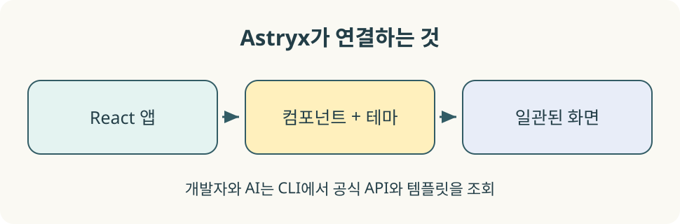
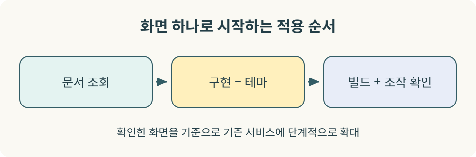

## 버튼은 만들었는데, 서비스 전체가 제각각이라면

페이지마다 버튼의 크기가 다르고, 다크 모드를 켜면 입력창만 밝게 남는다. AI에게 화면 생성을 맡길 때마다 서로 다른 컴포넌트와 스타일이 추가된다. 화면 수가 늘수록 이런 차이를 고치는 데 시간이 든다.

**Astryx는 공통 UI 부품과 시각 규칙, 이를 찾는 도구를 함께 제공하는 Meta의 오픈소스 디자인 시스템이다.** React 프로젝트에서 사용할 수 있으며, 개발자와 AI 에이전트가 같은 API와 문서를 참고하도록 설계됐다. [공식 저장소](https://github.com/meta/astryx)

이 글은 **2026년 11월 13일 확인한 공식 문서**를 기준으로 한다. Astryx는 현재 베타이며 React 19 이상을 요구한다. 아래 실습은 공식 설치 방식을 작은 예제로 정리한 것으로, 특정 운영 서비스에 적용한 후기와는 구분한다.

## Astryx는 무엇을 제공하나?

디자인 시스템은 버튼 모음에 색상표를 붙인 것보다 범위가 넓다. 부품의 동작, 화면에서의 일관성, 조합 방법을 함께 다룬다. Astryx 공식 홈페이지는 현재 180개 이상의 컴포넌트와 테마, 템플릿, CLI를 소개한다. 초기 소개 글의 150개 이상이라는 숫자와 차이가 있으므로, 사용할 부품은 현재 목록에서 확인하면 된다. [공식 홈페이지](https://astryx.atmeta.com/)

| 구성 | 하는 일 | 적용 예 |
|---|---|---|
| React 컴포넌트 | 재사용 가능한 UI와 상호작용 제공 | 버튼, 입력, 메뉴 |
| 디자인 토큰과 테마 | 색상·간격·타이포그래피 등의 공통 값 관리 | 브랜드 색상, 명암과 표면 표현 |
| 페이지 템플릿 | 자주 쓰는 화면의 출발점 제공 | 설정 화면, 대시보드 |
| CLI | API·토큰·템플릿 조회와 프로젝트 연동 | AI가 구현 전 실제 API 확인 |


_화면을 만드는 라이브러리와, 그 라이브러리의 사용법을 찾는 도구가 함께 제공된다._

Astryx 내부 스타일은 StyleX로 작성됐지만, 일반적인 소비 프로젝트에는 미리 만들어진 CSS와 JavaScript가 배포된다. 따라서 Astryx 사용만을 위해 StyleX 컴파일러를 설정할 필요는 없다. 기존 CSS나 CSS Modules, Tailwind와의 조합도 가능하다. 다만 공식 설치 명령에는 `@stylexjs/stylex` 의존성이 포함된다. “별도 스타일 빌드 설정이 필요 없다”를 “의존성 패키지가 전혀 없다”로 읽으면 안 된다. [구조 설명](https://astryx.atmeta.com/blog/how-astryx-works)

## 어떤 프로젝트에 적용하면 좋을까?

다음은 제공 기능을 바탕으로 한 도입 판단이다. 실제 효과는 서비스의 화면 구성과 기존 기술에 따라 달라진다.

- **React 기반 관리 도구:** 목록·입력·설정 화면의 반복 작업이 많은 경우, 공통 부품과 템플릿을 검토할 가치가 있다.
- **여러 사람이 만드는 제품:** 기본 테마와 조합 규칙을 함께 정해 화면의 차이를 줄이는 데 활용할 수 있다.
- **AI로 UI 코드를 만드는 프로젝트:** 설치된 버전의 컴포넌트 문서를 조회하게 해 존재하지 않는 props를 추측하는 일을 줄일 수 있다.

기존 React 18 프로젝트라면 React 업그레이드와 주변 패키지 호환성을 먼저 검토해야 한다. 정적인 블로그를 운영한다는 이유만으로 전체를 React로 바꿀 필요도 없다. 예를 들어 이 Jekyll 블로그에 Astryx를 도입하는 일과, 블로그에서 소개한 React 실습 프로젝트에 설치하는 일은 별개의 선택이다.

## 적용 실습: 작은 React 화면부터 시작하기

실습은 **Vite의 React + TypeScript 프로젝트**를 기준으로 한다. Node.js는 사용할 Vite 버전의 요구 조건을 만족하는 버전을 준비하고, 설치 도중 표시되는 엔진 요구 사항도 확인한다. 다음 명령은 새 연습 폴더를 만든다.

```bash
npm create vite@latest astryx-demo -- --template react-ts
cd astryx-demo
npm install
npm ls react react-dom
```

`react`와 `react-dom`이 모두 19 이상인지 확인한다. 오래된 프로젝트에 패키지만 추가하기보다, 먼저 새 프로젝트에서 화면 하나를 확인하는 편이 원인을 좁히기 쉽다.

### 1. 패키지 설치

```bash
npm install @astryxdesign/core @astryxdesign/theme-neutral @stylexjs/stylex
npm install -D @astryxdesign/cli
npm ls @astryxdesign/core @astryxdesign/theme-neutral @astryxdesign/cli
```

팀 작업에서는 `package-lock.json`을 함께 관리하고 재현 설치에는 `npm ci`를 사용한다. 이 글의 명령은 설치 시점에 배포된 버전을 받으므로, 이후 실행 결과를 비교할 때는 위 조회 결과를 함께 기록한다.

### 2. CSS를 순서대로 가져오기

새 프로젝트의 `src/index.css`를 다음으로 교체한다.

```css
@import '@astryxdesign/core/reset.css';
@import '@astryxdesign/core/astryx.css';
@import '@astryxdesign/theme-neutral/theme.css';

body {
  margin: 0;
  font-family: system-ui, sans-serif;
}

.demo-page {
  max-width: 640px;
  margin: 48px auto;
  padding: 24px;
}
```

**reset → 컴포넌트 스타일 → 테마** 순서를 유지한다. 테마 파일을 빠뜨리면 React 컴포넌트가 렌더링되더라도 의도한 테마와 다르게 보일 수 있다. 기존 프로젝트에서는 전역 reset이 다른 화면에 미치는 영향도 검토한다. [공식 Quick Start](https://github.com/meta/astryx/blob/main/packages/core/README.md#quick-start)

### 3. Theme으로 화면 감싸기

`src/main.tsx`를 다음과 같이 작성한다.

```tsx
import {StrictMode} from 'react';
import {createRoot} from 'react-dom/client';
import {Theme} from '@astryxdesign/core/theme';
import {neutralTheme} from '@astryxdesign/theme-neutral/built';
import App from './App';
import './index.css';

createRoot(document.getElementById('root')!).render(
  <StrictMode>
    <Theme theme={neutralTheme}>
      <App />
    </Theme>
  </StrictMode>,
);
```

CSS를 불러오는 것과 Theme을 연결하는 것은 둘 다 필요하다. 예제는 일반 CSS로 화면을 꾸미므로, 미리 빌드된 테마를 제공하는 `/built` 경로를 사용한다.

### 4. 버튼과 상태 연결

`src/App.tsx`를 다음 내용으로 교체한다. Vite 기본 예제의 `App.css` import는 제거한다.

```tsx
import {useState} from 'react';
import {Button} from '@astryxdesign/core/Button';

export default function App() {
  const [count, setCount] = useState(0);

  return (
    <main className="demo-page">
      <h1>Astryx 적용 연습</h1>
      <p>버튼의 스타일은 Astryx가, 숫자 상태는 React가 담당합니다.</p>
      <p role="status">클릭 횟수: {count}</p>
      <Button
        label="한 번 더하기"
        variant="primary"
        onClick={() => setCount(value => value + 1)}
      />
    </main>
  );
}
```

`Button`의 표시 문자열은 이 예제에서 `label`로 전달한다. 다른 UI 라이브러리의 사용법을 그대로 옮기기보다 현재 컴포넌트의 API를 먼저 확인한다.

```bash
npx @astryxdesign/cli component Button
npm run dev
npm run build
```

화면에서는 버튼 클릭 후 숫자가 증가하는지, Tab 키로 버튼에 접근할 수 있는지, 포커스 표시가 보이는지 확인한다. `npm run build` 성공은 타입과 번들 생성에 대한 확인이며, 키보드 조작이나 시각적인 품질까지 보장하지는 않는다.

## Next.js나 Tailwind를 이미 쓴다면

Next.js App Router에서는 전역 CSS에 같은 세 파일을 가져오고, `'use client'`가 있는 Providers 컴포넌트에서 Theme을 연결한다. 공식 예제는 Next.js의 Link와 Astryx의 `LinkProvider`를 연결하는 방법도 제공한다. 위 Vite의 `createRoot` 코드를 Next.js에 복사하지 말고 프레임워크별 진입점을 따른다. [Next.js 설정 예제](https://github.com/meta/astryx/blob/main/packages/core/README.md#nextjs-simplest)

Tailwind와 함께 쓸 때는 **CSS layer의 선언 순서**가 중요하다. 기존 Tailwind import와 Astryx 스타일을 순서 없이 섞으면 우선순위가 달라질 수 있다. 프로젝트를 통째로 바꾸기 전에 다음 문서에서 현재 버전의 설정을 확인한다.

```bash
npx @astryxdesign/cli docs styling-libraries/tailwind
```

## AI 에이전트와 함께 쓰는 방법

“agent ready”는 Astryx가 AI 모델을 제공한다는 의미가 아니다. AI가 컴포넌트의 실제 사용법을 읽고 구현에 반영하도록 자료와 도구를 갖췄다는 의미로 이해하면 된다.

프로젝트 루트에서 초기화한다.

```bash
npx @astryxdesign/cli init
```

공식 문서에 따르면 이 명령은 `AGENTS.md`·`CLAUDE.md`에 컴포넌트 탐색을 위한 가이드를 작성한다. 실행 후에는 기존 지침과 어떻게 합쳐졌는지 Git diff로 확인한다. CLI는 설치된 프로젝트 버전을 기준으로 문서와 도구를 사용하도록 돕는다. [CLI 공식 문서](https://github.com/meta/astryx/blob/main/packages/cli/README.md)


_문서를 먼저 찾고, 구현 결과는 빌드와 실제 조작으로 확인한다._

AI에게는 다음처럼 구체적인 작업을 줄 수 있다.

```text
이 React 프로젝트에 설정 화면을 만들어 줘.
먼저 Astryx CLI로 사용 가능한 템플릿과 필요한 컴포넌트 API를 확인해.
현재 설치된 버전에 있는 컴포넌트를 사용하고, 기존 Theme과 CSS 순서를 유지해.
구현 후 production build를 실행하고,
키보드 포커스와 좁은 화면에서 확인할 항목을 알려 줘.
```

템플릿이 필요하다면 목록에서 현재 제공되는 이름을 확인한다.

```bash
npx @astryxdesign/cli template --list
npx @astryxdesign/cli template dashboard
npx @astryxdesign/cli docs tokens
npx @astryxdesign/cli docs theme
```

템플릿은 화면 구성의 출발점이다. 인증, 권한 검사, API 연결, 업무 규칙은 애플리케이션에서 구현해야 한다. 또한 **`npx astryx` 대신 `npx @astryxdesign/cli`를 사용한다.** 공식 문서는 CLI가 설치되지 않은 상태의 짧은 패키지 이름이 무관한 npm 패키지로 해석될 수 있다고 안내한다.

## 기존 서비스에는 어떻게 도입할까?

전체 페이지 교체 전에 다음 순서로 비용과 효과를 비교하는 것을 권한다.

1. **화면 하나 선정:** 설정 페이지처럼 입력과 버튼이 있는 작은 영역을 선택한다.
2. **호환성 확인:** React 버전, 전역 reset, 테마 범위, 기존 UI 라이브러리와의 충돌을 확인한다.
3. **기본 테마 적용:** 브랜드 수정 전에 주요 상호작용이 정상인지 확인한다.
4. **토큰 기준 합의:** 색상·간격·반경 등 반복되는 값을 정하고 문서화한다.
5. **검증 후 확대:** 키보드, 명암, 모바일 화면, 번들 변화와 유지보수 비용을 보고 다음 화면으로 넓힌다.

테마는 CSS custom properties를 통해 조정할 수 있다. 처음부터 컴포넌트 전체를 복사하기보다 공식 테마 가이드와 토큰을 먼저 살펴본다. 내부 구현 자체를 소유해야 하는 경우에는 `swizzle`로 소스를 가져오는 기능도 있지만, 그 뒤의 수정과 업그레이드 병합 비용은 도입하는 팀이 감당해야 한다. [커스터마이징 방향](https://github.com/meta/astryx#overview)

## 적용 중 자주 막히는 지점

| 증상 | 먼저 확인할 것 |
|---|---|
| 설치 시 peer dependency 충돌 | React와 react-dom 버전, 설치된 패키지의 요구 조건 |
| 기본 HTML처럼 보이거나 테마가 다름 | CSS 세 파일의 import, 순서, Theme과 `/built` 테마 연결 |
| 기존 페이지의 여백·버튼이 달라짐 | 전역 reset과 기존 CSS의 영향, layer 순서 |
| 예제의 props가 타입 오류를 냄 | 설치 버전의 `component` 문서와 import 경로 |
| Next.js에서 client boundary 오류 | Theme 연결부와 상태·이벤트를 쓰는 컴포넌트의 경계 |
| 빌드는 되는데 쓰기 불편함 | 포커스 이동, 레이블, 모바일 레이아웃을 실제로 조작 |

접근성 기능이 있는 부품을 사용해도 잘못된 조합이나 레이블 누락까지 자동 해결되지는 않는다. 베타 라이브러리의 업데이트는 별도 브랜치에서 변경 사항을 읽고, 대표 화면을 다시 확인하는 방식으로 관리하는 편이 좋다.

## 첫 도입의 목표는 화면 하나를 끝까지 확인하는 것

Astryx를 도입할 때는 패키지 설치 자체보다 **컴포넌트·테마·문서 조회가 하나의 개발 흐름으로 이어지는지**가 중요하다. 새 React 프로젝트에서 버튼 하나를 표시하고, 테마가 반영되는지 확인하고, AI가 그 버전의 API를 찾아 수정하게 해 보면 적용 방식을 이해하기 쉽다.

그다음 실제 서비스의 한 화면에서 코드량, 일관성, 사용성, 업그레이드 비용을 비교한다. 이 작은 검증이 끝나면 팀에 맞는 공통 UI 기반으로 확대할지 판단할 수 있다.

## 참고 자료

- [Astryx 공식 홈페이지](https://astryx.atmeta.com/)
- [Meta Astryx GitHub](https://github.com/meta/astryx)
- [공식 Core 설치 가이드](https://github.com/meta/astryx/blob/main/packages/core/README.md)
- [공식 CLI 가이드](https://github.com/meta/astryx/blob/main/packages/cli/README.md)
- [컴포넌트 Storybook](https://astryx.atmeta.com/storybook/)
