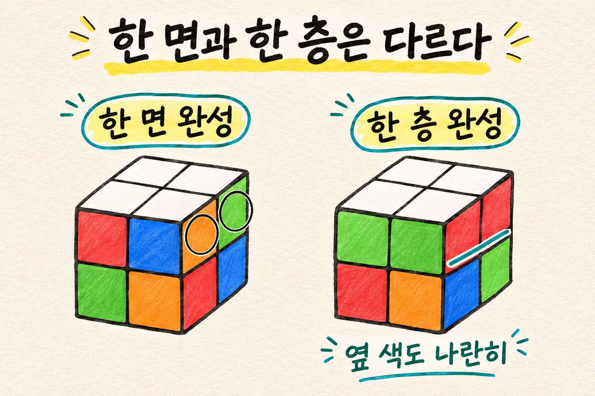
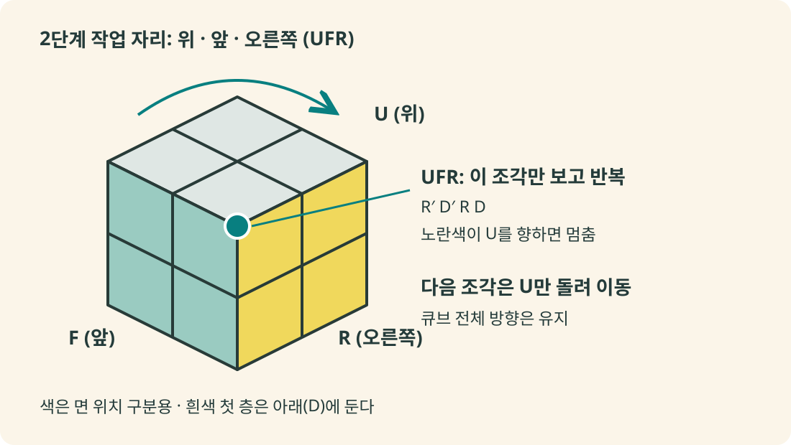

## 작은 큐브, 어디서부터 맞출까?

2×2×2 큐브는 작아서 쉬워 보이지만, 한 면을 맞추고 나면 다음에 무엇을 해야 할지 막히기 쉽다. **흰색 한 층을 완성하고 → 반대편 노란색 면을 만들고 → 마지막 조각들의 자리를 바꾸면 된다.** 이 글은 빠른 기록보다 처음부터 끝까지 혼자 완성하는 데 초점을 둔다.

2×2 큐브에는 겉으로 보이는 코너 조각이 8개 있으며, 각 조각에 색이 3개씩 있다. 3×3 큐브의 코너만 다루는 퍼즐로 이해하면 편하다. 가운데 색을 알려 주는 센터가 없으므로, 먼저 맞춘 조각을 기준으로 옆 색의 관계를 정한다. [Jaap의 2×2 큐브 설명](https://www.jaapsch.net/puzzles/cube2.htm)

아래 설명은 **흰색과 노란색이 서로 반대인 일반적인 색 배치**를 기준으로 한다. 자신의 큐브 색 배치가 다르면 흰색의 반대 색을 노란색 대신 사용한다. 조각을 손으로 비틀거나 분해하지 않고 정상적으로 섞은 큐브를 준비하자.

| 단계 | 목표 | 완료 기준 |
|---|---|---|
| 1 | 흰색 첫 층 | 흰색 4칸과 각 옆면의 아래 두 칸이 맞는다 |
| 2 | 노란색 면 | 흰색 층을 유지하면서 윗면 4칸이 노란색이다 |
| 3 | 마지막 자리 | 옆면까지 여섯 면이 각각 한 색이다 |

## 먼저 읽기: R, U, F와 작은따옴표

큐브를 잡았을 때 **내 앞을 F, 오른쪽을 R, 위를 U**라고 부른다. 색 이름이 아니라 현재 공간에서의 면 위치다. 예를 들어 앞면이 초록색이어도, 파란색이어도 앞을 보고 있으면 F다.

| 기호 | 뜻 |
|---|---|
| `R` | 오른쪽 면을 시계 방향으로 90° |
| `U` | 윗면을 시계 방향으로 90° |
| `F` | 앞면을 시계 방향으로 90° |
| `D` | 아랫면을 시계 방향으로 90° |
| `'` | 해당 면을 반시계 방향으로 90° |
| `2` | 해당 면을 180° |

**시계 방향은 돌리는 면을 정면에서 바라봤을 때의 방향**이다. `D`의 방향은 아래에서 올려다보는 기준이다. `R'`는 오른쪽 면을 정면으로 봤을 때 반시계 방향이며, `U2`는 윗면 반 바퀴다. [회전 표기 설명](https://www.jaapsch.net/puzzles/cube2.htm#notation)

공식은 왼쪽부터 차례대로 실행한다. 괄호는 외우기 편하게 나눈 것으로, 별도 회전을 뜻하지 않는다. **공식 하나를 실행하는 도중에는 큐브 전체를 돌려 잡지 않는다.**

이 글에서 “위·앞·오른쪽 조각(UFR)”은 위, 앞, 오른쪽 세 면이 만나는 코너다. “아래·앞·오른쪽 조각(DFR)”은 그 바로 아래 코너다.

## 1단계: 흰색 ‘한 층’을 맞춘다

### 흰색 네 칸만 맞추면 아직 끝이 아니다

흰색 면이 완성돼도 옆 색이 뒤섞일 수 있다. 첫 층은 **흰색 4칸에 더해, 그 층에 속한 옆면 두 칸씩도 같은 색**이어야 한다.


_차이를 보기 위해 그림에서는 흰색을 위에 두었다. 실제 아래 절차에서는 흰색을 아래로 잡는다._

### 기준 조각 하나를 잡고 나머지 세 조각을 넣는다

1. 흰색이 들어간 코너 하나를 찾아 **흰색 스티커가 아래(D)를 향하게** 잡는다. 이것이 첫 기준 조각이다.
2. 윗층에서 다른 흰색 코너를 찾는다. 흰색 이외의 두 색을 보고 들어갈 위치를 정한다.
3. 큐브 전체를 좌우로 돌려, 넣을 빈자리를 **아래·앞·오른쪽(DFR)**에 둔다. 흰색은 계속 아래다.
4. 윗면 `U`, `U'`, `U2` 중 필요한 회전을 해서, 넣을 조각을 그 자리 바로 위인 **UFR**에 놓는다.
5. 다음 네 동작을 **한 묶음씩 반복**한다. 목표 조각이 DFR에 들어가고 흰색이 아래를 향하면 멈춘다.

```text
R U R' U'
```

조각이 제대로 준비돼 있다면 1회, 3회 또는 5회 반복으로 들어간다. 매번 네 동작을 끝낸 뒤 확인하자. 다른 흰색 조각도 같은 방법으로 넣는다.

어느 자리가 맞는지 헷갈리면 먼저 맞춘 코너와 색을 비교한다. 예를 들어 기준 조각이 **흰색·빨강·초록**이면, 흰색·빨강·파랑 조각은 빨강 면을 공유하는 이웃이다. 흰색·주황·파랑처럼 흰색 이외의 공통 색이 없는 조각은 대각선 쪽에 들어간다. 이런 방식의 첫 층 구성은 [J Perm의 입문 튜토리얼](https://jperm.net/2x2)에서도 확인할 수 있다.

흰색 조각이 아랫층에 잘못 끼어 있다면, 그 위치를 DFR로 잡고 위 네 동작을 한 번 실행해 윗층으로 꺼낸 뒤 다시 넣는다. 이미 맞춘 다른 아랫층 조각은 유지된다.

**확인:** 흰색이 아래에서 4칸 모두 보이고, 앞·오른쪽·뒤·왼쪽 면의 **아래 두 칸씩**이 각각 같은 색이면 첫 층 완성이다.

## 2단계: 노란색 네 칸이 위를 보게 한다

여기서는 윗층 코너의 **방향**을 맞춘다. 옆 색의 자리는 다음 단계에서 처리하므로, 아직 옆면 전체가 맞지 않아도 괜찮다.

먼저 이 절차를 끝까지 읽자. **중간에 아랫층이 흐트러져 보이는 것은 정상**이며, 남은 윗층 조각들을 같은 기준으로 처리하면 복구된다.


_공식은 항상 UFR에서 실행한다. 다음 조각은 윗면만 돌려 같은 자리로 가져온다. 위쪽 곡선은 윗층 이동을 뜻한다._

### 한 조각을 처리하는 네 동작

흰색 첫 층을 아래에 두고, 노란색이 위를 보지 않는 코너를 `U`로 UFR에 가져온다. 다음 공식을 반복한다.

```text
R' D' R D
```

**네 동작을 모두 끝낸 시점에 UFR 조각의 노란색이 위를 향하면 멈춘다.** 정상적으로 준비된 상태라면 보통 두 묶음 또는 네 묶음이 필요하다. 중간 세 동작만 하고 멈추지 않는다.

### 다음 조각을 가져올 때가 가장 중요하다

1. 노란색이 위를 보게 된 조각은 잠시 그대로 둔다.
2. **윗면만** `U`, `U'`, `U2`로 돌려, 아직 방향이 틀린 코너를 UFR에 가져온다.
3. 같은 `R' D' R D`를 한 묶음씩 반복해 그 조각도 노란색이 위를 보게 한다.
4. 윗면의 네 칸이 모두 노란색이 될 때까지 이어간다.

이 단계에서는 **큐브 전체를 돌려 다음 조각을 가져오면 안 된다.** 처음 정한 앞면과 오른쪽 면을 계속 유지해야 한다. 또한 중간에 아랫층을 따로 복구하려고 다른 회전을 끼워 넣지 않는다.

**확인:** 윗면 전체가 노란색이고, 아랫층도 1단계 완료 상태로 돌아왔으면 성공이다. 윗면이 모두 노란색이었다면 처음부터 이 단계를 건너뛴다.

## 3단계: 마지막 코너들의 자리를 맞춘다

노란색 면은 완성됐는데 옆 색이 어긋나 있다면, 이제 코너의 위치만 바꾸면 된다. 사용하는 공식은 **T-perm** 하나다. 길지만 앞부분과 중간을 나눠 읽으면 따라가기 쉽다.

```text
(R U R' U') (R' F R2) (U' R' U') (R U R' F')
```

이 공식은 2×2에서 **윗층 오른쪽의 두 코너(UFR과 UBR)를 서로 바꾼다.** 노란색 면과 완성된 아랫층은 보존한다. 3×3에 같은 공식을 쓰면 엣지도 움직이지만, 이 글의 대상인 2×2에는 해당 엣지가 없다. [T-perm 공식 자료](https://esp.mit.edu/download/4db3e121d85b098e3c9a208ca60d4489/X3017_Intro_to_Blindfold_Cubing.pdf)

### 먼저 윗면만 돌려서 끝나는지 본다

`U`를 돌려 옆면 색을 맞춰 본다. 위층 전체가 같은 만큼 밀려 있는 상태라면 이것만으로 완성된다. 여섯 면이 맞으면 더 이상 공식을 실행하지 않는다.

### 옆면 윗줄에 같은 색 두 칸이 있다면

앞·오른쪽·뒤·왼쪽의 **윗줄 두 칸씩**을 확인한다. 같은 색 두 칸이 나란히 있는 곳을 여기서는 “짝”이라고 부른다. 노란색 윗면 네 칸을 말하는 것이 아니다.

1. 노란색을 위에 유지한 채 **큐브 전체를 좌우로 돌려**, 짝이 있는 면을 **왼쪽(L)**에 둔다.
2. 위의 T-perm 공식을 한 번 실행한다.
3. 마지막으로 `U`, `U'`, `U2` 중 필요한 회전을 해서 윗층과 아랫층의 옆 색을 정렬한다.

짝의 색이 바로 아래 색과 처음부터 같을 필요는 없다. **짝을 왼쪽에 두고 공식을 실행한 뒤 윗층을 정렬**하면 된다.

### 어느 옆면에도 짝이 없다면

노란색을 위에 둔 상태에서 앞면을 아무 쪽으로 정하고 **T-perm을 한 번** 실행한다. 그러면 짝이 생긴다. 새 짝을 왼쪽에 두고 T-perm을 한 번 더 실행한 뒤, 윗면을 정렬하면 완성된다.

| 현재 모습 | 할 일 |
|---|---|
| 윗면 회전만으로 여섯 면이 맞는다 | `U` 계열 회전으로 정렬하고 끝 |
| 옆면 윗줄에 같은 색 짝이 있다 | 짝을 왼쪽 → T-perm → 윗면 정렬 |
| 어느 옆면 윗줄에도 짝이 없다 | T-perm → 짝을 왼쪽 → T-perm → 윗면 정렬 |

## 잘 안 될 때 확인할 것

### 흰색 면은 맞았는데 다음 단계가 계속 꼬인다

흰색이 한 **층**으로 완성됐는지 확인한다. 옆면 아래 두 칸이 같은 색이 아니라면 1단계가 덜 끝난 것이다. 흰색 코너의 옆 색까지 다시 맞춘다.

### 2단계에서 아랫층이 무너졌다

아직 처리하지 않은 윗층 코너가 남았다면 같은 절차를 계속한다. 모든 노란색이 위를 보는데도 아랫층이 복구되지 않았다면, 네 동작을 끝내지 않았거나 큐브 전체를 돌려 잡았을 가능성이 있다. 이때 공식을 무작정 추가하기보다 첫 층부터 다시 확인한다.

### 마지막 공식 뒤에도 해결되지 않는다

T-perm의 **`R2`**, 작은따옴표, 마지막 **`F'`**가 빠지지 않았는지 확인한다. 짝을 오른쪽이나 뒤에 놓고 실행하지 않았는지도 살핀다. 공식이 끝났다면 윗면만 돌려 정렬할 수 있는 상태인지 먼저 확인한다.

### 코너 하나만 비틀려 남는다

다른 모든 조각이 완전히 맞고 **코너 하나의 방향만 틀린 상태**는 정상적인 면 회전으로 만든 섞기에서 나올 수 없다. 풀이 실수를 먼저 확인하고, 과거에 코너가 물리적으로 돌아가거나 재조립된 적이 있는지 확인한다. 이 상태를 해결하려고 계속 공식을 반복할 필요는 없다.

## 큐브 옆에 두는 공식 메모

```text
1. 흰색 첫 층: 흰색은 아래
   목표 조각을 UFR, 들어갈 자리를 DFR에 준비
   R U R' U' 반복 → 흰색이 아래에 들어가면 멈춤
   옆면 아래 두 칸씩도 같은 색인지 확인

2. 노란색 면: 흰색은 아래, 작업 자리는 UFR
   R' D' R D 반복 → 해당 노란색이 위면 멈춤
   다음 조각은 U만 돌려 UFR로 이동
   이 단계 도중 큐브 전체 방향을 바꾸지 않기

3. 마지막 자리: 노란색은 위
   우선 U로 정렬 가능한지 확인
   짝이 있으면 왼쪽에 두고 T-perm
   짝이 없으면 T-perm 한 번 후 짝을 왼쪽으로
   끝나면 U로 최종 정렬

T-perm:
R U R' U' R' F R2 U' R' U' R U R' F'
```

처음에는 한 동작씩 천천히 하고, 멈추는 조건을 확인하자. 익숙해지면 첫 층의 위치 판단부터 빨라진다. 더 빠른 해법을 배우고 싶을 때는 [J Perm의 2×2 심화 안내](https://jperm.net/2x2/faster)에서 다음 연습 방향을 볼 수 있다.

## 공식은 어떻게 확인했나?

이 글의 방향 맞추기와 T-perm 절차는 **흰색 첫 층이 완성된 뒤 가능한 윗층 648가지 상태**에 대해 좌표 기반 Python 모델로 검증했다. 코너 배치 24가지와 방향 27가지를 조합했으며, 모든 상태에서 아랫층 복구와 최종 여섯 면 완성을 확인했다. 첫 층 삽입도 UFR에 놓인 목표 코너의 세 방향을 확인했다. 실제 큐브를 손으로 돌린 실험 기록은 아니다.

검증 과정을 살펴보고 싶다면 [검증 코드 다운로드](/assets/code/2x2-cube-beginner-guide/verify.py)를 저장해 Python 3으로 실행할 수 있다. 추가 패키지는 필요 없다.

```console
python verify.py
```

정상 실행 시 `PASS: 648 last-layer states`로 시작하는 결과와 첫 층 삽입 검증 결과가 출력된다.
