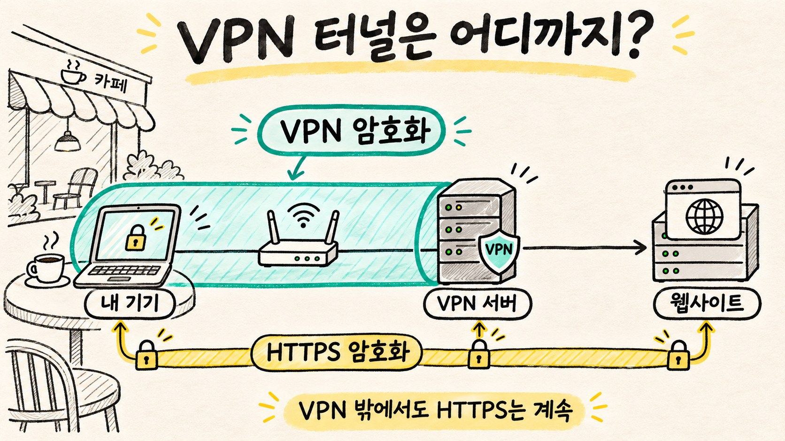
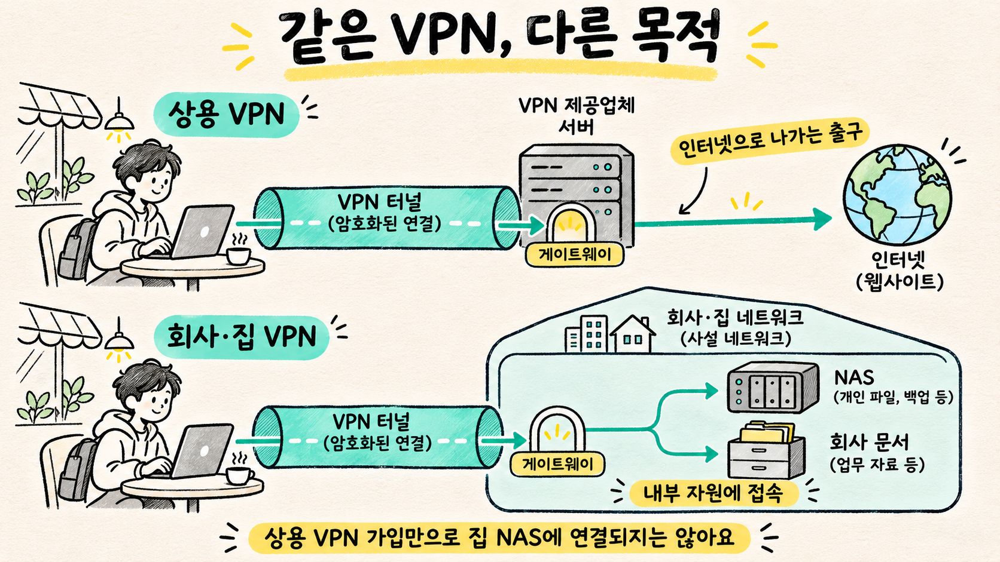

카페 Wi-Fi를 쓸 때, 집에서 회사 파일 서버에 접속할 때, 인터넷 광고를 볼 때 모두 VPN이라는 말을 만난다. 그런데 어떤 설명은 보안을, 어떤 설명은 IP 주소 변경을 이야기한다. 같은 기술을 서로 다른 목적으로 쓰기 때문이다.

**VPN은 인터넷 위에 가상의 연결 통로를 만드는 기술이다. 우리가 흔히 사용하는 VPN은 내 기기와 VPN 서버 사이를 암호화하고, 정해진 통신을 그 통로로 보낸다.** 어디에 있는 서버로 연결하고 어떤 통신을 보내느냐에 따라 쓰임새가 달라진다.

이 글에서는 제품을 고르기 전에 알아야 할 원리부터, 처음 연결한 뒤 확인할 항목까지 살펴본다. 설정 절차는 일반적인 안내이며 특정 기기에서 수행한 시험 결과는 아니다.

## VPN을 이해하는 데 필요한 네 단어

VPN은 **Virtual Private Network**, 한국어로 가상 사설망이다. 이름을 외우기보다 다음 네 가지를 구분하면 설명이 쉬워진다.

| 용어 | 초보자를 위한 설명 |
|---|---|
| IP 주소 | 네트워크에서 데이터를 보낼 곳을 구분하는 주소. 웹사이트에 보이는 공인 IP와 집 안에서 쓰는 사설 IP는 역할이 다르다. |
| 서버 | 다른 기기의 요청을 받아 처리하는 컴퓨터나 장치. VPN 서버는 연결을 받아 통신을 전달한다. |
| 암호화 | 통신 내용을 알맞은 키 없이는 읽기 어렵게 바꾸는 것 |
| 터널 | 원래 보낼 데이터를 다른 통신 안에 담아 두 지점 사이로 운반하는 가상의 통로 |

터널은 실제 전용선을 새로 까는 것이 아니다. 기존 인터넷 회선을 사용하므로 **Wi-Fi나 모바일 데이터 같은 인터넷 연결은 먼저 있어야 한다.**

## VPN을 켜면 통신 경로가 어떻게 바뀔까?

카페에서 노트북으로 웹사이트를 여는 장면을 생각해 보자. 상용 VPN으로 웹 통신을 보내면 경로는 대략 다음과 같다.

```text
VPN 연결 전
내 기기 → 카페 공유기·인터넷 통신사 → 웹사이트

VPN 연결 후
내 기기 → [암호화된 VPN 터널] → VPN 서버 → 웹사이트
```

두 번째 줄에서도 카페 공유기와 통신사를 거친다. 다만 그 구간에는 VPN 서버로 향하는 암호화된 통신이 흐른다. 터널이 적용되는 통신의 원래 목적지를 로컬 네트워크에서 직접 관찰하기는 어려워지고, 웹사이트에는 일반적으로 VPN 서버 쪽의 출구 IP가 보인다. 기본 동작은 [Cloudflare의 VPN 설명](https://www.cloudflare.com/en-gb/learning/access-management/what-is-a-vpn/)에서도 확인할 수 있다.

여기서 알아둘 조건이 있다.

- **모든 앱이 반드시 터널을 지나는 것은 아니다.** 앱·목적지별 예외 설정이나 분할 터널링에 따라 달라진다.
- **VPN 사용 자체가 숨겨지는 것은 아니다.** 로컬 네트워크나 통신사는 VPN 서버에 연결한 사실, 통신량과 시점 등을 관찰할 수 있다.
- **인터넷 출구가 바뀌어도 실제 위치가 바뀌지는 않는다.** 휴대폰 GPS, 계정 정보, 쿠키까지 함께 바뀌는 것은 아니다.

## VPN과 HTTPS는 보호하는 구간이 다르다

가장 헷갈리기 쉬운 부분이다. 브라우저 주소의 `https://`는 브라우저와 접속한 웹사이트 사이의 통신을 암호화한다. VPN은 내 기기와 VPN 서버 사이에 별도의 암호화 통로를 만든다. 두 보호는 함께 사용할 수 있다.


_청록색 VPN 터널은 VPN 서버에서 끝난다. 노란색 HTTPS 보호는 브라우저와 웹사이트 사이에 이어진다._

HTTPS를 정상적으로 사용하는 일반적인 개인 기기라면 VPN 서버를 지나는 동안에도 웹페이지 내용과 비밀번호는 HTTPS로 보호된다. **VPN 서버가 터널을 해제한다고 해서 HTTPS까지 자동으로 풀리는 것은 아니다.** 반대로 HTTP처럼 암호화되지 않은 통신은 VPN 서버 이후 구간까지 VPN이 보호해 주지는 않는다.

| 확인하려는 것 | HTTPS | VPN |
|---|---|---|
| 주로 보호하는 구간 | 브라우저와 웹사이트 사이 | 기기와 VPN 서버 사이 |
| 웹사이트가 보는 출구 IP 변경 | 그 기능은 제공하지 않음 | 해당 통신이 VPN을 지나면 일반적으로 변경 |
| 회사·집 내부망으로 연결 | HTTPS만으로 연결 경로가 생기지는 않음 | 해당 내부망의 VPN 구성과 권한이 있으면 가능 |
| 로그인한 사용자를 익명으로 만들기 | 제공하지 않음 | 제공하지 않음 |

회사에서 관리하는 기기는 별도의 인증서와 보안 정책에 따라 HTTPS 검사 등을 수행할 수 있다. 개인용 VPN의 설명을 회사 관리 환경에 그대로 적용하지 말고 조직의 안내를 확인하자.

## 같은 VPN이라도 목적지는 다르다


_어디에 있는 VPN 서버로 연결하는지가 중요하다. 상용 VPN에 가입하는 것만으로 집 NAS의 접속 경로가 생기지는 않는다._

### 1. 상용 VPN: 다른 인터넷 출구를 이용하기

서비스 사업자가 운영하는 VPN 서버로 연결한다. 해당 경로를 지나는 웹사이트 접속은 사업자의 서버 쪽에서 나온 것처럼 보인다. VPN 서버까지 통신을 보호하고 출구를 바꾸는 데 사용한다.

대신 **그 사업자를 신뢰할 수 있는지**가 중요해진다. 사업자는 연결 정보와 일부 목적지 정보를 관찰할 수 있다. HTTPS가 보호하는 본문과 별개로, 누가 언제 연결했는지 같은 기록을 어떻게 다루는지 확인해야 한다.

### 2. 회사 VPN: 허용된 사내 자원에 접속하기

집의 노트북에서 회사 VPN에 로그인한 다음 사내 파일 서버나 업무 시스템으로 접속한다. VPN 인증을 통과해도 서비스별 계정과 권한은 따로 필요할 수 있다.

회사에서 제공한 앱·서버 주소·인증 방식을 사용해야 한다. 개인용 상용 VPN을 설치해도 회사 VPN을 대신하지 못한다.

### 3. 집 VPN: 외부에서 집 안의 장치에 접속하기

집의 공유기나 별도 서버가 VPN 연결을 받도록 준비하면, 외부에서 인증한 뒤 허용된 NAS나 다른 장치에 접근할 수 있다. 서버 역할을 하는 장치는 켜져 있어야 하고 외부에서 도달할 수 있는 연결 구성도 필요하다.

VPN 연결만으로 꺼진 PC가 자동으로 켜지거나, 모든 집 안 장치에 대한 권한이 생기지는 않는다. 전원 켜기와 네트워크 접근은 별도의 문제다. PC 전원까지 다루려면 [Wake-on-LAN 설정 글](/posts/wake-on-lan-setup-guide/)도 참고할 수 있다.

## VPN이 해 주지 못하는 일

VPN은 특정 경로를 보호하는 도구다. 다음 작업을 대신하지는 않는다.

- 가짜 로그인 페이지에 비밀번호를 입력했을 때의 계정 보호
- 악성 프로그램이나 감염된 기기의 치료
- 로그인, 쿠키, 브라우저 지문 등에 의한 식별 차단
- 웹사이트에 직접 보낸 개인정보의 회수
- 인터넷 속도 향상 보장이나 모든 서비스의 접속 보장

공공 Wi-Fi에서도 HTTPS는 이미 통신 내용을 보호한다. VPN이 유용할 수 있지만, Wi-Fi를 쓸 때마다 VPN 없이는 비밀번호가 그대로 노출된다고 이해하면 잘못이다. 보안 업데이트, 정확한 사이트 주소 확인, 인증서 경고를 무시하지 않는 습관이 함께 필요하다. VPN의 익명성 한계와 공공 Wi-Fi에서의 역할은 [EFF의 VPN 선택 안내](https://ssd.eff.org/module/vpn.html)를 참고하자.

## 처음 연결하는 순서

### 1. 목적과 연결 대상을 정한다

회사 업무라면 담당자가 제공한 안내를 받는다. 집 NAS 접속이라면 집 쪽 VPN 서버 구성이 먼저다. 개인 인터넷 연결에 사용할 서비스라면 운영 주체, 개인정보 처리, 업데이트와 기기 지원을 살펴본다.

무료·유료 여부 하나만으로 안전성을 판단하지 말자. 서비스 비용을 어떻게 충당하는지, 어떤 연결 기록을 수집하고 얼마나 보관하는지 확인한다. 보안 감사가 있다면 수행 시점과 대상도 함께 본다. 감사나 광고 문구가 앞으로의 안전을 보장하지는 않는다.

### 2. 공식 앱 또는 제공받은 설정을 준비한다

공식 웹사이트나 신뢰할 수 있는 앱 스토어에서 받는다. 회사에서 지정한 배포 경로가 있다면 그 안내를 따른다. 임의의 VPN 설정 파일을 가져오면 예상하지 못한 서버로 통신을 보낼 수 있으므로 출처를 확인한다.

일반적으로 필요한 정보는 서버 주소, 계정 또는 키·인증서, 지원되는 연결 방식이다. 앱이 대신 처리하는 항목도 있다. 비밀 키나 설정 파일은 로그인 정보처럼 관리한다.

### 3. 연결하고 인증한다

사업자의 앱이라면 로그인 후 서버를 선택해 연결한다. 초보자는 제공자의 권장 설정에서 시작하는 편이 이해하기 쉽다. 회사 VPN은 지정 서버와 다중 인증 절차를 따른다.

Windows 11의 기본 기능을 쓰도록 안내받았다면 `설정 → 네트워크 및 인터넷 → VPN → VPN 추가`에서 프로필을 만들 수 있다. 서버 주소, VPN 종류, 로그인 방식은 제공받은 값으로 입력한다. **Windows의 VPN 메뉴가 VPN 서버나 이용권을 자동으로 제공하는 것은 아니다.** 전용 앱이 필요한 서비스도 있다. [Microsoft의 VPN 연결 안내](https://support.microsoft.com/en-us/windows/experience/connectivity-networking/connect-to-a-vpn-in-windows)

### 4. 목적에 맞게 확인한다

| 사용 목적 | 연결 후 확인할 것 | 잘못 판단하기 쉬운 점 |
|---|---|---|
| 상용 VPN으로 웹 접속 | 앱의 연결 상태, 같은 브라우저의 공인 IP 전후 비교, HTTPS 사이트 접속 | IP 하나가 바뀌었다고 모든 앱과 DNS·IPv6 경로까지 검증한 것은 아님 |
| 회사 VPN | 연결 상태, 권한이 있는 사내 서비스 접속 | 분할 터널링이면 일반 웹사이트에 보이는 공인 IP가 그대로일 수 있음 |
| 집 VPN | 외부 네트워크에서 연결 후 허용한 NAS 서비스 접속 | 집 Wi-Fi에서만 시험하면 외부 접속 구성을 확인하기 어려움 |

공인 IP 확인 페이지는 브라우저의 출구 주소를 보여 준다. 내 기기의 Wi-Fi 설정에 표시되는 `192.168.x.x` 같은 사설 IP와 비교하면 다른 것을 보게 된다.

회사 정책상 허용된다면 공급자의 공식 진단 안내로 DNS·IPv6 등의 경로도 확인한다. 민감한 내부 주소나 진단 결과를 공개 게시판에 올리지 않는다.

## 자주 보이는 설정 두 가지

**분할 터널링(Split tunneling)**은 일부 통신만 VPN으로 보내는 방식이다. 예를 들어 사내 시스템 접속은 회사 VPN으로, 일반 웹 접속은 기존 회선으로 보낼 수 있다. 예외 앱이 있다면 그 앱은 VPN의 보호 범위 밖일 수 있다. 회사 설정은 임의로 바꾸지 말고 담당자에게 확인한다.

**킬 스위치(Kill switch)**는 VPN 연결이 끊겼을 때 통신이 일반 회선으로 계속 나가는 것을 막도록 하는 기능이다. 작동 범위는 앱과 운영체제에 따라 다르다. 켜 둔 상태에서 VPN이 끊기면 인터넷도 안 되는 것처럼 보일 수 있으므로, 사용 중인 앱의 설명과 상태를 먼저 확인한다.

## 느리거나 연결이 안 될 때의 점검 순서

| 증상 | 먼저 확인할 것 |
|---|---|
| VPN 서버에 연결하지 못함 | VPN 없이 인터넷이 되는지, 계정과 다중 인증이 유효한지, 서버 주소가 맞는지 |
| 호텔·카페에서만 안 됨 | Wi-Fi의 이용 동의·로그인 페이지를 먼저 완료했는지. 안내 페이지는 운영 주체를 확인하고, 필요한 VPN 연결을 다시 수행 |
| 연결 후 인터넷이 안 됨 | 앱의 재연결·킬 스위치 상태, 공급자의 장애 공지와 공식 진단 안내 |
| 웹은 되는데 사내 서비스가 안 됨 | 사내 DNS·접속 경로·서비스 권한. 회사 담당자에게 증상 전달 |
| 집 NAS만 안 됨 | 집 쪽 장치 전원, 허용한 서비스와 방화벽, VPN 경로, 집과 외부 Wi-Fi의 사설 주소 대역 중복 여부 |
| 속도가 느림 | VPN 전후 같은 조건으로 비교. 개인용은 가까운 서버로 시험하고, 회사용은 지정 정책 내에서 문의 |

VPN은 서버를 경유하므로 거리, 회선 상태, 서버 혼잡, 암호화 처리 성능에 따라 지연이 늘거나 전송 속도가 낮아질 수 있다. **연결됨 표시는 터널 상태를 뜻할 뿐, 목적지 서비스의 정상 동작까지 보장하지 않는다.**

문제가 생겼다고 방화벽을 통째로 끄거나 인증서 경고를 무시하지 말자. 언제부터, 어떤 네트워크에서, 어느 서비스만 실패하는지 기록하면 원인을 좁히는 데 도움이 된다.

## 연결 버튼을 누르기 전에 기억할 것

처음에는 다음 세 가지를 스스로 설명할 수 있으면 충분하다.

1. **어디로 연결하는가?** 상용 사업자, 회사, 집 중 어느 VPN 서버인지 확인한다.
2. **무엇을 보내는가?** 모든 통신인지, 일부 앱·사내 주소만인지 확인한다.
3. **연결 후 무엇을 확인하는가?** 인터넷 출구 변경인지, 내부 서비스 접속인지 목적에 맞춰 확인한다.

VPN의 핵심은 정해진 통신을 다른 네트워크로 보내는 연결이다. 그 경로와 신뢰할 대상을 이해하면, 필요한 상황에서 VPN을 선택하고 연결 결과도 올바르게 판단할 수 있다.
