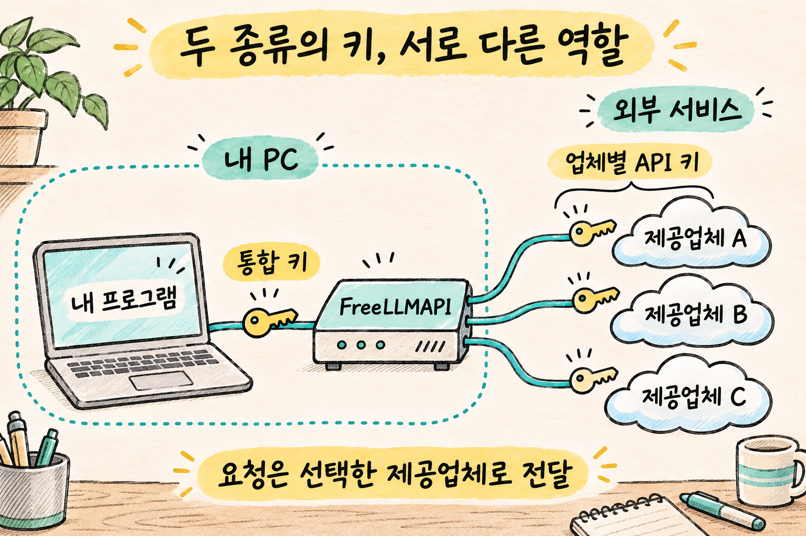
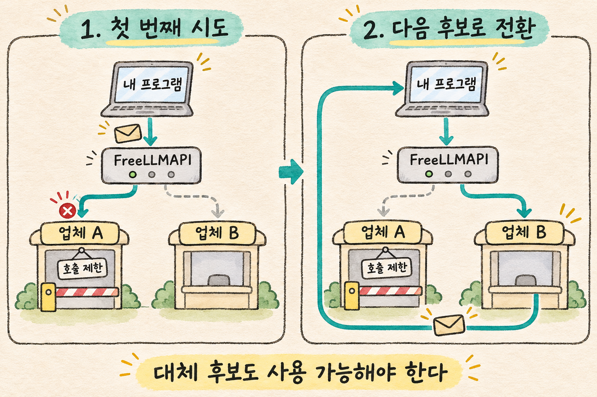

AI API를 시험하다 보면 업체마다 다른 키, 모델 이름, 무료 한도 때문에 예제 코드를 계속 바꾸게 된다. 한 업체의 제한에 걸렸을 때 다른 업체로 옮기는 작업도 번거롭다.

**FreeLLMAPI는 여러 제공업체를 내 PC의 API 하나로 연결하는 프로그램이다.** 내 코드는 통합 주소에 요청하고, FreeLLMAPI가 등록된 키와 모델 중 사용할 대상을 고른다. 특정 모델의 호출 제한이나 장애가 발생하면 다음 후보를 시도할 수 있다.

이 글은 **Windows 앱으로 시작하는 방법**을 먼저 설명하고, 서버에 설치할 사람을 위한 Docker 방식도 다룬다. 이후 PowerShell에서 첫 요청을 보내고 Python과 코딩 도구로 연결한다. 2026년 11월 16일의 공식 문서와 저장소를 기준으로 작성했다. 예제는 문서와 코드 구조를 확인한 안내이며, 실제 제공업체 계정으로 추론 요청을 실행한 결과는 아니다.

## 1. 설치 전에 이해할 구조와 비용

### FreeLLMAPI가 해 주는 일

전체 요청 경로를 먼저 보면 설정이 쉬워진다.

```text
내 프로그램
  → 내 PC의 FreeLLMAPI
    → 내가 활성화한 제공업체의 AI API
    → 응답을 내 프로그램으로 반환
```

OpenAI 호환 클라이언트는 기본적으로 `http://localhost:3001/v1`을 API 주소로 사용한다. 저장소는 OpenAI 형식뿐 아니라 Anthropic Messages와 Gemini 형식 등의 연결도 안내한다. 상세 기능은 [공식 저장소](https://github.com/tashfeenahmed/freellmapi)에서 확인할 수 있다.

### 무료라는 말의 범위

| 구분 | 이해할 점 |
|---|---|
| FreeLLMAPI 프로그램 | 무료로 설치해 실행할 수 있는 오픈소스 라우터 |
| 모델 호출 | 각 제공업체 계정의 무료 한도와 이용 조건에 따름 |
| Premium | 새 모델·한도·호환성 변경을 카탈로그에 즉시 반영하는 유료 기능 |
| 서버 비용 | 내 PC를 쓰면 해당 기기를 켜 두어야 하고, 별도 서버를 쓰면 서버 비용이 생길 수 있음 |

공식 요금 페이지는 현재 Premium을 연 19달러 또는 평생 49달러로 안내한다. 무료 설치본은 새 카탈로그 항목이 라이브 피드에 들어간 뒤 30일 후에 반영되는 방식이다. **Premium은 제공업체의 유료 추론 요금이나 사용 한도를 대신 결제하는 상품이 아니다.** 가격과 정책은 [공식 사이트](https://freellmapi.co/#pricing)에서 다시 확인하자.

홈페이지의 거대한 월간 토큰 숫자는 여러 제공업체의 무료 할당량을 합산한 설명이다. 내 계정에 그 양이 한 번에 지급되거나, 한 모델을 그만큼 사용할 수 있다는 뜻으로 읽으면 안 된다.

## 2. 가장 많이 헷갈리는 두 종류의 API 키


_내 프로그램에는 통합 키를 넣고, 제공업체에서 발급받은 키는 FreeLLMAPI에 등록한다._

| 키 | 발급·확인하는 곳 | 입력하는 곳 |
|---|---|---|
| 제공업체 API 키 | Groq, Google AI Studio 등 각 업체 콘솔 | FreeLLMAPI의 **Keys** 페이지 |
| FreeLLMAPI 통합 키 | 대시보드의 **Keys** 상단 또는 앱 트레이의 **Copy Key** | Python 코드, API 클라이언트, 코딩 도구 |

예를 들어 Groq에서 받은 키를 Python 예제의 `FREELLMAPI_API_KEY`에 직접 넣으면 인증 경로가 맞지 않는다. 그 키를 FreeLLMAPI에 저장하고, FreeLLMAPI에서 복사한 통합 키를 Python 쪽에 넣어야 한다.

서버 설치에는 대시보드 로그인 계정도 있다. 로그인 비밀번호, 업체 API 키, 통합 키는 서로 다른 용도다. 데스크톱 앱은 로컬 대시보드에 자동으로 로그인한다. [설치·자격 증명 안내](https://github.com/tashfeenahmed/freellmapi/blob/main/docs/en/install/01-install.md#credentials-and-where-your-data-lives)

## 3. Windows에서 앱으로 설치하기

처음이라면 이 방법으로 시작한다. Docker 설치는 다음 절의 별도 경로이므로 둘을 동시에 실행할 필요는 없다.

1. [공식 저장소](https://github.com/tashfeenahmed/freellmapi#quick-start)의 Windows 링크를 확인한다.
2. 안내된 [Microsoft Store 앱](https://apps.microsoft.com/detail/9PBN6G8K2B7F)을 설치한다.
3. 앱을 실행하고 작업 표시줄 알림 영역의 FreeLLMAPI 아이콘을 연다.
4. **Open Dashboard**로 관리 화면을 연다.
5. 앱에 표시된 포트와 실행 상태를 확인한다.

공식 문서는 Store 버전을 서명 및 자동 업데이트가 제공되는 Windows 경로로 안내한다. 별도 설치 파일은 [GitHub Releases](https://github.com/tashfeenahmed/freellmapi/releases/latest)에 있다.

이 글의 예제는 기본 포트 `3001`을 사용한다. 앱에서 포트를 바꿨다면 뒤의 모든 `localhost:3001`도 그 값으로 맞춘다. 앱을 종료하면 그 앱이 제공하던 API도 사용할 수 없으므로, 호출 중에는 실행 상태를 유지한다.

## 4. 서버·개발 환경에서 Docker로 설치하기

Docker 방식은 Git과 Docker Compose가 준비된 환경에서 사용한다. Windows에서는 Docker Desktop 엔진을 실행한 뒤 PowerShell에서 확인한다.

```powershell
git --version
docker version
docker compose version
```

`docker version`에서 서버 연결 오류가 난다면 Docker 엔진부터 켠다. 아래는 **새 폴더에 처음 설치하는 예제**다.

```powershell
git clone https://github.com/tashfeenahmed/freellmapi.git
cd freellmapi

if (Test-Path -LiteralPath .env) {
    throw '기존 .env가 있습니다. 암호화 키를 덮어쓰지 마세요.'
}

$keyBytes = New-Object byte[] 32
$keyGenerator = [Security.Cryptography.RandomNumberGenerator]::Create()
try {
    $keyGenerator.GetBytes($keyBytes)
} finally {
    $keyGenerator.Dispose()
}
$encryptionKey = -join ($keyBytes | ForEach-Object { '{0:x2}' -f $_ })
@("ENCRYPTION_KEY=$encryptionKey", 'PORT=3001') |
    Set-Content -LiteralPath .env -Encoding ascii

docker compose up -d
docker compose ps
```

브라우저에서 `http://localhost:3001`을 열고 초기 계정 설정 안내를 따른다. 초기 설정 코드가 요구되면 서버 로그를 확인한다.

```powershell
docker compose logs --tail 100 freellmapi
```

`ENCRYPTION_KEY`는 저장된 업체 키를 암호화하는 서버 설정이다. 통합 API 키 자리에 넣는 값이 아니다. 기존 DB를 계속 사용하면서 이 값을 새로 만들면 저장된 키를 해독하지 못할 수 있다. 처음 만든 `.env`와 데이터 볼륨을 보존한다.

공식 Compose는 기본적으로 포트를 `127.0.0.1`에만 공개한다. 개인용 설치에서는 이 기본값을 유지한다. 구성 근거는 [공식 Compose 파일](https://github.com/tashfeenahmed/freellmapi/blob/main/docker-compose.yml)과 [설치 문서](https://github.com/tashfeenahmed/freellmapi/blob/main/docs/en/install/01-install.md#docker-compose)에 있다.

## 5. 제공업체 키를 하나 등록하고 먼저 시험하기

처음부터 여러 업체를 등록하면 실패 원인을 찾기 어렵다. 하나를 연결하고 짧은 질문이 되는지 확인한 뒤 두 번째 업체를 추가하자.

### Groq를 연결하는 예

1. [Groq API Keys](https://console.groq.com/keys)에 로그인한다.
2. 권한과 이용 조건을 확인하고 **Create API Key**로 키를 만든다.
3. FreeLLMAPI의 **Keys** 페이지에서 Groq 항목에 등록한다.
4. 키의 활성 상태와 검증 결과를 확인한다.
5. 모델 목록에서 해당 계정으로 사용할 채팅 모델을 활성화한다.

콘솔에서 키를 만들 권한이 없다면 조직 소유자 또는 개발자 역할을 확인한다. 키를 저장했다고 모든 모델에 접근할 수 있는 것은 아니다.

### Google을 연결하려면

[Google AI Studio의 키 페이지](https://aistudio.google.com/apikey)에서 사용할 프로젝트와 API 키를 확인하고, FreeLLMAPI의 Google 항목에 등록한다. 프로젝트 가져오기와 키 생성 조건은 [Google 공식 키 안내](https://aistudio.google.com/docs/api-key)를 따른다. ChatGPT나 다른 채팅 서비스의 구독만으로 이 업체 API 키가 발급되는 것은 아니다.

### Playground에서 확인하기

대시보드의 Playground에서 연결한 채팅 모델을 선택하고 다음처럼 짧게 질문한다.

```text
한국어로 인사하고, 네가 할 수 있는 일을 한 문장으로 설명해 줘.
```

답변이 오면 키 등록과 해당 모델의 기본 호출 경로가 작동한 것이다. 다음으로 **Fallback Chain**에 실제 사용할 후보를 넣고 활성화한다. 번역이나 요약처럼 작은 작업으로 시작하면 모델별 차이도 비교하기 쉽다.

## 6. PowerShell에서 첫 API 요청 보내기

### 통합 키를 현재 터미널에 입력하기

대시보드 또는 트레이에서 **FreeLLMAPI 통합 키**를 복사한다. 아래 코드는 입력 문자를 화면에 표시하지 않고 현재 PowerShell 프로세스의 환경 변수에 저장한다. 영구 환경 변수로 저장하지 않으므로 새 터미널에서는 다시 설정해야 한다.

```powershell
$secureApiKey = Read-Host 'FreeLLMAPI 통합 키' -AsSecureString
$env:FREELLMAPI_API_KEY = [System.Net.NetworkCredential]::new(
    '', $secureApiKey
).Password
$env:FREELLMAPI_BASE_URL = 'http://localhost:3001/v1'

$apiHeaders = @{
    Authorization = "Bearer $env:FREELLMAPI_API_KEY"
}
```

환경 변수는 소스에 키를 적지 않도록 도와주지만 비밀 저장소 자체는 아니다. 같은 터미널에서 실행한 프로그램은 이를 상속할 수 있다. 키나 환경 변수 전체를 로그·스크린샷에 출력하지 않는다.

### 지금 호출 가능한 모델 조회하기

```powershell
$modelsUrl = "$env:FREELLMAPI_BASE_URL/models?available=true"
$modelList = Invoke-RestMethod -Uri $modelsUrl -Headers $apiHeaders
$modelList.data | Select-Object id, execution_status
```

`/v1/models`는 전체 카탈로그를 포함한다. `available=true`를 붙이면 현재 사용 가능한 모델로 좁힐 수 있다. 다만 `auto`, `fusion`, 프로필 같은 가상 라우터 항목은 항상 목록에 포함될 수 있으므로, 그 이름만 보인다고 실제 업체 키까지 준비됐다고 판단하면 안 된다. 실제 모델의 `ready` 상태와 짧은 호출을 함께 확인한다. [모델 목록 API 설명](https://github.com/tashfeenahmed/freellmapi/blob/main/docs/en/api/01-rest-api.md#model-listing)

### 자동 선택으로 질문하기

```powershell
$requestBody = @{
    model = 'auto'
    messages = @(
        @{ role = 'user'; content = 'API가 무엇인지 한국어로 세 문장으로 설명해 줘.' }
    )
    max_tokens = 300
} | ConvertTo-Json -Depth 6

$reply = Invoke-RestMethod `
    -Uri "$env:FREELLMAPI_BASE_URL/chat/completions" `
    -Method Post `
    -Headers $apiHeaders `
    -ContentType 'application/json; charset=utf-8' `
    -Body ([System.Text.Encoding]::UTF8.GetBytes($requestBody))

$reply.choices[0].message.content
```

정상적인 채팅 응답이면 마지막 줄에 답변이 표시된다. 답변 문구는 모델마다 다르며 고정된 예상 출력은 없다. `max_tokens`는 이 요청의 출력 길이를 제한하기 위한 값이다. 입력 프롬프트·대화 이력·재시도로 발생하는 사용량까지 고정하는 설정은 아니다.

## 7. Python 프로그램에서 사용하기

OpenAI 호환 클라이언트로 호출할 수 있다. 여기서 `openai`는 클라이언트 라이브러리 이름이다. 아래 코드는 지정한 로컬 FreeLLMAPI 주소로 요청한다.

```powershell
python -m venv .venv
.\.venv\Scripts\python.exe -m pip install openai
```

앞 절에서 환경 변수를 설정한 **같은 PowerShell**을 사용한다. 아래 내용을 `freellmapi_chat.py`로 저장한다. [예제 파일 다운로드](/assets/code/freellmapi-guide/freellmapi_chat.py)도 제공한다. 이 예제는 OpenAI Python SDK 3.51.0에서 모의 HTTP 응답으로 요청 구성·응답 파싱·헤더 읽기를 검증했다. 실제 모델의 추론 성공이나 계정 한도를 시험한 것은 아니다.

```python
import os

from openai import OpenAI


def main():
    api_key = os.environ.get("FREELLMAPI_API_KEY")
    if not api_key:
        raise SystemExit("FREELLMAPI_API_KEY 환경 변수를 먼저 설정하세요.")

    with OpenAI(
        base_url=os.environ.get(
            "FREELLMAPI_BASE_URL", "http://localhost:3001/v1"
        ),
        api_key=api_key,
        timeout=90.0,
        max_retries=0,
    ) as client:
        raw_response = client.chat.completions.with_raw_response.create(
            model=os.environ.get("FREELLMAPI_MODEL", "auto"),
            messages=[
                {"role": "user", "content": "파이썬 리스트와 튜플의 차이를 간단히 알려 줘."}
            ],
            max_tokens=400,
        )
        response = raw_response.parse()
        print(response.choices[0].message.content or "텍스트 응답이 없습니다.")
        print("실제 처리 경로:", raw_response.headers.get("x-routed-via", "미제공"))
        print("대체 시도:", raw_response.headers.get("x-fallback-attempts", "미제공"))
        if response.usage is not None:
            print("보고된 사용량:", response.usage.model_dump())


if __name__ == "__main__":
    main()
```

```powershell
.\.venv\Scripts\python.exe freellmapi_chat.py
```

실제 업체 경로는 JSON 객체의 임의 속성 대신 **HTTP 응답 헤더**에서 읽는다. `with_raw_response`를 쓰는 이유다. `X-Routed-Via`는 실제 처리한 제공업체와 모델을, 제공되는 경우 `X-Fallback-Attempts`는 대체 시도 정보를 알려 준다. `미제공`은 헤더가 없다는 뜻이며 0회와 같다고 단정하지 않는다. [응답 헤더 문서](https://github.com/tashfeenahmed/freellmapi/blob/main/docs/en/api/01-rest-api.md#response-headers)

예제의 `max_retries=0`은 클라이언트가 실패 요청을 다시 보내는 횟수를 줄여 관찰하기 쉽게 한 설정이다. FreeLLMAPI 내부의 모델 전환까지 비활성화하는 값은 아니다. 오류가 나면 자동 재실행을 반복하기 전에 대시보드의 처리 내역을 확인한다.

### 답변을 조금씩 출력하는 스트리밍

위 코드에서 만든 `client`의 `with` 블록 안에서 다음처럼 요청할 수 있다. 별도 파일에 옮긴다면 `import`, 환경 변수와 클라이언트 생성 부분도 필요하다.

```python
stream = client.chat.completions.create(
    model="auto",
    messages=[{"role": "user", "content": "파이썬 입문 학습 순서를 다섯 단계로 설명해 줘."}],
    max_tokens=500,
    stream=True,
)
try:
    for chunk in stream:
        if chunk.choices:
            text = chunk.choices[0].delta.content
            if text:
                print(text, end="", flush=True)
finally:
    stream.close()
print()
```

스트리밍은 답변이 만들어지는 대로 받아 보는 방식이다. 같은 내용을 요청한다고 생성 토큰이 무료가 되거나 모든 모델의 응답 시간이 같아지는 것은 아니다.

## 8. 모델 선택과 자동 전환을 설정하기


_대체 후보도 키·모델·남은 한도가 준비되어 있어야 전환이 의미가 있다._

처음에는 Playground에서 되는 모델 두 개를 확인해 Fallback Chain에 넣고 `auto`로 호출한다. 한 후보가 일시적으로 사용할 수 없을 때 다음 후보를 시도하는 흐름을 이해하기 쉽다. 테스트를 위해 실제 무료 한도를 일부러 소진할 필요는 없다.

| `model` 값 | 동작 |
|---|---|
| `auto` | 현재 활성 Fallback Chain을 따름 |
| `auto:fast` | 속도를 우선하는 방식 |
| `auto:smart` | 능력 평가를 우선하는 방식 |
| `auto:reliable` | 최근 성공률을 우선하는 방식 |
| `auto:balanced` | 신뢰도·속도·능력의 균형 |
| `auto:coding` | `coding`이라는 이름으로 **직접 만든 프로필**의 체인 사용 |
| 실제 모델 ID | 조회한 특정 모델 지정 |

전략 접미사 `fast`·`smart` 등은 활성 모델을 다시 평가하므로 단순히 수동 체인 순서를 그대로 따라가는 옵션으로 생각하면 안 된다. 존재하지 않는 프로필 이름은 오류를 반환한다. [라우팅 전략 설명](https://github.com/tashfeenahmed/freellmapi/blob/main/docs/en/api/01-rest-api.md#routing-strategies-auto)

Python 예제를 다른 모델로 바꿀 때는 파일을 고칠 필요 없이 실행 전에 설정한다.

```powershell
$env:FREELLMAPI_MODEL = 'auto:fast'
.\.venv\Scripts\python.exe freellmapi_chat.py
```

특정 모델을 쓰려면 `'auto:fast'` 자리에 `/models?available=true`에서 확인한 실제 ID를 넣는다. 오래된 블로그의 모델 이름보다 현재 대시보드와 API 목록을 기준으로 선택하자.

모델이 달라지면 한국어 표현, 코드 품질, 도구 호출 지원, 컨텍스트 길이도 달라질 수 있다. 코딩용 체인에는 필요한 도구 호출을 지원하는 후보를 넣는다. 기본 채팅 성공만으로 에이전트의 파일 수정·도구 사용까지 검증됐다고 판단하지 않는다.

## 9. 다른 앱과 코딩 도구에 연결하기

### OpenAI 호환 설정을 지원하는 앱

| 설정 항목 | 입력 값 |
|---|---|
| Provider | OpenAI compatible 또는 사용자 지정 API |
| Base URL | `http://localhost:3001/v1` |
| API Key | FreeLLMAPI 통합 키 |
| Model | `auto` 또는 현재 조회한 모델 ID |

앱마다 Base URL에 `/v1`을 자동으로 추가하는지 다르다. `/v1/v1`이 중복되지 않게 최종 요청 주소를 확인한다. 브라우저에서 직접 호출하는 웹 앱은 CORS나 HTTPS 페이지의 HTTP 접근 제한도 따로 확인해야 한다.

**`localhost`는 그 프로그램이 실행되는 기기 자신이다.** 휴대폰이나 다른 서버에서 위 주소를 입력하면 내 PC로 연결되는 것이 아니다. Docker 내부에서도 `localhost`는 그 컨테이너다. 우선 같은 PC의 클라이언트로 검증한 뒤 별도 네트워크 구성을 검토한다.

### FreeLLMAPI가 제공하는 설정 생성기

공식 CLI에는 코딩 도구별 설정 생성기가 있다. Node.js **20.18 이상**과 실행 중인 FreeLLMAPI가 필요하다. 앞에서 설정한 `FREELLMAPI_API_KEY` 환경 변수를 그대로 사용한다.

```powershell
node --version

# 변경 예정 내용을 먼저 확인
npx freellmapi setup-codex --url http://localhost:3001 --dry-run

# 내용을 확인한 다음 실제 반영
npx freellmapi setup-codex --url http://localhost:3001
```

여기서 `--url`에는 `/v1`을 붙이지 않은 게이트웨이 주소를 준다. 생성기가 대상 도구에 맞는 주소를 만든다. 공식 문서는 기존 설정을 병합하고 타임스탬프 백업을 만든다고 설명하지만, `--dry-run` 결과에서 변경 파일과 모델을 직접 확인한 뒤 실행하자.

다른 도구는 `setup-claude`, `setup-cline`, `setup-aider`, `setup-opencode` 등의 명령이 있다. 설정 형식과 지원 범위는 [FreeLLMAPI CLI 문서](https://github.com/tashfeenahmed/freellmapi/blob/main/cli/README.md) 및 [클라이언트별 연결 안내](https://github.com/tashfeenahmed/freellmapi/blob/main/docs/en/clients/01-agent-clients.md)를 따른다.

이 설정은 **해당 도구의 요청을 FreeLLMAPI에 연결하는 작업**이다. 특정 회사의 모델 구독이나 유료 모델 이용 권한을 새로 얻는 과정은 아니다. 실제 처리 모델은 등록한 제공업체와 체인으로 결정된다.

## 10. 무료 한도와 데이터를 관리하기

### 한도는 토큰 합계 하나로 끝나지 않는다

| 약어 | 뜻 | 흔히 만나는 상황 |
|---|---|---|
| RPM | 분당 요청 수 | 짧은 질문을 빠르게 반복 |
| RPD | 일일 요청 수 | 하루 동안 작은 요청이 누적 |
| TPM | 분당 토큰 수 | 큰 파일이나 긴 대화 전송 |
| TPD | 일일 토큰 수 | 요약·분석 작업을 하루 종일 수행 |

업체에 따라 입력·출력 토큰과 조직·프로젝트의 한도가 따로 적용된다. Groq는 조직 단위, Gemini는 프로젝트 단위 제한을 안내하므로 **같은 계정에서 키를 더 만든다고 한도가 독립적으로 늘어난다고 생각하면 안 된다.** [Groq 한도 설명](https://console.groq.com/docs/rate-limits), [Gemini 한도 설명](https://aistudio.google.com/docs/rate-limits)

처음에는 짧은 프롬프트와 낮은 동시 요청 수로 시작한다. 코드 저장소 전체를 매번 보내기보다 관련 파일과 오류를 추려 보내면 입력 사용량을 줄일 수 있다. 제공업체 콘솔의 실제 한도·과금 설정도 함께 확인한다.

### 데이터가 어디로 가는지 확인하기

FreeLLMAPI가 내 PC에서 실행되어도 외부 제공업체 모델을 선택하면 프롬프트는 그 업체로 전달된다. 민감한 코드를 보내기 전에 **선택 가능한 업체와 각 업체의 데이터 처리 정책**을 확인한다. 자동 전환 체인에도 허용할 업체만 넣는다.

제공업체 키는 로컬 SQLite에 암호화하여 보관하는 구조다. 그러나 실행 중인 PC의 접근 권한과 통합 키도 보호해야 한다. 통합 키를 Git 저장소, 공개 예제, URL의 쿼리 문자열에 넣지 않는다. 프로젝트는 개인·단일 사용자 사용을 전제로 하므로 공개 인터넷에 프록시를 열어 공유하지 않는다. [구조와 사용 범위](https://github.com/tashfeenahmed/freellmapi/blob/main/docs/en/architecture/00-high-level-index.md)

### 업데이트할 때 보존할 것

Docker 설치는 처음 만든 폴더에서 다음 명령을 실행한다.

```powershell
docker compose pull
docker compose up -d
```

`.env`와 데이터 볼륨을 보존하고 업데이트한다. **`docker compose down -v`는 데이터 볼륨을 삭제할 수 있으므로 일반적인 업데이트 명령으로 쓰지 않는다.** 백업은 실행 중인 SQLite 파일을 무작정 복사하기보다 공식 백업 방식이나 앱을 정상 종료한 뒤 복사하는 방법을 선택한다.

데스크톱 앱의 Windows 기본 데이터 위치는 `%APPDATA%\FreeLLMAPI\`이며 설정·DB·로그가 들어 있다. 설치 형태에 따른 위치와 복구 절차는 [공식 운영 문서](https://github.com/tashfeenahmed/freellmapi/blob/main/docs/en/install/01-install.md)를 확인한다.

## 11. 오류가 날 때 확인하는 순서

한꺼번에 키·모델·포트를 바꾸면 원인을 놓치기 쉽다. **로컬 서버 → 통합 인증 → 업체 키 → 모델·한도** 순서로 좁힌다.

| 증상 | 먼저 확인할 항목 |
|---|---|
| 연결 거부·접속 실패 | 앱 또는 컨테이너 실행 여부, 실제 포트, 클라이언트가 실행되는 기기 |
| `401` 인증 오류 | 통합 키인지, 앞뒤 공백이 없는지, 올바른 인스턴스의 키인지 |
| `403` 또는 업체 인증 실패 | 제공업체 권한, 계정·프로젝트 상태, 모델 이용 조건 |
| `404` | `/v1` 중복·누락, 잘못된 엔드포인트 또는 모델 ID |
| `400` | JSON 형식, 지원하지 않는 옵션, 존재하지 않는 프로필 |
| `429` | RPM·TPM·일일 한도와 쿨다운, 대체 후보의 사용 가능 여부 |
| `5xx`·시간 초과 | 제공업체 장애·네트워크·연속 대체 시도에 걸린 시간 |
| 모델 목록은 있는데 답변이 안 옴 | 전체 카탈로그와 실제 사용 가능 상태의 차이 |
| PowerShell은 되는데 다른 앱은 실패 | 그 앱의 Base URL 규칙, 키 저장 위치, 모델 지원 기능 |

HTTP 코드만으로 원인을 확정하지 말고 응답 본문의 오류 설명과 대시보드 처리 내역을 함께 본다. 예를 들어 `404`가 주소 문제인지 모델 문제인지는 본문을 읽어야 구분할 수 있다.

Docker에서는 다음을 확인한다.

```powershell
docker compose ps
docker compose logs --tail 100 freellmapi
```

데스크톱 앱에서는 트레이 메뉴의 로그 폴더 열기 기능을 사용한다. 로그를 질문에 첨부할 때에는 키·인증 헤더·초기 설정 코드·개인 프롬프트를 지운다. 인증 실패를 고치기 위해 DB나 암호화 키부터 삭제하지 않는다.

마지막으로 첫 성공의 범위를 작게 잡자. **업체 하나의 짧은 Playground 응답 → 사용 가능한 실제 모델 확인 → PowerShell 응답 → Python 응답 → 두 번째 업체와 체인 연결** 순서라면 어느 단계에서 문제가 생겼는지 쉽게 찾을 수 있다.

## 공식 문서

- [FreeLLMAPI 저장소와 기능](https://github.com/tashfeenahmed/freellmapi)
- [설치·운영·로그·데이터 위치](https://github.com/tashfeenahmed/freellmapi/blob/main/docs/en/install/01-install.md)
- [REST API·라우팅·응답 헤더](https://github.com/tashfeenahmed/freellmapi/blob/main/docs/en/api/01-rest-api.md)
- [코딩 도구 연결 안내](https://github.com/tashfeenahmed/freellmapi/blob/main/docs/en/clients/01-agent-clients.md)
- [CLI 명령과 요구 사항](https://github.com/tashfeenahmed/freellmapi/blob/main/cli/README.md)
- [현재 모델 카탈로그](https://freellmapi.co/models)
