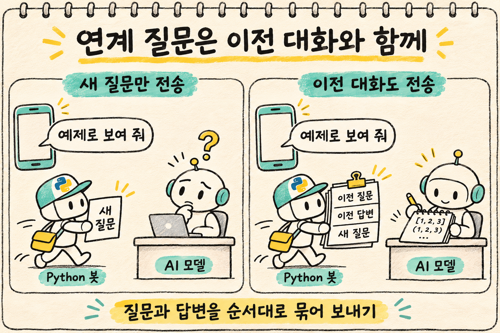

텔레그램에서 AI에게 설명을 부탁한 뒤, 이어서 이렇게 물어보고 싶을 때가 있다.

> “방금 내용을 더 쉽게 설명해 줘.”
>
> “그걸 파이썬 코드로 보여 줘.”
>
> “두 번째 예제만 바꿔 줘.”

[앞선 FreeLLMAPI 텔레그램 연동 글]()의 예제는 질문을 한 번씩 독립적으로 보낸다. 따라서 두 번째 질문을 보낼 때 AI는 첫 질문과 자신의 답변을 전달받지 못한다.

이번 글에서는 **Python 봇이 최근 질문과 답변을 기억하고, 새 질문을 보낼 때 함께 전달하도록** 바꾼다. 기존 봇 토큰과 FreeLLMAPI 통합 키를 그대로 사용할 수 있다. 최근 대화를 확인하는 `/status`, 새 주제를 시작하는 `/new`도 추가한다.

이 글은 Windows에서 앞선 예제를 한 번 실행해 본 초보자를 기준으로 한다. 처음 시작한다면 앞선 글에서 봇 생성과 첫 답변 수신부터 마친 뒤 돌아오면 된다.

## 1. 연계 질문이 가능한 원리


_“예제로 보여 줘”라는 말이 무엇을 가리키는지 알려 주려면 이전 질문과 답변도 함께 보내야 한다._

예를 들어 첫 대화가 다음과 같다고 하자. 아래 대화는 동작을 설명하기 위한 예시다.

```text
나: 파이썬 리스트와 튜플의 차이를 설명해 줘.
AI: 리스트는 내용을 바꿀 수 있고, 튜플은 ...
나: 방금 내용을 코드 예제로 보여 줘.
```

마지막 질문만 보내면 `방금 내용`이 무엇인지 알기 어렵다. 새 예제는 API에 보내는 `messages`를 다음 순서로 만든다.

```text
system     → 답변 방식에 관한 기본 지시
user       → 첫 질문
assistant  → 첫 답변
user       → 새 질문
```

`user`는 사용자의 말이고, `assistant`는 모델의 이전 답변이다. 세 번째 질문부터는 보관 중인 질문·답변 쌍을 같은 순서로 붙인다. 첫 질문만 저장하면 AI가 앞에서 어떤 예제나 항목을 제시했는지 빠질 수 있으므로, **질문과 답변을 한 쌍으로** 보관한다.

FreeLLMAPI에 별도의 “텔레그램 기억 켜기” 설정을 찾을 필요는 없다. 이번에 추가하는 기억은 Python 프로그램이 관리하며, FreeLLMAPI의 OpenAI 호환 채팅 API에 대화 목록을 전달한다. 주소와 통합 키는 기존과 같다. [FreeLLMAPI 공식 API 안내](https://github.com/tashfeenahmed/freellmapi/blob/main/docs/api.md)

### 텔레그램에 예전 메시지가 보이면 기억하는 것 아닌가?

텔레그램 화면에 남아 있는 메시지와 Python 봇의 기억은 별개다. 화면에 지난 대화가 보여도 프로그램이 그 내용을 다시 API 요청에 넣지 않으면 이번 요청에는 포함되지 않는다.

이 예제는 프로그램을 켠 뒤 새로 처리한 대화만 기억한다. 기존 채팅방의 과거 메시지를 자동으로 가져오거나, 예전 프로그램이 처리했던 대화를 복원하지 않는다.

## 2. 이번 예제의 기억 범위와 명령어

| 항목 | 동작 |
|---|---|
| 기억 단위 | 질문 1개 + 답변 1개를 한 쌍으로 보관 |
| 최대 대화 수 | 최근 10쌍 |
| 기록 길이 | 질문과 답변 내용을 합쳐 최대 12,000자 |
| 제한에 도달하면 | 가장 오래된 질문·답변 쌍부터 제외 |
| 새 질문 길이 | 최대 4,000자 |
| 저장 위치 | Python 프로그램의 메모리 |
| 봇 재시작 | 기억 초기화 |
| 사용 가능한 사람 | 등록한 사용자 ID의 개인 대화만 허용 |

**10쌍과 12,000자 중 먼저 걸리는 제한을 적용**한다. 대화가 길면 10쌍보다 적게 기억한다. 글자 수 제한은 기록의 무한 증가를 막는 기준이며, 모델의 토큰 수를 정확히 계산하는 기능은 아니다.

새 요청에는 보관 중인 최대 10쌍과 현재 질문, 기본 지시를 넣는다. 답변을 정상적으로 받은 뒤 텔레그램 전송까지 완료되면 새 질문·답변 쌍을 기록하고 제한을 다시 적용한다. 오류가 난 질문이나 오류 안내 문구는 대화 기록에 넣지 않는다.

| 명령어 | 용도 |
|---|---|
| `/start` | 사용 안내. 이미 있는 기억을 초기화하지 않음 |
| `/id` | 메시지를 보낸 내 계정의 사용자 ID 확인 |
| `/status` | 현재 기억 중인 대화 수와 글자 수 확인 |
| `/new` | 봇이 보관한 대화 기억을 비우고 새 주제로 시작 |

`/new`와 `/status`도 등록된 사용자만 사용할 수 있다. 사용자 ID가 비어 있는 초기 설정 상태에서는 AI를 호출하지 않고 ID 확인 안내만 제공한다.

## 3. 기존 예제를 새 버전으로 교체하기

### 먼저 실행 중인 봇을 종료한다

기존 봇이 실행 중인 PowerShell 창에서 `Ctrl+C`를 누른다. **같은 봇 토큰으로 기존 버전과 새 버전을 동시에 실행하지 않는다.** 중복 실행하면 메시지를 받는 과정에서 `Conflict` 오류가 발생할 수 있다.

FreeLLMAPI 앱은 계속 실행해 둔다. 봇 이름을 새로 만들거나 BotFather에서 토큰을 재발급할 필요는 없다.

### 새 예제 ZIP 내려받기

[대화 기억 버전 예제 ZIP 내려받기](/assets/code/freellmapi-telegram-memory/freellmapi-telegram-memory.zip)

ZIP을 별도 폴더에 풀면 다음 파일이 나온다.

```text
telegram_bot.py
requirements.txt
settings.env.example
.gitignore
```

기존 `freellmapi-telegram` 폴더의 `telegram_bot.py`는 먼저 다른 이름으로 백업한다. 앞선 글과 같은 폴더를 사용한다면 PowerShell에서 다음과 같이 할 수 있다.

```powershell
Set-Location -LiteralPath (Join-Path $env:USERPROFILE 'freellmapi-telegram')
$backupName = 'telegram_bot.backup-' + (Get-Date -Format 'yyyyMMdd-HHmmss') + '.py'
Copy-Item -LiteralPath telegram_bot.py -Destination $backupName
```

백업한 파일을 별도로 실행하지는 않는다. 그다음 압축을 푼 **새 `telegram_bot.py`와 `requirements.txt`만** 기존 폴더에 복사해 교체한다. 파일 이름이 `telegram_bot.py.txt`가 되지 않도록 탐색기에서 파일 확장명도 확인한다.

기존 `.env`에는 이미 본인 토큰, 통합 키, 사용자 ID가 있으므로 **양식 파일로 덮어쓰지 않는다.** 새 버전은 동일한 설정 이름을 사용한다. `.venv` 가상환경도 그대로 사용할 수 있다.

### 패키지 확인과 설치

같은 PowerShell 창에서 실행한다.

```powershell
.\.venv\Scripts\python.exe -m pip install -r requirements.txt
```

패키지 목록은 다음과 같다. 예제는 `python-telegram-bot` 22.8 이상, 23 미만을 대상으로 한다.

```text
python-telegram-bot>=22.8,<23.0
httpx>=0.28,<0.29
python-dotenv>=1.0,<2.0
```

기존 폴더가 없거나 봇을 아직 만들지 않았다면 [처음부터 설정하는 글]()의 Python 설치·가상환경·봇 생성 과정을 먼저 진행한다. 이 글의 ZIP으로 파일을 준비하고, `settings.env.example`을 `.env`로 복사해 본인 값을 입력하면 된다.

## 4. 설정은 기존 .env 그대로 사용한다

설정을 확인하려면 다음 명령으로 연다.

```powershell
notepad .env
```

설정의 형태는 다음과 같다. 아래는 **공개 예시 양식**이므로 실제 토큰이나 키가 아니다.

```dotenv
TELEGRAM_BOT_TOKEN=PASTE_YOUR_BOT_TOKEN_HERE
FREELLMAPI_BASE_URL=http://127.0.0.1:3001/v1
FREELLMAPI_API_KEY=PASTE_YOUR_UNIFIED_KEY_HERE
FREELLMAPI_MODEL=auto
ALLOWED_TELEGRAM_USER_ID=123456789
```

`ALLOWED_TELEGRAM_USER_ID`의 숫자는 내 봇에 `/id`를 보내 확인한 값이어야 한다. 전화번호나 봇 ID를 넣지 않는다. 통합 키 자리에는 FreeLLMAPI에서 복사한 키를 넣고, 제공업체 키는 FreeLLMAPI에 등록한다.

이 글에서도 Python과 FreeLLMAPI는 같은 PC에서 실행한다. 주소의 `127.0.0.1`은 그 PC 자신을 가리키므로 휴대폰 주소로 바꾸지 않는다. FreeLLMAPI 포트를 변경했다면 `3001`만 실제 값으로 맞춘다.

설정 파일이나 토큰은 공개 저장소·댓글·캡처에 올리지 않는다. 새 버전에도 실제 비밀값이 들어 있는 `.env`는 제공하지 않는다.

## 5. 연계 질문이 되는지 확인하기

### 새 프로그램 실행

```powershell
.\.venv\Scripts\python.exe telegram_bot.py
```

사용자 ID까지 설정되어 있다면 터미널에 다음 시작 안내가 표시된다.

```text
연계 질문 모드 | 종료: Ctrl+C
```

이 안내는 프로그램 실행을 시작했다는 뜻이다. 실제 텔레그램 연결과 AI 답변 수신은 아래 순서로 확인한다.

### 세 번 이어서 질문하기

휴대폰에서 **내 봇의 개인 대화창**을 열고 `/start`를 보낸다. 최근 대화 기억과 `/new`, `/status` 안내가 나오는지 확인한다.

그다음 다음 질문을 차례대로 보낸다. 한 번에 모두 붙여 넣지 말고, **각 답변을 받은 뒤 다음 질문을 보낸다.**

```text
1. 파이썬 리스트와 튜플의 차이를 초보자에게 설명해 줘.
2. 방금 설명한 둘의 차이를 짧은 코드 예제로 보여 줘.
3. 그 예제를 줄마다 설명해 줘.
```

위 번호는 설명을 위한 구분이다. 실제로는 각 문장을 메시지 하나씩 보내면 된다. 두 번째 답변이 리스트와 튜플의 예제이고, 세 번째가 앞서 받은 코드를 설명한다면 연계 질문이 의도대로 동작하는지 살펴볼 수 있다. 답변 문구는 선택된 모델에 따라 달라진다.

### /status로 프로그램의 기억 확인

세 번의 질문이 모두 정상 응답과 전송을 마쳤다면 `/status`에 `기억 중: 3쌍 / 최대 10쌍`이 표시된다. 긴 응답 때문에 글자 수 제한에 먼저 도달한 경우에는 그보다 적을 수 있다. 기록 길이의 숫자는 실제 질문과 답변 내용에 따라 달라진다.

**AI가 자연스럽게 답하는지와 프로그램이 기록을 보관하는지는 나누어 확인**하는 편이 좋다. `/status`는 기록 개수를 확인하는 명령이며, 모델의 답변 품질까지 보장하는 표시가 아니다.

## 6. 새 주제를 시작할 때 /new 사용하기


_`/new`는 다음 요청에 넣을 대화 기록을 비운다. 텔레그램 화면의 메시지를 지우는 명령은 아니다._

파이썬 질문을 하다가 여행 계획처럼 전혀 다른 주제로 넘어가고 싶다면 먼저 다음을 보낸다.

```text
/new
```

초기화 안내를 받은 뒤 `/status`를 보내면 기억 중인 대화 수와 기록 길이가 0으로 표시된다. 이제 새 주제로 질문한다.

초기화 직후에는 “그 코드 다시 보여 줘”처럼 지시 대상이 빠진 질문보다, “파이썬으로 CSV 파일을 읽는 예제를 보여 줘”처럼 **새 대화에 필요한 내용을 완전하게 적는 질문**이 적합하다.

### 초기화와 삭제를 구분하기

- `/new`는 이 Python 봇의 메모리에 있는 대화 기록을 비운다.
- 텔레그램에 보이는 이전 메시지는 그대로 남는다.
- FreeLLMAPI나 외부 제공업체에 남을 수 있는 로그까지 삭제하는 기능은 아니다.
- `/start`는 사용 안내만 보여 주므로 기억을 지우려면 `/new`를 사용한다.

요청을 하나씩 처리하므로 답변을 만드는 도중 보낸 `/new`는 앞선 처리가 끝난 다음 실행된다. **진행 중인 AI 요청을 즉시 취소하는 명령은 아니다.** 답변과 초기화 안내를 확인한 뒤 새 질문을 보낸다.

## 7. 코드에서 달라진 핵심 세 곳

전체 코드는 [다운로드한 Python 파일](/assets/code/freellmapi-telegram-memory/telegram_bot.py)에 들어 있다. 처음에는 파일을 교체해 사용하고, 원리를 알고 싶다면 다음 부분을 살펴보자.

### ① 대화방별 기록을 가져온다

```python
history = context.chat_data.get("history", [])
messages = build_messages(history, message.text)
```

`context.chat_data`는 같은 채팅 ID의 메시지를 처리할 때 공유하는 데이터다. 여기의 `history` 항목에 질문·답변 쌍을 넣는다. 이 예제는 개인 대화와 등록된 사용자만 허용하며, 디스크 저장용 persistence는 설정하지 않는다. [라이브러리의 `chat_data` 설명](https://docs.python-telegram-bot.org/en/stable/telegram.ext.callbackcontext.html#telegram.ext.CallbackContext.chat_data)

### ② 이전 질문과 답변을 번갈아 넣는다

```python
def build_messages(history, text):
    messages = [{"role": "system", "content": SYSTEM_PROMPT}]
    for question, answer in trim_history(history):
        messages.append({"role": "user", "content": question})
        messages.append({"role": "assistant", "content": answer})
    messages.append({"role": "user", "content": text})
    return messages
```

이 함수가 연계 질문의 핵심이다. 이전 모델 답변을 `assistant`로 넣고 마지막에 현재 질문을 붙인다. 현재 질문만 들어 있던 기존 예제와 비교하면 무엇이 달라졌는지 알 수 있다.

### ③ 성공한 대화만 저장하고 오래된 쌍을 제외한다

```python
context.chat_data["history"] = trim_history(history + [(message.text, answer)])
```

이 줄은 AI 응답을 받고 답변의 모든 조각을 텔레그램으로 전송한 뒤 실행한다. API 오류나 시간 초과가 발생하면 기존 기록은 그대로 두고, 실패한 질문은 추가하지 않는다.

```python
def trim_history(history):
    kept = list(history)
    while kept and (len(kept) > MAX_TURNS or history_chars(kept) > MAX_HISTORY_CHARS):
        kept.pop(0)
    return kept
```

질문과 답변을 묶어서 제거하므로, 질문만 사라지고 답변만 맨 앞에 남는 식의 순서 오류를 피할 수 있다. 한 쌍 자체가 글자 수 제한을 넘으면 그 쌍도 기록에 남기지 않는다.

프로그램은 `.concurrent_updates(False)`로 메시지를 순서대로 처리한다. 앞 질문의 답변이 기록되기 전에 다음 질문이 같은 기록을 읽는 문제를 줄이기 위한 설정이다. 명령어도 같은 순서로 처리한다. [동시 처리 설정 문서](https://docs.python-telegram-bot.org/en/stable/telegram.ext.applicationbuilder.html#telegram.ext.ApplicationBuilder.concurrent_updates)

## 8. 얼마나 오래 기억해야 할까?

### 대화 수가 늘면 입력 토큰도 늘어난다

새 질문을 보낼 때 과거 대화도 다시 전송한다. 따라서 같은 한 문장 질문이어도 보관 중인 대화가 많으면 요청 입력이 커진다. 무료 제공업체의 토큰 한도나 요청 처리 시간에도 영향을 줄 수 있다.

답변 길이를 제한하는 `max_tokens=768`은 과거 대화의 길이를 줄이는 설정이 아니다. 긴 기록을 줄이려면 `/new`로 초기화하거나 코드 상단의 기억 제한을 조정한다.

```python
MAX_TURNS = 10
MAX_HISTORY_CHARS = 12000
MAX_INPUT_CHARS = 4000
```

모델이 문맥 길이 오류를 반환하거나 응답이 느리다면, 예를 들어 `MAX_TURNS = 5`, `MAX_HISTORY_CHARS = 6000`으로 낮춰 시험할 수 있다. 파일을 수정한 뒤에는 프로그램을 재시작한다. **재시작하면 기존 기억도 초기화**된다.

한국어·영어·코드·이모지는 글자 수가 같아도 토큰 수가 다르다. 12,000자 제한이 모든 모델의 입력 한도 안에 들어간다는 뜻은 아니다. 현재 질문과 기본 지시, 출력에 필요한 여유도 고려해야 하므로 모델별 한도는 사용하는 모델에서 확인한다.

### 기록이 있어도 답변이 항상 정확한 것은 아니다

기억 기능은 필요한 문맥을 모델에 전달하는 기능이다. 모델이 앞 답변을 잘못 이해하거나 사실과 다른 답을 할 가능성까지 없애지는 않는다. 오래된 대화가 제한 때문에 제외되었다면 필요한 조건을 새 질문에 다시 적어 준다.

`auto`를 사용하면 FreeLLMAPI의 라우팅에 따라 다른 모델이 답할 수 있다. 보관한 대화는 새 요청에도 전달하지만 말투나 답변 품질은 달라질 수 있다. 같은 모델로 비교하고 싶다면 사용 가능한 정확한 모델 ID를 확인해 `.env`의 `FREELLMAPI_MODEL`에 지정한다.

### PC를 재시작해도 기억하게 만들 수 있나?

가능하다. SQLite 같은 저장소나 라이브러리의 persistence 기능을 추가할 수 있다. 다만 이 글의 예제에는 포함하지 않는다. **이 예제의 기록은 메모리에만 있고, 프로그램을 종료하면 다음 실행에서 복원하지 않는다.** 재시작 후 텔레그램 화면에 이전 메시지가 남아 있어도 새 봇의 기억은 0쌍이다.

대화를 디스크에 저장하는 버전을 만든다면 저장 위치, 보관 기간, 삭제 방법까지 함께 정해야 한다. 현재 예제도 질문·답변이 텔레그램과 선택된 AI 제공업체를 거치므로 비밀번호나 토큰 같은 비밀정보를 대화에 입력하지 않는다.

## 9. 자주 생기는 문제

| 증상 | 확인할 것 |
|---|---|
| `/start`가 여전히 “각 질문은 별도로 처리”라고 안내 | 새 파일로 교체했는지, 올바른 폴더에서 실행했는지, 기존 프로세스를 종료했는지 확인 |
| `/status`가 답하지 않음 | 새 코드 실행 여부와 등록한 사용자 ID·개인 대화 여부 확인 |
| `/status`는 0쌍인데 이전 대화가 화면에 있음 | 화면 기록과 봇 메모리는 별개. 새 질문부터 다시 시작 |
| 뒤따른 질문이 엉뚱한 주제를 설명 | 직전 답변이 정상 도착했는지, `/new`·재시작·기록 제한으로 문맥이 사라졌는지 확인 |
| 대화 중 문맥 길이 오류 발생 | `/new` 후 다시 질문하거나 기억 수·글자 수 제한을 낮춤 |
| 실패한 질문 뒤 기억 수가 늘지 않음 | 정상 동작. 성공한 답변 전송까지 끝난 쌍만 기록 |
| 답변 일부만 도착한 뒤 기억 수가 늘지 않음 | 텔레그램 전송 중 오류일 수 있음. 연결을 확인하고 질문을 다시 보냄 |
| `Conflict` 발생 | 같은 토큰으로 실행 중인 예전 봇·다른 프로그램 종료 |
| ID 확인 모드만 표시 | `.env`의 `ALLOWED_TELEGRAM_USER_ID` 확인 후 재시작 |
| 여러 질문을 보내니 초기화가 늦음 | 순서대로 처리 중. 앞 요청 완료와 `/new` 안내를 기다림 |

이 예제는 시작할 때 대기 중이던 메시지를 버리도록 `drop_pending_updates=True`를 사용한다. 봇이 꺼져 있을 때 보낸 질문은 재실행 후 다시 보내야 한다. 새 버전도 메시지의 수정 이력, 사진·음성·첨부 파일을 대화 기억에 넣지 않는다. [폴링 시작 옵션](https://docs.python-telegram-bot.org/en/stable/telegram.ext.application.html#telegram.ext.Application.run_polling)

## 예제 파일과 검증 범위

- [전체 예제 ZIP](/assets/code/freellmapi-telegram-memory/freellmapi-telegram-memory.zip)
- [Python 코드](/assets/code/freellmapi-telegram-memory/telegram_bot.py)
- [패키지 목록](/assets/code/freellmapi-telegram-memory/requirements.txt)
- [설정 양식](/assets/code/freellmapi-telegram-memory/settings.env.example)

2026년 11월 18일 확인한 공식 자료와 `python-telegram-bot` 22.8을 기준으로 작성했다. 로컬에서는 가상 AI 응답과 메시지 객체를 사용해 대화 순서, 후속 질문에 과거 응답 포함, 기억 제한, `/new`, 사용자 제한과 실패 시 기록 보존을 검증했다. 실제 텔레그램 토큰·제공업체 키를 사용한 종단 간 통신은 시험하지 않았다. 본인의 계정에서는 5~6단계로 후속 답변과 `/status`, 초기화 결과를 확인한다.
