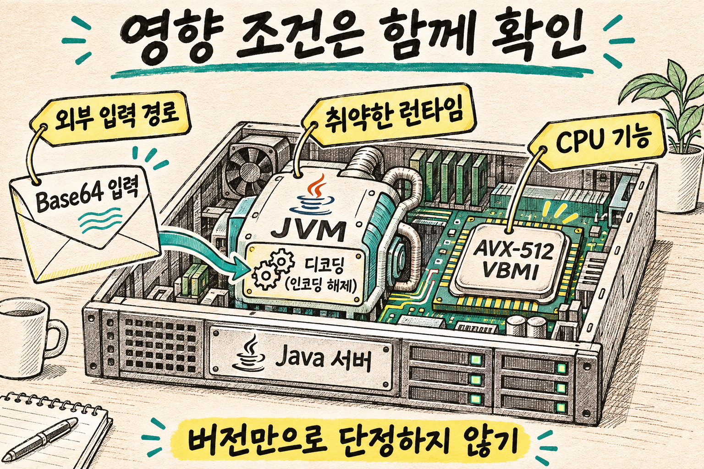
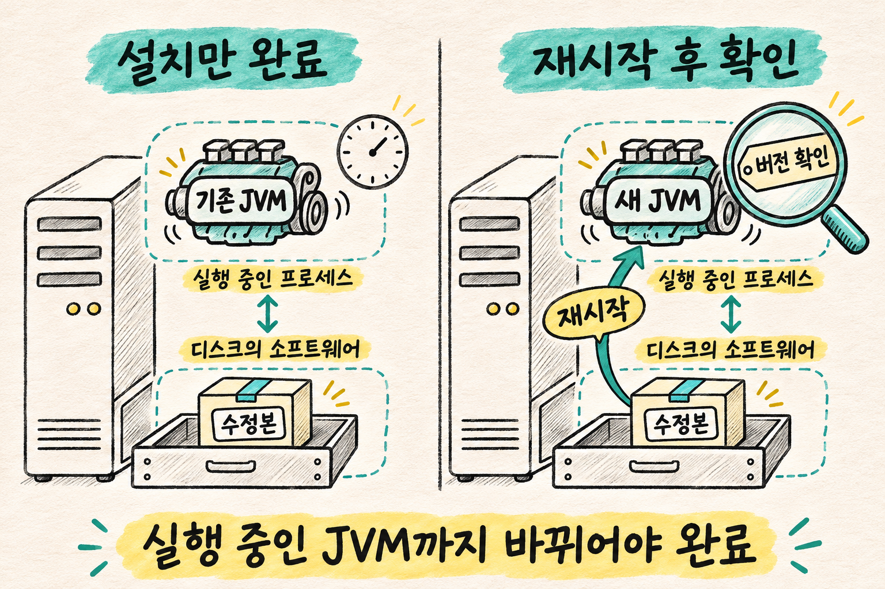

## Java2Shell은 무엇인가

**Java2Shell과 Java4Shell은 CVE-2026-114938을 가리키는 이름이다.** Java 애플리케이션이 사용하는 HotSpot JVM의 하드웨어 가속 Base64 디코더에 메모리 손상 결함이 있으며, 조건이 맞으면 서비스 중단이나 원격 코드 실행으로 이어질 수 있다. 2026년 11월 17일 Oracle과 OpenJDK가 수정 사항을 공개했다. ([CERT-EU 공지](https://cert.europa.eu/publications/security-advisories/2026-021/), [발견자 Calif의 설명](https://calif.io/java4shell/))

이 글은 **2026년 11월 20일 기준** 공식 공지와 발견자의 분석을 바탕으로 운영자가 점검할 항목을 정리한다. 실제 취약 시스템에 대한 공격 재현이나 원격 코드 실행 시험은 수행하지 않았다.

| 항목 | 내용 |
|---|---|
| 식별자 | CVE-2026-114938 |
| 별칭 | Java2Shell, Java4Shell |
| 구성 요소 | HotSpot의 x86-64 Base64 디코더 intrinsic |
| 핵심 조건 | 취약 런타임, 특정 CPU 기능, 활성화된 가속 경로, 공격자 입력 도달 |
| Oracle·OpenJDK 평가 | CVSS v3.1 8.1 |
| 우선 대응 | 공급자 수정 런타임 적용 후 모든 해당 JVM 재시작 |

점수와 구성 요소는 [OpenJDK 위험도 표](https://openjdk.org/groups/vulnerability/advisories/2026-11-17)를 기준으로 한다. 보안 업데이트 전체의 영향 버전 목록과 **이 CVE에 표시된 개별 행**을 구분해서 읽어야 한다.

## Java인데 어떻게 메모리가 손상될까

Java는 일반적인 배열 접근에 범위 검사를 제공한다. 다만 JVM은 자주 사용하는 연산을 빠르게 처리하기 위해 일부 메서드를 CPU 명령을 활용한 내부 구현으로 바꾼다. 이를 **intrinsic**이라고 부른다.

이번 결함은 x86-64 AVX-512 Base64 디코딩 구현에서 잘못된 패딩을 처리할 때 출력 길이와 쓰기 마스크를 계산하는 과정에 있다. 그 결과 출력 버퍼 범위를 넘어 쓸 수 있다. 입력을 잘못된 Base64라고 판단해 예외를 던지더라도, 그 전에 쓰기가 일어날 수 있다는 점이 중요하다. ([Calif의 원인 분석](https://calif.io/java4shell/))

따라서 애플리케이션이 `IllegalArgumentException`을 잡거나 HTTP 401·400을 반환한다는 사실만으로 안전하다고 판정할 수 없다. 메모리 손상에서 코드 실행까지는 애플리케이션별 입력 경로와 메모리 배치 등 추가 조건이 필요하다. 발견자는 제품별 공격 구성이 필요하다고 설명하므로, 모든 Java 서버에 동일한 요청 하나로 코드 실행이 가능하다고 일반화해서도 안 된다.

Log4Shell과 이름은 비슷하지만 대응 대상은 다르다. 이번 점검의 중심은 Log4j 의존성이 아니라 **실제로 서비스를 실행하는 Java 런타임**이다.

## 어떤 환경이 영향받는가


_런타임, CPU 기능, 입력 경로를 함께 조사해야 노출 범위를 판단할 수 있다._

[CERT-EU](https://cert.europa.eu/publications/security-advisories/2026-021/)는 다음 조건을 제시한다.

1. 해당 결함이 있는 Java 런타임을 사용한다.
2. JVM에 보이는 x86-64 CPU 기능에 `avx512f`, `avx512bw`, `avx512vbmi`, `bmi2`가 있다.
3. 해당 Base64 intrinsic 경로가 활성화되어 있다.
4. 공격자가 제어하는 Base64 데이터가 디코더에 도달한다.

입력 후보에는 HTTP Basic 인증, JWT, SAML, 쿠키, TLS 데이터 등이 있다. 이름이 등장한다는 이유만으로 해당 기능을 사용하는 모든 제품이 취약한 것은 아니다. **어느 런타임에서 어떤 디코더를 호출하는지**를 확인해야 한다.

ARM64는 이 x86-64 구현의 영향 대상이 아니다. 가상 머신과 컨테이너는 호스트의 CPU 모델명만으로 판단하지 말고 JVM 실행 환경에서 노출된 기능을 확인한다. CPU 조건이 맞지 않더라도 같은 업데이트가 수정하는 다른 취약점의 적용 여부는 별도로 확인해야 한다.

### 영향 계열과 수정 버전

다음은 [CERT-EU가 제시한 계열별 수정 버전](https://cert.europa.eu/publications/security-advisories/2026-021/)이다. 배포판 패키지나 제품 내장 JRE는 공급자의 보안 공지와 빌드 번호를 우선한다.

| 계열 | 공지에 나온 영향 범위 | 수정 버전 기준 |
|---|---|---|
| Java 17 | 17.0.6부터 17.0.21까지 | 17.0.21.1 |
| Java 21 | 해당 계열의 21.0.13 및 이전 취약 릴리스 | 21.0.13.1 |
| Java 25 | 해당 계열의 25.0.5 및 이전 취약 릴리스 | 25.0.5.1 |
| Java 27 | 해당 계열의 27.0.1 및 이전 취약 릴리스 | 27.0.1.1 |
| Oracle Java 8 특수 performance 빌드 | 8u511-perf 계열 | 8u513, 공급자 빌드 확인 |
| Oracle GraalVM for JDK 17·21 | 공급자가 지정한 취약 릴리스 | 해당 제품 공지 확인 |

**일반 OpenJDK 8·11 전체가 이 CVE에 해당한다는 뜻은 아니다.** OpenJDK 공지에는 다른 CVE를 포함한 업데이트 전체의 버전 목록도 함께 나온다. 반대로 Java 8이라는 이유만으로 Oracle의 특수 performance 빌드까지 비영향이라고 처리해서도 안 된다. Oracle의 정확한 해당 빌드는 `8u511b33-perf`로, [발견자가 인용한 Oracle 목록](https://calif.io/java4shell/)과 [Oracle 개별 CVE 설명](https://www.oracle.com/security-alerts/cspunov2026.html)을 대조한다.

Temurin·Corretto·Zulu·Microsoft Build of OpenJDK 등 OpenJDK 기반 배포판도 점검 대상이다. 서로 다른 공급자의 숫자만 비교해 수정 여부를 확정하지 않는다. 백포트된 배포판 패키지는 릴리스 번호가 달라도 수정될 수 있고, 다운로드한 최신 설치 파일이 아직 실행 프로세스에 반영되지 않았을 수도 있다.

## 운영 환경에서 확인하는 순서

### 1. 서비스가 사용하는 Java를 식별한다

터미널에서 다음 명령을 실행하면 **그 셸이 선택한 Java**를 확인할 수 있다.

```bash
java -version
java -XshowSettings:properties -version
```

`java.home`, 런타임 버전, VM 종류를 기록한다. 하지만 이것만으로 서비스의 Java가 확인되지는 않는다. 제품 설치 폴더의 `jre/`, systemd의 실행 경로, Windows 서비스 설정, 컨테이너 이미지에 다른 Java가 있을 수 있다.

JDK의 진단 도구를 사용할 수 있다면 서비스와 같은 사용자·실행 환경에서 대상 JVM을 조사한다. 아래 `12345`는 실제 서비스의 Java PID로 바꾼다.

```bash
jcmd -l
jcmd 12345 VM.version
jcmd 12345 VM.command_line
jcmd 12345 VM.flags -all
```

이 명령은 런타임 조회용이며 공격 트래픽을 보내지 않는다. Attach 권한, JDK 도구 설치 여부, 컨테이너의 PID 네임스페이스에 따라 실패할 수 있다. 실패하면 제품의 진단 화면이나 서비스 시작 로그로 같은 정보를 확인한다. 명령행에는 비밀 값이 포함될 수 있으므로 결과 원문을 공개 게시하지 않는다.

Linux에서는 실행 파일 경로도 확인할 수 있다.

```bash
readlink /proc/12345/exe
```

경로 끝의 `(deleted)`는 실행 파일 교체 후 예전 프로세스가 남아 있을 가능성을 보여 준다. 이 표시가 없다고 재시작이나 패치가 검증되는 것은 아니다.

### 2. CPU 기능과 입력 경로를 확인한다

Linux에서는 JVM이 실행되는 VM·컨테이너 안에서 다음과 같이 확인한다.

```bash
uname -m
grep -m1 '^flags' /proc/cpuinfo | tr ' ' '\n' \
  | grep -E '^(avx512f|avx512bw|avx512vbmi|bmi2)$'
```

네 기능의 존재는 하드웨어 조건의 확인이며, 공격 가능성 전체를 입증하지 않는다. 출력이 없거나 명령을 사용할 수 없을 때도 곧바로 비영향으로 결론내리지 말고 아키텍처·CPU 노출 설정을 확인한다. Windows는 Linux 명령을 그대로 사용하지 말고 운영 환경의 CPU 기능 조회 도구와 제품 공지를 이용한다.

이어서 인증 앞단, API 게이트웨이 뒤의 애플리케이션, 파일 업로드, 토큰 처리, 외부 서버 연결 등에서 신뢰할 수 없는 입력이 Java Base64 디코더로 들어오는지 조사한다. 소스 검색 결과나 WAF 차단 여부만으로 모든 경로를 조사했다고 보기는 어렵다.

### 3. 공급자 수정본을 적용하고 재시작한다

인터넷에 노출된 서비스부터 우선순위를 정하고, 공급자가 이 CVE의 수정을 명시한 런타임 또는 제품 업데이트를 적용한다. ([CERT-EU 권고](https://cert.europa.eu/publications/security-advisories/2026-021/))

- 일반 서버: 서비스가 실제 사용하는 JDK·JRE를 갱신하고 해당 서비스를 재시작한다.
- 컨테이너: 수정된 Java가 포함된 이미지로 다시 빌드·배포하고 기존 인스턴스를 교체한다.
- 제품 내장 JRE: 공급자가 지원하는 제품 패치나 런타임 교체 절차를 따른다.
- 다중 인스턴스: 모든 노드와 복제본의 실행 버전을 기록한다.

호스트 패키지 갱신만으로 컨테이너 내부 Java가 바뀌지는 않는다. 디스크의 설치 파일을 교체해도 이미 실행 중인 JVM은 계속 과거 코드를 사용할 수 있다.


_패키지 설치 완료와 실행 JVM 교체 완료를 구분한다._

### 4. 변경 후 실행 JVM과 서비스를 확인한다

재시작 후 새 PID에 대해 `VM.version`, `VM.command_line`, `VM.flags -all`을 다시 확인한다. 수정 패키지의 빌드 번호와 공급자 공지를 대조하고, 로그인·토큰 검증·업로드 등 서비스의 정상 동작을 확인한다. 장시간 실행되는 배치, 별도 관리 도구, 백그라운드 Java 프로세스도 점검 목록에 넣는다.

점검 기록은 다음처럼 작성할 수 있다. 이는 실제 장비의 결과가 아닌 **기록 양식 예시**다.

| 서비스 | 실행 경로·이미지 | 공급자 수정 근거 | 재시작 후 버전 | 기능 확인 |
|---|---|---|---|---|
| 예시 API | 실제 경로 또는 이미지 digest | 해당 공급자 공지와 패키지 릴리스 | 새 PID의 런타임 버전 | 로그인·API 정상 여부 |

## 바로 패치할 수 없을 때의 임시 완화

[CERT-EU](https://cert.europa.eu/publications/security-advisories/2026-021/)는 Base64 intrinsic을 끄는 방법을 안내한다. 아래는 직접 `java -jar`로 실행하는 서비스의 시작 명령 예시다. `app.jar`는 실제 애플리케이션 경로로 바꾼다.

```bash
java -XX:+UnlockDiagnosticVMOptions -XX:-UseBASE64Intrinsics -jar app.jar
```

systemd·제품별 서비스 래퍼·컨테이너에서 실행한다면 **그 서비스의 JVM 시작 옵션**에 반영해야 한다. 별도 셸에서 이 명령을 실행하는 것만으로 기존 서비스에 적용되지는 않는다. 옵션은 `-jar`보다 앞에 둔다. 적용 후 JVM을 재시작하고 대상 PID에서 확인한다.

```bash
jcmd 12345 VM.flags -all
```

결과에서 `UseBASE64Intrinsics`가 `false`인지 확인한다. `12345`는 재시작 후의 PID다. 새 셸에서 `java -XX:+PrintFlagsFinal -version`만 실행하면 새로 시작한 JVM의 설정을 보여 주므로, 이미 실행 중인 서비스의 검증을 대신하지 못한다.

발견자는 x86-64에서 AVX-512 사용을 제한하는 다음 대안도 안내한다.

```bash
java -XX:UseAVX=2 -jar app.jar
```

**이 대안은 x86-64용이다. ARM JVM에 그대로 적용하면 시작에 실패할 수 있다.** 더 넓은 벡터 연산 성능에 영향을 줄 수 있으므로 비운영 환경에서 시작과 성능을 확인한다. 지원되지 않는 옵션을 무시하도록 설정해 문제를 숨기지 말고, 실제 JVM 구현과 공급자 안내를 확인한다. 두 방법 모두 재시작이 필요하고 수정본 적용 전까지의 임시 조치다. ([Calif의 완화 안내](https://calif.io/java4shell/))

## 자주 놓치는 판단

**“Log4j를 업데이트했으니 끝났다.”** 이 결함의 대상은 JVM의 Base64 구현이다. 의존성 업데이트와 별도로 런타임을 확인한다.

**“로그인 실패를 반환하니 안전하다.”** 인증 전에 디코딩할 수 있고, 예외를 반환하기 전에 메모리 손상이 생길 수 있다. 정상적인 거절 응답은 패치 증거가 아니다.

**“`java -version`이 바뀌었으니 서비스도 바뀌었다.”** 셸과 서비스의 실행 경로가 다를 수 있다. 내장 JRE, 컨테이너, 기존 PID를 확인한다.

**“WAF나 프록시 버퍼링을 켜면 해결된다.”** 발견자는 애플리케이션별 경로가 다르며 요청 버퍼링을 일반적인 완화책으로 볼 수 없다고 설명한다. 런타임 패치 또는 공급자가 안내한 JVM 완화 설정을 기준으로 대응한다. ([Calif 분석](https://calif.io/java4shell/))

운영 완료의 기준은 다운로드 성공이 아니라, **각 서비스의 실행 JVM이 수정된 빌드로 바뀌었고 필요한 기능이 정상 동작한다는 기록**이다.

## 참고 자료

- [OpenJDK: 2026년 11월 17일 취약점 공지](https://openjdk.org/groups/vulnerability/advisories/2026-11-17)
- [Oracle: 2026년 11월 Critical Security Patch Update](https://www.oracle.com/security-alerts/cspunov2026.html)
- [CERT-EU: High Severity Vulnerability in Java SE and OpenJDK](https://cert.europa.eu/publications/security-advisories/2026-021/)
- [Calif: Java4Shell 원인·영향 환경·완화 설명](https://calif.io/java4shell/)
