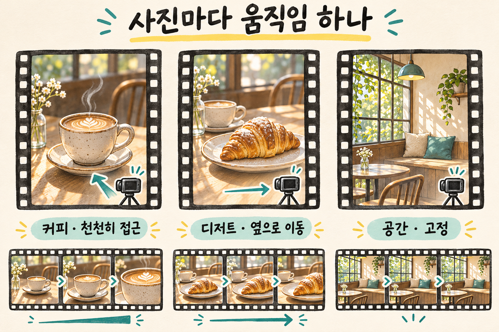
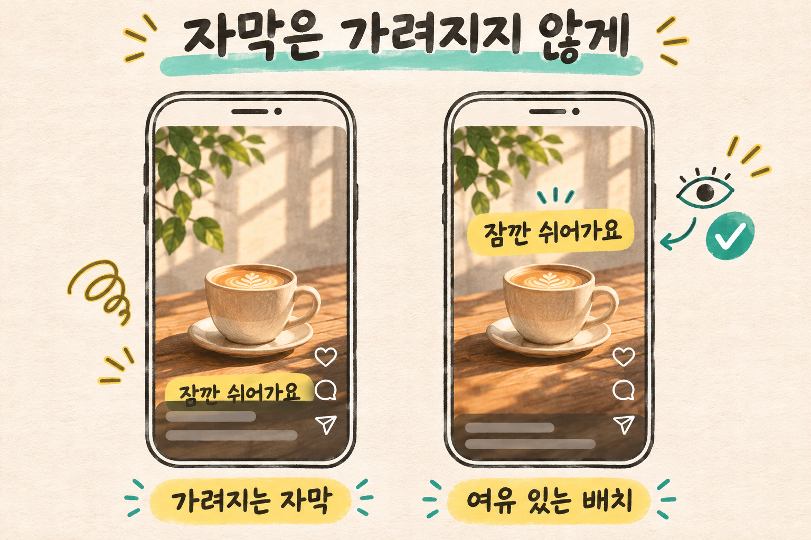

## 사진만 있으면 릴스를 만들 수 있을까

인스타그램에서 사진 속 커피에 김이 오르거나, 제품 주위를 카메라가 부드럽게 도는 영상을 보면 어떻게 찍었는지 궁금해진다. 이런 장면을 만드는 방법 중 하나가 **힉스필드(Higgsfield)의 이미지 기반 영상 생성**이다.

Higgsfield는 이미지·영상 생성 모델과 편집 기능을 제공하는 서비스다. 사진을 넣고 대상이나 카메라가 어떻게 움직일지 지정하면 짧은 영상으로 확장할 수 있다. 공식 페이지에서도 사진 애니메이션과 카메라 움직임, 세로 비율 변환을 안내한다. ([Image to Video 소개](https://higgsfield.ai/image-to-video-ai))

처음 만든다면 **사진으로 짧은 클립을 생성하고, 편집기에서 좋은 부분을 골라 릴스로 조립하는 방식**을 권한다. 한 번의 생성으로 자막·음악·브랜드 정보까지 모두 해결하려 하면 수정해야 할 요소가 늘어난다.

이 글은 **2026년 11월 21일 기준 공식 자료를 확인한 제작 가이드**다. 아래 카페 영상은 따라 하기 위한 기획과 프롬프트 예시이며, 유료 영상 생성이나 실제 인스타그램 게시 결과를 측정한 후기는 아니다. 15초는 이 예제의 편집 목표이지 릴스의 최대 길이가 아니다.

## 먼저 15초짜리 구성부터 정한다

주제는 ‘잠깐 쉬어가고 싶은 카페’로 잡자. 사진은 커피, 디저트, 창가 자리 세 장을 준비한다. 완성 영상의 구성은 다음과 같다.

| 편집 구간 | 보여 줄 장면 | 나중에 넣을 자막 | 역할 |
|---|---|---|---|
| 0~3초 | 커피를 가까이 보여 주는 장면 | 오늘은 잠깐 쉬어가요 | 첫 장면에서 분위기 전달 |
| 3~8초 | 디저트와 테이블의 질감 | 커피 한 잔, 달콤한 한 입 | 볼거리 확장 |
| 8~12초 | 햇빛이 드는 창가 자리 | 햇빛 좋은 자리까지 | 공간 소개 |
| 12~15초 | 가장 안정적인 장면 재사용 | 다음 카페 시간에 저장 | 가벼운 행동 제안 |

영상 세 개를 각각 생성한 뒤 쓸 부분만 잘라 배치한다. 모델이 지원하는 생성 길이와 최종 편집 길이는 서로 달라도 된다. 마지막 구간은 새 영상을 생성하기보다 기존 컷의 다른 부분이나 원본 사진을 활용해도 좋다.

이 구성은 출발점이다. 상품 소개라면 마지막에 제품명을, 여행 기록이라면 장소명을 넣는 식으로 바꾼다. 특정 구성이나 효과가 조회수를 보장하지는 않는다.

## 1. 사진과 세로 구도를 준비한다

본인이 촬영했거나 사용 권한이 있는 사진을 고른다. 첫 시도에는 손이나 사람이 복잡하게 얽힌 사진보다, 커피잔처럼 주제가 분명하고 배경이 단순한 사진이 편하다.

- **같은 카페로 보이는 사진**을 고른다. 색온도와 시간대가 비슷하면 컷을 연결하기 쉽다.
- **세로 화면에서 주제가 남는지** 먼저 확인한다. 가로 사진을 세로로 자르면 접시나 손잡이가 잘릴 수 있다.
- **중요한 글자는 별도로 준비한다.** 간판, 메뉴, 로고는 영상 생성 과정에서 형태가 달라질 수 있으므로 결과를 프레임별로 확인한다.
- **자막 공간을 남긴다.** 커피잔이 화면을 꽉 채운 사진보다 위쪽이나 주변에 여백이 있는 사진이 편집하기 쉽다.

사진이 없으면 먼저 이미지를 생성할 수도 있지만, 실제 매장 소개에 쓸 때에는 실제 공간·상품과 일치하는지 확인해야 한다. 분위기용 가상 장면을 실제 방문 기록처럼 설명하지 않는다.

## 2. 힉스필드에서 사진을 짧은 영상으로 바꾼다

[Higgsfield](https://higgsfield.ai/)에 로그인한 뒤 영상 생성 화면에서 이미지 입력을 지원하는 모델이나 작업 방식을 선택한다. 공식 사이트에는 **Video**, **Image to Video**, **Cinema Studio** 같은 진입점이 있다. 화면 구성과 지원 옵션은 모델·계정에 따라 달라질 수 있으므로 버튼의 고정 위치보다 다음 입력 항목을 확인하자.

1. 커피 사진을 시작 이미지 또는 참조 이미지로 업로드한다. 두 입력 방식이 함께 있다면, 사진의 구도에서 바로 출발할 때는 시작 이미지 방식을 우선 검토한다.
2. 릴스용 **9:16** 출력을 지원하는지 확인한다. 비율 선택이 없다면 입력 사진과 출력 규칙을 확인하고, 최종 편집에서 세로 화면을 맞춘다.
3. 처음에는 지원되는 짧은 길이와 미리보기용 해상도를 선택한다. 예를 들어 5초·720p가 제공된다면 테스트에 사용할 수 있다. 모든 모델에 같은 옵션이 있는 것은 아니다.
4. 아래 예시처럼 움직임을 짧게 입력한다. 별도의 카메라 설정이 있다면 프롬프트와 같은 방향으로 맞춘다.
5. 생성 버튼에 표시되는 크레딧을 확인하고 실행한다.
6. 결과를 재생해 모양·움직임을 확인한 뒤 다운로드한다. 디저트와 공간 사진도 각각 같은 방식으로 진행한다.

Cinema Studio는 참조와 카메라·조명 등 연출 설정을 함께 다루는 작업 공간이다. 첫 릴스에서는 모든 설정을 바꾸기보다 사진과 움직임을 먼저 확정하는 편이 수정 원인을 파악하기 쉽다. ([Cinema Studio 공식 가이드](https://higgsfield.ai/blog/cinema-studio-4-0-complete-guide))


_사진마다 주된 카메라 움직임을 하나씩 정하면 컷의 목적이 선명해진다._

### 복사해서 바꿔 쓸 프롬프트

시작 이미지가 이미 외형을 보여 주므로, 프롬프트에서는 **무엇이 어떻게 움직이는지와 유지할 특징**을 중심으로 적는다. Higgsfield의 공식 프롬프트 자료도 시작 이미지 기반 영상에서는 동작을 설명하고, 비율·길이 등 출력 설정은 화면에서 지정하도록 안내한다. ([공식 프롬프트 가이드](https://github.com/higgsfield-ai/skills/blob/main/higgsfield-generate/references/prompt-engineering.md), [Prompting 문서](https://higgsfield.ai/enterprise-help-center/platform/prompting))

**커피 컷 — 잔을 향해 천천히 접근**

```text
The camera slowly pushes toward the coffee cup.
A thin wisp of steam rises gently.
The cup stays still on the table, keeping its shape and handle.
Warm window light remains steady. One continuous shot.
```

뜻은 ‘카메라가 커피잔을 향해 천천히 다가가고, 얇은 김이 올라오며, 잔의 모양과 조명은 유지된다’이다. 김 표현이 어색하면 해당 문장부터 빼고 카메라 이동만 시험한다.

**디저트 컷 — 작은 옆 이동**

```text
The camera slides slowly to the right past the pastry plate.
The pastry and plate stay still with consistent shapes and textures.
Soft afternoon window light. One continuous shot.
```

**공간 컷 — 카메라는 고정하고 작은 변화만**

```text
A locked-off shot of the cafe window seat.
Leaves outside the window move gently in the breeze.
The furniture and window frames remain still and consistent.
Warm daylight. One continuous shot.
```

영어는 그대로 활용하기 위한 예시이며 필수 조건은 아니다. 사진에 창밖 나뭇잎이 없다면 해당 문장을 삭제한다. ‘영화처럼 멋지게’라는 표현을 늘리기보다 **카메라의 방향, 대상의 동작, 유지할 특징**을 구체적으로 바꿔 보자. 유지 지시는 결과를 보장하는 잠금장치가 아니므로 검수는 필요하다.

## 3. 결과에서 쓸 부분을 골라 편집한다

생성된 영상을 바로 올리기 전에 **처음·중간·끝 프레임**을 살핀다. 커피잔 손잡이가 하나 더 생기거나, 접시가 휘거나, 창틀이 흐르는 부분은 제외한다. 짧게라도 이상한 프레임이 있으면 반복 재생에서 눈에 띈다.

그다음 익숙한 모바일·PC 편집기에서 새 프로젝트를 만들고 다음 순서로 조립한다. 이 단계는 특정 편집기 기능을 전제로 하지 않는 일반적인 작업 순서다.

1. 프로젝트 캔버스를 **9:16**으로 설정한다.
2. 세 클립을 앞서 정한 순서로 배치한다.
3. 불안정한 시작·끝 부분을 자르고 총길이를 15초 안팎으로 조정한다.
4. 컷 사이에는 우선 단순한 전환을 사용하고, 밝기와 색감을 비슷하게 맞춘다.
5. 자막을 짧게 넣고, 필요한 음악이나 내레이션을 추가한다.

길이가 부족하면 무리하게 느리게 늘리기보다 원본 사진을 짧게 섞거나 안정적인 컷을 추가한다. Higgsfield 안에서 비율을 조정하려면 **Reframe** 같은 편집 기능도 검토할 수 있다. 단순 자르기와 생성 기반 재구성은 결과가 다를 수 있으므로 피사체와 배경을 다시 확인한다. ([공식 영상 편집 가이드](https://higgsfield.ai/blog/how-to-edit-videos-with-ai))

### 자막은 영상 생성 후에 얹는다

한국어 문구를 생성 영상에 직접 그려 넣기보다 편집기의 텍스트로 추가하면 오탈자와 위치를 바로 고칠 수 있다. 한 화면에 긴 문장을 몰아넣지 말고 휴대전화에서 읽어 보며 길이를 줄인다.


_아래쪽 설명과 오른쪽 버튼이 자막을 가릴 수 있으므로 업로드 미리보기에서 위치를 확인한다._

중요한 문구는 화면 가장자리와 하단에 바짝 붙이지 않는다. 정확히 몇 픽셀을 띄우면 모든 화면에서 안전하다고 단정하기보다, 실제 앱의 릴스 미리보기와 커버 미리보기를 각각 확인한다.

### 음악은 게시 목적에 맞춰 고른다

개인 기록인지 매장 홍보·광고인지에 따라 사용할 음원의 조건을 확인한다. 편집기에 들어 있는 음악이나 인기 음원이라는 이유만으로 모든 게시·광고에 쓸 수 있다고 가정하지 않는다. 직접 보유한 음원이나 게시 목적에 맞는 사용 권한을 확인한 음악을 선택하자.

내레이션이 있다면 휴대전화 스피커로 재생해 말소리가 음악에 묻히는지 확인한다. 생성 클립에 소리가 포함됐다면 편집 과정에서 원본 소리를 유지할지 음소거할지도 정한다.

## 4. 내보내고 인스타그램에 올린다

이 예제의 **편집·내보내기 출발값**은 아래와 같다. 플랫폼의 모든 허용 규격이나 최대치를 뜻하지 않는다.

| 항목 | 예제에서 사용할 값 |
|---|---|
| 화면 비율 | 9:16 세로 |
| 출력 크기 | 1080 × 1920 |
| 프레임레이트 | 30fps |
| 파일 | MP4, H.264 영상과 AAC 오디오 |
| 편집 길이 | 약 15초 |

원본 클립이 720p라면 1080p로 내보내도 없던 디테일이 복원되지는 않는다. 최종 후보를 고른 뒤 더 높은 해상도로 다시 생성할지 판단한다. 지원되는 업스케일 기능을 쓰더라도 잔의 표면이나 음식 질감이 달라졌는지 살핀다.

인스타그램 앱에서 릴스 만들기를 열어 파일을 선택하고, **잘림·자막·음량·커버**를 확인한다. 커버에는 영상 내용이 바로 드러나는 장면을 고르고 짧은 제목을 배치한다. 설명에는 실제 장소나 제품 정보처럼 영상만으로 알기 어려운 내용을 보충한다.

AI로 만든 사실적인 영상·음성은 업로드 화면의 AI 콘텐츠 공개 항목과 적용 정책도 확인한다. Meta는 생성형 AI 콘텐츠를 탐지한 신호나 사용자의 공개에 따라 **AI info** 표시를 적용한다고 설명한다. ([Meta의 AI 콘텐츠 표시 안내](https://about.fb.com/news/2024/04/metas-approach-to-labeling-ai-generated-content-and-manipulated-media/))

게시 전에는 다음을 한 번씩 확인한다.

- 첫 화면에서 무엇을 보여 주는 영상인지 알 수 있는가?
- 소리를 꺼도 자막으로 내용을 이해할 수 있는가?
- 잔·접시·창틀·글자가 중간에 변하지 않는가?
- 자막과 커버 제목이 앱 화면 요소에 가려지지 않는가?
- 사진·음악·인물의 사용 권한과 AI 콘텐츠 공개 항목을 확인했는가?

## 크레딧을 아끼려면 무엇부터 줄일까

모델 이름보다 먼저 **몇 개의 컷을 어떤 길이로 시험할지** 정한다. 테스트 영상을 여러 개 만든 뒤 최종 후보만 고해상도로 생성하면 예산을 관리하기 쉽다.

Higgsfield는 모델·길이·해상도 등에 따라 생성 비용이 달라지는 크레딧 방식을 사용한다. 요금제, 무료 생성, 무제한 적용 대상은 바뀔 수 있으므로 고정된 ‘릴스 한 편 가격’으로 계산하지 않는다. 웹사이트의 혜택이 MCP·CLI 같은 다른 경로에 동일하게 적용되는지도 별도로 확인한다. ([현재 요금과 적용 조건](https://higgsfield.ai/pricing))

예를 들어 **생성 화면에 한 번당 10크레딧이라고 표시됐다고 가정**하면, 세 컷을 두 번씩 시험하는 계획은 `3 × 2 × 10 = 60크레딧`이다. 이는 계산 방법을 보여 주는 가상 예시이며 실제 단가가 아니다. 이미지 생성, 고해상도 재생성, 편집 기능 비용은 따로 더해야 한다.

수정할 때에는 사진·프롬프트·카메라 이동을 동시에 바꾸지 않는다. 컵이 변형되면 움직임부터 줄이고, 구도가 어색하면 사진의 세로 크롭부터 확인하는 식으로 원인을 하나씩 좁힌다.

## 자주 막히는 문제

| 문제 | 먼저 시도할 수정 |
|---|---|
| 컵이나 제품 모양이 달라진다 | 회전·큰 이동을 줄이고 단순한 접근 또는 고정 구도로 시험 |
| 카메라가 너무 요란하다 | 여러 효과를 함께 쓰지 말고 작은 움직임 하나만 지정 |
| 세 컷이 다른 장소처럼 보인다 | 같은 장소·시간대의 사진을 선택하고 편집에서 색감 조정 |
| 글자가 깨지거나 로고가 바뀐다 | 글자가 중요한 부분은 원본을 활용하고 자막은 편집기에서 추가 |
| 세로로 바꾸니 주제가 잘린다 | 입력 사진을 먼저 9:16으로 미리 보고 위치 조정 |
| 영상은 예쁜데 전달할 내용이 없다 | 첫 자막과 마지막 문구를 먼저 쓰고 필요한 컷만 남기기 |
| 생성할수록 크레딧만 줄어든다 | 컷별 시도 횟수에 상한을 정하고 한 번에 한 요소만 수정 |

첫 작업은 **커피 사진 한 장, 작은 카메라 움직임 하나, 짧은 자막 한 줄**부터 시작해도 충분하다. 그 결과에서 쓸 수 있는 몇 초를 고르는 감각을 익힌 뒤 디저트와 공간 컷을 붙여 보자. 힉스필드의 생성 기능에 기획과 편집을 더하면, 단순히 움직이는 사진을 넘어 전달할 내용이 있는 릴스로 만들 수 있다.
