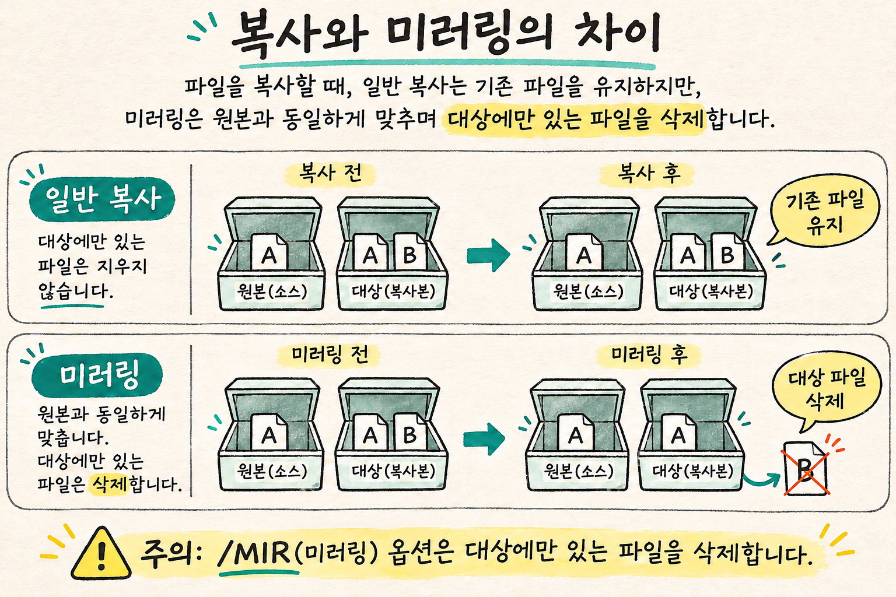

사진과 문서가 늘어나면 폴더를 드래그해 복사하는 일도 번거로워진다. 복사 도중 오류가 났는지, 다음번에는 무엇이 달라지는지 기록도 남기고 싶어진다. 이럴 때 Windows에 포함된 **Robocopy**로 작업을 명령으로 남길 수 있다.

먼저 작은 연습 폴더에서 **미리보기 → 복사 → 결과 확인 → 복원 시험**을 해 보자. 실제 문서 폴더나 NAS를 바로 대상으로 삼지 않아도 명령의 의미를 익힐 수 있다. 아래 명령은 PowerShell용이다.

## 원본과 대상부터 구분하기

```text
robocopy "원본 폴더" "대상 폴더" 옵션
```

왼쪽이 읽어 올 곳, 오른쪽이 복사해 둘 곳이다. 실행 전 두 경로를 소리 내어 읽어 보면 방향을 뒤집는 실수를 줄일 수 있다. 대상 폴더를 원본 폴더 안에 만들지 말고, 별도 위치로 정한다.

이 글에서 사용할 옵션은 다음과 같다. Windows 10·11을 포함한 지원 환경과 자세한 동작은 [Microsoft Robocopy 공식 문서](https://learn.microsoft.com/en-us/windows-server/administration/windows-commands/robocopy)에서 확인할 수 있다.

| 옵션 | 의미 |
|---|---|
| `/E` | 빈 폴더를 포함해 하위 폴더 복사 |
| `/L` | 실제 변경 없이 작업 목록만 표시 |
| `/R:2 /W:2` | 복사 실패 시 재시도 2회, 대기 2초 |
| `/XJ` | 정션 지점 제외 |
| `/LOG:경로` | 실행 로그 저장, 같은 로그 파일은 덮어씀 |
| `/TEE` | 로그와 콘솔에 함께 표시 |

## 1. 연습용 폴더 만들기

아래 코드는 사용자 임시 폴더 아래에 고유한 이름으로 실습 폴더를 만든다. 개인 문서 대신 짧은 텍스트 파일 하나를 사용한다. **같은 PowerShell 창에서 순서대로 실행**한다.

```powershell
$demoRoot = Join-Path $env:TEMP ("robocopy-demo-" + [guid]::NewGuid().ToString('N'))
$sourceDir = Join-Path $demoRoot 'source'
$targetDir = Join-Path $demoRoot 'backup'
$logFile = Join-Path $demoRoot 'copy.log'

New-Item -ItemType Directory -Path $sourceDir, $targetDir | Out-Null
New-Item -ItemType Directory -Path (Join-Path $sourceDir 'empty') | Out-Null
Set-Content -LiteralPath (Join-Path $sourceDir 'hello.txt') -Value 'backup practice' -Encoding utf8
$demoRoot
```

표시된 경로를 기억해 둔다. `source`가 원본, `backup`이 복사 대상이다. 임시 폴더는 운영체제 정리 대상이므로 이 위치를 실제 장기 백업 장소로 쓰지는 않는다.

## 2. /L로 미리 보기

```powershell
robocopy $sourceDir $targetDir /E /XJ /R:2 /W:2 /L
Get-ChildItem -LiteralPath $targetDir -Force
```

첫 명령에서 원본·대상 경로와 예정된 파일 목록을 확인한다. 두 번째 명령으로 대상이 아직 비어 있는지도 살핀다. `/L`을 붙인 상태에서는 파일이 실제로 복사되지 않는다.

미리보기가 맞으면 다음 단계로 넘어간다. 예상하지 못한 폴더가 보이면 복사부터 실행하지 말고 경로를 먼저 고친다.

## 3. 실제 복사하고 종료 코드 확인하기

```powershell
robocopy $sourceDir $targetDir /E /XJ /R:2 /W:2 /LOG:$logFile /TEE
$copyExitCode = $LASTEXITCODE

if ($copyExitCode -ge 8) {
    throw "Robocopy 복사 실패: 종료 코드 $copyExitCode. 로그 확인: $logFile"
}

Get-Content -LiteralPath $logFile
Get-ChildItem -LiteralPath $targetDir -Recurse -Force
```

`$LASTEXITCODE`는 다른 외부 명령을 실행하기 전에 저장한다. Robocopy는 **0만 성공인 프로그램이 아니다.** 공식 문서상 0은 복사할 변화가 없었던 경우, 1은 파일을 복사한 경우이며, 8 이상은 복사 실패가 포함된 경우다. 2~7은 추가 파일이나 불일치 등의 상태가 섞일 수 있어 로그를 함께 읽는다.

성공 여부와 별도로 `backup` 안에 `hello.txt`와 `empty` 폴더가 생겼는지 확인한다. 같은 명령을 한 번 더 실행하면 무엇을 건너뛰는지도 비교해 볼 수 있다.

## /E와 /MIR는 무엇이 다를까?

`/E`만으로 복사하면 대상에만 있던 파일을 삭제하지 않는다. `/MIR`는 `/E`와 `/PURGE`를 합친 동작으로, 원본에서 사라진 파일을 대상에서도 제거한다. **백업 폴더에만 남은 파일도 삭제 대상이 될 수 있다.**


_같은 원본 A를 복사해도 대상에만 있던 B의 처리 방식이 달라진다._

그림의 ‘기존 파일 유지’는 **대상에만 존재하는 파일**에 대한 설명이다. `/E` 복사도 같은 이름의 변경된 파일은 덮어쓸 수 있다. 따라서 복사본 하나를 계속 갱신하면 이전 버전이 사라질 수 있다.

중요한 자료에는 날짜별 보관, 별도 장치, 버전 기록 기능을 함께 고려한다. ‘현재 폴더와 똑같은 사본’과 ‘지난주 파일을 되찾을 수 있는 백업’은 필요한 보관 방식이 다르다. 이 실습에서는 `/MIR`를 실행하지 않는다.

## 4. 복원은 별도 폴더에서 시험하기

복사가 끝났다는 메시지만으로 확인을 마치지 말자. 원본에 덮어쓰지 않고, 새로운 `restore-check` 폴더로 파일을 꺼내 비교한다.

```powershell
$restoreDir = Join-Path $demoRoot 'restore-check'
robocopy $targetDir $restoreDir /E /XJ /R:2 /W:2
$restoreExitCode = $LASTEXITCODE
if ($restoreExitCode -ge 8) {
    throw "복원 시험 실패: 종료 코드 $restoreExitCode"
}

$sourceHash = (Get-FileHash -LiteralPath (Join-Path $sourceDir 'hello.txt') -Algorithm SHA256).Hash
$restoredHash = (Get-FileHash -LiteralPath (Join-Path $restoreDir 'hello.txt') -Algorithm SHA256).Hash
if ($sourceHash -ne $restoredHash) {
    throw '복원 파일의 내용이 다릅니다.'
}
Get-Content -LiteralPath (Join-Path $restoreDir 'hello.txt')
```

위 검사는 예제 파일 하나의 내용을 비교한다. 전체 폴더의 권한·모든 파일·응용프로그램 복구까지 보장하는 검사는 아니다. 실제 문서라면 복원한 파일을 해당 프로그램으로 열어 보는 과정도 필요하다.

## 실제 폴더에 적용할 때 확인할 것

연습을 마친 뒤에는 위 예제의 `$sourceDir`와 `$targetDir`를 본인 경로로 바꾸고, `/L` 단계부터 다시 시작한다. 외장 드라이브 문자가 달라지지 않았는지, 대상 저장 공간이 충분한지, 로그를 저장할 폴더가 존재하는지도 확인한다. 경로에 공백이 있으면 문자열을 따옴표로 감싼다.

| 증상 | 먼저 살펴볼 항목 |
|---|---|
| 접근 거부 또는 사용 중인 파일 | 계정 권한과 파일을 열고 있는 프로그램 |
| 예상보다 오래 재시도함 | 지정한 `/R`, `/W` 값과 로그의 반복 오류 |
| NAS의 특정 폴더만 실패함 | 공유 접근 권한, 접속 상태, 해당 경로 |
| 복사는 끝났는데 내용이 이상함 | 복사 방향, 원본 파일 상태, 복원 파일 직접 열기 |

열려 있는 데이터베이스나 시스템 전체 복구는 이 폴더 복사 실습의 범위를 벗어난다. 먼저 응용프로그램의 내보내기·백업 절차를 확인하는 편이 좋다.

정기 실행이 필요하면 수동 복사와 복원 시험을 먼저 마친 뒤 [Windows 작업 스케줄러 사용법](/posts/task_scheduler/)과 연결한다. 예약 실행에서도 로그 저장과 종료 코드 판정을 남겨야 실패를 발견할 수 있다.

## 이 글의 검증 범위

게시 전 별도의 작은 로컬 폴더에서 미리보기, 실제 복사, 재실행, 대상 전용 파일 보존, 복원 파일 해시 비교를 확인했다. 개인 문서·외장 드라이브·NAS에는 명령을 실행하지 않았다. 실습 폴더는 확인 후 표시된 경로를 탐색기로 열어 직접 정리할 수 있다.
