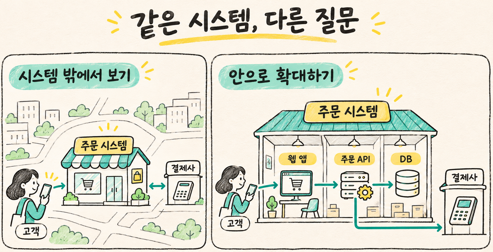

소프트웨어 아키텍처 설계 문서를 작성할 때는 프로젝트의 목적에서 출발해 시스템 범위, 설계를 좌우하는 요구, 선택한 해법, 구체적인 구조를 차례로 설명해야 한다. 앞의 근거와 뒤의 설계가 연결되어야 검토자가 설계의 타당성을 판단할 수 있다.

이 글은 다음 **다섯 장으로 구성된 Software Architecture Design Documentation**의 작성법을 다룬다.

| 장 | 핵심 질문 | 주된 내용 |
|---|---|---|
| 1. Project Overview | 왜 이 프로젝트를 수행하는가? | 배경, 사업 목표, 범위, 이해관계자 |
| 2. System Overview | 어떤 시스템을 만드는가? | 기능, 사용자, 시스템 경계, 외부 연동 |
| 3. Architectural Drivers | 무엇이 설계 선택을 좌우하는가? | 핵심 기능, 품질 속성, 제약, 우선순위 |
| 4. Architecture Design Decision | 무엇을 왜 선택했는가? | 설계 문제, 대안, 평가, 결정, 상충 관계 |
| 5. Architectural Design Description | 선택한 설계를 어떻게 구성하고 동작시키는가? | 구조·실행·배포 뷰, 인터페이스, 데이터, 검증 연결 |

**이 다섯 장의 명칭과 순서를 모든 조직에 적용되는 단일 표준으로 전제하지 않는다.** 여기서는 이 구성을 기준으로 각 장에 무엇을 쓰고 서로 어떻게 연결하는지 설명한다. C4는 그림을 표현하는 방법으로, ADR은 개별 결정을 기록하는 방법으로 필요한 위치에서 활용할 수 있다.

전체 예제는 온라인 주문 서비스다. 인력, 일정, 성능 수치와 구성은 설명을 위한 가정이며, 실제 구축 결과나 측정 성능을 의미하지 않는다.

## 1. Project Overview — 프로젝트 개요

### 이 장의 역할

프로젝트가 시작된 배경과 달성하려는 성과를 설명한다. 이후 설계에서 비용이나 일정 때문에 선택을 제한해야 할 때 판단 기준이 된다.

**프로젝트 범위는 이번 사업·개발에서 수행할 일의 범위**다. 다음 장의 시스템 경계는 소프트웨어가 책임질 영역을 구분한다. 두 범위는 관련되지만 같은 내용은 아니다. 예를 들어 데이터 이관 교육은 프로젝트 작업에 포함돼도 주문 시스템의 실행 기능은 아닐 수 있다.

### 작성할 내용과 예제

| 항목 | 작성 내용 | 주문 서비스 예제 |
|---|---|---|
| 추진 배경 | 현재의 문제와 개선 필요성 | 전화·수기 주문으로 주문 상태 확인과 누락 추적이 어려움 |
| 사업 목표 | 사용자·사업이 얻을 성과 | 고객이 직접 주문하고 담당자가 상태를 추적하게 함 |
| 개발 범위 | 이번 단계의 포함·제외 작업 | 주문·결제 연동과 운영자 교육 포함, 배송 시스템 구축 제외 |
| 이해관계자 | 역할, 관심사, 검토·승인 책임 | 고객, 운영 담당자, 개발팀, 서비스 책임자 |
| 일정·자원 | 설계에 영향을 줄 일정, 인력, 비용 | 개발자 3명, 첫 출시까지 12주라는 가정 |
| 완료·성공 기준 | 무엇으로 프로젝트 결과를 판단할지 | 합의한 핵심 주문 시나리오의 인수 시험 통과 |

“최고의 서비스를 구축한다” 대신 해결할 문제와 완료 조건을 적는다. 사업 목표와 기술 목표도 연결해 보자. “주문 누락을 추적할 수 있게 한다”는 목표는 뒤에서 주문 상태 저장, 이력 기록, 미확정 주문 조회 요구로 구체화된다.

문서 앞부분에는 버전, 작성·검토자, 승인 상태, 적용 릴리스, 참고 요구사항 문서를 함께 적어 두면 좋다. 설계안과 운영 중인 구조가 혼동되지 않도록 문서의 적용 기준을 표시한다.

## 2. System Overview — 시스템 개요

### 이 장의 역할

사용자와 외부 시스템의 관점에서 **무엇을 제공하고 어디까지 책임지는 시스템인지** 설명한다. 상세한 모듈 설계에 들어가기 전에 모든 독자가 같은 대상을 떠올릴 수 있어야 한다.

예제 시스템은 고객의 주문 생성·조회, 외부 결제사와의 결제 연동, 운영자의 미확정 주문 확인을 제공한다. 배송·물류는 별도 시스템의 책임으로 둔다.


_왼쪽은 System Overview에서 설명할 경계와 외부 관계다. 오른쪽처럼 내부 책임을 나누는 상세 내용은 5장에서 구체화한다._

### 작성할 내용

| 구분 | 예제 내용 |
|---|---|
| 사용자·역할 | 고객: 주문 생성·조회, 운영자: 상태 확인·수동 확인 요청 |
| 주요 기능 | 주문 등록, 결제 요청, 상태 조회, 미확정 주문 재확인 |
| 시스템 경계 | 주문 상태와 연동 조정은 내부, 실제 결제 승인은 외부 결제사 |
| 외부 인터페이스 | 결제 요청 API, 결제 결과 조회 API, 결과 웹훅 |
| 주요 데이터 | 주문, 주문 상태 이력, 결제 참조값 |
| 대표 시나리오 | 고객이 주문하고 결제 결과를 확인하는 과정 |
| 가정·의존성 | 결제사 계약에서 결과 조회·인증 방법을 확인해야 함 |

이 장에서는 핵심 기능에 ID를 붙여 두자. 예를 들어 `F-01 주문 생성`, `F-02 결제 결과 확인`, `F-03 주문 조회`다. 모든 기능을 상세히 명세하기보다 아키텍처를 이해하는 데 필요한 수준으로 설명하고 요구사항 원본을 연결한다.

C4의 [시스템 컨텍스트 그림](https://c4model.com/diagrams/system-context)은 이 장의 경계 설명에 활용할 수 있다. 사용자·대상 시스템·외부 시스템의 관계를 보여 주고, 내부 클래스나 배포 서버 수는 뒤의 상세 뷰에서 다룬다.

## 3. Architectural Drivers — 아키텍처 설계 동인

### 모든 요구사항을 다시 나열하지 않기

Architectural Drivers는 **구조·기술·통신·배포 선택에 큰 영향을 주는 요구와 조건**이다. 보통 아키텍처에 중요한 기능 요구사항, 품질 속성 요구사항, 제약사항을 식별한다. 사업 목표와 이해관계자의 관심사는 이를 선정하고 우선순위를 정하는 근거가 된다.

[NASA의 아키텍처 기술 지침](https://swehb.nasa.gov/pages/viewpage.action?pageId=32964839)도 기능 요구, 품질 속성, 제약 등이 설계에 큰 영향을 줄 때 아키텍처 드라이버로 식별한다고 설명한다.

예를 들어 버튼 색상은 일반적으로 전체 구조를 좌우하지 않지만, “외부 결제 응답이 끊겨도 주문과 결제 결과를 나중에 대조할 수 있어야 한다”는 요구는 저장 구조와 상태 전이, 재확인 작업에 직접 영향을 준다.

### 드라이버 목록 만들기

| ID | 종류 | 드라이버 | 우선순위 | 설계에 미치는 영향 |
|---|---|---|---|---|
| DR-F01 | 핵심 기능 | F-02: 결제 결과가 미확정인 주문을 후속 확인 | 높음 | 대기 상태 저장, 결제 참조값, 결과 대조 경로 |
| DR-Q01 | 성능 | 지정 부하에서 주문 조회 p95 300ms 이하 목표 | 높음 | 조회 경로, 인덱스, 자원 배치 검토 |
| DR-Q02 | 보안 | 다른 고객의 주문 내용을 응답·로그에 노출하지 않음 | 높음 | 서버 측 소유권 검사와 로그 정책 |
| DR-Q03 | 복구 | RTO 30분, RPO 5분 목표 | 높음 | 백업·로그 보존과 복구 구조 검토 |
| DR-C01 | 제약 | 개발자 3명, 첫 출시 12주 | 높음 | 운영 복잡도와 배포 단위 수 제한 검토 |
| DR-C02 | 외부 제약 | 결제사의 실제 API·웹훅 계약 준수 | 높음 | 멱등성·서명 검증·재시도 조건 확인 |

위 수치는 합의 전 예제 목표다. 우선순위에는 사업상 중요성과 구현 난이도·위험을 함께 검토하고 선정 근거를 남긴다. “높음”인 항목만 나열하면 상충하는 요구 사이에서 무엇을 우선할지 판단하기 어렵다.

### 품질 요구를 시나리오로 구체화하기

품질 속성은 “빠르게”, “안전하게”로 끝내지 말고 **자극의 원천, 자극, 환경, 대상, 반응, 반응 측정값**으로 구체화한다.

| 요소 | DR-Q01의 예제 |
|---|---|
| 자극의 원천 | 인증된 고객 |
| 자극 | 주문 조회 요청 |
| 환경 | 스테이징, 합의한 100만 건 데이터셋, 100요청/초를 10분 유지 |
| 대상 | 주문 조회 API와 조회 저장소 |
| 반응 | 권한이 있는 고객에게 주문 내용 반환 |
| 반응 측정값 | API 진입부터 응답 완료까지 p95 300ms 이하, 오류율 1% 미만 |

시험 환경과 운영 환경의 차이도 적어야 한다. 수치를 썼다는 사실은 달성 증거가 아니다. 시험 보고서와 연결하고 `목표 / 검증 완료 / 미충족`을 구분한다.

제약은 선택할 수 없는 조건인지 확인한다. “관계형 DB를 사용하고 싶다”는 제안이고, “기존 운영 계약상 지정 DB를 사용해야 한다”는 제약이다. 가정에는 확인 담당자와 기한을 붙이고, 확인되기 전까지 사실로 확정하지 않는다.

## 4. Architecture Design Decision — 아키텍처 설계 결정

### 드라이버에 대응하는 대안을 비교하기

이 장에는 **어떤 문제에 대해 어떤 대안을 비교했고, 무엇을 왜 선택했으며, 어떤 비용을 받아들였는지** 적는다. 기술 이름 목록만으로는 설계 이유를 검토할 수 없다.

예제의 결정 문제는 “초기 주문 기능과 결제 연동을 어떤 배포 단위로 구성할 것인가?”다. `DR-C01`의 인력·일정과 `DR-F01`의 상태 추적 요구가 관련된다.

| 평가 기준 | 하나의 애플리케이션 + 모듈 경계 | 주문·결제 연동을 별도 서비스로 분리 |
|---|---|---|
| 초기 배포·운영 부담 | 운영할 배포 단위가 적음 | 통신·관측·장애 처리 구성이 늘어남 |
| 독립 배포·확장 | 제약이 있음 | 영역별 조정에 유리 |
| 상태 추적 | 내부 흐름 추적이 상대적으로 단순 | 서비스 간 실패·상태 대조가 추가됨 |
| 외부 결제와의 정합성 | 외부 연동이므로 여전히 별도 처리 필요 | 역시 별도 처리 필요 |

비교표는 예제 조건에서의 정성 평가다. 특정 구조가 항상 우수하다는 뜻은 아니다. 결정이 중요한 경우 점수의 근거, 프로토타입·성능 측정 결과, 불확실성을 함께 기록한다.

### 결정 기록 예제

| 항목 | DD-01의 내용 |
|---|---|
| 제목 | 초기 서비스를 모듈형 모놀리스로 구성 |
| 관련 드라이버 | DR-C01, DR-F01 |
| 상태 | Proposed — 예제 설계안 |
| 선택 | 하나의 애플리케이션에 주문·결제 연동 모듈을 분리 |
| 근거 | 작은 팀의 초기 운영 부담을 줄이면서 책임 경계를 유지 |
| 수용한 단점 | 독립 확장이 어렵고 배포 장애의 영향 범위를 공유 |
| 후속 조치 | 모듈 간 인터페이스와 데이터 접근 규칙을 정의 |
| 재검토 조건 | 독립 배포 요구가 생기거나 자원 병목이 측정될 때 |

다음 결정 `DD-02`는 `DR-F01`과 `DR-C02`에 대응한다. 결제 응답 타임아웃을 즉시 실패로 확정하지 않고 `PAYMENT_PENDING`으로 유지하며 결과 조회·웹훅으로 상태를 대조하는 설계안이다. 이 선택에는 재확인 작업과 운영 관측 비용이 따른다.

결정별로 식별자, 결정일, 담당자, 승인 상태를 기록한다. 개별 기록을 별도 ADR 파일로 관리한다면 이 장에는 목록과 요약을 두고 원본을 연결하면 된다. [ADR 원저자의 설명](https://cognitect.com/blog/2011/11/15/documenting-architecture-decisions)처럼 변경된 결정도 대체 관계와 함께 보존하면 당시 판단을 추적할 수 있다.

**결정은 선택의 근거를 설명하고, 다음 장의 설계 기술은 선택이 반영된 구체적인 구조와 동작을 설명한다.** 같은 내용을 반복하기보다 결정 ID와 뷰 ID로 연결한다.

## 5. Architectural Design Description — 아키텍처 설계 기술

### 뷰마다 무엇을 설명할지 정하기

여기서 Description은 설계한 아키텍처를 구체적으로 서술한다는 뜻이다. 독자는 이 장을 통해 구현 경계와 인터페이스를 이해하고, 앞의 드라이버를 충족할 구조인지 검토한다.

[SEI의 Views and Beyond](https://www.sei.cmu.edu/library/views-and-beyond-collection/)는 관련 뷰들과 여러 뷰에 걸친 정보를 함께 문서화하는 접근을 설명한다. 한 장의 구성도에 모든 정보를 넣기보다 독자의 질문에 맞춰 구조·실행·배포 등을 구분하자.

| 뷰 ID | 설명할 내용 | 예제 요소 |
|---|---|---|
| V-01 모듈 뷰 | 코드의 책임 분해와 허용된 의존 관계 | 주문 모듈, 결제 어댑터, 저장소 인터페이스 |
| V-02 실행 뷰 | 실행 요소의 상호작용과 성공·실패 흐름 | 주문 API, DB, 결제사, 재확인 작업 |
| V-03 배포 뷰 | 소프트웨어와 실행 환경의 배치 | 운영·스테이징별 API 실행 환경, DB, 네트워크 경계 |
| V-04 데이터·인터페이스 | 데이터 소유권, 계약, 일관성 규칙 | 주문 상태, 참조값, API·웹훅 계약 |

C4, UML 또는 팀이 합의한 표기법을 사용할 수 있다. 그림마다 범위와 범례, 요소의 책임, 관계·방향, 인터페이스, 관련 드라이버·결정을 설명한다. 모듈 하나가 곧 서버 한 대라는 식으로 코드 구조와 배포 구조를 혼동하지 않는다.

### 구조와 실행을 구체화하기

`DD-01`을 반영한 V-01은 주문 모듈이 결제 어댑터의 공개 인터페이스를 호출하도록 정한다. 어댑터는 결제사별 요청 변환을 담당하고, 주문 상태의 소유권은 주문 모듈에 둔다. 어댑터가 주문 테이블을 임의로 수정하는 의존은 허용하지 않는다는 규칙도 명시한다.

V-02에서는 `DD-02`가 실행에 어떻게 반영되는지 설명한다.

1. API가 인증·주문 입력을 검사하고 DB에 대기 주문을 저장한다.
2. 주문에 연결한 고정 참조값으로 외부 결제를 요청한다.
3. 성공을 확인하면 주문을 `PAID`로 갱신한다.
4. 응답 타임아웃이면 `PAYMENT_PENDING`을 유지하고 결과를 조회한다.
5. 인증된 웹훅과 조회 결과를 대조해 상태를 원자적으로 갱신한다.


_드라이버는 미확정 주문을 확인해야 한다는 요구이고, 결정은 대기 상태와 후속 확인을 선택한 이유이며, 실행 뷰는 그 처리 순서를 기술한다._

이 흐름만으로 구현 명세가 완성되지는 않는다. 실제 문서에는 결제사 계약을 확인한 뒤 중복 요청 식별 키, 웹훅 서명 검증, 상태 전이 조건, 재시도 간격·상한, 재확인 담당 작업, 수동 확인 경로를 구체화해야 한다. DB 저장과 외부 결제는 하나의 로컬 트랜잭션으로 묶이지 않으므로, 결제 성공 후 DB 갱신 실패도 다룬다.

V-03에는 외부 공개 지점과 내부 통신, 인증 정보의 관리 위치, 로그·지표, 백업·복원 경로를 적는다. `DR-Q03`의 복구 목표는 구성도만으로 입증할 수 없으며 복원 훈련 결과를 연결해야 한다.

### 드라이버 → 결정 → 설계 → 검증 연결하기

| 드라이버 | 관련 결정·설계 조치 | 설계 설명 | 검증 계획 |
|---|---|---|---|
| DR-F01 미확정 결제 확인 | DD-02 대기 상태와 결과 대조 | V-02 실행 흐름, V-04 상태 전이 | 응답 유실·중복 통지·갱신 실패 시험 |
| DR-C01 작은 팀·출시 일정 | DD-01 모듈형 모놀리스 | V-01 모듈 경계, V-03 배포 | 의존 관계 검토, 배포·롤백 연습 |
| DR-Q01 조회 성능 | 조회 경로·인덱스 설계 검토 | V-04 조회 모델 | 지정 조건의 부하 시험; 현재 미검증 |
| DR-Q02 주문 접근 보호 | 서버 측 소유권 검사 | V-02 권한 처리, V-04 API 계약 | 타인 주문 ID 접근 시험·로그 점검 |
| DR-Q03 복구 목표 | 백업·복구 방식 결정 필요 | V-03 복구 경로 보완 필요 | 복원 훈련; 현재 미결 |

표는 설계가 끝났다는 표시가 아니다. 아직 결정하지 못한 부분과 검증하지 못한 부분도 드러내야 한다. 중요 드라이버에 대응하는 결정·구조가 없거나, 설계 선택이 어떤 요구에 대응하는지 설명되지 않으면 검토할 공백이 생긴 것이다.

### 다섯 장으로 시작하는 문서 템플릿

아래 템플릿을 [Markdown 파일로 다운로드](/assets/downloads/2026-11-23-architecture-readme-template.md)해 프로젝트에 맞게 채울 수 있다.

```markdown
# Software Architecture Design Documentation

- 대상 시스템 / 적용 릴리스: <시스템과 기준 버전>
- 문서 버전 / 작성일 / 검토일: <값>
- 작성자 / 검토자 / 승인자: <역할과 이름>
- 상태: <Draft / In Review / Approved>
- 참고 자료와 용어: <요구사항 문서, 용어 정의 링크>

## 1. Project Overview
- 추진 배경과 해결할 문제:
- 사업 목표와 성공 기준:
- 프로젝트 포함·제외 범위:
- 이해관계자와 책임:
- 일정·인력·예산 조건:

## 2. System Overview
- 사용자와 주요 기능(F-ID):
- 시스템 경계와 외부 연동:
- 컨텍스트 그림과 대표 시나리오:
- 주요 데이터, 가정과 의존성:

## 3. Architectural Drivers
- DR-ID / 유형 / 요구 / 출처 / 우선순위 / 선정 근거:
- 아키텍처에 중요한 기능 요구사항:
- 품질 시나리오(원천·자극·환경·대상·반응·측정값):
- 기술·사업 제약과 확인할 가정:

## 4. Architecture Design Decision
- DD-ID / 제목 / 상태 / 일자 / 담당자:
- 해결할 문제와 관련 DR-ID:
- 대안과 평가 기준·근거:
- 선택, 이유, 상충 관계와 수용한 단점:
- 후속 조치와 재검토 조건:

## 5. Architectural Design Description
- V-ID / 뷰의 목적 / 독자 / 표기법과 범례:
- 모듈 책임과 의존 관계:
- 실행 상호작용, 상태 전이와 실패 처리:
- 환경별 배포, 보안 경계와 운영·복구:
- 데이터 소유권과 인터페이스 계약:
- DR-ID → DD-ID → V-ID → 검증 항목 추적표:
- 미결 사항 / 위험 / 담당자 / 해결 시점:
```

검토할 때는 Project Overview의 목표가 Drivers에 반영됐는지, Decision이 대안과 비용을 설명하는지, Description에 그 선택이 실제 구조와 동작으로 나타나는지를 확인한다. 요구나 환경이 바뀌면 연결된 장과 검증 계획을 함께 갱신한다.
