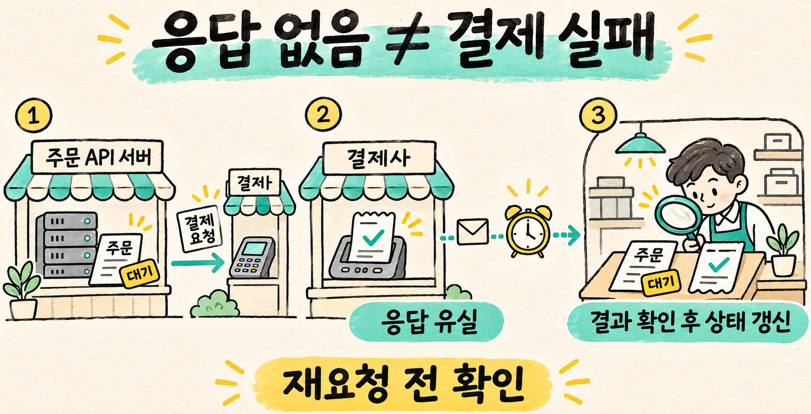

새 프로젝트를 맡았는데 저장소에는 소스 코드와 서버 구성도 한 장만 있다. API가 어디로 연결되는지는 보이지만, 왜 서비스를 나눴는지, 결제가 실패하면 주문이 어떻게 되는지, 무엇부터 바꿔도 되는지는 알기 어렵다.

**소프트웨어 아키텍처 설계 문서(Software Architecture Design Documentation)는 시스템의 중요한 구조와 제약, 동작, 설계 이유를 다음 사람이 판단할 수 있게 남기는 기록**이다. 그림을 잘 그리는 것만큼 중요한 일은 그림으로 답할 질문을 정하는 것이다.

이 글에서는 작은 온라인 주문 서비스를 가정해 문서를 만드는 과정을 설명한다. 서비스 구성과 수치, ADR은 설명을 위한 가상 예제이며 실제 운영 성능이나 검증 결과를 뜻하지 않는다.

## 1. 누가 어떤 결정을 하려고 읽는가

문서를 쓰기 전에 독자와 질문을 짝지어 보자.

| 독자 | 문서에서 찾아야 하는 답 |
|---|---|
| 새로 합류한 개발자 | 시스템 경계와 각 모듈의 책임은 무엇인가? |
| 기능을 바꾸는 개발자 | 어느 인터페이스와 데이터에 영향이 가는가? |
| 운영 담당자 | 어디에 배포되며, 장애를 어떻게 발견하고 복구하는가? |
| 보안 검토자 | 인증·권한 검사는 어디서 하며 민감 정보는 어디에 저장되는가? |
| 제품 담당자 | 어떤 제약과 비용 때문에 이 방식을 선택했는가? |

작은 서비스라면 한 개의 Markdown 문서와 몇 장의 그림, 주요 결정 기록으로 시작해도 된다. 모든 클래스와 함수를 옮겨 적기보다 **바꾸기 어렵거나 여러 영역에 영향을 주는 부분**에 먼저 집중한다.

요구사항 문서에는 달성할 동작과 조건을, 아키텍처 문서에는 이를 실현하는 주요 구조와 선택을, 상세 설계에는 모듈 내부 알고리즘과 자료구조를 둔다. 경계가 겹칠 때는 원본으로 링크하고 같은 내용을 여러 곳에 복제하지 않는다.

## 2. C4·arc42·ADR은 각각 어디에 쓰는가

다음 세 가지는 함께 사용할 수 있다. 아래 조합은 이 글에서 제안하는 시작 방식이다.

| 도구·접근 | 맡길 일 | 첫 산출물 |
|---|---|---|
| C4 모델 | 시스템 구조를 적절한 확대 수준으로 설명 | 시스템 컨텍스트와 컨테이너 그림 |
| arc42 | 문서에 빠진 관점이 있는지 점검 | 프로젝트에 맞춰 줄인 문서 목차 |
| ADR | 중요한 선택의 배경과 결과를 기록 | 결정 한 건당 짧은 파일 하나 |

[C4 공식 설명](https://c4model.com/)은 시스템·컨테이너·컴포넌트·코드의 계층과 이를 표현하는 그림을 구분한다. [그림 선택 안내](https://c4model.com/diagrams)에 따르면 모든 수준을 작성할 필요는 없고, 많은 팀은 컨텍스트와 컨테이너 수준으로 시작할 수 있다.

[arc42 공식 개요](https://arc42.org/overview/)는 목표, 제약, 경계, 해결 전략, 구조, 실행, 배포, 공통 개념, 결정, 품질 요구, 위험, 용어의 12개 영역을 제시한다. 이를 그대로 채우는 숙제로 삼기보다 현재 시스템에서 설명이 필요한 부분을 고르는 점검표로 사용하자.

ADR은 뒤에서 예제를 통해 다룬다. 먼저 현재 구조를 이해할 수 있어야 그 구조를 선택한 이유도 읽힌다.

## 3. 시스템 경계와 책임부터 그리기

예제의 범위는 **상품을 선택한 사용자가 주문을 만들고 외부 결제사를 통해 결제하는 웹 서비스**다. 물류와 배송은 이번 설계 범위에서 제외한다. 결제사는 외부 시스템이며 내부 DB를 직접 읽지 않는다.


_컨텍스트는 외부와의 관계를, 내부 확대 그림은 책임의 분담을 설명한다._

컨텍스트 그림에는 사용자, 우리 시스템, 직접 연결하는 외부 시스템과 관계를 넣는다. 내부 구현을 설명할 때는 다음과 같이 책임을 나눈다.

| 구성 요소 | 책임 | 주요 연결 |
|---|---|---|
| 웹 앱 | 주문 화면과 사용자 입력 | 주문 API를 HTTPS로 호출 |
| 주문 API | 인증·권한 검사, 주문 상태 관리, 결제 요청 조정 | DB 읽기·쓰기, 결제사 HTTPS API 호출 |
| 주문 DB | 주문 상태와 결제 참조 정보 저장 | 주문 API만 접근 |
| 외부 결제사 | 결제 처리와 결과 통지 | 주문 API가 호출하고 웹훅을 수신 |

**C4에서 컨테이너는 애플리케이션이나 데이터 저장소를 가리킨다.** Docker 컨테이너와 같은 의미로 한정하면 안 된다. 기술 선택과 통신 관계를 표현하고, 서버 수·복제·장애 조치 같은 환경별 배포 정보는 별도 그림으로 다루는 편이 명확하다. [C4 컨테이너 그림 안내](https://c4model.com/diagrams/container)

실제 그림의 화살표에는 `호출`만 쓰지 말고 `주문 생성 / HTTPS JSON`처럼 목적과 방식을 적자. 제목에는 대상 시스템과 확대 수준을, 범례에는 색·선·경계의 의미를 적는다. 데이터 흐름 방향인지 의존 관계 방향인지도 통일해야 한다.

## 4. 정적인 구조에 실행 흐름을 붙이기

구성도만으로는 중간 실패를 설명하기 어렵다. 예제에서는 다음 정책을 **설계안**으로 정했다고 가정한다.

1. 웹 앱이 주문 API에 주문 생성을 요청한다.
2. API가 입력과 권한을 검사하고 DB에 `PAYMENT_PENDING` 주문을 저장한다.
3. API가 주문에 연결된 고정 결제 참조값으로 결제사에 요청한다.
4. 결제 성공을 확인하면 DB의 주문을 `PAID`로 바꾼다.
5. 타임아웃이면 성공 여부를 단정하지 않고 대기 상태를 유지하며 결과 조회·웹훅으로 확인한다.

여기서 DB 저장과 외부 결제 처리는 하나의 로컬 DB 트랜잭션으로 묶이지 않는다. **결제 성공 후 주문 갱신이 실패하는 경우**도 남으므로, 미확정 주문을 조회하고 정합성을 복구하는 절차가 필요하다.


_응답이 없다는 사실만으로 결제 실패를 확정할 수 없다. 미확정 상태와 후속 확인 경로를 함께 설계한다._

설계 문서에는 다음 질문의 답을 적는다.

- 같은 주문 생성 요청이 두 번 오면 어떤 키로 중복을 식별하는가?
- 결제사 재요청에는 어떤 멱등성 기능을 쓰며 지원 조건은 무엇인가?
- 성공 응답, 웹훅, 결과 조회가 겹치면 상태 갱신을 어떻게 보호하는가?
- 웹훅 서명과 재전송 여부는 어디서 검증하는가?
- 장시간 대기한 주문은 누가 어떤 주기로 확인하는가?

이 정책은 결제사의 실제 API 계약을 확인한 뒤 구체화해야 한다. 멱등성 키 하나만 적는다고 중복 결제와 분산 상태 문제가 모두 해결되는 것은 아니다. 이 흐름에 상태 전이표, 유일성 제약, 원자적 갱신 조건, 재조정 담당 작업을 연결해야 구현과 시험이 가능하다.

## 5. 품질 요구사항을 측정 가능한 문장으로 만들기

“빠르고 안정적이어야 한다”는 말로는 설계를 비교하기 어렵다. **조건 → 사건 → 시스템 반응 → 측정 기준**으로 바꾸어 적자.

아래 수치는 예제의 목표 초안이다. 실제 프로젝트에서는 트래픽, 데이터 규모, 측정 환경, 비용을 확인해 합의하고 부하 시험으로 검증한다.

| 관심사 | 예제 시나리오와 목표 | 확인 방법 |
|---|---|---|
| 성능 | 스테이징의 지정 데이터셋에서 주문 조회 100요청/초, 10분 동안 p95 300ms 이하, 오류율 1% 미만 | 고정 부하 시험, API 진입부터 응답 완료까지 측정 |
| 복구 | 백업이 있는 DB 장애 상황에서 서비스 복구 30분 이내, 데이터 손실 범위 5분 이내 목표 | 백업·로그 복원 훈련으로 RTO/RPO 검증 |
| 권한 | 다른 사용자의 주문 ID로 조회하면 주문 내용이 응답·로그에 노출되지 않아야 함 | 권한 경계 통합 시험과 로그 점검 |
| 변경 용이성 | 결제사 연동 변경 시 주문 도메인의 상태 전이 규칙을 유지 | 어댑터 계약 시험과 변경 영향 검토 |

RTO는 복구 시간 목표, RPO는 감내할 수 있는 데이터 손실의 시간 범위다. 백업 파일이 존재한다는 사실만으로 위 복구 목표를 충족했다고 적으면 안 된다. 복원할 수 있는 시점과 실제 소요 시간을 확인해야 한다.

목표마다 관련 구조, 담당자, 검증 결과 링크를 붙인다. “목표”, “검증 완료”, “미충족”을 구분하면 문서가 주장만 모아 둔 자료가 되는 것을 줄일 수 있다.

## 6. ADR로 설계 이유 남기기

아키텍처 그림은 현재 모양을 보여 주지만 선택 당시의 조건은 잘 드러내지 못한다. ADR(Architecture Decision Record)은 그 이유를 기록한다. 원저자의 [Documenting Architecture Decisions](https://cognitect.com/blog/2011/11/15/documenting-architecture-decisions)는 맥락·결정·상태·결과를 짧게 남기고, 변경된 결정도 대체 관계와 함께 보존하는 방식을 설명한다.

아래는 예제 프로젝트에서 검토할 ADR이다. 팀이 실제로 합의하지 않았으므로 상태는 `Proposed`로 둔다.

```markdown
# ADR-0001: 초기 주문 서비스를 모듈형 모놀리스로 구성

- 상태: Proposed
- 날짜: 2026-11-23
- 결정 담당: 주문 서비스 팀

## 맥락
개발자 3명이 주문·결제 연동을 개발한다.
현재 독립 배포와 영역별 개별 확장은 필수 요구사항이 아니다.
주문 상태의 일관성을 추적하고 운영 복잡도를 낮춰야 한다.

## 검토한 대안
1. 주문과 결제 연동을 별도 서비스로 배포한다.
2. 하나의 애플리케이션 안에서 모듈 경계를 분리한다.

## 결정
초기에는 하나의 애플리케이션으로 배포한다.
주문과 결제 연동 모듈의 인터페이스를 명시하고,
결제사 호출은 어댑터를 통해 수행한다.

## 결과와 비용
배포와 추적이 단순해진다.
영역별 독립 확장은 어렵고, 배포 장애의 영향 범위를 공유한다.
모듈 사이의 임의 DB 접근을 막는 코드 검토가 필요하다.

## 재검토 조건
결제 연동의 독립 배포 요구나 자원 사용 차이가 커지면
측정 자료를 바탕으로 서비스 분리를 다시 검토한다.
```

ADR에는 선택의 단점과 운영 부담도 적는다. 이후 결정을 바꾸면 기존 파일을 삭제하지 말고 `Superseded by ADR-0007`처럼 연결한다. 구조 문서는 현재 상태로 고치고, ADR은 당시 판단의 이력을 보존한다.

## 7. 바로 시작할 수 있는 문서 구성

다음은 arc42의 관점을 참고해 이 예제에 맞게 줄인 구성이다. 공식 템플릿 전체를 재현한 것은 아니다. 기존 위키가 있다면 같은 문서를 중복 생성하지 말고 이 구조에 맞는 링크를 모아도 된다.

```text
docs/architecture/
├── README.md                 # 시작점, 범위, 현재 상태
├── context.md                # 사용자, 외부 시스템, 경계
├── structure.md              # 책임, 의존 관계, 데이터 소유권
├── runtime.md                # 주요 성공·실패 시나리오
├── deployment.md             # 환경별 배포, 신뢰 경계, 복구
├── quality.md                # 품질 목표와 검증 근거
├── risks.md                  # 위험, 기술 부채, 미결 질문
├── diagrams/                 # 편집 가능한 그림 원본
└── decisions/
    └── 0001-modular-monolith.md
```

첫 `README.md`는 다음 템플릿에서 시작할 수 있다. 이 내용만 별도 파일로도 [다운로드](/assets/downloads/2026-11-23-architecture-readme-template.md)할 수 있다.

```markdown
# 시스템 아키텍처

- 담당 팀: <팀 이름>
- 상태: <초안 / 검토 중 / 승인>
- 마지막 검토일: <YYYY-MM-DD>
- 적용 기준: <릴리스 또는 커밋>

## 목적과 범위
해결할 문제, 사용자, 포함·제외 범위를 적는다.

## 목표와 제약
우선순위가 높은 품질 목표, 예산, 일정, 필수 기술을 적는다.
목표 수치와 검증 방법은 quality.md로 연결한다.

## 구조와 동작
context.md, structure.md, runtime.md, deployment.md로 연결한다.
현재 구현과 제안 중인 구조를 구분한다.

## 공통 규칙
인증·인가, 데이터 소유권, 오류, 재시도, 로깅 원칙을 적는다.
상세 API 계약과 운영 절차는 원본 문서로 연결한다.

## 중요한 결정
decisions/의 ADR 목록과 현재 유효한 결정을 연결한다.

## 위험과 미결 질문
risks.md로 연결하고 항목별 담당자와 검토 시점을 적는다.

## 용어
같은 단어를 다르게 이해하기 쉬운 업무 용어를 정의한다.
```

배포 문서에는 운영·스테이징 환경을 구분하고, 실행 단위와 데이터 저장소, 공개 접근 지점, 내부 통신, 비밀 관리 위치, 백업과 복구 경로를 적는다. 실제 비밀값은 문서에 넣지 않는다. 실행 절차가 길어지면 운영 런북으로 분리하고 연결한다.

## 8. 코드와 함께 검토하고 갱신하기

문서가 오래되면 잘못된 확신을 줄 수 있다. 담당자만 지정해 두기보다 **변경이 생기는 지점에 문서 확인을 붙이는 것**이 도움이 된다.

| 변경 | 함께 검토할 기록 |
|---|---|
| 외부 API·DB·메시지 브로커 추가 | 경계 그림, 의존 관계, 데이터 소유권 |
| 주문 상태·재시도 정책 변경 | 실행 흐름, 상태 전이, 실패 시험 |
| 배포 단위·네트워크 경계 변경 | 배포 그림, 접근 제어, 복구 절차 |
| 중요한 기술·구조 선택 변경 | 새 ADR, 기존 ADR 대체 관계 |
| 품질 목표 변경 | 측정 조건, 검증 결과, 위험 평가 |

PR 양식에는 `아키텍처 영향: 있음/없음`, `수정한 문서 또는 영향 없는 이유`를 넣을 수 있다. 자동 검사는 링크 깨짐과 도식 문법을 잡고, 리뷰는 책임 경계와 실패 처리의 타당성을 판단한다.

새 팀원에게 문서를 읽고 **“주문이 어디에 저장되는가?”, “결제 응답이 끊기면 누가 확인하는가?”, “왜 지금은 서비스를 나누지 않았는가?”**를 설명해 달라고 해 보자. 답을 찾기 어렵다면 필요한 정보를 보강할 위치가 드러난다.

처음에는 시스템 경계 한 장, 내부 책임 한 장, 중요한 실행 흐름 하나, 측정 가능한 품질 목표 몇 개, ADR 한 건을 작성해 보자. 이후 기능과 운영상의 질문이 늘어날 때 해당 관점을 확장하면 된다.
