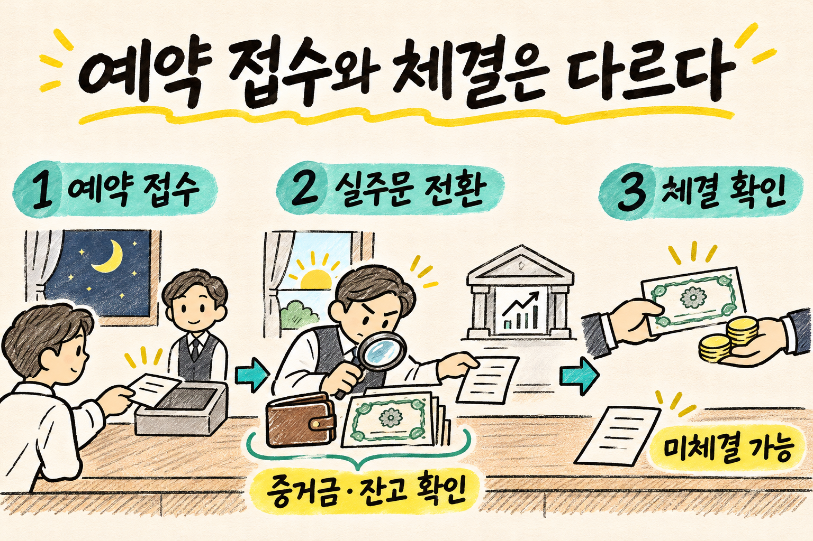
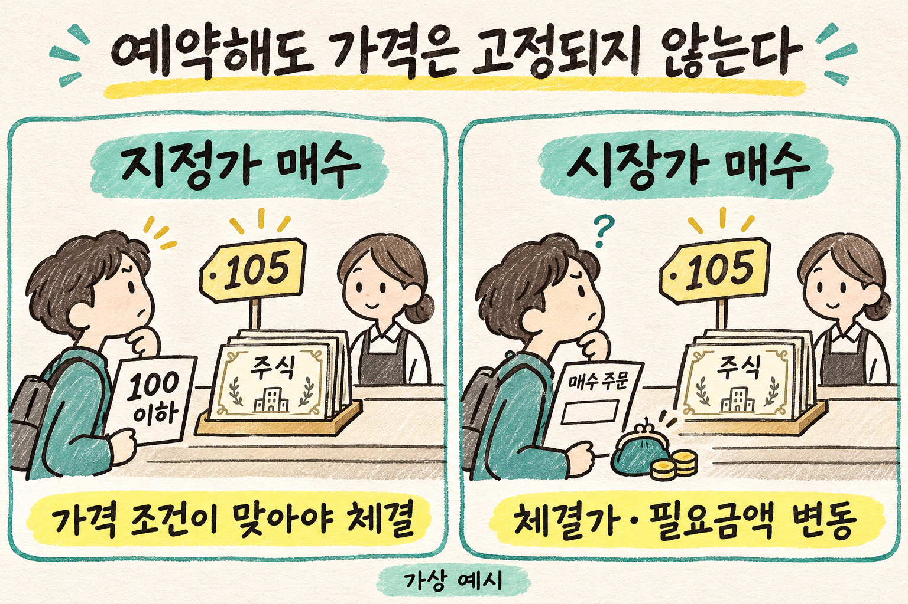

메리츠증권에서 주식을 미리 사거나 팔도록 신청하려면 **예약주문을 접수한 뒤, 해당 거래일에 실제 주문이 정상적으로 나갔는지까지 확인**해야 한다. 예약 화면에 내역이 생겼다고 매매가 끝난 것은 아니다.

예약매매를 이해할 때 가장 중요한 질문은 세 가지다. **어느 시장에 언제 주문이 나가는가, 어떤 가격 조건으로 주문하는가, 접수 뒤 어디서 결과를 확인하는가**다. 이 글은 국내주식과 해외주식을 나누어 그 과정을 설명한다.

> **2026년 11월 24일 확인한 메리츠증권 공식 자료 기준이다.** 국내 예약시간과 중국·홍콩 예약 시작시간은 공식 페이지 사이에도 차이가 있다. 아래에 출처를 구분했으며, 실제 주문에는 이용하는 매체의 최신 공지와 예약 화면에 표시된 적용 시간을 확인해야 한다. 금액·수량 예시는 이해를 위한 가상 사례다.
{: .prompt-info }

## 1. 예약주문은 어떻게 처리되나

예약주문은 증권사에 주문 조건을 미리 맡겨 두었다가 정해진 때 실주문으로 전환하는 방식이다. 온라인서비스 이용약관 제10조는 예약 접수 뒤 실주문 전환 시 적합성을 판단하고, 증거금·보유수량·주문 내용 등의 문제로 전환되지 않을 수 있다고 설명한다. [온라인서비스 이용약관 제10조](https://home.imeritz.com/include/resource/comm/ctcn/pdf/meritz_yk_13.html?ver=2026011201)

_예약 내역, 실주문 처리 결과, 실제 체결 결과를 차례로 확인한다._

화면을 읽을 때는 다음처럼 구분하면 된다. 아래 표현은 상태의 의미를 설명한 것이며 앱의 실제 상태명은 다를 수 있다.

| 확인할 단계 | 알 수 있는 사실 | 추가로 확인할 것 |
|---|---|---|
| 예약 접수 | 미리 입력한 주문이 저장됨 | 계좌·시장·거래일·가격·수량 |
| 실주문 전환 | 주문이 실제 매매 과정으로 넘어감 | 전환 성공 여부와 거부 사유 |
| 미체결 | 아직 거래가 성립하지 않은 수량이 있음 | 가격 조건, 잔량, 취소 가능 여부 |
| 부분체결 | 일부 수량만 거래됨 | 체결수량과 남은 주문수량 |
| 전량체결 | 신청 수량의 거래가 완료됨 | 체결가격·수수료·잔고 반영 |

예를 들어 10주를 예약하고 3주만 체결되었다면 보유수량은 3주 늘고, 7주는 별도 확인 대상이다. 이때 10주를 다시 주문하면 총 매수량이 의도보다 커질 수 있다. 재주문 전에 기존 주문의 체결수량과 잔량부터 확인한다.

## 2. 국내주식 예약시간: KRX·NXT와 ARS를 구분한다

### 현재 매매시간 페이지의 KRX·NXT 안내

메리츠증권의 **고객지원 → 서비스안내 → 계좌/매매/입출금 → 매매시간/증거금률** 페이지는 국내주식 예약을 다음과 같이 표시한다. 모두 한국시간이다. [공식 매매시간/증거금률](https://home.imeritz.com/svcinfo/DealOderStlm.do)

| 시장 | 예약주문 접수시간 | 주문집행 안내 |
|---|---|---|
| 한국거래소 KRX | 10:00~익영업일 07:50 | 08:30경 |
| 대체거래소 NXT | 10:00~익영업일 07:50 | 08:00경 |

**주문집행 시각은 체결 완료 시각이 아니다.** 또한 NXT 예약을 KRX의 09:00 시초가 매매와 같은 것으로 이해하면 안 된다. 어느 시장을 선택했는지에 따라 실제 주문이 나가는 시점이 달라진다.

가령 월요일 14시에 예약 화면을 열었다면, 현재 거래 중인 주문 화면과 다음 거래일용 예약 화면을 구분해야 한다. 표의 접수시간이 장중과 겹치더라도 예약주문이 그 즉시 체결되는 주문이라는 뜻은 아니다. 주문 확인창의 **처리 예정 거래일**을 확인한다.

### 약관과 ARS에는 다른 시간이 표시되어 있다

같은 회사의 다른 공식 자료에는 다음 안내도 남아 있다.

| 자료 | 표시된 예약 접수시간 | 함께 확인할 내용 |
|---|---|---|
| 온라인서비스 이용약관 제10조 | 16:00~익영업일 08:10 | 실주문 전환·취소·거부에 관한 규정 |
| ARS 이용안내 | 16:00~익일 08:10 | 주문집행 08:15 안내 |

출처: [온라인서비스 이용약관](https://home.imeritz.com/include/resource/comm/ctcn/pdf/meritz_yk_13.html?ver=2026011201), [ARS 이용안내](https://home.imeritz.com/odermdia/OderMdiaDnldArs.do).

따라서 “메리츠 예약은 무조건 08:10까지 된다”거나 “모든 매체가 07:50에 끝난다”고 통합해서 단정하기 어렵다. **사용 중인 MTS·HTS·ARS의 안내, 선택한 KRX·NXT, 해당 거래일 공지**를 함께 대조해야 한다. 특히 마감 직전에는 서로 다른 자료의 시간을 조합해 주문하지 않는다.

주말·공휴일에는 달력상 내일과 다음 영업일이 달라진다. 특수 개장일이나 시장 운영 변경이 있는 날도 평소 시각을 그대로 적용하지 말고 처리 예정일을 다시 확인한다.

## 3. 해외주식 예약시간: 국가별로 따로 본다

메리츠증권은 HTS·MTS에서 미국·중국·홍콩·일본의 온라인 실시간 주문과 예약주문을 안내한다. 거래에 앞서 해당 계좌의 해외주식 거래 신청 여부를 확인한다. [해외주식 거래절차](https://home.imeritz.com/fstock/ForeignStock01_02.do)

**해외주식 → 해외주식 매매안내 → 거래안내 → 국가별 거래시간**에 표시된 예약시간은 다음과 같다. [해외주식 국가별 거래시간](https://home.imeritz.com/fstock/ForeignStock01_03.do)

| 국가 | 예약주문 접수시간: 한국시간 | 확인할 점 |
|---|---|---|
| 미국 | 09:00~22:30 | 서머타임 적용 시 09:00~21:30 |
| 중국 | 18:00~익일 08:30 | 현지 휴장일 확인 |
| 홍콩 | 18:00~익일 08:30 | 현지 휴장일 확인 |
| 일본 | 16:30~익일 07:30 | 현지 휴장일 확인 |

중국·홍콩은 별도의 **매매시간/증거금률 페이지에 시작시간이 17:30으로 표시**되어 위 표와 다르다. 17:30~18:00 구간의 접수 가능 여부는 실제 예약 화면이나 해외주식 데스크를 통해 확인한다. 두 페이지 중 하나가 모든 매체에 우선한다고 임의로 정하지 않는다. [서로 다른 안내가 있는 매매시간 페이지](https://home.imeritz.com/svcinfo/DealOderStlm.do)

### 미국 예약주문과 주간·프리마켓 주문은 다르다

미국주식은 예약시간에도 다른 거래 세션이 열릴 수 있다. 아래는 공식 미국시장 안내의 시간표다. [미국시장 거래안내](https://home.imeritz.com/mobile/content/overseas/usa.html)

| 구분 | 서머타임 미적용 | 서머타임 적용 |
|---|---|---|
| 주간거래 | 10:00~17:50 | 09:00~16:50 |
| 프리마켓 | 18:00~23:30 | 17:00~22:30 |
| 정규장 | 23:30~익일 06:00 | 22:30~익일 05:00 |
| 애프터마켓 | 06:00~09:50 | 05:00~08:50 |

예를 들어 서머타임 미적용일 오후 2시에 주문할 때, **주간거래에서 지금 주문할 것인지 예약 화면에서 이후 거래를 신청할 것인지**를 먼저 정한다. “미국 정규장이 아직 안 열렸으니 모든 주문이 예약”이라고 생각하면 주문 의도와 실제 동작이 달라질 수 있다.

미국 예약 접수 마감은 정규장 시작보다 1시간 이르다. 예약을 놓쳤다고 프리마켓 주문으로 아무 조건 없이 대체하지 말고, 이용하려는 세션과 주문유형을 확인한다. [미국 예약시간과 세션별 안내](https://home.imeritz.com/mobile/content/overseas/usa.html)

## 4. MTS·HTS에서 신청하고 확인하는 순서

앱과 HTS의 버전에 따라 메뉴 위치가 달라질 수 있어, 아래는 화면 이름을 찾아 진행하는 공통 절차로 정리했다. 특정 버전의 버튼 위치를 전제로 하지 않는다.

### ① 예약주문 화면을 찾는다

메뉴 검색에서 `예약주문`, `주식예약`, `해외주식 예약` 등을 검색한다. 국내주식과 해외주식 화면을 구분하고, 조회 전용 화면이 아닌 매수·매도 입력 화면을 선택한다. 검색 기능이 없다면 해당 주식의 주문 메뉴에서 예약 기능을 찾는다.

### ② 계좌와 시장을 먼저 확인한다

종합계좌 안에 여러 거래 계좌가 있을 수 있다. 잔고가 있는 계좌와 주문하려는 계좌가 같은지 확인한다. 국내주식은 KRX·NXT 등 화면의 시장 선택을, 해외주식은 국가·거래소·거래통화를 살핀다.

주문 화면에서 시장 선택을 제공하지 않거나 원하는 종목이 검색되지 않는다면 다른 주문 화면의 지원 범위를 그대로 적용하지 않는다. 해당 화면의 도움말과 종목 거래 가능 여부를 확인한다.

### ③ 매수·매도, 종목, 수량, 가격을 입력한다

확인창에서 다음 항목을 다시 읽는다.

- **거래 방향:** 매수와 매도를 바꾸어 입력하지 않았는가.
- **종목:** 비슷한 이름의 다른 주식·ETF나 다른 시장의 종목은 아닌가.
- **수량:** 1주와 10주, 원화 금액과 주식 수량을 혼동하지 않았는가.
- **가격·주문유형:** 지정가인지 시장가인지, 거래통화는 무엇인지.
- **예약 처리일·시장:** 어느 거래일의 어느 시장으로 전환되는가.

일반 주문 화면에서 제공되는 주문유형이 예약 화면에도 모두 제공된다고 가정하지 않는다. **현재 예약 화면에서 선택 가능한 항목**으로 입력한다.

### ④ 접수 후 예약 내역을 조회한다

완료 알림만 보고 닫지 말고 예약 내역에서 종목·수량·가격·거래일을 확인한다. 예약번호가 표시되면 함께 기록한다. 네트워크 오류로 결과를 알 수 없을 때는 같은 주문을 다시 누르기 전에 조회부터 한다.

### ⑤ 처리 시점 이후 실주문과 체결을 조회한다

예약 처리 결과에서 실주문 전환 여부를 보고, 당일 주문·미체결·체결 내역으로 이동한다. 단순한 “접수” 표시보다 **체결수량과 미체결잔량**을 기준으로 실제 보유·매도 결과를 판단한다.

## 5. 지정가와 시장가는 예약해도 성격이 유지된다

예약은 주문을 미리 맡기는 방식이다. 지정가·시장가는 가격을 어떻게 정하는지에 관한 조건이다. 두 개념을 나누어 이해해야 한다.

한국거래소는 지정가 매수를 지정한 가격 또는 그보다 낮은 가격, 지정가 매도를 지정한 가격 또는 그보다 높은 가격으로 거래하려는 주문으로 설명한다. 시장가는 가격을 지정하지 않는 주문이다. [한국거래소 주문유형 안내](https://regulation.krx.co.kr/contents/RGL/03/03010100/RGL03010100T2.jsp)

_같은 가격 변동이라도 지정가와 시장가는 결과가 달라진다._

### 가상 예시: 100에 사려고 했는데 시장가격이 105가 되었다면

주문 전환 뒤 매도호가가 모두 105 이상이고 다른 거래 조건은 충족된 상황을 가정한다.

| 주문 조건 | 가격 측면에서 예상할 수 있는 결과 |
|---|---|
| 지정가 매수 100 | 105에는 사지 않는다. 가격 조건이 맞는 상대 주문이 생겨야 한다. |
| 시장가 매수 | 당시 시장과 증권사의 주문 처리 기준에 따라 가격·필요금액이 달라진다. |
| 지정가 매도 100 | 100 이상 가격은 조건에 맞지만 상대 주문·수량이 있어야 체결된다. |

지정가 주문은 희망 가격에 거래할 기회를 만드는 것이므로 미체결을 감수한다. 시장가 주문도 유동성, 거래정지, 주문 가능금액 등과 무관하게 전량 체결을 보장하는 것은 아니다.

국내주식을 전날 예약했다고 시초가 체결이 보장되지도 않는다. KRX의 단일가매매는 접수된 주문을 모아 가격을 정하고 가격·시간 우선원칙 등에 따라 체결한다. **증권사 예약 접수와 거래소 호가 접수는 서로 다른 단계**이므로, 예약을 먼저 넣었다는 사실만으로 모든 주문에 우선한다고 판단하지 않는다. [한국거래소 단일가매매 설명](https://regulation.krx.co.kr/contents/RGL/03/03010201/RGL03010201.jsp)

### 미국 시장가 매수에는 메리츠의 별도 처리 기준이 있다

메리츠의 미국시장 안내는 시장가 매수를 직전 체결가보다 10% 높은 가격의 **유사 시장가인 지정가 주문**으로 발주하고, 직전 체결가가 없으면 전일 종가를 기준으로 산정한다고 설명한다. 이에 따라 미체결도 가능하다. 예약 시장가 매수는 장 시작 후 실제 주문가격이 정해져 증거금 부족으로 거부될 수 있다. [미국시장 주문유형·유의사항](https://home.imeritz.com/mobile/content/overseas/usa.html)

따라서 미국주식 예약 시장가 매수를 “현재 화면에 보이는 가격 × 수량만 준비하면 되는 주문”으로 계산하지 않는다. 해당 종목·주문유형의 제한과 실제 주문 가능금액을 함께 확인한다.

## 6. 예약 내용을 바꾸거나 취소하려면

온라인서비스 이용약관 제10조는 **예약주문의 정정을 허용하지 않고, 기존 예약을 취소한 뒤 다시 입력**하도록 규정한다. 제9조는 실주문의 정정·취소를 체결 전까지 직접 처리하도록 안내한다. [온라인서비스 이용약관 제9·10조](https://home.imeritz.com/include/resource/comm/ctcn/pdf/meritz_yk_13.html?ver=2026011201)

실제로 확인할 순서는 주문이 어느 단계에 있는지에 따라 달라진다.

| 현재 단계 | 확인·조치 순서 |
|---|---|
| 아직 예약 상태 | 예약 내역에서 해당 건 취소 → 취소 결과 확인 → 필요한 내용으로 재예약 |
| 실주문으로 전환됨 | 당일 주문·미체결에서 원주문과 남은 수량 조회 → 가능한 정정·취소 처리 |
| 일부 체결 | 체결분을 제외한 잔량 확인 → 미체결 수량에 대한 취소 결과 확인 |
| 전량 체결 | 완료된 거래는 주문취소로 되돌릴 수 없으므로 이후 판단은 별개의 거래로 구분 |

취소 버튼을 누른 뒤에도 상태를 다시 조회한다. 취소 요청과 실제 취소 완료 사이에 체결이 발생할 수 있기 때문이다. 특히 예약 마감·실주문 전환 경계에서는 화면이 바뀌거나 처리가 제한될 수 있으므로, **취소 완료를 확인하기 전 대체 주문을 중복으로 넣지 않는 것**이 중요하다.

## 7. 예약했는데 주문이 안 된 경우의 확인 순서

예약이 보이는데 주식이 늘지 않았다면 먼저 “실주문 전환 실패”인지 “정상 주문 후 미체결”인지 나눈다. 약관은 계좌·주문 입력 오류, 매수 증거금 부족, 매도 잔고 부족, 가격제한폭 등 적합성 문제와 법령에 따른 거부 사유를 설명한다. [예약주문 거부·효력 상실 규정](https://home.imeritz.com/include/resource/comm/ctcn/pdf/meritz_yk_13.html?ver=2026011201)

| 증상 | 우선 확인할 항목 |
|---|---|
| 예약 접수 자체가 안 됨 | 이용 매체의 접수시간, 계좌·종목 지원 여부, 점검·공지 |
| 예약은 있는데 실주문이 없음 | 처리 예정 거래일, 전환 결과와 거부 코드 |
| 증거금 부족 | 실제 주문 가능금액, 다른 주문의 자금 사용, 수수료 등 필요금액 |
| 매도 잔고 부족 | 주문 계좌, 매도 가능수량, 다른 매도주문에 묶인 수량 |
| 주문은 나갔는데 미체결 | 지정가격, 상대 주문수량, 해당 세션의 거래 가능 여부 |
| 해외주식만 처리되지 않음 | 현지 영업일, 거래통화, 거래 약정·종목 제한 |
| 조회 중 결과가 불분명함 | 예약번호와 원주문번호, 체결수량·잔량을 함께 조회 |

예를 들어 예수금이 100만 원이라는 사실만으로 서로 다른 예약 3건을 각각 100만 원씩 살 수 있는 것은 아니다. 각 주문을 따로 볼 때와 모든 주문이 함께 처리될 때 필요한 총액은 다르다. 예약 후 출금하거나 다른 매수에 자금을 사용했다면 처리 시점의 주문 가능금액도 다시 살핀다.

해외주식은 매수 시 수수료·제비용을 포함한 증거금과 매도 가능수량을 확인해야 한다. 통합증거금 약정 여부에 따라 사용할 수 있는 자금의 범위도 달라지므로, 원화 잔고와 외화 주문 가능금액을 같은 값으로 보지 않는다. [해외주식 증거금 안내](https://home.imeritz.com/svcinfo/DealOderStlm.do), [통합증거금 안내](https://home.imeritz.com/mobile/content/overseas/over_sale.html)

## 8. 예약주문·모으기·조건부 자동주문은 목적이 다르다

예약 한 건을 넣었다고 매달 자동으로 같은 주문이 반복되는 것은 아니다. 정기매수를 원한다면 별도 서비스의 주기와 유효기간을 확인해야 한다.

| 목적 | 확인할 기능과 조건 |
|---|---|
| 다음 대상 거래일에 주문을 미리 맡김 | 국내·해외 예약주문, 처리일과 주문유형 |
| 매일·매주·매월 일정 금액으로 미국주식 매수 | 해외주식 모으기, 대상 종목·금액·주기 |
| 특정 가격 도달 등을 감시해 주문 | 해당 조건을 지원하는 자동주문 기능과 감시시간 |
| 원하는 시각·전략으로 직접 주문 자동화 | API 지원 범위, 주문시간, 중복 방지와 오류 처리 |

메리츠의 해외주식 **모으기**는 소수점 주문의 체결방식을 기반으로 정기 자동매수를 실행하며 매일·매주·매월 주기를 선택한다. 체결가격을 지정하는 서비스가 아니다. 일반 수량 기반 예약주문과 소수점·모으기의 취소·배분 규칙을 섞지 않는다. [소수점거래/모으기 공식 안내](https://home.imeritz.com/fstock/ForeignStock01_08.do)

기간예약·잔량예약·스톱 주문 등은 증권사와 매체마다 제공 범위가 다를 수 있다. 다른 증권사의 “최대 30일 예약” 같은 규칙을 메리츠에도 그대로 적용하지 말고 실제 화면의 기간·반복 조건을 확인한다.

## 9. Open API로도 예약주문을 다룰 수 있나

공식 Open API 문서에는 국내·해외 각각 **예약주문 매수·매도·취소·조회**가 나뉘어 있다. 예약 접수 API의 성공 응답과 당일 실제 체결 확인은 별도로 다뤄야 한다. [메리츠증권 Open API 문서](https://openapi.imeritz.com/apiservice)

자동화 프로그램은 다음 정보를 연결해 기록하도록 설계하는 것이 좋다.

1. 프로그램이 의도한 계좌·종목·수량·가격·대상 거래일.
2. 예약 접수 응답과 조회로 확인한 예약 내역.
3. 전환 이후 원주문과 거부·체결·미체결 결과.
4. 취소 요청 뒤 실제 취소된 수량과 최종 잔고.

응답을 받지 못했다고 예약 매수 API를 즉시 재호출하면 중복 주문이 생길 수 있다. 재시도 전에 예약 조회와 주문 조회로 기존 건을 확인하는 절차가 필요하다. API 시작 방법은 [메리츠증권 Open API 신청·Python 연동 가이드]()를 참고한다.

## 10. 주문 전후에 확인할 체크리스트

**접수 전**에는 이용 매체, 시장, 대상 거래일, 지정가·시장가, 수량·통화, 실제 주문 가능금액을 확인한다. **접수 직후**에는 예약 내역을 조회한다. **처리 시점 이후**에는 실주문 전환 결과와 체결수량·미체결잔량을 확인한다.

가격이나 수량을 바꿀 때는 기존 건의 취소 여부부터 확인하고, 결과가 불분명하면 중복 접수보다 원주문 확인을 먼저 한다. 문의할 때 예약번호·처리일·거부 문구를 준비하면 어느 단계의 문제인지 설명하기 쉽다.

공식 안내의 연락처는 국내 고객지원센터 **1588-3400**, 해외주식 데스크 **1833-6611**이다. [고객지원센터 이용안내](https://www.imeritz.com/cust/custInqr/CtCntr.do), [해외주식 거래절차·문의처](https://home.imeritz.com/fstock/ForeignStock01_02.do)
