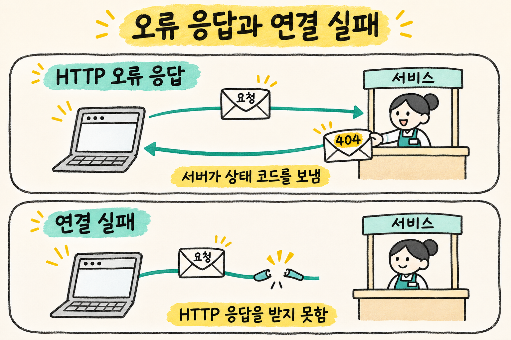

웹페이지가 열리지 않을 때 화면에 `404`가 보이기도 하고, 연결할 수 없다는 메시지만 나타나기도 한다. 둘 다 실패처럼 보이지만 **HTTP 응답을 받았는지**부터 구분하면 점검할 곳이 달라진다.

이 글에서는 상태 코드의 의미를 익힌 뒤, 내 PC 안에서 실행하는 작은 서버로 응답을 비교한다. 외부 서비스에 오류나 과도한 요청을 발생시킬 필요는 없다. 실습 명령은 Python과 `curl.exe`를 사용할 수 있는 Windows PowerShell을 기준으로 한다.

## 상태 코드는 서버가 보낸 응답의 일부

HTTP는 요청과 응답을 주고받는다. 응답에는 처리 결과를 나타내는 세 자리 상태 코드, 부가 정보를 담는 헤더, 필요한 경우 본문이 들어간다. HTTP/1.x 응답은 다음처럼 읽을 수 있다.

```http
HTTP/1.0 404 Not Found
Content-Type: text/plain; charset=utf-8
Content-Length: 10

Not found
```

이는 아래 실습에서 살펴볼 응답 형태다. `404`는 HTTP 상태 코드, `Content-Type`은 본문의 형식, 빈 줄 다음은 본문이다. HTTP/2·3의 전송 표현은 다르지만 상태 코드의 의미를 공통으로 사용할 수 있다.


_404 응답을 받았다면 어떤 HTTP 서버가 응답한 것이다. 그것이 최종 애플리케이션인지 중간 프록시인지는 따로 확인해야 한다._

DNS 조회 실패, 연결 거부, TLS 연결 실패는 HTTP 응답을 받기 전에 발생할 수 있다. 반대로 `500`은 서버 측 오류를 뜻하는 **HTTP 응답**이다. 이 두 부류를 모두 ‘서버에 연결되지 않았다’고 표현하면 원인 찾기가 어려워진다.

## 먼저 숫자의 첫 자리를 읽기

상태 코드의 분류와 주요 코드의 의미는 [HTTP 표준 RFC 9110의 상태 코드 절](https://www.rfc-editor.org/rfc/rfc9110.html#name-status-codes)에서 확인할 수 있다.

| 분류 | 의미 | 대표 예 |
|---|---|---|
| 1xx | 처리 도중의 정보 응답 | 100 |
| 2xx | 요청 성공 | 200, 201, 204 |
| 3xx | 이동 또는 캐시 관련 추가 처리 | 301, 302, 304 |
| 4xx | 요청을 처리할 수 없거나 거절함 | 400, 401, 403, 404 |
| 5xx | 서버가 요청을 처리하지 못함 | 500, 502, 503, 504 |

4xx라는 이름만으로 사용자가 항상 잘못했다고 단정하지는 않는다. 잘못된 서버 라우팅이 404를 만들 수도 있다. 상태 코드는 원인을 좁히는 출발점이며, 정확한 원인은 요청 내용과 서버 기록을 함께 봐야 한다.

| 코드 | 읽는 방법 | 먼저 확인할 항목 |
|---|---|---|
| 200 | 요청 성공 | 기대한 본문과 형식인지 |
| 301 / 302 | 영구 / 임시 이동 | `Location` 헤더의 목적지 |
| 401 | 유효한 인증 정보가 부족함 | 인증 방식, 토큰 만료 여부 |
| 403 | 서버가 요청 이행을 거절함 | 접근 정책과 계정 권한 |
| 404 | 대상을 찾지 못했거나 존재를 공개하지 않음 | 경로, 배포 주소, 라우팅 |
| 500 | 예상하지 못한 서버 내부 문제 | 같은 시점의 애플리케이션 로그 |
| 502 | 게이트웨이가 잘못된 상위 서버 응답을 받음 | 프록시와 상위 서버 간 통신 |
| 503 | 일시적으로 서비스할 수 없음 | 과부하·점검 상태와 재시도 안내 |
| 504 | 게이트웨이가 상위 서버 응답을 제때 받지 못함 | 상위 서버 지연과 타임아웃 |

**429는 요청 빈도 제한**을 알리는 코드다. `Retry-After`가 있으면 재시도 시점을 확인한다. 자세한 정의는 [RFC 6585의 429 설명](https://www.rfc-editor.org/rfc/rfc6585.html#section-4)에 있다. 실패했다고 즉시 반복 요청을 늘리기보다 해당 서비스의 제한 안내를 살핀다.

## 1. 내 PC에서 실습 서버 실행하기

[실습 서버 파일 다운로드](/assets/code/http-status-codes-guide/demo_server.py)를 연습 폴더에 `demo_server.py`로 저장한다. PowerShell에서 그 폴더로 이동한 뒤 실행한다.

```powershell
python --version
curl.exe --version
python demo_server.py
```

첫 번째 창은 서버가 실행된 상태로 둔다. 이 예제는 `127.0.0.1:8766`에서만 연결을 받고, 개인 파일을 제공하지 않는다. 다음 경로에 정해진 응답을 반환한다.

| 경로 | 응답 | 실습 의도 |
|---|---|---|
| `/ok` | 200 | 정상 응답 |
| `/redirect` | 302, `Location: /ok` | 이동 안내 |
| `/missing` 등 등록되지 않은 경로 | 404 | 없는 경로 |
| `/limited` | 429, `Retry-After: 30` | 제한 안내 형식 |
| `/error` | 500 | 서버 오류 응답 형식 |

429와 500은 실제 과부하나 프로그램 고장을 일으키지 않고 정해진 값을 돌려주는 예제다. 예제의 기반인 [Python http.server](https://docs.python.org/3/library/http.server.html)는 운영 서비스용으로 권장되지 않으므로 로컬 연습에만 사용한다.

## 2. 헤더와 본문을 함께 확인하기

두 번째 PowerShell 창을 열어 실행한다. `--noproxy`는 이 로컬 주소를 프록시로 보내지 않도록 지정한다.

```powershell
curl.exe --noproxy 127.0.0.1 --max-time 5 -i http://127.0.0.1:8766/ok
curl.exe --noproxy 127.0.0.1 --max-time 5 -i http://127.0.0.1:8766/missing
curl.exe --noproxy 127.0.0.1 --max-time 5 -i http://127.0.0.1:8766/error
```

`-i`는 응답 헤더도 출력하고, `--max-time 5`는 전체 작업 시간을 5초로 제한한다. 첫 줄의 상태 코드와 마지막 본문을 비교한다. 세 요청 모두 응답을 받지만 결과의 의미는 다르다.

PowerShell에서는 `curl` 대신 **`curl.exe`**라고 적어 실제 curl 프로그램을 명확하게 선택한다. `-I`는 HEAD 요청을 보내는 별도 옵션이므로 이 GET 전용 실습에서는 소문자 `-i`를 사용한다. 옵션의 정확한 동작은 [curl 공식 매뉴얼](https://curl.se/docs/manpage.html)에서 확인할 수 있다.

## 3. HTTP 코드와 curl 종료 코드를 분리하기

다음 명령은 본문을 버리고 HTTP 상태 코드만 표시한다.

```powershell
curl.exe --noproxy 127.0.0.1 --max-time 5 -sS -o NUL -w '%{http_code}\n' http://127.0.0.1:8766/missing
$curlExitCode = $LASTEXITCODE
Write-Output "curl exit: $curlExitCode"
```

기본 curl은 HTTP 404를 받았다는 이유만으로 전송 실패를 반환하지 않는다. 따라서 이 예제에서는 **HTTP 코드 404와 curl 종료 코드 0**이 함께 나타날 수 있다. `$LASTEXITCODE`는 다른 외부 명령을 실행하기 전에 저장한다.

자동화에서 HTTP 오류도 실패로 다루려면 다음처럼 `--fail-with-body`를 사용할 수 있다.

```powershell
curl.exe --noproxy 127.0.0.1 --max-time 5 --fail-with-body -i http://127.0.0.1:8766/missing
$curlExitCode = $LASTEXITCODE
Write-Output "curl exit: $curlExitCode"
```

이 실습의 404 응답에는 종료 코드 22가 나오고 본문은 남는다. 이 옵션은 curl 7.76.0부터 제공되므로 인식되지 않으면 `curl.exe --version`을 확인한다. 모든 프로그램에서 같은 종료 코드 규칙을 사용한다고 생각해서는 안 된다.

## 4. 리다이렉트와 요청 제한 읽기

```powershell
curl.exe --noproxy 127.0.0.1 --max-time 5 -i http://127.0.0.1:8766/redirect
curl.exe --noproxy 127.0.0.1 --max-time 5 -i -L http://127.0.0.1:8766/redirect
curl.exe --noproxy 127.0.0.1 --max-time 5 -i http://127.0.0.1:8766/limited
```

첫 명령은 302와 `Location: /ok`를 확인하기 위한 것이다. 두 번째는 `-L`로 이동을 따라가서 최종 200까지 확인한다. `-i`와 함께 쓰면 중간 응답 헤더도 보이므로 첫 줄만 읽고 최종 결과로 착각하지 않는다.

마지막 명령에서는 429와 `Retry-After: 30`을 살펴본다. 여기서 30은 초 단위 대기 안내다. 실제 서비스에서는 이 헤더가 HTTP 날짜로 올 수도 있으며, 헤더가 없는 경우도 있다. 예제 서버는 시간이 지나도 `/limited`에서 계속 429를 반환하도록 되어 있다.

## 5. 서버를 끄고 연결 실패와 비교하기

첫 번째 창에서 `Ctrl+C`로 서버를 종료한 뒤 두 번째 창에서 실행한다.

```powershell
curl.exe --noproxy 127.0.0.1 --max-time 5 -sS -o NUL -w '%{http_code}\n' http://127.0.0.1:8766/ok
$curlExitCode = $LASTEXITCODE
Write-Output "curl exit: $curlExitCode"
```

다른 프로그램이 같은 포트를 사용하지 않는다면 연결 실패 메시지가 나타난다. 이때 표시되는 **`000`은 HTTP 표준 상태 코드가 아니다.** curl이 HTTP 응답 코드를 얻지 못한 상태를 표시한 것이다. 연결 거부, 시간 초과 등 정확한 원인은 함께 출력된 오류와 종료 코드로 구분한다.

실제 장애를 점검할 때도 이 순서를 사용하면 된다. HTTP 응답을 받았는지 확인하고, 받았다면 코드·헤더·본문을 함께 읽는다. API가 200 응답 안에 업무 실패를 담는 경우도 있으므로, 최종 성공 판정은 해당 API의 응답 규격까지 확인해야 한다.
