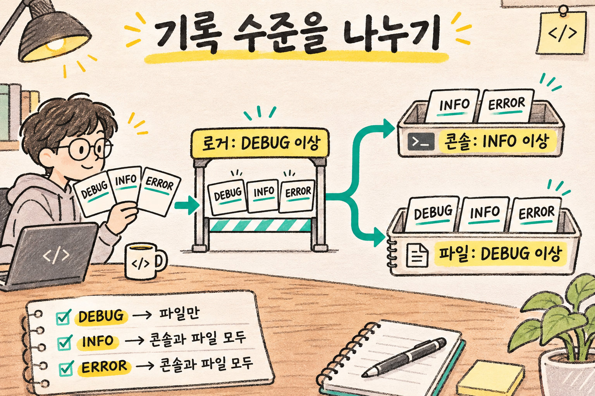

예약 실행한 Python 프로그램이 중간에 멈췄다. 실행 창은 닫혔고, 어디까지 처리했는지도 기억나지 않는다. 이럴 때 필요한 것은 **작업 시작·완료 시점과 실패 위치를 나중에 읽을 수 있는 기록**이다.

Python 표준 라이브러리의 `logging`으로 화면과 파일에 기록을 남길 수 있다. 이 글에서는 별도 패키지 설치 없이 작은 단일 프로세스 프로그램을 만들고 정상 실행과 오류 실행을 비교한다. 명령은 Windows PowerShell 기준이다.

## print와 로그는 언제 나눠 쓸까?

`print()`는 계산 결과처럼 프로그램 사용자가 바로 볼 내용을 출력하기에 간단하다. 로그는 프로그램이 실행되는 동안 무슨 일이 있었는지를 수준과 시각을 붙여 기록할 때 유용하다. 기본 사용법과 구분은 [Python Logging HOWTO](https://docs.python.org/3/howto/logging.html)에 정리되어 있다.

| 수준 | 이 글에서 사용할 기준 |
|---|---|
| DEBUG | 입력 개수나 처리 단계 같은 상세 진단 정보 |
| INFO | 작업 시작·완료 같은 정상 진행 상황 |
| WARNING | 처리는 계속하지만 살펴볼 상황 |
| ERROR | 일부 작업을 수행하지 못한 오류 |
| CRITICAL | 프로그램 전체의 지속 실행이 어려운 심각한 문제 |

높은 수준만 중요하고 낮은 수준은 불필요하다는 뜻은 아니다. 상세 기록은 원인을 찾을 때 유용하지만 평소 화면에 전부 보이면 필요한 정보를 놓치기 쉽다. 그래서 출력 위치별로 수준을 다르게 정한다.

## 1. 가장 짧은 예제로 시작하기

새 파일 `basic_log.py`에 저장하고 실행한다. 기존 프로그램이나 노트북에 붙이기보다 별도 프로세스로 시작하면 이미 설정된 로거와 섞이지 않는다.

```python
import logging

logging.basicConfig(
    level=logging.INFO,
    format="%(asctime)s %(levelname)s %(message)s",
)
logging.debug("상세 진단 정보")
logging.info("작업 시작")
logging.warning("확인이 필요한 상황")
```

```powershell
python basic_log.py
```

이 설정에서는 INFO와 WARNING을 보고 DEBUG는 보지 않는다. `basicConfig()`의 기본 스트림 출력은 표준 오류인 `stderr`를 사용한다. 따라서 화면에 로그가 보인다는 사실과 프로그램이 실패했다는 사실은 같은 뜻이 아니다.

## 2. 로거·핸들러·포매터의 역할

| 구성 요소 | 역할 | 예 |
|---|---|---|
| Logger | 어떤 이름과 수준으로 기록할지 결정 | `logging_practice` |
| Handler | 기록을 보낼 위치와 출력 기준 결정 | 콘솔 INFO 이상, 파일 DEBUG 이상 |
| Formatter | 출력할 한 줄의 모양 결정 | 시각, 수준, 로거 이름, 메시지 |

이 구분과 로거 간 전달 방식은 [logging API 문서](https://docs.python.org/3/library/logging.html)에 설명되어 있다. 아래 예제에서는 이름 있는 로거 하나에 핸들러 두 개를 붙인다.


_그림은 세 수준의 기록만 예로 든다. 실제로는 WARNING과 CRITICAL도 각 기준 이상이면 출력된다._

로거를 INFO로 설정해 버리면 DEBUG 기록은 핸들러에 도달하기 전에 제외된다. 파일 핸들러만 DEBUG로 바꿔도 그 기록을 되살릴 수 없다. **로거의 기준과 핸들러의 기준을 함께 확인해야 한다.**

## 3. 콘솔과 파일에 나누어 기록하기

[전체 실행 예제 다운로드](/assets/code/python-logging-guide/logging_demo.py)를 연습 폴더에 `logging_demo.py`로 저장한다. 파일은 Python 표준 라이브러리만 사용한다.

핵심 설정은 다음과 같다. 이 부분만 따로 실행하려면 `logging`과 `RotatingFileHandler`를 가져오고, `log_dir`를 먼저 준비해야 한다. 전체 파일에는 이 준비 과정이 포함되어 있다.

```python
logger = logging.getLogger("logging_practice")
logger.setLevel(logging.DEBUG)
logger.propagate = False

console = logging.StreamHandler()
console.setLevel(logging.INFO)

file_handler = RotatingFileHandler(
    log_dir / "app.log",
    maxBytes=1_000_000,
    backupCount=3,
    encoding="utf-8",
)
file_handler.setLevel(logging.DEBUG)
```

전체 예제는 두 핸들러에 동일한 `Formatter`를 설정한 뒤 `logger.addHandler()`로 연결한다. `propagate = False`는 이 로거의 기록이 상위 로거에도 전달되어 같은 내용이 다시 출력되는 것을 막기 위한 이 예제의 선택이다. 다른 프로그램에 설정을 가져갈 때는 기존 로깅 구조와 함께 판단한다.

예제의 로그 폴더는 다음 코드로 정한다.

```python
log_dir = Path(__file__).resolve().parent / "logs"
```

현재 작업 폴더 대신 **스크립트 파일이 있는 폴더**를 기준으로 `logs`를 만든다. 프로그램을 다른 위치에서 실행해도 로그 위치가 바뀌지 않는다. 해당 폴더에 쓰기 권한이 있어야 하므로 연습 파일은 본인이 쓸 수 있는 폴더에 둔다.

PowerShell에서 다운로드한 파일이 있는 폴더로 이동한 뒤 실행한다.

```powershell
python logging_demo.py
$programExitCode = $LASTEXITCODE
Write-Output "exit: $programExitCode"
Get-Content -LiteralPath .\logs\app.log -Encoding utf8 -Tail 20
```

화면에는 시작과 완료가 보이고, 파일에는 상세 입력 개수 기록도 남는다. 정상 경로는 종료 코드 0을 반환한다. 파일에는 실행할 때마다 기록을 이어 쓰므로, 여러 번 실행했다면 이전 실행 내용도 함께 보일 수 있다.

## 4. 오류 메시지에 실패 위치까지 남기기

예제의 오류 처리 부분은 다음과 같다.

```python
try:
    value = int("not-a-number" if args.simulate_error else "42")
except ValueError:
    logger.exception("숫자 변환 실패")
    return 1
```

`logger.exception()`은 예외 처리 블록에서 사용하며, ERROR 수준 메시지와 예외 추적 정보를 함께 기록한다. [공식 메서드 설명](https://docs.python.org/3/library/logging.html#logging.Logger.exception)처럼 예외를 처리하는 시점에 호출해야 실패 위치를 읽을 수 있다.

다음 명령은 일부러 숫자로 바꿀 수 없는 문자열을 넣는다. 외부 서비스나 개인 파일을 조작하지 않는 연습이다.

```powershell
python logging_demo.py --simulate-error
$programExitCode = $LASTEXITCODE
Write-Output "exit: $programExitCode"
Get-Content -LiteralPath .\logs\app.log -Encoding utf8 -Tail 20
```

콘솔과 파일에서 `숫자 변환 실패`, `ValueError`, 관련 코드 위치를 찾는다. 오류 경로에서는 종료 코드 1을 반환하며, 해당 실행의 완료 메시지는 남기지 않는다. 파일에 이전 정상 실행의 완료 메시지가 있을 수 있으므로 시각과 시작 기록을 함께 읽는다.

**로그를 남긴다고 자동으로 실패 종료되는 것은 아니다.** 이 예제는 `return 1`과 마지막의 `raise SystemExit(main())`로 실패를 호출한 쪽에 전달한다. 예약 작업에서도 기록과 종료 결과를 같이 확인할 수 있게 설계한다.

## 5. 로그 파일이 계속 커지지 않게 하기

예제는 [RotatingFileHandler](https://docs.python.org/3/library/logging.handlers.html#rotatingfilehandler)를 사용한다. 기준 크기에 가까워지면 현재 로그를 보관 파일로 넘기고 새 파일에 기록하는 방식이다.

```text
logs/
  app.log      현재 기록
  app.log.1    가장 최근 보관본
  app.log.2    그 이전 보관본
  app.log.3    가장 오래된 보관본
```

`maxBytes=1_000_000`은 약 1 MB의 전환 기준이고 `backupCount=3`은 보관본 수다. 전환이 발생할 때 오래된 보관본은 순차적으로 밀려나고 보관 개수를 넘는 것은 제거된다. **로그 한 줄 크기까지 포함해 디스크 사용량을 정확히 고정하는 엄격한 용량 제한은 아니다.**

둘 중 하나를 0으로 두면 크기에 따른 전환이 일어나지 않는다. 작은 예제는 기준 크기에 도달하지 않아 보관본이 바로 생기지 않는 것이 정상이다. 이 예제는 한 프로세스에서 쓰는 구성이며, 여러 프로세스가 같은 파일에 동시에 기록해야 하는 경우에는 별도 수집 구조를 검토한다.

## 기록이 보이지 않거나 중복될 때

| 증상 | 먼저 볼 항목 |
|---|---|
| INFO가 안 보임 | 로거와 핸들러의 수준, 기존 설정 여부 |
| DEBUG가 파일에도 없음 | 로거가 INFO 이상으로 막고 있지 않은지 |
| 같은 줄이 두 번씩 출력됨 | 핸들러 중복 등록과 상위 로거 전달 |
| 로그 파일을 못 찾음 | 작업 폴더 기준인지 스크립트 기준인지 |
| 한글이 깨짐 | 파일의 `encoding`과 읽는 프로그램의 인코딩 |
| 예약 실행에서만 파일 생성 실패 | 실행 계정의 쓰기 권한과 실제 로그 경로 |

전체 예제의 `make_logger()`는 이미 핸들러가 붙어 있으면 같은 로거를 반환해 중복 등록을 피한다. 실행 중에 다른 폴더로 설정을 바꾸는 용도로 설계한 함수는 아니므로, 로깅 설정은 시작할 때 한 번 정한다.

실제 프로그램에 적용할 때는 `작업 시작`, 처리 건수, `작업 완료`, 실패 시점부터 남겨 보자. 토큰·비밀번호·개인정보를 그대로 기록하는 대신 필요한 식별 정보만 최소한으로 남긴다. [Windows 작업 스케줄러](/posts/task_scheduler/)와 연결할 때도 로그 폴더와 종료 코드 확인을 함께 준비하면 실행 창이 없어도 문제를 추적하기 쉬워진다.
