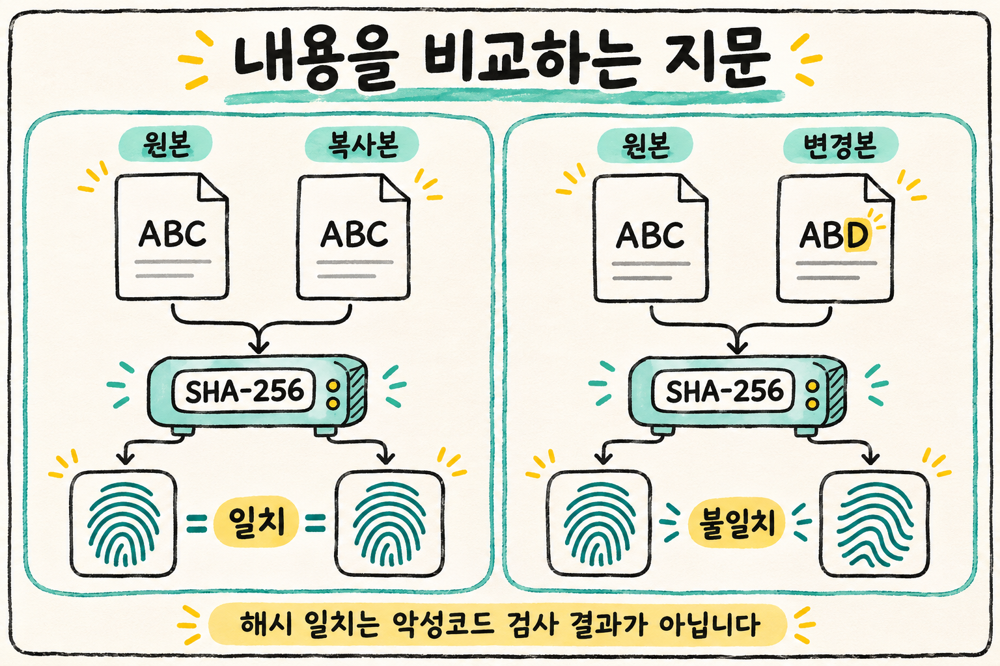

파일을 외장 드라이브로 복사했거나 설치 파일을 내려받았다. 이름과 크기가 같으면 내용도 같다고 생각하기 쉽지만, 조금 더 확실한 비교 기준이 필요할 때가 있다. 이럴 때 **파일 내용으로 계산한 SHA-256 해시**를 대조할 수 있다.

이 글은 Windows PowerShell의 `Get-FileHash`로 작은 연습 파일을 비교한다. 실제 문서나 설치 파일을 바꾸지 않고, 새 임시 폴더에서 내용 변경을 시험한다.

## 해시는 파일 내용을 요약하는 값

해시 함수는 길이가 다양한 입력을 고정 길이의 요약값으로 바꾼다. SHA-256은 SHA-2 계열의 함수이며, 결과를 16진수로 적으면 64자리다. 관련 개념과 충돌 저항성은 [NIST의 해시 함수 설명](https://csrc.nist.gov/projects/hash-functions)에 정리되어 있다.

파일 이름이나 수정 시각 대신 **파일을 구성하는 바이트**를 비교한다는 점이 핵심이다. 일반적인 파일 검증에서 SHA-256 값이 같으면 내용이 같다는 매우 강한 근거로 사용한다. 다만 유한한 해시값을 쓰므로 서로 다른 입력이 절대로 같은 값을 만들 수 없다는 수학적 보장은 아니다.


_그림의 지문은 비교 원리를 나타낸다. 실제 명령에서는 64자리 16진수 값을 비교한다._

| 확인하려는 것 | SHA-256 비교로 알 수 있는 범위 |
|---|---|
| 원본과 복사본의 내용 | 같은 알고리즘으로 계산한 값을 대조 |
| 공식 체크섬과 다운로드 파일 | 믿을 수 있는 기준값과 내용의 일치 여부 확인 |
| 파일의 악성코드 유무 | 해시 일치만으로 판정할 수 없음 |
| 작성자·배포자의 신원 | 해시만으로 인증되지 않음 |

누군가 파일과 기준 해시를 함께 바꿀 수 있다면, 두 값이 일치해도 정식 배포본이라는 근거가 되지 않는다. **무엇과 비교하는지**가 계산 자체만큼 중요하다.

## 1. 파일 하나의 SHA-256 계산하기

확인하려는 파일 경로를 지정한다. 아래 경로는 예시이므로 본인의 실제 파일로 바꾼다.

```powershell
Get-FileHash -LiteralPath 'C:\Downloads\example.zip' -Algorithm SHA256 |
    Format-List Algorithm, Hash, Path
```

`Get-FileHash`의 기본 알고리즘도 SHA256이지만, 예제에서는 비교 기준이 드러나도록 명시했다. `-LiteralPath`는 대괄호 같은 문자가 있는 파일명을 와일드카드로 해석하지 않고 그대로 다룬다. 매개변수와 출력 예는 [Microsoft Get-FileHash 문서](https://learn.microsoft.com/en-us/powershell/module/microsoft.powershell.utility/get-filehash)에 있다.

표가 화면 폭 때문에 잘려 보이면 `Format-List`로 펼치거나 `(Get-FileHash ...).Hash`처럼 값만 꺼내 읽는다. 앞부분 몇 자리만 눈으로 비교하는 대신 전체 문자열을 비교한다.

## 2. 복사본은 이름이 달라도 같은 값인지 확인하기

아래 명령을 같은 PowerShell 창에서 순서대로 실행한다. 새 폴더 이름에 임의의 값을 붙여 기존 파일과 겹치지 않게 한다.

```powershell
$hashDemoDir = Join-Path $env:TEMP ('sha256-demo-' + [guid]::NewGuid().ToString('N'))
New-Item -ItemType Directory -Path $hashDemoDir | Out-Null
$originalFile = Join-Path $hashDemoDir 'original.txt'
$copiedFile = Join-Path $hashDemoDir 'renamed-copy.txt'

Set-Content -LiteralPath $originalFile -Value 'backup practice' -Encoding utf8
Copy-Item -LiteralPath $originalFile -Destination $copiedFile

$originalHash = (Get-FileHash -LiteralPath $originalFile -Algorithm SHA256).Hash
$copiedHash = (Get-FileHash -LiteralPath $copiedFile -Algorithm SHA256).Hash
$originalHash -eq $copiedHash
```

두 파일의 이름은 다르지만 내용은 그대로 복사했으므로 비교 결과는 `True`가 된다. `$hashDemoDir`를 입력하면 연습 폴더 경로를 볼 수 있다. 임시 폴더는 운영체제가 정리할 수 있으므로 장기 보관 장소로 사용하지 않는다.

## 3. 복사본의 내용만 바꾸어 비교하기

```powershell
Add-Content -LiteralPath $copiedFile -Value 'one more line' -Encoding utf8
$changedHash = (Get-FileHash -LiteralPath $copiedFile -Algorithm SHA256).Hash
$originalHash -eq $changedHash
```

복사본에 한 줄을 추가했으므로 결과는 `False`가 된다. 원본은 바꾸지 않았다. 파일명이 같아도 내용을 변경하면 비교 결과가 달라질 수 있다는 점을 보여 주는 실습이다.

해시는 특정 시점에 읽은 내용의 결과다. 프로그램이 계속 쓰고 있는 파일이라면 저장을 마친 뒤 비교한다. 이 실습은 작은 정적 파일을 대상으로 하며, 실행 중인 데이터베이스 전체의 일관성을 보장하는 백업 절차는 아니다.

## 4. 공식 체크섬과 다운로드 파일 대조하기

공식 배포 페이지에서 **파일명·버전·운영체제·아키텍처가 일치하는 SHA-256**을 찾는다. 다음의 안내 문자열은 실제 체크섬이 아니므로 그대로 실행하면 길이 검사에서 멈춘다.

```powershell
$downloadedFile = 'C:\Downloads\example.zip'
$expectedHash = '공식 페이지의 64자리 SHA-256을 여기에 입력'
$expectedHash = $expectedHash.Trim()

if ($expectedHash -notmatch '^[0-9a-fA-F]{64}$') {
    throw '기준값은 SHA-256 16진수 64자리여야 합니다.'
}

$actualHash = (Get-FileHash -LiteralPath $downloadedFile -Algorithm SHA256 -ErrorAction Stop).Hash
if ($actualHash -ne $expectedHash) {
    throw 'SHA-256이 기준값과 다릅니다. 파일과 기준값의 버전을 다시 확인하세요.'
}
Write-Output 'SHA-256 일치'
```

대소문자는 이 PowerShell 문자열 비교에서 구분하지 않는다. MD5나 SHA-1처럼 다른 알고리즘의 값과 비교하면 안 된다. SHA-256 값이 없는 배포물은 공식 문서가 안내하는 서명 확인 등 다른 검증 절차를 따른다.

## 5. 읽기 오류와 불일치를 나누어 처리하기

자동화에서는 두 값이 다른 경우와 파일을 읽지 못한 경우를 구분해 두면 점검하기 쉽다. 다음 명령은 실제 파일 내용에 쓰지 않고 결과만 확인한다. 앞 실습의 복사본은 이미 바뀌었으므로 `해시 불일치`가 표시된다.

```powershell
try {
    $firstHash = (Get-FileHash -LiteralPath $originalFile -Algorithm SHA256 -ErrorAction Stop).Hash
    $secondHash = (Get-FileHash -LiteralPath $copiedFile -Algorithm SHA256 -ErrorAction Stop).Hash
    if ($firstHash -eq $secondHash) {
        Write-Output '해시 일치'
    } else {
        Write-Output '해시 불일치'
    }
} catch {
    Write-Output ("파일 읽기 또는 해시 계산 실패: " + $_.Exception.Message)
}
```

이 코드는 사람이 결과를 살펴보기 위한 예제다. 불일치해도 자동으로 파일을 덮어쓰거나 삭제하지 않는다. 예약 작업에 연결한다면 각 결과를 로그로 남기고, 실패를 호출한 쪽에 어떻게 전달할지도 해당 작업의 규칙으로 정한다.

## 화면으로는 같아 보이는데 왜 값이 다를까?

텍스트 파일은 보이는 글자 외에도 인코딩, BOM, 줄바꿈 방식, 마지막 줄바꿈이 바이트 차이를 만들 수 있다. 서로 다른 PowerShell 버전에서 텍스트를 새로 저장했다면 같은 문구라도 파일이 달라질 수 있다. 이 글이 특정 해시값을 정답으로 제시하지 않고, 실제 복사본과 비교하는 이유다.

| 상황 | 확인할 항목 |
|---|---|
| 공식 값과 불일치 | 정확한 버전·파일명·플랫폼의 체크섬인지 |
| 텍스트만 불일치 | 인코딩, 줄바꿈, 저장 과정의 변경 |
| 파일을 찾지 못함 | 실제 경로와 파일명, 현재 작업 폴더 |
| 권한 또는 읽기 오류 | 실행 계정, 파일 사용 상태, 접근 권한 |
| 폴더 전체를 확인하고 싶음 | 파일 누락·추가와 상대 경로까지 비교할 별도 목록 필요 |

`Get-FileHash` 한 번으로 폴더 구조·권한·모든 파일의 누락까지 확인하는 것은 아니다. [Robocopy 폴더 백업](/posts/robocopy-backup-guide/) 뒤 중요한 파일을 따로 대조하거나, 배포본의 공식 체크섬을 확인하는 작은 단계부터 적용해 보자.
